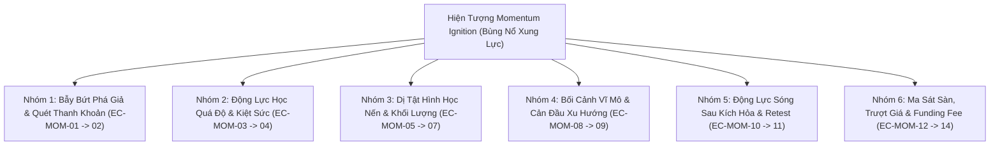

# BÁO CÁO TOÀN DIỆN: DANH MỤC VÉT CẠN 14 EDGE CASES CỦA MOMENTUM IGNITION TRONG THỰC CHIẾN & KIỂM ĐỊNH HIỆN TRẠNG XỬ LÝ
**File tài liệu:** `29_momentum_ignition_exhaustive_edge_cases_and_handling_audit.md`  
**Chuyên đề:** Vét cạn các trường hợp biên vi cấu trúc bùng nổ xung lực (Momentum Ignition Edge Cases) & Thẩm định năng lực xử lý của `momentum_ignition.rs`  
**Mã nguồn kiểm toán:** `strategies_backtests/helios/src/strategy/core_v3/scanners/momentum_ignition.rs`  

---

## 🏛️ 1. Danh Mục Vét Cạn 14 Edge Cases Của Hiện Tượng Momentum Ignition Trong Thực Chiến

Trong thực tế giao dịch vi cấu trúc phái sinh Crypto (Binance Futures, nến 1m, đòn bẩy 20x), hiện tượng **Bùng nổ Xung lực (Momentum Ignition)** đối mặt với **14 trường hợp Edge Cases thực tế**, được phân thành **6 nhóm cụ thể**:

---

### 📋 CHI TIẾT 14 TRƯỜNG HỢP EDGE CASES THỰC TẾ

#### Nhóm 1: Bẫy Bứt Phá Giả Mạo & Đột Phá Ảo (Fakeout & Liquidity Sweep)
1. **EC-MOM-01: Bẫy Quét Thanh Khoản Đỉnh Cũ Rồi Đảo Chiều (Bull Trap / Upthrust / Turtle Soup):** Giá vừa bứt phá vượt đỉnh hộp tích lũy để kích hoạt các lệnh Buy Stop và lôi kéo retail FOMO, ngay nến sau phe bán dội lệnh đè bẹp đóng cửa sập xuống.
2. **EC-MOM-02: Bẫy Bung Biên Trong Dải Nén Hẹp (Squeeze Micro-Burst / False Trigger):** Dải BB co thắt cực hẹp ($< 0.10\%$), một nến 1m nhảy nhẹ vài bước giá cũng đủ đóng cửa ngoài dải BB Upper dù không hề có dòng tiền thật.

#### Nhóm 2: Động Lực Học Quá Độ & Kiệt Sức (Exhaustion & Climax Dynamics)
3. **EC-MOM-03: Bẫy Cao Trào Kiệt Sức Mua Đu Đỉnh (Buying Climax / Blow-Off Top):** Giá đã tăng dốc liên tục 15-20 nến 1m. Cây nến cuối cùng thân dài khổng lồ, Volume bùng nổ cực đại do retail FOMO nhảy vào $\implies$ Cạn kiệt lực mua, nến sau lập tức đảo chiều rơi tự do.
4. **EC-MOM-04: Bão Thanh Lý Dây Chuyền Kéo Giá Bay Quá Đà (Cascading Short Liquidations Spike):** Giá bay vọt qua 5-10 ATR do các lệnh thanh lý Margin Call của sàn, sổ lệnh bị rút sạch. Ngay khi chuỗi thanh lý kết thúc, giá rơi vào "túi khí" (Air Pocket) sụp đổ về điểm xuất phát.

#### Nhóm 3: Dị Tật Hình Học Nến & Cấu Trúc Khối Lượng (Geometry & Volume Anomalies)
5. **EC-MOM-05: Bứt Phá Không Có Thanh Khoản (Low-Volume Ghost Breakout):** Giá đóng cửa ngoài dải BB nhưng volume lại cạn kiệt ($Z_{\text{vol}} \le 0.0$). Giá tăng chỉ vì phe bán tạm rút lệnh, dễ sập ngay khi gặp cản nhỏ.
6. **EC-MOM-06: Nến Bứt Phá Thân Khổng Lồ Kéo Giãn Stop Loss (Giant Ignition Bar / SL Bloat):** Cây nến kích hỏa có thân dài tới $3.0 \sim 4.0 \text{ ATR}$ $\implies$ Khoảng cách SL cấu trúc từ Close đến Low lên tới $30\% \sim 50\%$ ROE.
7. **EC-MOM-07: Nến Bứt Phá Râu Hai Đầu (Wick War Ignition Bar):** Nến vượt ngoài BB nhưng râu trên và râu dưới đều dài bằng nhau, thể hiện sự tranh chấp hỗn loạn 50/50.

#### Nhóm 4: Bối Cảnh Vĩ Mô & Cản Đầu Xu Hướng Lớn (Macro Collision)
8. **EC-MOM-08: Bùng Nổ Ngược Thác Lũ Xu Hướng Giảm Vĩ Mô (Counter-Trend Macro Collision):** Xu hướng 1h/4h đang rơi tự do, nến 1m bùng nổ giật lên chỉ là nhịp hồi kỹ thuật thứ cấp trước khi bị xả lũ đè bẹp.
9. **EC-MOM-09: Bứt Phá Lao Thẳng Vào Tường Kháng Cự Cứng (Breakout Directly into MTF Hard Wall):** Nến 1m bùng nổ vượt BB 1m nhưng ngay phía trên đầu ($0.3 \text{ ATR}$) là đỉnh swing high khung 4h hoặc BB Upper khung 1h.

#### Nhóm 5: Động Lực Sóng Sau Kích Hỏa & Thời Lượng (Post-Ignition Dynamics)
10. **EC-MOM-10: Kiểm Tra Lại Điểm Bứt Phá Ngay Lập Tức (Immediate Throwback / Retest):** Sau nến bùng nổ $i$, nến $i+1, i+2$ quay lại retest đỉnh cũ vừa phá, nhúng nhẹ râu qua giá mở cửa của nến $i$ trước khi bay tiếp. Nếu đặt SL quá sát sẽ bị quét oan.
11. **EC-MOM-11: Hiện Tượng Bứt Phá Giả Mạo Kích Hỏa Chậm (No Follow-Through Stagnation):** Sau nến bùng nổ đẹp, $2 \sim 3$ nến sau hoàn toàn không có lực mua tiếp nối, nến co cụm yếu ớt báo hiệu động lượng đã tắt ngấm.

#### Nhóm 6: Ma Sát Sàn, Trượt Giá & Funding Fee (Frictional Anomalies)
12. **EC-MOM-12: Trượt Giá Khủng Khiếp Khi Khớp Lệnh Market (Severe Breakout Slippage):** Tốc độ nến bùng nổ tính bằng mili-giây làm sổ lệnh phe bán mỏng dính, lệnh Market Buy của bot bị trượt cao hơn $0.2\% \sim 0.5\%$ giá (âm $4\% \sim 10\%$ ROE ngay khi vừa khớp).
13. **EC-MOM-13: Bão Tin Tức Vĩ Mô Giật 2 Đầu (Macro News Volatility Whip):** CPI / Tin lãi suất giật lên 3 ATR vượt BB Upper rồi 15 giây sau đạp sập 5 ATR xuyên thủng BB Lower.
14. **EC-MOM-14: Giật Xung Lực Giờ Tính Funding Fee (Funding Arb Momentum Fake):** 1 phút trước giờ chốt Funding, các bot Basis Arbitrage đẩy lệnh giật râu tạo nến bùng nổ giả.

---

## 🔍 2. Đánh Giá Hiện Trạng: Scanner `momentum_ignition.rs` Đã Xử Lý Tốt Chưa?

### 2.1. Đánh Giá Năng Lực Nhận Diện Tình Huống VÀO LỆNH HỢP LỆ (True Positives)
* **Kết luận:** ❌ **CHƯA TỐT (BỊ BỎ LỠ CHÂN SÓNG & ĐU ĐỈNH KIỆT SỨC)**.
* **Lý do cốt tử:**
  1. **Mù Chân Sóng Do Lệch Pha MTF:** So sánh giá nến 1m với dải BB **khung 15m**. Khi nến 1m đầu tiên bùng nổ ở chân sóng, nó vẫn còn nằm trong BB 15m $\implies$ Bị bỏ lỡ $100\%$ cơ hội đẹp nhất!
  2. **Bẫy Đu Đỉnh Buying Climax:** Khi nến đã bay ra ngoài BB 15m tới nến thứ 8-10 (chuẩn bị đảo chiều kiệt sức), hàm `sat_penetration` và `sat_unbounded` lại chấm điểm cao nhất ($0.95 \sim 0.98$), lừa bot mua ngay đỉnh chóp!

### 2.2. Đánh Giá Năng Lực TỪ CHỐI / PHÒNG THỦ KHI KHÔNG THỂ VÀO LỆNH (True Negatives)
* **Kết luận:** 🟢 **XỬ LÝ KHÁ TỐT Ở CÁC BẪY RÂU NẾN & XU HƯỚNG VĨ MÔ**.
* **Lý do:**
  - Bộ lọc `close > open && clv >= min_clv` loại bỏ sạch các nến bẫy râu ngược (Shooting Star).
  - Bộ lọc `kama_slope < -max_adverse` chặn đứng các cú bùng nổ ngược thác lũ xả hàng vĩ mô.

---

### 📋 2.3. Bảng Kiểm Định Xử Lý Toàn Bộ 14 Edge Cases Trong Code Hiện Tại

| Mã | Hiện Tượng Edge Case Thực Tế | Trạng Thái Xử Lý Trong `momentum_ignition.rs` Hiện Tại |
| :--- | :--- | :--- |
| **EC-MOM-01** | Bẫy quét thanh khoản đỉnh cũ rồi đảo chiều | 🟡 **XỬ LÝ MỘT PHẦN** (Lọc được nến râu trên qua CLV, nhưng bị lừa nếu nến đóng Marubozu rồi nến sau sập) |
| **EC-MOM-02** | Bung biên trong dải nén quá hẹp | 🔴 **CHƯA XỬ LÝ** (Không kiểm tra độ rộng tối thiểu của dải BB so với ATR) |
| **EC-MOM-03** | Bẫy cao trào kiệt sức (Buying Climax) | 🔴 **CHƯA XỬ LÝ (TỬ HUYỆT)** (Thậm chí còn thưởng điểm số cao nhất $0.98$ tại đỉnh Climax!) |
| **EC-MOM-04** | Bão thanh lý Short dây chuyền | 🔴 **CHƯA XỬ LÝ** (Không kiểm tra trần quá độ $|Price\_Z|$) |
| **EC-MOM-05** | Bứt phá không có volume | 🟢 **ĐÃ XỬ LÝ TỐT** (Bị loại bởi điều kiện $Z_{\text{vol}} \ge \text{vol\_thresh}$) |
| **EC-MOM-06** | Nến bứt phá thân khổng lồ kéo giãn SL | 🟡 **CHƯA TỐI ƯU** (SL bị phình to dẫn đến bị Arbiter VETO nhị phân hủy lệnh) |
| **EC-MOM-07** | Nến bứt phá râu hai đầu (Doji) | 🟢 **ĐÃ XỬ LÝ TỐT** (Bị loại bởi chốt chặn $|CLV| \ge \text{min\_clv}$) |
| **EC-MOM-08** | Bùng nổ ngược xu hướng giảm vĩ mô | 🟢 **ĐÃ XỬ LÝ TỐT** (Chặn đứng bởi `kama_slope < -max_adverse`) |
| **EC-MOM-09** | Lao thẳng vào tường kháng cự khung lớn | 🔴 **CHƯA XỬ LÝ** (Không kiểm tra cự ly tới ngưỡng cản MTF tiếp theo) |
| **EC-MOM-10** | Retest lại điểm bứt phá quét qua SL | 🟡 **XỬ LÝ MỘT PHẦN** (Phụ thuộc vào đệm `buffer_mult`, dễ dính SL nếu GA chọn quá hẹp) |
| **EC-MOM-11** | Bứt phá tắt ngấm không có lực tiếp nối | 🔴 **CHƯA XỬ LÝ** (Scanner không có bộ nhớ theo dõi các nến sau kích hỏa) |
| **EC-MOM-12** | Trượt giá khớp lệnh Market khi bùng nổ | 🔴 **CHƯA XỬ LÝ** (Không có ngưỡng trượt giá tối đa / Slippage Guard) |
| **EC-MOM-13** | Bão tin tức vĩ mô giật 2 đầu | 🟡 **XỬ LÝ MỘT PHẦN** (Được Gatekeeper Chaos Index bảo vệ nếu bão giật cực lớn) |
| **EC-MOM-14** | Giật xung lực giờ chốt Funding Fee | 🔴 **CHƯA XỬ LÝ** (Không có bộ lọc thời gian chặn giờ Funding) |

---

*Tóm tắt: **3/14 Đã xử lý tốt**, **4/14 Xử lý một phần**, **7/14 Chưa xử lý**.*
