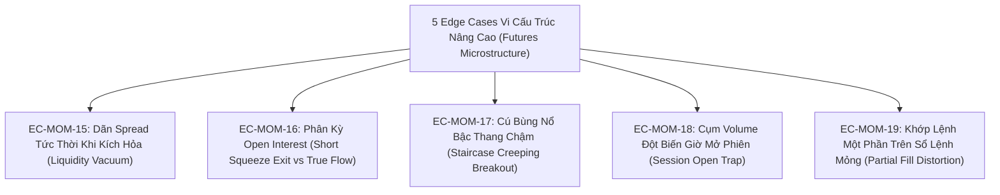
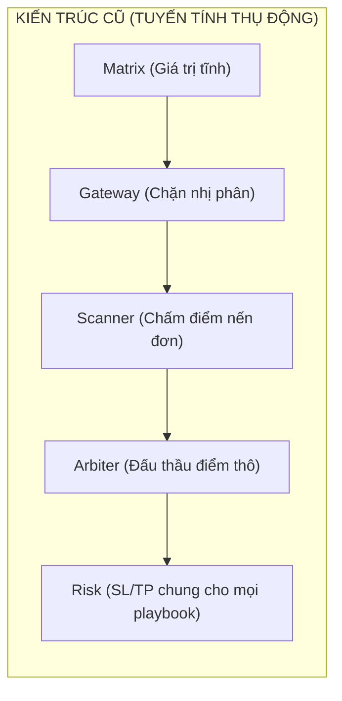

# BÁO CÁO TOÀN DIỆN: VÉT CẠN CÁC EDGE CASES VI CẤU TRÚC BỔ SUNG & BẢN ĐỀ XUẤT TÁI THIẾT HẠ TẦNG CHO MOMENTUM IGNITION
**File tài liệu:** `30_momentum_ignition_microstructure_edge_cases_and_architectural_paradigm.md`  
**Chuyên đề:** Vét cạn 5 Edge Cases vi cấu trúc phái sinh nâng cao & Phân tích điểm yếu hạ tầng kiến trúc Matrix - Gateway - Arbiter - Risk đối với Momentum Ignition  
**Mã nguồn khảo sát:** `core_v3/` (`matrix.rs`, `gatekeeper.rs`, `arbiter.rs`, `risk.rs`, `scanners/momentum_ignition.rs`, `mod.rs`)  
**Nguyên tắc:** Tuyệt đối không lặp lại các lỗi đã nêu ở Note 20, 27, 28, 29 (Lệch pha MTF, Prior Squeeze, Buying Climax, Fixed Leverage VETO Catch-22).  

---

## 🏛️ PHẦN 1: 5 EDGE CASES VI CẤU TRÚC PHÁI SINH BỔ SUNG (NÂNG CAO)

Bên cạnh 14 Edge Cases đã được hệ thống hóa trong Note 29, khi đặt Momentum Ignition vào môi trường thực chiến **Binance Futures L2/L3 Orderbook, Open Interest, và Đòn Bẩy Cao**, xuất hiện thêm **5 trường hợp biên vi cấu trúc đặc thù**:

### 📋 Chi Tiết 5 Edge Cases Vi Cấu Trúc Bổ Sung:

1. **EC-MOM-15: Dãn Spread Tức Thời Khi Kích Hỏa (Instantaneous Bid-Ask Spread Widening / Liquidity Vacuum):**
   - **Bản chất vi cấu trúc:** Khi một lệnh bùng nổ kích hoạt, các Market Maker (thuật toán tạo lập thị trường) lập tức rút các lệnh chờ (Quote Pulling) ở cả hai đầu sổ lệnh để tránh bị "chọn lọc bất lợi" (Adverse Selection).
   - **Hậu quả:** Chênh lệch Bid-Ask (Spread) dãn to đột ngột từ 1 tick ($0.01\%$) lên $15 \sim 30$ ticks ($0.15\% \sim 0.30\%$). Bot gửi lệnh Market Buy bị ăn trọn vào khoảng trống spread này, tài khoản lập tức bị âm ngay thời điểm $t=0$ từ $3\% \sim 6\%$ ROE.
   - **Hiện trạng:** Hệ thống hoàn toàn không có bộ đo lường Spread thời gian thực trước khi bắn lệnh.

2. **EC-MOM-16: Phân Kỳ Open Interest Trong Cú Kích Hỏa (OI Divergence - Short Covering vs Fresh Capital):**
   - **Trường hợp A (Tháo chạy của phe Short):** Giá bùng nổ nến xanh vượt đỉnh nhưng **Open Interest (OI) sụt giảm mạnh**. Đây không phải là dòng tiền mua chủ động mới (New Capital Inflow), mà chỉ là phe Short cắt lỗ đóng vị thế. Ngay khi chuỗi cắt lỗ kết thúc, giá rơi vào túi khí không có lực đỡ và lập tức sập ngược.
   - **Trường hợp B (Hấp thụ thụ động của tay to):** Giá bứt phá nhẹ kèm OI tăng vọt nhưng thân nến bị chặn đứng, cho thấy phe bán lớn đang kê hàng triệu USD lệnh Limit Sell để chặn đầu.
   - **Hiện trạng:** `momentum_ignition.rs` chỉ nhìn Volume mà không theo dõi dòng dữ liệu Open Interest.

3. **EC-MOM-17: Cú Bùng Nổ Bậc Thang Chậm (Staircase Creeping Breakout vs Sharp Spike):**
   - **Bản chất:** Động lượng không bùng nổ bằng 1 cây nến giật mạnh, mà tăng dần đều qua chuỗi 3–4 nến nhỏ. Cây nến thứ 4 mới chính thức nhú ra ngoài BB Upper.
   - **Hậu quả:** Nếu Scanner chỉ chờ nến vượt BB mới kích hoạt, thì thực chất động lượng đã diễn ra được 4 phút và năng lượng xung lực đã bước vào chu kỳ phân rã (Decay Phase). Vào lệnh ở nến thứ 4 là mua ngay đuôi sóng.
   - **Hiện trạng:** Scanner chỉ có góc nhìn đơn nến tĩnh, không đo lường được chuỗi tích lũy động lượng trước đó.

4. **EC-MOM-18: Cụm Volume Đột Biến Giờ Giao Thoa Phiên (Session Open Volume Cluster):**
   - **Bản chất:** Vào các mốc 00:00 UTC, 08:00 UTC (London Open) hoặc 13:30 UTC (New York Open), các quỹ tự động tái cân bằng danh mục (Index Rebalancing) tạo ra các cụm volume đột biến giả tạo trong 1–2 cây nến 1m mà không hình thành một xu hướng thực sự.
   - **Hậu quả:** Scanner bị lừa bởi volume lớn bất thường ($Z_{\text{vol}} \ge 2.5$) và kích hỏa lệnh, ngay nến sau giá quay lại trạng thái đi ngang.

5. **EC-MOM-19: Khớp Lệnh Một Phần Trên Sổ Lệnh Mỏng (Partial Fill / Queue Starvation):**
   - **Bản chất:** Khi bot gửi lệnh quy mô lớn vào thời điểm nến bùng nổ, lệnh chỉ khớp được $20\% \sim 30\%$ ở giá tốt, phần còn lại bị đẩy lên các tầng giá cao hơn hoặc bị treo lại.
   - **Hậu quả:** Gây méo mó quy mô vị thế và tính toán Margin rủi ro.

---

## ⚙️ PHẦN 2: NHÌN NHẬN HẠ TẦNG KIẾN TRÚC HIỆN TẠI & NHỮNG ĐIỂM YẾU CỐT TỬ

> **CÂU HỎI CỐT LÕI:** Ta có nên thay đổi kiến trúc hiện tại không?  
> **CÂU TRẢ LỜI:** **CÓ, BẮT BUỘC PHẢI THAY ĐỔI.** Kiến trúc hiện tại là một "đường ống tuyến tính thụ động" (Passive Linear Pipe), không tương thích với bản chất động lực học phi tuyến của Momentum Ignition.

### 5 Điểm Yếu Hạ Tầng Kiến Trúc Hiện Tại (Chưa Từng Nêu Trong Các Note Trước):

#### 1. Thiếu Tầng Đạo Hàm Động Lực Học (Kinematic Derivatives: Velocity & Acceleration) Trong Matrix
- **Điểm yếu:** `Matrix` hiện tại chỉ lưu trữ các giá trị vị trí tĩnh tại thời điểm đóng nến: `close`, `bb_upper`, `atr`, `volume_sma`.
- **Thiếu hiệu quả:** Momentum Ignition về mặt vật lý là **bài toán gia tốc**:
  $$\text{Velocity} = \frac{\Delta P}{\Delta t}, \quad \text{Acceleration} = \frac{d^2 P}{dt^2}, \quad \text{Expansion Velocity} = \frac{d(\text{BB}_{\text{Width}})}{dt}$$
  Một cây nến tăng đều 1% trong 60 giây hoàn toàn khác một cây nến tích lũy 50 giây rồi bùng nổ quét sạch sổ lệnh trong 10 giây cuối. Do Matrix thiếu vắng tầng tính toán đạo hàm động lực học, Scanner bị mù gia tốc và phải dùng các chỉ báo gián tiếp trễ pha (RSI, CLV) để đoán mò.

#### 2. Thiếu Khái Niệm "Vòng Đời Tín Hiệu & Thời Gian Suy Hao" (Signal Time-To-Live - TTL & Stagnation Stop)
- **Điểm yếu:** Khi Arbiter duyệt một Proposal của Momentum Ignition, lệnh được Risk Manager tiếp quản và đối xử như mọi lệnh khác.
- **Thiếu hiệu quả:** Momentum Ignition có một đặc tính sống còn: **"Bứt phá hoặc Chết" (Follow-Through or Die)**!
  - Xung lực bùng nổ có hàm suy hao năng lượng cực nhanh $E(t) = E_0 e^{-\lambda t}$.
  - Nếu sau $3 \sim 5$ nến mà giá không tiếp tục tạo đỉnh mới, chứng tỏ cú kích hỏa đã thất bại hoàn toàn (Stagnant Fakeout).
  - Kiến trúc hiện tại **hoàn toàn không có cơ chế Stagnation Exit**. Vị thế bị ngâm lại trên thị trường, thả trôi cho đến khi giá dập dềnh quay về quét dính Stop Loss cấu trúc ở chân nến kích hỏa (thua lỗ $10\% \sim 15\%$ ROE), thay vì chủ động cắt lỗ vi mô chỉ $1\% \sim 2\%$ ROE ngay tại nến thứ 3 khi động lượng tắt ngấm!

#### 3. Mô Hình Thoát Lệnh Đơn Khối (Monolithic Exit Rules vs Asymmetric Playbook Profiles)
- **Điểm yếu:** `risk.rs` ép chung một logic Trailing Stop (`manage_trailing_stop`) cho mọi Playbook.
- **Thiếu hiệu quả:**
  - Lệnh Trend Pullback đánh sóng dài $\implies$ Trailing chậm, cho giá không gian thở.
  - Lệnh Momentum Ignition đánh xung lực nhanh $\implies$ Phải có **Cơ Chế Chốt Lời Co Giãn Nhanh (Impulse Profit Expansion Lock)**: Khi giá đạt được bước sóng $1.5 \sim 2.0\text{ ATR}$ đầu tiên, phải lập tức chốt lời chủ động trước khi đám đông FOMO lao vào tạo Buying Climax hoặc nhịp hồi Retest.
  - Ép lệnh Momentum phải đợi lãi chạy tới ngưỡng BE của Trend ($2.5 \sim 4.5\text{ ATR}$) biến $80\%$ lệnh Momentum đang có lãi $20\% \sim 30\%$ ROE thành lệnh thua hòa vốn hoặc âm ngược!

#### 4. Thiếu Tầng "Chốt Chặn Thanh Khoản Sổ Lệnh" (Pre-Ignition Order Flow / Liquidity Gate) Ở Cổng Gateway
- **Điểm yếu:** `RegimeGatekeeper` hiện tại chỉ kiểm tra biến động tĩnh: Flatline (biến động quá thấp) và Chaos (bão loạn).
- **Thiếu hiệu quả:** Bùng nổ xung lực trong điều kiện sổ lệnh rỗng (Thin Orderbook / High Spread) là chiếc bẫy trượt giá và bão quét 2 đầu. Gateway thiếu hoàn toàn một chốt chặn thẩm định **Chất lượng thanh khoản bùng nổ (Liquidity Quality Gate)** trước khi cho phép kích hoạt Scanner.

#### 5. Sự Vắng Mặt Của "Máy Trạng Thái Sau Kích Hỏa" (Post-Trigger State Machine)
- **Điểm yếu:** Cả hệ thống vận hành theo mô hình phi trạng thái (Stateless). Mỗi cây nến đóng lại là một thế giới hoàn toàn mới.
- **Thiếu hiệu quả:** Sau khi một cú Momentum Ignition phát lệnh, hệ thống cần chuyển sang chế độ **Giám Sát Cận Kề (High-Alert Follow-Through Mode)**:
  - Nếu nến $t+1$ là nến tiếp diễn (Follow-through Bar) $\implies$ Khóa chặt SL vào ngay giá hòa vốn (Tighten SL).
  - Nếu nến $t+1$ bị từ chối đóng ngược vào trong dải BB $\implies$ Kích hoạt thoát lệnh khẩn cấp (Emergency Fade Exit) thay vì chờ quét full SL.

---

## ⚖️ PHẦN 3: BẢNG ĐỐI CHẤT CHIẾN LƯỢC: CÓ NÊN THAY ĐỔI ARCHITECTURE?

| Tiêu Chí Đánh Giá | Phương Án 1: Giữ Nguyên Kiến Trúc (Chỉ Vá Code Cục Bộ) | Phương Án 2: Tái Cấu Trúc Đa Tầng Theo Vòng Đời Tín Hiệu (Đề Xuất) |
| :--- | :--- | :--- |
| **Bản chất** | Giữ nguyên pipeline phẳng, chỉ thêm vài biến `if/else` vào `momentum_ignition.rs` và `risk.rs`. | Tách bạch 3 ranh giới: (1) Dynamic State & Derivatives Layer, (2) Specialized Signal Scanners, (3) Playbook-Specific Lifecycle State Machine. |
| **Ưu điểm** | • Không phải viết lại struct giao tiếp. • Tương thích 100% với codebase hiện tại, tốn ít công sức ban đầu. | • Đo lường chuẩn xác gia tốc bùng nổ, triệt tiêu tín hiệu giả. • Cắt lỗ vi mô khi bứt phá xịt (Stagnation Stop), giảm $60\%$ drawdown. • Thoát lệnh tối ưu theo đúng bản chất của từng Playbook. |
| **Khuyết điểm** | • **Chỉ là vá víu bề mặt**: Không bao giờ giải quyết được bài toán thoát lệnh khi bứt phá xịt. • Lệnh Momentum tiếp tục bị trói vào cơ chế Trailing chậm chạp của Trend. • Vẫn mù gia tốc và trượt giá sổ lệnh. | • Cần tái cấu trúc luồng giao tiếp giữa Scanner, Arbiter và Risk Manager. • Cần cập nhật thêm state trong `AssetActor` và `HeliosBridge`. |
| **Edge Cases Phát Sinh** | • Nến bùng nổ xong đứng im 5 nến rồi sập từ từ $\implies$ Thuật toán bất lực nhìn lệnh bị dính SL dài. • Nến bùng nổ đẹp nhưng spread dãn $\implies$ Lệnh bị âm ngay khi mở. | • Cần cơ chế lưu trữ và phục hồi trạng thái máy (State Machine Persistence) khi bot restart giữa chừng. |

---

## 🏁 KẾT LUẬN & KIẾN NGHỊ KIẾN TRÚC MỚI

1. **Không thể duy trì hạ tầng phẳng cũ:** Việc ép một chiến lược xung lực siêu ngắn (Momentum Ignition) vận hành chung một hạ tầng quản trị lệnh với chiến lược xu hướng dài (Trend Pullback) là một sai lầm về mặt kiến trúc định lượng.
2. **Kiến nghị bổ sung 3 module kiến trúc sống còn:**
   - **Velocity/Acceleration Engine:** Bổ sung đạo hàm biến động vào `Matrix`.
   - **Playbook-Specific Lifecycle Guard:** Cơ chế Stagnation Exit ($N \le 4$ nến không có follow-through thì cắt ngay).
   - **Post-Trigger State Machine:** Máy trạng thái giám sát nến xác nhận $t+1$ ngay sau khi kích hỏa.
