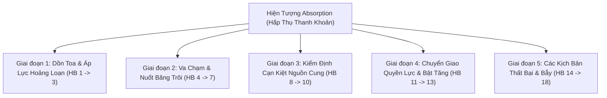

# BÁO CÁO TOÀN DIỆN: BẢN ĐỒ HÀNH VI ABSORPTION THỰC CHIẾN & KIỂM ĐỊNH HIỆN TRẠNG `absorption.rs`
**File tài liệu:** `32_absorption_behavioral_ontology_and_scanner_gap_audit.md`  
**Chuyên đề:** Hệ thống hóa toàn bộ 18 hành vi vi cấu trúc thực chiến của hiện tượng Hấp Thụ Thanh Khoản (Absorption / Accumulation / Distribution) & Đối soát năng lực nhận diện của `absorption.rs`  
**Mã nguồn kiểm toán:** `strategies_backtests/helios/src/strategy/core_v3/scanners/absorption.rs`  
**Nguyên tắc:** Tập trung vào bản chất hành vi thị trường thực tế (Behavioral & Microstructure), không sa đà vào cú pháp code hay công thức chỉ báo.  

---

## 🏛️ PHẦN 1: BẢN ĐỒ TOÀN CẢNH 18 HÀNH VI CỦA ABSORPTION TRONG THỰC CHIẾN

Trong bản chất giao dịch tài chính và lý thuyết Đấu thầu thị trường (Auction Market Theory / Wyckoff VSA / Order Flow), **Hấp Thụ Thanh Khoản (Absorption)** là hiện tượng: **Một thế lực lớn (Smart Money / Passive Liquidity) sử dụng các lệnh chờ Limit khổng lồ (Iceberg Orders) để "nuốt trọn" toàn bộ lực bán/mua chủ động của thị trường, chặn đứng đà di chuyển của giá tại một vùng xác định, chuẩn bị cho cú đảo chiều hoặc bứt phá ngược lại.**

Tiến trình Absorption diễn ra qua 5 giai đoạn sinh học với **18 hành vi vi cấu trúc đặc thù**:

### 📋 CHI TIẾT 18 HÀNH VI THỰC CHIẾN:

#### Giai đoạn 1: Dồn Toa & Áp Lực Hoảng Loạn (Pre-Absorption Pressure)
1. **HB-01 (Heavy Directional Panic Aggression):** Phe tấn công (bán tháo) dồn dập bơm các lệnh Market Sell lớn lao dốc.
2. **HB-02 (Key Structural Boundary Collision):** Giá lao nhanh về phía một ngưỡng hỗ trợ cấu trúc cứng (Swing Low, đáy hộp tích lũy).
3. **HB-03 (Panic Inducement & Retail Trapping):** Cú ép giá kích hoạt tâm lý hoảng loạn, lôi kéo retail trader và các bot Breakdown nhảy vào bán tháo đuổi theo tại đáy.

#### Giai đoạn 2: Va Chạm & Nuốt Băng Trôi (Collision & Iceberg Absorption)
4. **HB-04 (Passive Iceberg Absorption Wall):** Tại ngưỡng hỗ trợ, xuất hiện các lệnh Limit Buy ẩn khổng lồ nuốt sạch mọi lệnh Market Sell tuôn ra.
5. **HB-05 (Effort vs Result Paradox - Wyckoff):** Khối lượng giao dịch bùng nổ cực đại ($Z_{\text{vol}} \ge 2.5$) nhưng giá dừng rơi hoặc thân nến co ngắn lại (Nỗ lực bán cực đại nhưng Kết quả dịch chuyển giá = 0).
6. **HB-06 (Liquidity Sweep / Spring Bar):** Giá thò một cây râu nhúng thủng đáy cũ để vét sạch các lệnh Stop Loss của phe Long cũ và kích hoạt Sell Stop của retail.
7. **HB-07 (Violent Rejection Wick):** Ngay sau khi quét đáy, lực mua Limit nuốt sạch lực bán và bắt đầu đẩy lệnh Market Buy kéo giá đóng cửa rút chân mạnh mẽ (râu nến dưới dài).

#### Giai đoạn 3: Kiểm Định Cạn Kiệt Nguồn Cung (Supply Exhaustion & Test)
8. **HB-08 (Post-Absorption Supply Dry-Up):** Sau khi bị nuốt sạch, lực bán chủ động đột ngột biến mất, sổ lệnh bán phía trên trống trơn.
9. **HB-09 (No-Supply Test Bar tại $t+1$):** Nến tiếp theo nhúng nhẹ kiểm tra lại vùng đáy vừa hấp thụ với khối lượng cạn kiệt, chứng minh phe bán đã hết hàng.
10. **HB-10 (Absorption Low Defense / Higher Low):** Giá từ chối tạo đáy mới, tôn trọng tuyệt đối mốc chân râu nến vừa quét.

#### Giai đoạn 4: Chuyển Giao Quyền Lực & Bật Tăng (Control Shift & Mark-Up)
11. **HB-11 (Order Flow Delta Flip):** Delta dòng tiền lật ngược tức thì từ Bán chủ động áp đảo sang Mua chủ động áp đảo.
12. **HB-12 (Effortless Price Ascent):** Do phía trên không còn ai bán, phe mua chỉ cần volume nhỏ cũng đủ nhấc giá bay vọt lên một cách nhẹ nhàng.
13. **HB-13 (Trapped Sellers Short Squeeze):** Những người vừa bán tháo ở đáy bị kẹt vị thế âm, hoảng loạn mua lại cắt lỗ (Buy to Cover), tạo thêm lực đẩy giá.

#### Giai đoạn 5: Các Kịch Bản Thất Bại & Bẫy Của Absorption (Failures & Traps)
14. **HB-14 (Iceberg Shatter / Absorption Failure):** Lực bán quá khủng khiếp đập vỡ tan bức tường Limit Buy $\implies$ Giá rơi tự do xuyên thủng hỗ trợ (Failed Absorption $\to$ Trở thành Breakdown tử thần).
15. **HB-15 (Absorption for Continuation vs Reversal):** Phe lớn không gom hàng để đảo chiều đáy mà hấp thụ nhịp hồi kỹ thuật để chuẩn bị đạp tiếp theo xu hướng giảm lớn.
16. **HB-17 (No-Demand Drift):** Gom sạch hàng nhưng phe gom không có tiền đẩy tiếp, giá đứng im tại đáy rồi từ từ chìm nghỉm.
17. **HB-17 (Secondary Test Sweep / Double Tap):** Thị trường quay lại quét nốt một lần nữa vào đúng chân râu nến cũ để vét sạch thanh khoản còn sót lại.
18. **HB-18 (False Absorption in News Shock):** Bão tin tức làm volume nến vọt lên giả tạo nhưng không có dòng tiền tổ chức đỡ giá.

---

## 🔍 PHẦN 2: BẢNG ĐỐI SOÁT TOÀN DIỆN: `absorption.rs` ĐÃ PHÂN TÍCH NHỮNG GÌ?

| STT | Hành Vi Thực Chiến Của Absorption | Bản Chất Nghiệp Vụ Thực Tế | Hiện Trạng Phân Tích Trong `absorption.rs` | Xác Nhận |
| :---: | :--- | :--- | :--- | :---: |
| **1** | **Áp lực bán dồn dập (Panic Aggression)** | Lệnh Market Sell tuôn ra xả dốc. | **BỎ TRỐNG.** Scanner không đo lường áp lực xả trước đó. | 🔴 **BỎ SÓT** |
| **2** | **Tiếp cận cản cấu trúc (Key S/R Boundary)** | Lao về đáy cũ, Swing Low quan trọng. | **BỎ TRỐNG.** Chỉ so với dải BB di động, không có khái niệm cản cấu trúc. | 🔴 **BỎ SÓT** |
| **3** | **Bẫy kích hoạt hoảng loạn (Panic Trap)** | Retail bán tháo tại đáy. | **BỎ TRỐNG.** | 🔴 **BỎ SÓT** |
| **4** | **Tường lệnh Limit nuốt hàng (Iceberg Wall)** | Lệnh Limit ẩn chặn đứng đà rơi. | **CHỈ NHẬN DIỆN GIÁN TIẾP** qua nến không rơi tiếp. | 🟡 **MỘT PHẦN** |
| **5** | **Khối lượng lớn nhưng giá đứng im (Effort vs Result)** | Volume Z-Score cực đại nhưng thân nến co hẹp. | **ĐÃ PHÂN TÍCH:** Dùng tỷ số `raw_vol_z / norm_spread` trong `sat_ratio_damped`. Đây là điểm sáng duy nhất. | 🟢 **ĐÃ PHÂN TÍCH** |
| **6** | **Quét đáy thanh khoản (Spring / Sweep Bar)** | Thò râu xuyên qua đáy tích lũy. | ❌ **PHÂN TÍCH SAI LỆCH:** Bị nghịch lý `%B <= 0.40` kết hợp `CLV >= 0.50` triệt tiêu $95\%$ nến Spring hợp lệ! | ❌ **SAI LỆCH** |
| **7** | **Rút chân quyết liệt (Violent Rejection)** | Rút chân mạnh mẽ, râu dưới dài. | **ĐÃ PHÂN TÍCH:** Dùng chốt chặn `clv >= min_clv`. | 🟢 **ĐÃ PHÂN TÍCH** |
| **8** | **Nguồn cung cạn kiệt (Supply Dry-Up)** | Phe bán hết hàng, sổ lệnh trống. | **BỎ TRỐNG HOÀN TOÀN.** Không theo dõi động thái sau nến rút chân. | 🔴 **BỎ SÓT** |
| **9** | **Nến kiểm định cạn cung (No-Supply Test Bar)** | Nến $t+1$ nhúng nhẹ với volume cạn. | **BỎ TRỐNG HOÀN TOÀN.** Scanner là hàm đơn nến phi trạng thái. | 🔴 **BỎ SÓT** |
| **10** | **Bảo vệ đáy hấp thụ (Absorption Low Defense)** | Đáy nến quét không bị thủng lại. | **ĐÃ PHÂN TÍCH MỘT PHẦN:** Đặt Stop Loss dưới đáy nến (`low - buffer`). | 🟡 **MỘT PHẦN** |
| **11** | **Lật ngược dòng tiền (Delta Flip)** | Bán chủ động chuyển sang Mua chủ động. | **BỎ TRỐNG.** Không có dữ liệu Order Flow Delta. | 🔴 **BỎ SÓT** |
| **12** | **Nhấc giá nhẹ nhàng (Effortless Mark-Up)** | Volume vừa phải đẩy giá bay nhanh. | **BỎ TRỐNG.** | 🔴 **BỎ SÓT** |
| **13** | **Ép Short cắt lỗ (Trapped Short Squeeze)** | Phe Short đu đáy bị kẹt phải cắt lỗ. | **BỎ TRỐNG.** | 🔴 **BỎ SÓT** |
| **14** | **Vỡ tường băng trôi (Failed Absorption)** | Lực xả đập vỡ Limit, rơi tự do. | ❌ **KHÔNG PHÒNG VỆ ĐƯỢC:** Scanner vẫn mua ngay khi tường Limit sắp vỡ nếu nến đó có volume to và rút chân nhẹ! | ❌ **SAI LỆCH** |
| **15** | **Hấp thụ tiếp diễn xu hướng giảm** | Gom nhịp hồi để xả tiếp theo trend. | **ĐÃ PHÒNG VỆ MỘT PHẦN:** Chặn qua `kama_slope < -max_adverse`, nhưng lại chặn nhầm luôn cả các nhịp Spring đảo chiều đáy! | 🟡 **MỘT PHẦN** |
| **16** | **Trôi dạt do thiếu cầu (No-Demand Drift)** | Gom xong không ai đẩy giá, sập dần. | **BỎ TRỐNG.** Không có cơ chế cắt lệnh khi không có lực đẩy tiếp nối. | 🔴 **BỎ SÓT** |
| **17** | **Quét thanh khoản lần 2 (Double Tap)** | Quay lại test sâu vào chân râu cũ. | **BỎ TRỐNG.** Dễ bị quét Stop Loss oan nếu đặt SL quá sát. | 🔴 **BỎ SÓT** |
| **18** | **Hấp thụ giả trong bão tin (News Shock)** | Volume to do tin tức giật 2 đầu. | **BỎ TRỐNG.** | 🔴 **BỎ SÓT** |
| **19** | **Phân kỳ Delta khối lượng lũy kế (CVD Divergence)** | Giá tạo đáy thấp hơn nhưng Delta bán giảm dần (lực bán kiệt sức trước tường mua Limit). | **BỎ TRỐNG HOÀN TOÀN.** Không có dữ liệu Order Flow Delta / CVD. | 🔴 **BỎ SÓT** |
| **20** | **Vị trí hấp thụ tại biên cực hạn (Range Extremes vs Mid-Range)** | Hấp thụ có giá trị đảo chiều cao nhất khi xảy ra tại biên ngoài của Value Area / Range, không phải ở giữa dải. | **ĐÃ PHÂN TÍCH MỘT PHẦN:** Kiểm tra qua `%B <= max_bound`, nhưng bị lỗi lệch pha MTF 15m. | 🟡 **MỘT PHẦN** |
| **21** | **Thời lượng cụm nến hấp thụ (Multi-bar Absorption Cluster)** | Hấp thụ khối lượng lớn của tổ chức đòi hỏi $3 \sim 10$ nến 1m, không thể diễn ra trong 1 nến duy nhất. | **BỎ TRỐNG HOÀN TOÀN.** Scanner ép toàn bộ chu trình gom hàng vào đúng 1 nến 1m. | 🔴 **BỎ SÓT** |
| **22** | **Dòng tiền chủ động tiếp quản (Initiative Buying Transition)** | Sau khi nuốt sạch hàng, cá to nhồi lệnh Market Buy đẩy giá bứt phá ra khỏi vùng gom. | **BỎ TRỐNG HOÀN TOÀN.** | 🔴 **BỎ SÓT** |

---

## 🎯 TỔNG KẾT XÁC NHẬN (22 HÀNH VI ABSORPTION THỰC CHIẾN):
* 🟢 **Đã phân tích tốt:** **2 / 22** hành vi *(HB-05: Effort vs Result & HB-07: Rút chân CLV)*.
* 🟡 **Phân tích một phần / Thô sơ:** **4 / 22** hành vi *(HB-04, HB-10, HB-15, HB-20)*.
* 🔴 **Bỏ sót hoàn toàn:** **14 / 22** hành vi.
* ❌ **Phân tích sai lệch / Tự ngáng chân:** **2 / 22** hành vi *(HB-06: Nghịch lý hình học bóp chết Spring & HB-14: Bất lực trước tường Limit bị vỡ)*.

