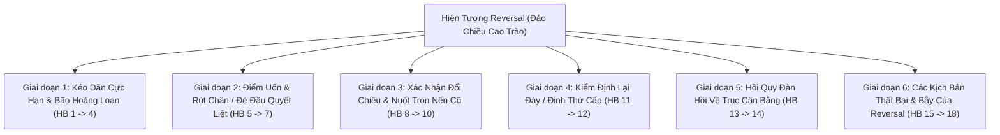

# BÁO CÁO TOÀN DIỆN: BẢN ĐỒ HÀNH VI REVERSAL THỰC CHIẾN & KIỂM ĐỊNH HIỆN TRẠNG `reversal.rs`
**File tài liệu:** `33_reversal_behavioral_ontology_and_scanner_gap_audit.md`  
**Chuyên đề:** Hệ thống hóa toàn bộ 18 hành vi vi cấu trúc thực chiến của hiện tượng Đảo Chiều Cao Trào (Climax Reversal / Mean Reversion) & Đối soát năng lực nhận diện của `reversal.rs`  
**Mã nguồn kiểm toán:** `strategies_backtests/helios/src/strategy/core_v3/scanners/reversal.rs`  
**Nguyên tắc:** Tập trung thuần túy vào bản chất hành vi thị trường thực tế (Behavioral & Microstructure), không sa đà vào cú pháp code hay công thức chỉ báo.  

---

## 🏛️ PHẦN 1: BẢN ĐỒ TOÀN CẢNH 18 HÀNH VI CỦA REVERSAL TRONG THỰC CHIẾN

Trong thực tế giao dịch tài chính, **Reversal (Đảo Chiều Xu Hướng / Cao Trào Kiệt Sức)** là một cuộc chiến khốc liệt: **Sự kiệt sức hoàn toàn của phe đang nắm giữ xu hướng (sau một đợt xả lũ hoặc bơm dốc cực hạn) vấp phải một cú phản công bạo lực của dòng tiền tổ chức đối ứng, kéo giá giật ngược trở lại đường cân bằng dài hạn.**

Một đợt Reversal thực chiến chân chính diễn ra qua 6 giai đoạn sinh học với **18 hành vi vi cấu trúc đặc thù**:

### 📋 CHI TIẾT 18 HÀNH VI THỰC CHIẾN:

#### Giai đoạn 1: Kéo Dãn Cực Hạn & Bão Hoảng Loạn (Extreme Stretch & Capitulation)
1. **HB-01 (Parabolic Acceleration):** Giá tăng tốc dốc đứng theo đường cong Parabol (gần 90 độ), kéo giãn khoảng cách cực xa khỏi trục cân bằng dài hạn.
2. **HB-02 (Capitulation / Blow-Off Climax):** Phe thua cuộc chính thức đầu hàng (Long bị thanh lý hàng loạt ở đáy, hoặc Short bị cháy tài khoản ở đỉnh), tạo ra làn sóng cắt lỗ hoảng loạn.
3. **HB-03 (Climax Volume Spike):** Khối lượng giao dịch bùng nổ kỷ lục (gấp $3 \sim 5$ lần bình thường), đánh dấu toàn bộ lượng hàng trôi nổi bị sang tay cho cá mập.
4. **HB-04 (Wide Spread Expansion):** Biên độ nến giãn to cực đại, thân nến dài bất thường thể hiện sự hoảng loạn tột độ.

#### Giai đoạn 2: Điểm Uốn & Rút Chân Quyết Liệt (Inflection Pivot & Violent Rejection)
5. **HB-05 (Counter-Force Absorption Wall):** Dòng tiền lớn đặt các lệnh Limit đối ứng khổng lồ nuốt trọn đợt xả/bơm hoảng loạn cuối cùng tại mức giá cực hạn.
6. **HB-06 (Violent Rejection Wick):** Nến nhúng rất sâu nhưng cuối phiên bị kéo giật ngược trở lại đóng cửa sát phía đối diện (râu nến chiếm trên $60\%$ chiều dài nến).
7. **HB-07 (Momentum & Flow Divergence):** Giá tạo đáy mới thấp hơn nhưng các thước đo dòng tiền (MFI, RSI, Delta) không thể tạo đáy mới thấp hơn (chứng minh lực xả đã rỗng ruột).

#### Giai đoạn 3: Xác Nhận Đổi Chiều & Nuốt Trọn Nến Cũ (Confirmation & Engulfing)
8. **HB-08 (Engulfing / Confirmation Bar tại $t+1$):** Cây nến tiếp theo đóng cửa phủ nhận hoàn toàn nến trước hoặc bứt phá vượt qua điểm giữa của nến cao trào.
9. **HB-09 (Market Structure Shift - MSS vi mô):** Giá bứt phá vượt qua đỉnh/đáy dẫn đến cực trị vừa tạo, chính thức chuyển cấu trúc vi mô từ giảm sang tăng.
10. **HB-10 (Trapped Trend Followers Squeeze):** Những người vừa đu bán ở cây nến xả đáy bị kẹt vị thế lỗ nặng, buộc phải mua lại cắt lỗ, biến thành lực đẩy giá bật ngược.

#### Giai đoạn 4: Kiểm Định Lại Đáy / Đỉnh Thứ Cấp (Secondary Test - ST)
11. **HB-11 (Low-Volume Secondary Test):** Giá quay lại retest vùng cực trị vừa tạo với khối lượng sụt giảm rất thấp, chứng minh nguồn cung xả đã cạn sạch.
12. **HB-12 (Higher Low Formation):** Cú retest tôn trọng đáy cũ, chính thức thiết lập đáy sau cao hơn đáy trước (Higher Low).

#### Giai đoạn 5: Hồi Quy Đàn Hồi Về Trục Cân Bằng (Elastic Mean Reversion Snap)
13. **HB-13 (Elastic Snap-back):** Như sợi dây chun bị kéo căng quá mức, khi lực kéo thả ra, giá bật ngược cực nhanh về phía trục giá trị cân bằng (KAMA Midline).
14. **HB-14 (Asymmetric R:R Expansion):** Do bắt tại điểm cực hạn và mục tiêu là trục cân bằng ở tít xa, tỷ lệ Risk/Reward tự nhiên rất lớn ($R:R \ge 2.0 \sim 4.0$).

#### Giai đoạn 6: Các Kịch Bản Thất Bại & Bẫy Của Reversal (Failures & Traps)
15. **HB-15 (Falling Knife Continuation Trap):** Nhịp rút chân chỉ là cú nảy tạm thời (Dead Cat Bounce), ngay nến sau giá tiếp tục rơi tự do xuyên thủng đáy (bẫy bắt dao rơi).
16. **HB-16 (Strong Trend Pegging Trap):** Trong một xu hướng giảm vĩ mô quá mạnh (xả lũ tin tức), giá có thể tiếp tục giảm thêm 10 nến dù MFI/RSI đã ở mức 0.
17. **HB-17 (Negative R:R Reversal Trap):** Vào lệnh khi giá đã hồi quá nửa đường về trục cân bằng $\implies$ Khoảng cách tới SL thì xa mà tiềm năng ăn TP thì quá ngắn ($R:R < 1.0$).
18. **HB-18 (Stagnation Drift):** Giá không bật hồi mạnh mà lờ đờ đi ngang, lực hồi quy bị triệt tiêu dần và giá trôi dạt sụp đổ.

---

## 🔍 PHẦN 2: BẢNG ĐỐI SOÁT TOÀN DIỆN: `reversal.rs` ĐÃ PHÂN TÍCH NHỮNG GÌ?

| STT | Hành Vi Thực Chiến Của Reversal | Bản Chất Nghiệp Vụ Thực Tế | Hiện Trạng Phân Tích Trong `reversal.rs` | Xác Nhận |
| :---: | :--- | :--- | :--- | :---: |
| **1** | **Kéo dãn dốc đứng (Parabolic Acceleration)** | Giá bay dốc đứng rời xa trục cân bằng. | **ĐÃ PHÂN TÍCH MỘT PHẦN:** Kiểm tra qua `z_score` và `displacement >= min_disp * atr`. | 🟡 **MỘT PHẦN** |
| **2** | **Bán tháo đầu hàng (Capitulation Dump)** | Thanh lý dây chuyền, retail bán tháo cắt lỗ. | **CHỈ NHẬN DIỆN MỘT PHẦN GIÁN TIẾP** qua MFI quá bán. | 🟡 **MỘT PHẦN** |
| **3** | **Bùng nổ khối lượng cao trào (Climax Volume Spike)** | Volume kỷ lục thể hiện dòng tiền sang tay. | ❌ **PHÂN TÍCH SAI LỆCH NGUY HIỂM:** Hàm `sat_proximity(vol_ratio, 0.50)` **ép volume phải nhỏ quanh 0.50 mới được điểm cao**, nếu có volume bão xả hàng thì PHẠT VỀ 0 ĐIỂM! | ❌ **SAI LỆCH** |
| **4** | **Biên độ nến giãn to (Wide Spread)** | Thân nến dài bất thường thể hiện hoảng loạn. | **BỎ TRỐNG HOÀN TOÀN.** Scanner không đo lường độ dài nến so với trung bình. | 🔴 **BỎ SÓT** |
| **5** | **Tường Limit đối ứng chặn đứng (Absorption Wall)** | Lệnh Limit lớn nuốt sạch lực bán hoảng loạn. | **BỎ TRỐNG HOÀN TOÀN.** | 🔴 **BỎ SÓT** |
| **6** | **Rút chân quyết liệt (Violent Rejection Wick)** | Nến nhúng sâu rồi rút chân tạo râu dài. | **ĐÃ PHÂN TÍCH:** Kiểm tra qua chốt chặn `clv >= min_clv`. | 🟢 **ĐÃ PHÂN TÍCH** |
| **7** | **Phân kỳ dòng tiền (Flow Divergence)** | MFI kiệt sức ở vùng quá bán. | **ĐÃ PHÂN TÍCH:** Kiểm tra qua điều kiện `mfi <= mfi_thresh`. | 🟢 **ĐÃ PHÂN TÍCH** |
| **8** | **Nến xác nhận phủ nhận nến cũ (Engulfing Bar tại $t+1$)** | Nến tiếp theo vượt qua nửa nến cao trào. | **BỎ TRỐNG HOÀN TOÀN.** Scanner là hàm đơn nến phi trạng thái (Stateless), mù tịt về nến $t+1$. | 🔴 **BỎ SÓT** |
| **9** | **Bẻ gãy cấu trúc vi mô (MSS / CHoCH)** | Phá vỡ đỉnh dẫn tới đáy thấp nhất. | **BỎ TRỐNG HOÀN TOÀN.** Không có khái niệm cấu trúc swing vi mô. | 🔴 **BỎ SÓT** |
| **10** | **Nhốt kẹt phe đuổi sóng (Trapped Trend Squeeze)** | Phe Short đu đáy bị kẹt lỗ phải cắt lỗ. | **BỎ TRỐNG HOÀN TOÀN.** | 🔴 **BỎ SÓT** |
| **11** | **Kiểm định lại đáy thứ cấp (Secondary Test ST)** | Nến quay lại test đáy cũ với volume cạn. | **BỎ TRỐNG HOÀN TOÀN.** | 🔴 **BỎ SÓT** |
| **12** | **Thiết lập đáy sau cao hơn (Higher Low)** | Tôn trọng mốc đáy cũ, bắt đầu cấu trúc tăng. | **BỎ TRỐNG HOÀN TOÀN.** | 🔴 **BỎ SÓT** |
| **13** | **Bật hồi đàn hồi (Elastic Snap-back)** | Giá giật nhanh về trục KAMA Midline. | **ĐÃ ĐƯA VÀO MỤC TIÊU:** Đặt `suggested_tp = Some(kama_mid)`. | 🟢 **ĐÃ PHÂN TÍCH** |
| **14** | **Mở rộng tỷ lệ R:R ($R:R \ge 2.0$)** | Tiềm năng ăn tới KAMA Midline lớn hơn SL. | ❌ **BỎ TRỐNG / NGUY CƠ BẪY R:R ÂM:** Scanner **hoàn toàn không so sánh** khoảng cách từ Entry tới SL với khoảng cách tới TP $\implies$ Có thể vào lệnh khi $R:R < 1.0$! | 🔴 **BỎ SÓT** |
| **15** | **Bẫy bắt dao rơi (Falling Knife Trap)** | Nhịp rút chân giả rồi xả lũ tiếp. | ❌ **HOÀN TOÀN BẤT LỰC:** Bỏ trống `_matrix` $\implies$ Mù xu hướng KAMA vĩ mô dốc xả lũ và mù chỉ số Chaos bão loạn! | ❌ **SAI LỆCH** |
| **16** | **Bẫy xu hướng siêu mạnh (Trend Pegging)** | MFI lì đòn ở mức 0, giá tiếp tục rơi 10 nến. | **BỎ TRỐNG HOÀN TOÀN.** Không có chốt chặn kiểm tra độ dốc xu hướng KAMA khung lớn. | 🔴 **BỎ SÓT** |
| **17** | **Bẫy R:R âm khi hồi quá nửa đường** | Giá hồi sát KAMA rồi mới vào lệnh. | **CHỈ PHÒNG VỆ THÔ SƠ** qua `displacement >= min_disp * atr`, nhưng không liên kết với khoảng cách SL cấu trúc. | 🟡 **MỘT PHẦN** |
| **18** | **Đình trệ sau đảo chiều (Stagnation Drift)** | Giá không bật hồi mà đi ngang rồi sập. | **BỎ TRỐNG HOÀN TOÀN.** Không có cơ chế Stagnation Exit. | 🔴 **BỎ SÓT** |
| **19** | **Thanh lọc vị thế mở OI (Open Interest Capitulation Flush)** | Khối lượng thanh lý cực đại làm OI sụt giảm dốc đứng (Long bị quét sạch ở đáy), báo hiệu áp lực bán đã cạn kiệt. | **BỎ TRỐNG HOÀN TOÀN.** Không có dữ liệu Open Interest. | 🔴 **BỎ SÓT** |
| **20** | **Độ lệch cực hạn của Funding Rate (Funding Rate Dislocation)** | Funding Rate âm sâu kỷ lục (ví dụ $-0.1\% \sim -0.3\%$) do toàn bộ retail FOMO Short đuổi đáy $\implies$ Mồi lửa Short Squeeze. | **BỎ TRỐNG HOÀN TOÀN.** Không có dữ liệu Funding Rate. | 🔴 **BỎ SÓT** |
| **21** | **Đảo chiều tích lũy đa nến / 2 Đáy (Multi-leg W Reversal)** | Đảo chiều thường tạo mô hình 2 đáy vi mô (W-bottom) hoặc đáy dẹt kéo dài qua $3 \sim 8$ nến thay vì giật V-shape 1 nến. | **BỎ TRỐNG HOÀN TOÀN.** Scanner ép bắt đáy ngay tại 1 nến duy nhất. | 🔴 **BỎ SÓT** |
| **22** | **Bùng nổ Delta mua đối ứng (Order Flow Delta Surge)** | Delta nến lật ngược tức thì từ âm kỷ lục sang dương áp đảo ngay tại đáy. | **BỎ TRỐNG HOÀN TOÀN.** | 🔴 **BỎ SÓT** |

---

## 🎯 TỔNG KẾT XÁC NHẬN (22 HÀNH VI REVERSAL THỰC CHIẾN):
* 🟢 **Đã phân tích tốt:** **3 / 22** hành vi *(HB-06: Rút chân CLV, HB-07: MFI kiệt sức, HB-13: Mục tiêu TP KAMA)*.
* 🟡 **Phân tích một phần / Thô sơ:** **3 / 22** hành vi *(HB-01, HB-02, HB-17)*.
* 🔴 **Bỏ sót hoàn toàn:** **14 / 22** hành vi.
* ❌ **Phân tích sai lệch / Tự bóp chết:** **2 / 22** hành vi *(HB-03: Nghịch lý volume ép vol về 0.50 & HB-15: Mù tịt xu hướng vĩ mô do bỏ trống `_matrix`)*.

