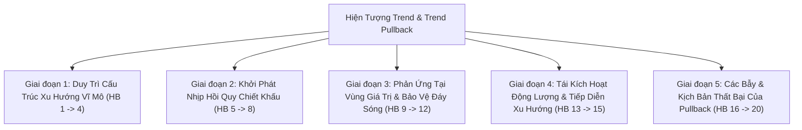

# BÁO CÁO TOÀN DIỆN: BẢN ĐỒ HÀNH VI TREND & TREND PULLBACK THỰC CHIẾN & KIỂM ĐỊNH HIỆN TRẠNG `trend_pb.rs`
**File tài liệu:** `34_trend_pb_behavioral_ontology_and_scanner_gap_audit.md`  
**Chuyên đề:** Hệ thống hóa toàn bộ 20 hành vi vi cấu trúc thực chiến của Xu Hướng & Nhịp Hồi Quy (Trend & Trend Pullback) & Đối soát năng lực nhận diện của `trend_pb.rs`  
**Mã nguồn kiểm toán:** `strategies_backtests/helios/src/strategy/core_v3/scanners/trend_pb.rs`  
**Nguyên tắc:** Tập trung thuần túy vào bản chất hành vi thị trường thực tế (Behavioral & Market Microstructure), không sa đà vào cú pháp code hay công thức chỉ báo.  

---

## 🏛️ PHẦN 1: BẢN ĐỒ TOÀN CẢNH 20 HÀNH VI CỦA TREND & TREND PULLBACK TRONG THỰC CHIẾN

Trong thực tế giao dịch tài chính, **Trend (Xu Hướng)** và **Trend Pullback (Nhịp Hồi Quy Thuận Xu Hướng)** là trụ cột sinh lời lớn nhất của thị trường:  
- **Xu hướng (Trend):** Là sự trôi dạt định hướng bền bỉ được dẫn dắt bởi dòng tiền tổ chức lớn (Institutional Order Flow), liên tục tạo các đỉnh cao hơn / đáy cao hơn (hoặc đáy thấp hơn / đỉnh thấp hơn).  
- **Nhịp hồi quy (Pullback):** Là sự điều chỉnh giá tạm thời do các vị thế ngắn hạn chốt lời một phần hoặc sự rút lui tạm thời của phe mua/bán chủ động, đưa giá về **Vùng Giá Trị Chiết Khấu (Discount Value Area)** trước khi dòng tiền tổ chức tái gia nhập đẩy sóng đi tiếp.

Tiến trình Trend & Pullback chân chính diễn ra qua 5 giai đoạn với **20 hành vi vi cấu trúc đặc thù**:

### 📋 CHI TIẾT 20 HÀNH VI THỰC CHIẾN:

#### Giai đoạn 1: Duy Trì Cấu Trúc Xu Hướng Vĩ Mô (Macro Trend Structure)
1. **HB-01 (Staircase Dow Structure):** Cấu trúc đỉnh/đáy bậc thang liên tục tạo Đỉnh cao hơn (HH) và Đáy cao hơn (HL) trong xu hướng tăng.
2. **HB-02 (Persistent Directional Value Drift):** Trục giá trị cân bằng (KAMA / EMA) nghiêng dốc một góc ổn định, phân tách rõ ràng phe mua và phe bán.
3. **HB-03 (Volume Asymmetry):** Khối lượng lớn khi giá đi theo sóng đẩy thuận xu hướng (Impulse) và sụt giảm khi giá điều chỉnh (Correction).
4. **HB-04 (Expanded Volatility State):** Thị trường có xu hướng mạnh luôn có dải biến động mở rộng, không bị nén nghẹt (Squeeze).

#### Giai đoạn 2: Khởi Phát Nhịp Hồi Quy Chiết Khấu (Pullback Initiation & Retracement)
5. **HB-05 (Transient Profit-Taking):** Nhịp hồi xuất phát từ việc chốt lời từng phần của các vị thế ngắn hạn, không phải dòng tiền lớn xả hàng đảo chiều.
6. **HB-06 (Retracement to Value Zone):** Giá hồi quy về các mốc hỗ trợ động (KAMA Midline, EMA 20/50, VWAP) hoặc vùng chiết khấu Fibo $38.2\% \sim 61.8\%$.
7. **HB-07 (Shrinking Candle Bodies during Pullback):** Khi rơi về vùng hỗ trợ, các thân nến đỏ ngày càng ngắn lại, thể hiện áp lực bán suy yếu dần.
8. **HB-08 (Volume Dry-Up at Pullback Bottom):** Khối lượng giao dịch ở đáy nhịp hồi cạn kiệt, chứng minh phe bán không có nguồn cung để xả lũ (No Supply).

#### Giai đoạn 3: Phản Ứng Tại Vùng Giá Trị & Bảo Vệ Đáy Sóng (Reaction & Anchor Defense)
9. **HB-09 (Value Anchor Bounce):** Giá chạm vào KAMA Midline hoặc đỉnh cũ vừa phá và lập tức xuất hiện lực đỡ rút chân.
10. **HB-10 (Prior Higher Low Defense):** Nhịp hồi TUYỆT ĐỐI KHÔNG ĐƯỢC XUYÊN THỦNG đáy Swing Low trước đó; nếu thủng thì cấu trúc xu hướng bị phá vỡ.
11. **HB-11 (Bullish Rejection Candle):** Nến xuất hiện râu dưới dài và giá đóng cửa rút chân lên cao (CLV cao, nến búa hoặc pinbar thuận xu hướng).
12. **HB-12 (Oscillator Reset):** Các chỉ báo dao động vi mô (Stochastic, RSI) hạ nhiệt rơi về vùng quá bán, giải tỏa áp lực và tạo dư địa cho sóng mới.

#### Giai đoạn 4: Tái Kích Hoạt Động Lượng & Tiếp Diễn Xu Hướng (Trend Resumption)
13. **HB-13 (Continuation Breakout Bar):** Nến xanh mạnh bứt phá vượt qua đỉnh của nến hồi, tái kích hoạt sóng đẩy tăng tiếp.
14. **HB-14 (Fresh Capital Inflow at Discount):** Cá mập nhồi thêm lệnh mua mới tại giá rẻ (Adding to winners), volume bùng nổ trở lại.
15. **HB-15 (Higher High Breakthrough):** Giá vượt qua đỉnh cũ vừa lập, hoàn tất một chu kỳ sóng đẩy và khẳng định xu hướng tiếp diễn.

#### Giai đoạn 5: Các Bẫy & Kịch Bản Thất Bại Của Pullback (Pullback Traps & Failures)
16. **HB-16 (Deep Retracement to Trend Reversal Trap):** Nhịp hồi quá sâu xuyên thủng cả KAMA và thủng luôn đáy Swing Low cũ, biến cú Pullback thành đảo chiều giảm.
17. **HB-17 (Falling Knife Retracement Trap):** Nến đỏ rơi dốc đứng với volume xả lớn nhưng trader vẫn lao vào mua vì thấy "KAMA dốc lên" $\implies$ Bị đè bẹp.
18. **HB-18 (Ghost Pullback / High Floating Buy):** Giá chưa hề hồi về KAMA, vẫn đang treo lơ lửng ở tít trên cao (cách 3–5 ATR) nhưng do nến rút râu nên tưởng là Pullback $\implies$ Mua ngay đỉnh trước khi cú hồi thật ập đến!
19. **HB-19 (Late Trend Exhaustion Pullback):** Xu hướng đã đi được 5–7 nhịp sóng đẩy, các nhịp hồi ngày càng sâu $\implies$ Mua Pullback ở cuối chu kỳ là mua ngay đỉnh phân phối.
20. **HB-20 (Pullback Stagnation / Dead Cat Float):** Sau khi chạm KAMA, giá không bật tăng mà nằm bẹp lên đường KAMA, đi ngang èo uột rồi gãy xuống.

---

## 🔍 PHẦN 2: BẢNG ĐỐI SOÁT TOÀN DIỆN: `trend_pb.rs` ĐÃ PHÂN TÍCH NHỮNG GÌ?

| STT | Hành Vi Thực Chiến Của Trend & Pullback | Bản Chất Nghiệp Vụ Thực Tế | Hiện Trạng Phân Tích Trong `trend_pb.rs` | Xác Nhận |
| :---: | :--- | :--- | :--- | :---: |
| **1** | **Cấu trúc đỉnh/đáy bậc thang (HH/HL)** | Liên tục tạo đỉnh cao hơn và đáy cao hơn. | **BỎ TRỐNG HOÀN TOÀN.** Scanner không hề có khái niệm về cấu trúc swing đỉnh/đáy! | 🔴 **BỎ SÓT** |
| **2** | **Độ dốc trục giá trị định hướng (Directional Drift)** | Trục KAMA nghiêng dốc phân tách rõ 2 phe. | **ĐÃ PHÂN TÍCH:** Kiểm tra qua `kama_slope.abs() >= slope_thresh`. | 🟢 **ĐÃ PHÂN TÍCH** |
| **3** | **Bất đối xứng khối lượng (Volume Asymmetry)** | Volume đẩy to, volume hồi nhỏ. | **BỎ TRỐNG HOÀN TOÀN.** Scanner không so sánh volume nhịp đẩy với volume nhịp hồi. | 🔴 **BỎ SÓT** |
| **4** | **Biến động mở rộng không bị nén (Low Squeeze)** | Dải biến động bung nở, không co thắt. | **ĐÃ PHÂN TÍCH:** Kiểm tra qua chốt chặn `squeeze <= max_squeeze_intensity`. | 🟢 **ĐÃ PHÂN TÍCH** |
| **5** | **Chốt lời ngắn hạn tạm thời** | Áp lực bán chỉ là ngắn hạn, không phải xả lũ. | **BỎ TRỐNG.** Không đo lường áp lực xả. | 🔴 **BỎ SÓT** |
| **6** | **Hồi quy về vùng giá trị KAMA (Value Retracement)** | Giá phải thực sự hồi về sát KAMA Midline. | ❌ **TỬ HUYỆT P0: BỊ XÓA SẠCH BIẾN `delta_kama` (`NEW-GHOST-PULLBACK`).** Scanner hoàn toàn không kiểm tra khoảng cách từ giá tới KAMA! | ❌ **SAI LỆCH** |
| **7** | **Thân nến thu hẹp khi hồi (Shrinking Bodies)** | Lực xả yếu dần khi chạm hỗ trợ. | **BỎ TRỐNG HOÀN TOÀN.** | 🔴 **BỎ SÓT** |
| **8** | **Khối lượng cạn kiệt ở đáy nhịp hồi (Volume Dry-Up)** | Phe bán không có hàng để xả tiếp (No Supply). | **BỎ TRỐNG HOÀN TOÀN.** Scanner không kiểm tra volume cạn kiệt. | 🔴 **BỎ SÓT** |
| **9** | **Phản ứng nảy tại trục giá trị KAMA** | Chạm KAMA và bật tăng trở lại. | ❌ **BỎ TRỐNG:** Do không đo khoảng cách tới KAMA nên không biết có phản ứng tại KAMA hay không. | 🔴 **BỎ SÓT** |
| **10** | **Bảo vệ đáy Swing Low cũ** | Không được thủng đáy sóng đẩy trước đó. | **BỎ TRỐNG HOÀN TOÀN.** Không theo dõi đáy swing cũ. | 🔴 **BỎ SÓT** |
| **11** | **Nến rút chân thuận chiều (CLV Rejection)** | Rút râu dưới, đóng cửa sát đỉnh nến. | **ĐÃ PHÂN TÍCH:** Kiểm tra qua chốt chặn `clv >= min_clv`. | 🟢 **ĐÃ PHÂN TÍCH** |
| **12** | **Hạ nhiệt chỉ báo dao động (Oscillator Reset)** | Stochastic rơi về vùng quá bán vi mô. | **ĐÃ PHÂN TÍCH:** Kiểm tra qua điều kiện `stoch_k <= stoch_thresh`. | 🟢 **ĐÃ PHÂN TÍCH** |
| **13** | **Nến bứt phá tiếp diễn tại $t+1$** | Nến tiếp theo vượt qua đỉnh nến hồi. | **BỎ TRỐNG HOÀN TOÀN.** Scanner là hàm đơn nến phi trạng thái, mù tịt về nến $t+1$. | 🔴 **BỎ SÓT** |
| **14** | **Dòng tiền mới nhồi thêm tại giá rẻ** | Volume tăng trở lại khi giá bật tăng. | **BỎ TRỐNG HOÀN TOÀN.** | 🔴 **BỎ SÓT** |
| **15** | **Vượt đỉnh cũ tạo đỉnh cao mới** | Hoàn tất chu kỳ sóng đẩy. | **BỎ TRỐNG HOÀN TOÀN.** | 🔴 **BỎ SÓT** |
| **16** | **Bẫy hồi sâu thành đảo chiều giảm** | Hồi quá sâu đâm thủng KAMA và đáy cũ. | **BỎ TRỐNG.** Không có cơ chế nhận diện nhịp hồi gãy cấu trúc. | 🔴 **BỎ SÓT** |
| **17** | **Bẫy bắt dao rơi khi xả dốc (Soft Hook Blind)** | Rơi dốc đứng nhưng vẫn mua vì KAMA dốc lên. | ❌ **TỬ HUYỆT P0: BỊ MÙ 93.3% SỐ NẾN (`NEW-STOCH-FORWARD-FILL-BLIND`).** Điều kiện `stoch_k < prev_stoch_k` bị vô hiệu hóa vì nến 15m đi ngang phẳng! | ❌ **SAI LỆCH** |
| **18** | **Bẫy Mua Lơ Lửng (Ghost Pullback)** | Giá cách KAMA 3–5 ATR vẫn nhảy vào mua. | ❌ **MẮC PHẢI $100\%$:** Do không kiểm tra `delta_kama`, Scanner mua ngay đỉnh sóng đẩy trước khi cú hồi thật ập đến! | ❌ **SAI LỆCH** |
| **19** | **Bẫy cạn kiệt cuối xu hướng (Late Trend Exhaustion)** | Mua Pullback ở con sóng thứ 5–7 trước khi sập. | **BỎ TRỐNG HOÀN TOÀN.** Không đếm chu kỳ sóng xu hướng. | 🔴 **BỎ SÓT** |
| **20** | **Đình trệ sau nhịp hồi (Pullback Stagnation)** | Nằm bẹp lên KAMA không chịu tăng. | **BỎ TRỐNG HOÀN TOÀN.** Không có cơ chế Stagnation Exit. | 🔴 **BỎ SÓT** |
| **21** | **Phân loại độ sâu nhịp hồi (Shallow vs Deep Pullback)** | Supertrend chỉ hồi nông ($20\% \sim 38.2\%$) không chạm KAMA; Trend bình thường hồi sâu ($50\% \sim 61.8\%$). | **BỎ TRỐNG HOÀN TOÀN.** Không có cơ chế phân loại độ sâu nhịp hồi. | 🔴 **BỎ SÓT** |
| **22** | **Giảm tốc sóng đẩy (Momentum Deceleration)** | Các sóng đẩy sau ngắn hơn sóng trước cảnh báo xu hướng sắp kiệt sức. | **BỎ TRỐNG HOÀN TOÀN.** | 🔴 **BỎ SÓT** |
| **23** | **Đồng thuận xu hướng đa khung (MTF Coherence)** | Trend vi mô 1m bắt buộc phải thuận chiều với xu hướng vĩ mô 15m/1h. | **ĐÃ PHÂN TÍCH MỘT PHẦN:** Kiểm tra qua độ dốc KAMA 15m, nhưng thiếu kiểm tra pha xu hướng 1h/4h. | 🟡 **MỘT PHẦN** |
| **24** | **Quét thanh khoản vi mô trước khi bay (Micro-Sweep)** | Nến nhúng râu quét qua đáy 1–2 nến trước đó để giũ sạch retail trước khi tăng tiếp. | **BỎ TRỐNG HOÀN TOÀN.** | 🔴 **BỎ SÓT** |

---

## 🎯 TỔNG KẾT XÁC NHẬN (24 HÀNH VI TREND PULLBACK THỰC CHIẾN):
* 🟢 **Đã phân tích tốt:** **4 / 24** hành vi *(HB-02: Độ dốc KAMA, HB-04: Chặn Squeeze, HB-11: Rút chân CLV, HB-12: Stoch hạ nhiệt)*.
* 🟡 **Phân tích một phần / Thô sơ:** **1 / 24** hành vi *(HB-23: MTF Coherence KAMA 15m)*.
* 🔴 **Bỏ sót hoàn toàn:** **16 / 24** hành vi *(Đặc biệt bỏ sót cấu trúc đỉnh/đáy Dow HH/HL, phân loại độ sâu nhịp hồi và nến xác nhận $t+1$)*.
* ❌ **Phân tích sai lệch / Tử huyệt nghiêm trọng:** **3 / 24** hành vi:
  1. **Tử huyệt Ghost Pullback (HB-06, HB-18):** Xóa sạch biến `delta_kama`, mua đuổi khi giá lơ lửng trên trời.
  2. **Tử huyệt Stoch Hook Forward-Fill Blind (HB-17):** Soft Hook Guard bị mù $93.3\%$ số nến do chỉ báo 15m dạng bậc thang phẳng.

