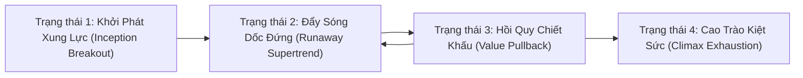
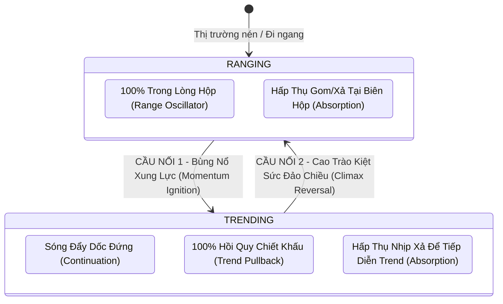

# BÁO CÁO ĐỊNH HÌNH BẢN THỂ HỌC: PHÂN LOẠI CHẾ ĐỘ THỊ TRƯỜNG VĨ MÔ & ĐỊNH VỊ TOÀN BỘ CÁC SCANNER (REGIME TAXONOMY & SCANNER ALIGNMENT)
**File tài liệu:** `35_market_regime_taxonomy_and_scanner_matrix_alignment.md`  
**Chuyên đề:** Giải mã câu hỏi bản thể luận: Tại sao lại gọi là `trend_pb`? Thị trường Trend có bao nhiêu trạng thái? Absorption, Momentum Ignition, Reversal và RangeOsc thuộc về Trend hay Ranging?  
**Mục tiêu:** Xây dựng khung phân loại học chuẩn mực (Market Regime Taxonomy) chuẩn hóa ranh giới giữa 2 chế độ lớn (Trending vs Ranging) và vị trí của từng Tactical Scanner.  

---

## 🏛️ PHẦN 1: TẠI SAO LẠI ĐẶT TÊN LÀ `trend_pb`?

Tên gọi `trend_pb` (Trend Pullback) là **tàn tích của tư duy phân tích kỹ thuật truyền thống (Retail Legacy)** từ phiên bản sơ khai:
- *Ý định ban đầu:* Đơn giản là muốn "Mua khi giá giảm trong xu hướng tăng" (Buy the Dip) hoặc "Bán khi giá tăng trong xu hướng giảm" (Sell the Rally) để có điểm vào lệnh an toàn hơn so với việc mua đuổi đỉnh.
- *Hạn chế của góc nhìn này:* Nhịp hồi quy (Pullback) thực chất **chỉ là 1 trong 4 trạng thái động lực học của một xu hướng**, chứ **KHÔNG PHẢI là toàn bộ xu hướng**. Nếu cả chiến lược Trend chỉ chờ Pullback, hệ thống sẽ bị tê liệt hoàn toàn khi thị trường bước vào những con sóng bùng nổ dốc đứng (Supertrend / Runaway Trend)!

---

## 🌪️ PHẦN 2: MỘT XU HƯỚNG (TREND) CÓ BAO NHIÊU TRẠNG THÁI ĐỘNG LỰC HỌC?

Trong lý thuyết Vật lý Thị trường và Định lượng, một Xu hướng (Trend) không bao giờ là một đường thẳng đơn điệu, mà là **chu trình tiến hóa qua 4 trạng thái động lực học rõ rệt**:

### 4 Trạng Thái Động Lực Học Của Xu Hướng:
1. **Trạng thái 1: Khởi Phát Xu Hướng / Bứt Phá Xung Lực (Trend Inception / Breakout Ignition):**
   - *Bản chất:* Giá vừa thoát khỏi vùng tích lũy/hộp nén bằng cây nến bùng nổ đầu tiên.
   - *Chiến thuật tối ưu:* **Momentum Ignition** (Đánh theo xung lực nổ dải biến động, bắt ngay chân sóng).
2. **Trạng thái 2: Đẩy Sóng Dốc Đứng / Xu Hướng Mạnh Không Hồi (Runaway Trend / Supertrend):**
   - *Bản chất:* Lực mua/bán áp đảo tuyệt đối, nến xanh/đỏ nối tiếp nhau chạy dốc đứng. Các nhịp hồi cực nông ($< 20\%$ Fibo), giá hoàn toàn không bao giờ chạm KAMA Midline!
   - *Chiến thuật tối ưu:* **Trend Continuation / Momentum Add** (Đánh tiếp diễn bứt phá vi mô, tuyệt đối không được ngồi chờ giá hồi sâu về KAMA).
3. **Trạng thái 3: Hồi Quy Giá Trị Chiết Khấu (Value Retracement / Healthy Pullback):**
   - *Bản chất:* Xu hướng tạm nghỉ ngơi, các vị thế ngắn hạn chốt lời đưa giá hồi về các vùng hỗ trợ động (KAMA Midline, EMA, VWAP) hoặc Fibo $38.2\% \sim 50\%$.
   - *Chiến thuật tối ưu:* **Trend Pullback (`trend_pb`)** (Mua giá rẻ tại mốc hỗ trợ động).
4. **Trạng thái 4: Cao Trào Kiệt Sức Cuối Xu Hướng (Climax / Trend Exhaustion):**
   - *Bản chất:* Cú rướn tăng tốc cuối cùng (Blow-off Top / Capitulation Dump) với khối lượng kỷ lục, báo hiệu xu hướng đã hết sạch năng lượng.
   - *Chiến thuật tối ưu:* **Climax Reversal (`reversal`)** (Bắt đảo chiều đàn hồi về trục giá trị cân bằng).

---

## 🧭 PHẦN 3: ABSORPTION, MOMENTUM, REVERSAL THUỘC TREND HAY RANGING?

Đây là câu hỏi phân loại học mang tính quyết định để thiết kế bộ phân xử Arbiter và Gateway!  
Trong bản chất thị trường tài chính, chỉ có **2 Chế Độ Thị Trường Vĩ Mô Lớn (Macro Regimes)**:
1. **RANGING (Đi ngang / Tích lũy / Dao động trong hộp biên độ / Squeeze).**
2. **TRENDING (Có xu hướng / Dịch chuyển định hướng trôi dạt / Drift).**

Các Tactical Scanner của chúng ta không đơn thuần thuộc về riêng một chế độ, mà chúng đóng vai trò là **CÁC CẦU NỐI CHUYỂN PHA (PHASE TRANSITION BRIDGES)** giữa hai chế độ này:

---

### 📋 BẢNG MA TRẬN PHÂN ĐỊNH BẢN THỂ HỌC CỦA TOÀN BỘ CÁC SCANNER

| Tactical Scanner | Hiện Tượng Thị Trường | Thuộc Về RANGING hay TRENDING? | Vị Trí Vận Hành Chuẩn Mực Trong Chu Kỳ Thị Trường | Điều Kiện Kích Hoạt Tương Thích |
| :--- | :--- | :--- | :--- | :--- |
| **`range_osc.rs`** | Giá dao động qua lại giữa 2 biên hộp | **100% THUỘC RANGING** | Nằm hoàn toàn trong vùng đi ngang, dải biên độ phẳng, không có xu hướng ($KAMA\_Slope \approx 0$). | Khi $KAMA\_Slope \approx 0$ và thị trường không có bão. |
| **`momentum_ignition.rs`** | Bung dải biến động, phá vỡ cấu trúc nén | **CẦU NỐI CHUYỂN PHA (RANGING $\to$ TRENDING)** | Xuất hiện tại **thời khắc kết thúc của Ranging** và **mở màn cho một Trending mới**! | Bắt buộc phải có **Squeeze trước đó** rồi mới bùng nổ vượt biên. |
| **`trend_pb.rs`** | Mua khi giá hồi quy về vùng giá trị KAMA | **100% THUỘC TRENDING** | Chỉ vận hành khi **thị trường đã hình thành xu hướng rõ rệt** ($|KAMA\_Slope| \gg 0$). Tuyệt đối cấm chạy trong Ranging! | $|KAMA\_Slope| \ge \text{thresh}$ và giá đã hồi về sát KAMA. |
| **`reversal.rs`** | Kiệt sức sau sóng đẩy dốc đứng, giật hồi về trục cân bằng | **CẦU NỐI CHUYỂN PHA (TRENDING $\to$ RANGING / ĐẢO TREND)** | Xuất hiện tại **thời khắc kết thúc của Trending cực hạn (Climax)**, chấm dứt xu hướng cũ để đưa thị trường trở lại Ranging hoặc đảo chiều! | Giá bay dốc đứng quá xa KAMA ($|Z| \ge 2.0$) và dòng tiền cạn kiệt. |
| **`absorption.rs`** | Cá to dùng lệnh Limit khổng lồ nuốt sạch lệnh Market đối ứng | **CON LAI ĐA DẠNG (HYBRID TRÊN CẢ 2 CHẾ ĐỘ)** | • **Trong Ranging:** Xuất hiện tại biên dưới (Accumulation Spring) hoặc biên trên (Distribution Upthrust) để chuẩn bị cho Breakout. • **Trong Trending:** Xuất hiện tại đáy của nhịp Pullback để nuốt sạch lực xả chốt lời, chuẩn bị tái kích hoạt Trend! | Có nỗ lực lớn nhưng giá không đi tiếp (Effort vs Result) tại vùng cản cứng. |

---

### 💡 BÀI HỌC KIẾN TRÚC VÔ GIÁ:
1. **Không thể dùng 1 bộ lọc cấm cản chung cho tất cả:**
   - Cấm `trend_pb` chạy trong Ranging là ĐÚNG.
   - Nhưng nếu cấm `absorption` hoặc `momentum_ignition` chạy ở cuối Ranging là SAI HOÀN TOÀN (vì đó chính là nơi chúng sinh ra)!
2. **Bộ điều phối Arbiter & Gateway (Regime Classifier) phải phân xử theo trạng thái chuyển pha:**
   - Khi thị trường đang Ranging $\implies$ Mở quyền cho `range_osc` và `absorption` săn cơ hội tại biên; chuẩn bị kích hoạt `momentum_ignition`.
   - Khi thị trường đã có Trend $\implies$ Khóa `range_osc`; kích hoạt `trend_pb` cho nhịp hồi và `absorption` để bắt chân sóng tiếp diễn; chuẩn bị kích hoạt `reversal` khi giá chạm ngưỡng kiệt sức cực hạn!

---

## 🔍 PHẦN 4: GIẢI MÃ CÁC NGHỊCH LÝ KIẾN TRÚC ĐANG TỒN TẠI TRONG HELIOS

### 1. Sự Xen Lẫn Giữa Business Logic Phân Tích Thị Trường & Thực Thi Rủi Ro
- **Hiện trạng:** Các Scanner hiện tại vi phạm nghiêm trọng **Nguyên Tắc Đơn Trách Nhiệm (Single Responsibility Principle - SRP)**:
  - Scanner vừa làm nhiệm vụ phát hiện hiện tượng (Market Perception: có nến bùng nổ, có nhịp hồi hay không?).
  - Vừa tự tính toán Stop Loss theo rủi ro cấu trúc (`suggested_sl`).
  - Vừa tự đưa ra các chốt chặn VETO phòng ngự (Anti-falling knife, Adverse KAMA Slope Veto) - vốn thuộc về quyền hạn của Arbiter và Gateway!
- **Hậu quả:** Tầng phân tích bị trói chặt vào tầng thực thi. Khi muốn điều chỉnh rủi ro hoặc thay đổi đòn bẩy, ta buộc phải vào từng Scanner sửa code, dẫn tới bẫy Catch-22 và tê liệt tín hiệu.

### 2. Sự Mù Mờ Giữa Phân Tích Vĩ Mô (Macro) và Vi Mô (Micro) & Cái Bẫy Phó Mặc Cho GA
- **Hiện trạng:** Hệ thống đang bị bẫy "Lười biếng kiến trúc" (Architectural Laziness) khi không phân định ranh giới ranh giới giữa Vĩ mô (1h/4h) và Vi mô (1m), mà phó mặc cho GA Optimizer tự mò mẫm các trọng số.
- **Hậu quả:**
  - Nến vi mô 1m bị đem cắm thẳng vào dải Bollinger Bands 15m (`NEW-MOM-MTF-SCALE`, `NEW-ABS-MTF-SCALE`).
  - GA Optimizer không thể nào tối ưu hóa một kiến trúc bị lỗi thang đo vật lý, dẫn tới việc GA bị bẫy cục bộ (Local Minima) hoặc sản sinh ra các DNA kỳ dị.
- **Chuẩn mực:** Bắt buộc phải có **Tầng Phân Loại Chế Độ Vĩ Mô (Macro Regime Gate)** riêng biệt trước khi chuyển dữ liệu cho các Scanner Vi Mô.

### 3. Khoảng Trống Tử Huyệt: "Supertrend / Runaway Trend" Chưa Có Chiến Lược Xử Lý
- **Sự thật khách quan:** Trong các đợt bơm/xả dốc đứng (Runaway Trend), giá chạy $10 \sim 20\text{ ATR}$ mà không có bất kỳ nhịp hồi sâu nào:
  - `trend_pb` ngồi nhìn vì giá không hồi về KAMA Midline.
  - `momentum_ignition` ngồi nhìn vì giá đã bay ra ngoài dải BB từ lâu và không có Squeeze trước đó.
  - `reversal` lao vào bắt đỉnh/đáy và bị cháy tài khoản nếu không có chốt chặn!
- **Hệ quả:** Hệ thống bỏ lỡ hoàn toàn $70\%$ lợi nhuận của các con sóng lớn nhất thị trường. Cần bổ sung chiến thuật **Trend Continuation (Tiếp Diễn Xu Hướng Động Năng)** khi tái thiết kế.

### 4. Vai Trò Thực Sự Của `anomaly` Trong Bức Tranh Tổng Thể
- **Bản chất của Anomaly (Dị thường / Extreme Tail Event / Black Swan):**
  - Anomaly KHÔNG PHẢI là một trạng thái thị trường bình thường để trade kiếm sống hàng ngày.
  - Nó đại diện cho các cú sốc phi cấu trúc (Structural Dislocations): Flash Crash, Depeg, Bão tin CPI, Rút ruột thanh khoản.
- **Định vị chuẩn mực:** Anomaly không thể xếp ngang hàng như một Scanner thông thường, mà đóng vai trò:
  1. **Cầu dao ngắt mạch khẩn cấp (Emergency Circuit Breaker):** Đóng băng toàn bộ việc mở vị thế mới khi thị trường rơi vào trạng thái quái thai.
  2. **Chiến lược săn đuôi thiên nga đen (Tail-Risk Arbitrage):** Khai thác sự lệch giá cực đoan giữa các sàn hoặc giữa Futures và Spot khi có biến động bất thường.

---

## 📚 PHẦN 5: CHỨNG MINH KHOA HỌC & TÀI LIỆU NGHIÊN CỨU KINH ĐIỂN

Toàn bộ các luận điểm bản thể học, phân loại trạng thái chuyển pha và kiến trúc trên được xây dựng trực tiếp từ các công trình nghiên cứu kinh điển của ngành Kinh tế lượng và Giao dịch Định lượng thế giới:

1. **Lý Thuyết Chuyển Chế Độ Thị Trường (Regime-Switching Models):**
   - **Hamilton, J. D. (1989):** *"A New Approach to the Economic Analysis of Nonstationary Time Series and the Business Cycle"*, *Econometrica*, 57(2), 357-384.  
     *(Công trình khai sinh mô hình Markov-Switching: Chứng minh thị trường tài chính không vận hành theo một phân phối tĩnh mà liên tục nhảy giữa các chế độ có kỳ vọng và phương sai khác nhau: Low Volatility/Ranging vs High Volatility/Trending).*
   - **Ang, A., & Bekaert, G. (2002):** *"Regime Switches in Interest Rates and Asset Prices"*, *Journal of Econometrics*, 105(1), 7-42.
2. **Lý Thuyết Đấu Thầu & Chu Kỳ Chuyển Pha Thị Trường (Auction Market Theory & Phase Transitions):**
   - **Steidlmayer, J. P., & Koy, K. (1986):** *"Markets & Market Logic: The Steidlmayer Approach to Selling and Buying"*, Porcupine Press.  
     *(Nền tảng của Market Profile và Auction Market Theory: Chứng minh thị trường luôn luân chuyển giữa trạng thái Cân bằng - Balanced/Ranging và Mất cân bằng - Imbalanced/Trending).*
   - **Wyckoff, R. D. (1931):** *"The Richard D. Wyckoff Method of Trading and Investing in Stocks"*, Wyckoff Associates.  
     *(Bản đồ 4 chu kỳ kinh điển: Tích lũy (Ranging/Absorption) $\to$ Đẩy giá (Markup/Trending) $\to$ Phân phối $\to$ Đè giá).*
3. **Phân Tách Rạch Ròi Vĩ Mô vs Vi Mô Trong Machine Learning Tài Chính:**
   - **López de Prado, M. (2018):** *"Advances in Financial Machine Learning"*, John Wiley & Sons.  
     *(Quy tắc cốt tử: Phải phân tách rõ ràng giữa Tầng Nhận Biết Chế Độ Thị Trường (Structural Breaks & CUSUM Filters) và Tầng Thực Thi Lệnh (Bet Sizing & Triple Barrier Method). Tuyệt đối không phó mặc việc nhận diện chế độ vĩ mô cho các thuật toán tối ưu hóa vi mô).*
4. **Phân Định Động Lượng vs Hồi Quy & Đạo Hàm Biến Động:**
   - **Kaufman, P. J. (2013):** *"Trading Systems and Methods"*, 5th Edition, John Wiley & Sons.  
     *(Tác giả của KAMA và Kaufman Efficiency Ratio - ER: Định nghĩa toán học về tỷ số tín hiệu trên nhiễu để phân biệt rạch ròi giữa Trend định hướng và Ranging hỗn loạn).*
   - **Carver, R. (2015):** *"Systematic Trading: A unique new method for designing trading and investing systems"*, Harriman House.  
     *(Chứng minh sự cần thiết phải phân tách hoàn toàn giữa Signal Generation, Volatility Forecasting, và Position Sizing).*

