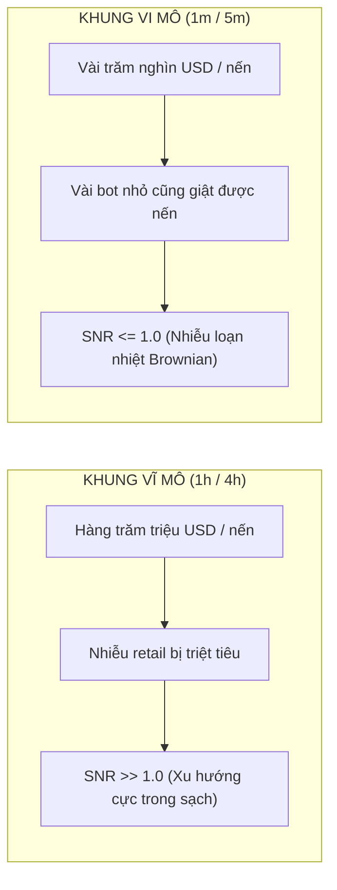

# BÁO CÁO KHOA HỌC: BẢN CHẤT FLASH CRASH, TÍNH HÌNH HỌC PHÂN DẠNG (FRACTAL) & NGUYÊN LÝ PHỐI HỢP VĨ MÔ - VI MÔ
**File tài liệu:** `36_flash_crash_mechanics_and_fractal_macro_micro_synthesis.md`  
**Chuyên đề:** Giải mã bản chất vi cấu trúc của Flash Crash & Chứng minh nguyên lý phân tầng Vĩ mô (Macro) vs Vi mô (Micro) dựa trên Lý thuyết Thị trường Phân dạng (Fractal Market Hypothesis)  
**Mục tiêu:** Trả lời trực diện hai câu hỏi nhận thức luận: (1) Flash Crash là gì, có dự đoán được không và thuộc về Gateway hay Scanner? (2) Tại sao khung nào cũng thấy Trend/Range, và phân chia Vĩ mô - Vi mô có làm mất cơ hội hay giúp hệ thống chuẩn xác hơn?  

---

## 🏛️ PHẦN 1: BẢN CHẤT CỦA FLASH CRASH & VỊ TRÍ CHUẨN MỰC TRONG KIẾN TRÚC

### 1. Flash Crash Có Phải Là Thao Túng Thị Trường Và Ngẫu Nhiên Không Thể Phán Đoán?
- **Bản chất vật lý vi cấu trúc (Microstructure Reality):**  
  Flash Crash (Sụp đổ chớp nhoáng) về mặt cơ chế sổ lệnh là hiện tượng **"Hố Đen Rút Ruột Thanh Khoản Kết Hợp Bão Thanh Lý Dây Chuyền" (Liquidity Black Hole & Cascading Liquidations)**:
  1. *Cú kích nổ đầu tiên:* Có thể là một lệnh xả lớn có chủ đích của cá mập (thao túng), một lỗi thuật toán (Fat-finger), hoặc một tin tức rò rỉ.
  2. *Bốc hơi thanh khoản (Quote Pulling):* Khi giá giảm quá nhanh, các thuật toán tạo lập thị trường (Market Makers) đồng loạt hủy lệnh chờ (bỏ chạy để tự vệ) $\implies$ Sổ lệnh phe mua xuất hiện một "khoảng trống không trọng lực" (Air Pocket).
  3. *Tuyết lở thanh lý (Cascading Liquidations):* Giá rơi tự do xuyên qua các mốc đòn bẩy cao ($50\text{x}, 100\text{x}, 20\text{x}$), kích hoạt chuỗi lệnh Margin Call của sàn. Các lệnh thanh lý này bị ép bán thẳng ra thị trường dưới dạng lệnh Market Sell, tiếp tục đạp sập giá xuống mức sâu hơn.
- **Có phán đoán được không?**
  - **Không thể đoán trước chính xác từng giây/phút** khi nào que diêm sẽ được bật.
  - Nhưng **hoàn toàn đo được độ dễ vỡ của thị trường (Market Fragility)** trước đó: Khi Open Interest phình to quá mức, Funding Rate quá lệch, sổ lệnh mỏng dính $\implies$ Thị trường rơi vào trạng thái "lò thuốc súng".

### 2. Flash Crash Nên Thuộc Về GATEWAY Hay SCANNER?
👉 **CÂU TRẢ LỜI:** **$100\%$ PHẢI THUỘC VỀ GATEWAY (VÀ RISK MANAGEMENT), TUYỆT ĐỐI KHÔNG ĐƯỢC LÀ SCANNER ĐƠN THUẦN!**

* **Tại sao không thể là Scanner (bắt đáy Flash Crash)?**
  - Trong tích tắc diễn ra Flash Crash, độ trượt giá (Slippage) có thể lên tới $2\% \sim 5\%$ giá nến. Sàn Binance lag, API drop kết nối, dãn spread từ 1 tick lên 50 ticks.
  - Cố tình viết Scanner nến 1m để "bắt dao rơi Flash Crash" là hành vi **đứng trước đoàn tàu hỏa đứt phanh để nhặt tiền lẻ**. Nếu bắt trúng thì ăn to, nhưng nếu bắt nhầm phải nhịp rơi đầu tiên của một cú sụp đổ (Depeg, sập sàn, hack dự án) thì tài khoản cháy sạch trong 30 giây!
* **Vị trí đúng: GATEWAY CIRCUIT BREAKER (CẦU DAO NGẮT MẠCH):**
  - Khi Gateway phát hiện biến động dị thường cực hạn ($Z_{\text{vol}} > 5.0$, nến rơi $> 4.0\text{ ATR}$ trong 1 phút, hoặc Spread dãn to) $\implies$ **LẬP TỨC ĐÓNG BĂNG HỆ THỐNG (FREEZE)**.
  - Cấm mọi Scanner mở lệnh mới, hủy các lệnh chờ mở, bảo toàn $100\%$ tiền trong tài khoản trong khi toàn bộ thị trường đang hoảng loạn thanh lý!

---

## 🔬 PHẦN 2: TÍNH HÌNH HỌC PHÂN DẠNG (FRACTAL) & NGUYÊN LÝ PHỐI HỢP VĨ MÔ - VI MÔ

### 1. Tại Sao Khung Nào (1h, 15m, 5m, 1m) Cũng Nhìn Thấy Trend Và Range?
Quan sát của bạn hoàn toàn chính xác và trùng khớp với **Lý Thuyết Thị Trường Phân Dạng (Fractal Market Hypothesis)** do nhà toán học vĩ đại Benoît Mandelbrot phát minh:
- **Tính Tự Tương Đồng (Self-Similarity):** Thị trường tài chính có cấu trúc hình học phân dạng (Fractal). Một xu hướng lớn trên khung 1h được cấu tạo bởi nhiều nhịp sóng nhỏ trên khung 15m; một nhịp sóng trên khung 15m lại được cấu tạo bởi các chuỗi nến trên khung 1m. Ở khung thời gian nào, quy luật nén (Squeeze), bùng nổ (Breakout) và hồi quy (Pullback) cũng đều lặp lại.

### 2. Nhưng Tại Sao Khung 5m/1m Lại "Khó Nhìn Ra Hơn Và Dễ Bị Lừa Hơn"?
Bản chất nằm ở định luật vật lý về **Tỷ Số Tín Hiệu Trên Nhiễu (Signal-to-Noise Ratio - SNR)**:
$$\text{SNR} = \frac{\text{Động Cơ Dòng Tiền Lớn (Tín Hiệu - Signal)}}{\text{Chuyển Động Nhiệt Ngẫu Nhiên & Ma Sát Sàn (Nhiễu - Noise)}}$$

- **Trên khung 1h/4h:** Mỗi cây nến đại diện cho hàng trăm triệu USD giao dịch thực tế của các quỹ lớn. Nhiễu của vài lệnh nhỏ bị triệt tiêu hoàn toàn $\implies$ **Xu hướng rất rõ nét, độ tin cậy cực cao**.
- **Trên khung 1m/5m:** Mỗi cây nến chỉ đại diện cho lượng tiền nhỏ. Một lệnh Market vài chục BTC của một cá nhân cũng đủ giật râu làm nến 1m bùng nổ giả tạo $\implies$ **Nhiễu loạn ngẫu nhiên chiếm ưu thế**.

---

### 3. Phân Chia Rõ Ràng Vĩ Mô - Vi Mô Có Làm Bỏ Lỡ Cơ Hội Hay Phân Tích Sai?

👉 **CÂU TRẢ LỜI:** **KHÔNG HỀ LÀM BỎ LỠ CƠ HỘI MÀ ĐÂY LÀ CHÌA KHÓA DUY NHẤT ĐỂ NÂNG CAO TỶ LỆ THẮNG LÊN GẤP ĐÔI VÀ TỐI ƯU R:R!**

Hãy hình dung sự phối hợp giữa **Kính Thiên Văn (Vĩ mô 1h/4h)** và **Kính Hiển Vi (Vi mô 1m)**:

| Tiêu Chí So Sánh | Không Phân Tách (Chỉ nhìn 1m hoặc cắm chéo 1m vào 15m) | Phân Tách Rạch Ròi: Vĩ Mô (Context) + Vi Mô (Timing) |
| :--- | :--- | :--- |
| **Bản chất vận hành** | Đánh đồng mọi cây nến 1m đều có giá trị như nhau. | **Vĩ mô chỉ đường (La bàn định hướng) $\implies$ Vi mô bấm cò (Bắn tỉa điểm vào).** |
| **Nguy cơ cản đầu xe tăng** | Nến 1m bùng nổ xanh rất đẹp $\implies$ Lao vào Mua! Nhưng thực chất khung 1h đang trong thác lũ xả hàng $\implies$ **Ăn trọn cú sập đè bẹp**. | Khung 1h đang xả lũ $\implies$ **Vĩ mô khóa chặt chiều Long**, cấm mọi nến xanh 1m lừa gạt hệ thống! |
| **Độ tối ưu của Stop Loss** | Nếu chỉ trade theo khung 1h: Stop Loss phải đặt cách $50 \sim 100$ giá (quá xa, đòn bẩy 20x sẽ bị cháy nếu giá giật ngược). | Dùng **Vĩ mô 1h để chọn hướng đi**, nhưng dùng **Vi mô 1m để bắt điểm rút chân / nén bùng nổ** $\implies$ **Stop Loss cực hẹp** (chỉ cách vài giá dưới chân nến 1m) $\implies$ **Tỷ lệ R:R vọt lên $3R \sim 5R$!** |
| **Có bị bỏ lỡ cơ hội?** | Ta tưởng là bỏ lỡ nhiều lệnh, nhưng thực tế $80\%$ các cơ hội nến 1m bị Vĩ mô từ chối chính là **NHỮNG CHIẾC BẪY QUÉT THANH KHOẢN (FALSE BREAKOUTS)**. | **Loại bỏ $80\%$ lệnh thua rác rưởi** để chỉ vào những lệnh có xác suất thắng cao nhất khi Vi mô đồng thuận hoàn toàn với Vĩ mô! |

---

### 💡 BẢN TỔNG KẾT NGUYÊN LÝ VẬN HÀNH (THE DUAL-LENS PRINCIPLE):

1. **Vĩ mô (1h/4h) trả lời câu hỏi:** *"Thị trường đang là Mùa Hè (Uptrend), Mùa Đông (Downtrend), hay Mùa Thu Mù Sương (Ranging)?"*.
   $\implies$ Quyết định: **ĐƯỢC ĐÁNH CHIỀU NÀO (Long/Short) VÀ MỞ QUYỀN CHO SCANNER NÀO HOẠT ĐỘNG.**
2. **Vi mô (1m) trả lời câu hỏi:** *"Đúng giây phút này, có giọt nước nào làm tràn ly không (Nến Spring rút chân, Nến kích hỏa bùng nổ)?"*.
   $\implies$ Quyết định: **ĐIỂM BẤM CÒ VÀO LỆNH VỚI STOP LOSS NHỎ NHẤT CÓ THỂ.**
3. **Gateway là Cầu dao bảo vệ:** Gặp hiện tượng quái thai như Flash Crash $\implies$ Ngắt mạch lập tức, bảo toàn tính mạng tài khoản!
