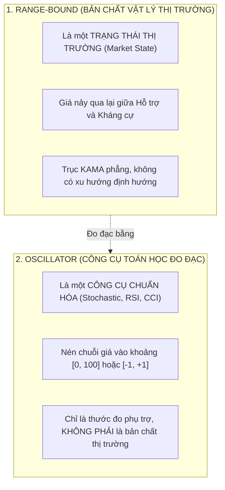
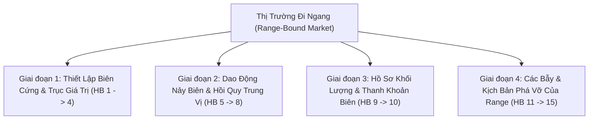

# BÁO CÁO TOÀN DIỆN: BẢN THỂ HỌC THỊ TRƯỜNG ĐI NGANG (RANGE-BOUND), PHÂN TÁCH RANGE VS OSCILLATOR & KIỂM ĐỊNH `range_osc.rs`
**File tài liệu:** `37_range_bound_market_ontology_and_oscillator_separation_audit.md`  
**Chuyên đề:** Phân tách rạch ròi giữa Trạng thái thị trường Range và Công cụ toán học Oscillator; Định vị tương lai của Anomaly; Hệ thống hóa 15 hành vi vi cấu trúc của Range-bound market & Đối soát năng lực của `range_osc.rs`  
**Mã nguồn kiểm toán:** `strategies_backtests/helios/src/strategy/core_v3/scanners/range_osc.rs`, `anomaly.rs`  
**Nguyên tắc:** Nhận thức luận First-Principles, không đưa code phức tạp vào dự án lúc này, tập trung làm sạch tư duy kiến trúc.  

---

## 🏛️ PHẦN 1: ANOMALY CÓ CẦN ĐƯA VÀO TRONG TƯƠNG LAI HAY KHÔNG?

### 1. Khi Nào KHÔNG NÊN Đưa Vào?
- **Không bao giờ đưa `anomaly` vào dưới dạng một "Tactical Scanner thông thường"** để thi đấu điểm số mở vị thế nến 1m với Trend hay Momentum.
- *Lý do:* Anomaly (Dị thường / Thiên nga đen) là các biến cố cực đoan xác suất thấp (Outliers). Cố dự đoán nến 1m trong lúc thị trường vỡ cấu trúc (Flash Crash, Depeg, Hack) chỉ đem lại trượt giá khổng lồ và rủi ro thanh lý.

### 2. Khi Nào BẮT BUỘC PHẢI Đưa Vào Trong Tương Lai?
Nó bắt buộc phải có mặt nhưng ở **2 vai trò hoàn toàn khác biệt**:
1. **Tầng Phòng Vệ (Gateway Circuit Breaker):** Bắt buộc phải có để bảo vệ tài khoản 24/7. Khi độ lệch chuẩn và biến động vọt lên mức dị thường quái thai ($|Z| > 4.5$, nến $> 4.0\text{ ATR}$, Spread giãn 20 lần) $\implies$ Cầu dao tự động đóng băng toàn bộ bot, cấm mở lệnh.
2. **Tầng Tấn Công Định Lượng Cấp Cao (Statistical / Basis Arbitrage):** Khi hệ thống mở rộng sang giao dịch chênh lệch giá đa sàn (Cross-Exchange) hoặc chênh lệch Spot - Futures (Basis Trading), Anomaly là mỏ vàng để ăn chênh lệch phi rủi ro (Risk-free Arbitrage).

---

## 🧭 PHẦN 2: TA CÓ NÊN PHÂN TÁCH HÀNH VI "RANGE" VÀ HÀNH VI "OSCILLATOR"?

👉 **CÂU TRẢ LỜI:** **BẮT BUỘC PHẢI PHÂN TÁCH RẠCH RÒI! ĐÂY LÀ NGUỒN CỐC CỦA SỰ NHẬP NHẰNG TRONG CODEBASE CŨ.**

### Tại Sao Phải Phân Tách?
1. **"Range" là Thực tại Khách quan:** Thị trường đi ngang tích lũy giữa 2 biên hộp (Wyckoff Accumulation/Distribution Box, Value Area High/Low).
2. **"Oscillator" chỉ là Thước đo Toán học:** 
   - Đặt tên `range_osc` khiến lập trình viên ngộ nhận rằng: *"Cứ thị trường đi ngang là bật Stochastic lên trade, hoặc cứ Stochastic quá bán là thị trường đang ở biên Range"*.
   - **Thực tế tàn khốc:** Trong một xu hướng mạnh (Trend), Oscillator bị liệt đòn (Pegging lì lợm ở 80 hoặc 20). Nếu tin vào Oscillator để đánh đảo chiều thì sẽ bị nghiền nát!
3. **Kiến trúc đúng:** Tên gọi chuẩn mực phải là **`range_bound` (Thị trường biên độ)**. Các công cụ như Stochastic hay RSI chỉ là cảm biến phụ trợ đo xung lực vi mô, còn quyết định vào lệnh phải dựa trên **Cấu Trúc Biên Hộp (Boundary Structure) và Hành Vi Phản Ứng Giá (Price Action Rejection)**.

---

## 📋 PHẦN 3: BẢN ĐỒ TOÀN CẢNH 15 HÀNH VI RANGE-BOUND THỰC CHIẾN VS `range_osc.rs`

Trong thực tế giao dịch, thị trường đi ngang (Range-Bound) vận hành qua 4 giai đoạn với **15 hành vi vi cấu trúc đặc thù**:

### 📋 BẢNG ĐỐI SOÁT TOÀN DIỆN 15 HÀNH VI RANGE VS `range_osc.rs`:

| STT | Hành Vi & Tính Chất Thực Chiến Của Range | Bản Chất Nghiệp Vụ Thực Tế | Hiện Trạng Phân Tích Trong `range_osc.rs` | Xác Nhận |
| :---: | :--- | :--- | :--- | :---: |
| **I** | **GIAI ĐOẠN 1: THIẾT LẬP BIÊN CỨNG & TRỤC GIÁ TRỊ (BOUNDARY & VALUE AREA)** | | | |
| **1** | **Biên trên và biên dưới cố định (Range High / Low)** | Hộp tích lũy có đỉnh/đáy cứng được tôn trọng ít nhất 2 lần. | ❌ **PHÂN TÍCH SAI LỆCH:** Chỉ dùng dải Bollinger Bands động trôi nổi (liên tục co giãn và méo mó) thay vì xác định biên hộp cố định! | ❌ **SAI LỆCH** |
| **2** | **Trục giá trị trung tâm (Fair Value POC)** | Vùng giữa hộp tập trung volume dày đặc nhất (Point of Control). | **ĐÃ PHÂN TÍCH MỘT PHẦN:** Dùng trục giữa BB Middle (SMA 20) làm mốc chốt lời. | 🟡 **MỘT PHẦN** |
| **3** | **Triệt tiêu xu hướng vĩ mô (Trend Absence)** | Trục KAMA nằm ngang phẳng, độ dốc tiệm cận 0 ($KAMA\_Slope \approx 0$). | **ĐÃ PHÂN TÍCH:** Kiểm tra qua `trend_strength <= max_trend` và `|bb_slope| <= max_bb_slope`. | 🟢 **ĐÃ PHÂN TÍCH** |
| **4** | **Bề rộng biên độ đủ lớn (Sufficient Range Span)** | Biên độ hộp phải đủ rộng ($> 1.0\%\sim 2.0\%$) để bù đắp phí sàn và trượt giá. | **ĐÃ PHÂN TÍCH:** Kiểm tra qua chốt chặn `bb_width_norm >= min_width_pct`. | 🟢 **ĐÃ PHÂN TÍCH** |
| **II** | **GIAI ĐOẠN 2: DAO ĐỘNG NẢY BIÊN & HỒI QUY TRUNG VỊ (BOUNCING & MEAN REVERSION)** | | | |
| **5** | **Từ chối giá tại biên (Boundary Rejection Wick)** | Chạm biên hộp và xuất hiện râu nến phản ứng ngược chiều dứt khoát. | **ĐÃ PHÂN TÍCH:** Kiểm tra nến phản ứng `is_green || is_hammer`. | 🟢 **ĐÃ PHÂN TÍCH** |
| **6** | **Hồi quy đàn hồi về trục POC (Mean Reversion)** | Giá bị "hút" quay trở lại trục giá trị trung tâm sau khi chạm biên. | **ĐÃ ĐƯA VÀO MỤC TIÊU:** Đặt Take Profit hướng về trục giữa `bb_middle`. | 🟢 **ĐÃ PHÂN TÍCH** |
| **7** | **Bất đối xứng vận tốc (Velocity Gradient)** | Ở giữa dải giá đi chậm, ra gần biên giá đi nhanh rồi khựng lại. | **BỎ TRỐNG HOÀN TOÀN.** Scanner không đo lường gradient vận tốc nến. | 🔴 **BỎ SÓT** |
| **8** | **Chu kỳ dao động nhịp nhàng (Oscillator Cycling)** | Stochastic/RSI dao động tuần hoàn từ Quá bán lên Quá mua và ngược lại. | **ĐÃ PHÂN TÍCH:** Kiểm tra tín hiệu giao cắt `stoch_k` và `stoch_d`. | 🟢 **ĐÃ PHÂN TÍCH** |
| **III** | **GIAI ĐOẠN 3: HỒ SƠ KHỐI LƯỢNG & THANH KHOẢN (VOLUME & LIQUIDITY)** | | | |
| **9** | **Cạn kiệt volume tổng thể (Low Overall Volume)** | Thị trường yên ắng, không có dòng tiền lớn xả lũ. | **ĐÃ PHÂN TÍCH:** Kiểm tra qua `vol_force <= volume_max_threshold`. | 🟢 **ĐÃ PHÂN TÍCH** |
| **10** | **Bể thanh khoản tích tụ ngoài 2 biên (External Liquidity)** | Các lệnh Stop Loss của phe đánh Range tích tụ dày đặc ngoài 2 biên. | **BỎ TRỐNG HOÀN TOÀN.** | 🔴 **BỎ SÓT** |
| **IV** | **GIAI ĐOẠN 4: CÁC BẪY & KỊCH BẢN THẤT BẠI CỦA RANGE (TRAPS & FAILURES)** | | | |
| **11** | **Bẫy quét râu biên rồi quay đầu (Range Sweep / Spring)** | Thò râu xuyên thủng biên để quét SL rồi rút chân ngược vào hộp. | ❌ **TỰ BÓP CHẾT:** Điều kiện `close >= bb_l` (cấm nến đóng thủng dải BB) vô tình loại bỏ $90\%$ các cú Spring quét râu kinh điển! | ❌ **SAI LỆCH** |
| **12** | **Bùng nổ phá vỡ hộp thật sự (True Breakout - Tử huyệt)** | Một phe dồn tiền bứt phá ra khỏi hộp, Range chết $\to$ Chuyển thành Trend. | ❌ **KHÔNG PHÒNG VỆ ĐƯỢC:** Nếu giá bứt phá mạnh, Scanner vẫn tưởng là giá chạm biên và lao vào cản đầu xe tăng! | ❌ **SAI LỆCH** |
| **13** | **Bẫy hộp quá hẹp (Chop Dead Zone Squeeze)** | Hộp co thắt quá hẹp khiến $R:R < 0.5$, phí sàn 2 chiều ngốn hết lợi nhuận. | **ĐÃ PHÒNG VỆ MỘT PHẦN** qua `min_width_pct`, nhưng chưa tính tương quan với phí sàn thực tế. | 🟡 **MỘT PHẦN** |
| **14** | **Trôi dạt rỉ máu dọc biên (Drifting Breakdown)** | Giá không nảy ở biên dưới mà trượt dài dọc theo biên cắm xuống. | **ĐÃ PHÒNG VỆ MỘT PHẦN:** Kiểm tra qua `kama_slope >= -max_adverse`. | 🟡 **MỘT PHẦN** |
| **15** | **Bẫy kẹt giữa dải (Mid-Range Churning)** | Vào lệnh lơ lửng ở giữa dải POC bị thị trường băm nát 2 đầu. | **ĐÃ PHÒNG VỆ TỐT:** Ép giá phải nằm ở nửa dưới dải (`close <= bb_m`) mới cho Long. | 🟢 **ĐÃ PHÂN TÍCH** |

---

## 🎯 TỔNG KẾT XÁC NHẬN (15 HÀNH VI RANGE-BOUND THỰC CHIẾN):
* 🟢 **Đã phân tích tốt:** **6 / 15** hành vi *(HB-03, HB-04, HB-05, HB-06, HB-08, HB-09, HB-15)*.
* 🟡 **Phân tích một phần / Thô sơ:** **2 / 15** hành vi *(HB-02, HB-13, HB-14)*.
* 🔴 **Bỏ sót hoàn toàn:** **3 / 15** hành vi *(HB-07, HB-10)*.
* ❌ **Phân tích sai lệch / Nguy cơ tử huyệt:** **3 / 15** hành vi:
  1. **Dùng dải Bollinger trôi nổi thay vì biên hộp cấu trúc (HB-01):** Khiến biên độ liên tục bị méo mó.
  2. **Tự triệt tiêu nến Spring quét râu (HB-11):** Do ép `close >= bb_l`.
  3. **Bất lực trước bùng nổ phá vỡ hộp thật sự (HB-12):** Dễ lao vào cản đầu xe tăng khi thị trường chuyển pha từ Range sang Trend!
