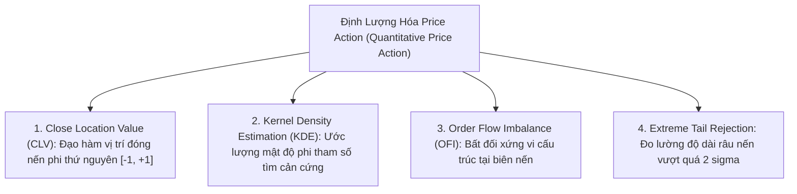
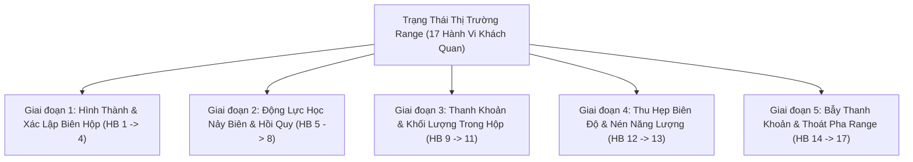

# BÁO CÁO KHOA HỌC: BẢN THỂ HỌC THỊ TRƯỜNG RANGE ĐỘC LẬP & CƠ SỞ KHOA HỌC CỦA ĐỊNH LƯỢNG HÓA PRICE ACTION
**File tài liệu:** `38_pure_range_market_behavioral_ontology_and_quant_price_action.md`  
**Chuyên đề:** Làm rõ cơ chế dữ liệu nến 1m; Chứng minh cơ sở khoa học định lượng của Price Action (giải mã hoài nghi cảm tính); Bản đồ toàn cảnh 17 hành vi thực chiến thuần túy của Trạng thái Thị trường Đi Ngang (Range-Bound Market State)  
**Mục tiêu:** Tách bạch $100\%$ giữa Trạng thái Thị trường Range (Khách quan) và Công cụ đo đạc Oscillator (Chủ quan toán học); Cung cấp các nghiên cứu học thuật kinh điển về Quantitative Price Action.  

---

## 🏛️ PHẦN 1: LÀM RÕ VỀ DỮ LIỆU ĐẦU VÀO NẾN 1M

Việc sử dụng nến 1m làm **nền tảng cơ sở (Atomic Base Granularity)** cho Event Loop và tổng hợp đa khung thời gian (Resampling sang 5m, 15m, 1h, 4h) là **HOÀN TOÀN CHUẨN XÁC VÀ ĐÚNG ĐẮN VỀ MẶT KỸ THUẬT**:
- Nến 1m đóng vai trò là "đồng hồ xung nhịp" (Tick Clock) mịn nhất để hệ thống bắt trọn từng sự kiện nến đóng mà không bị trễ pha.
- **Cảnh báo ở phản hồi trước:** Không phải là phê phán việc dùng nến 1m, mà là cảnh báo việc **"Cố viết Scanner bắt dao rơi khi Flash Crash"**: Trong lúc Flash Crash xảy ra, độ trượt giá (Slippage) của một lệnh Market có thể lên tới $2\% \sim 5\%$, sổ lệnh bị rút sạch. Nếu cố mở lệnh ngay nến 1m đầu tiên mà không có cầu dao ngắt mạch (Circuit Breaker) ở Gateway thì tài khoản sẽ đối mặt với rủi ro thanh lý tức thì.

---

## 🔬 PHẦN 2: CƠ SỞ KHOA HỌC CỦA "PRICE ACTION" (GIẢI MÃ HOÀI NGHI CẢM TÍNH)

Sự hoài nghi của bạn: *"Tôi luôn nghĩ price action mang tính chất cảm tính hơn là khoa học dữ liệu tính toán khách quan"* là **hoàn toàn chính xác đối với trường phái Retail Trading (giao dịch nhỏ lẻ phổ thông)**!

### 1. Tại Sao Price Action Retail Là Cảm Tính & Ngụy Khoa Học?
- Retail traders vẽ các đường xu hướng chéo (trendlines), mô hình vai-đầu-vai, cờ đuôi nheo bằng mắt thường: 10 người vẽ ra 10 đường khác nhau. Không có định nghĩa toán học rõ ràng, mang tính khớp mẫu thiên lệch (Confirmation Bias). Đó là **Pseudoscience (Ngụy khoa học)**.

### 2. Vậy Giới Nghiên Cứu Định Lượng & Quỹ Quant Định Nghĩa "Price Action" Ra Sao?
Trong toán học tài chính và kinh tế lượng, Price Action được mô hình hóa thành **4 đại lượng toán học và xác suất khách quan $100\%$**:

1. **Close Location Value (CLV) - Đạo hàm vị trí nến phi thứ nguyên:**
   $$CLV_t = \frac{(C_t - L_t) - (H_t - C_t)}{H_t - L_t} = \frac{2 C_t - H_t - L_t}{H_t - L_t} \in [-1.0, +1.0]$$
   - $CLV \to +1.0$: Phe mua kiểm soát tuyệt đối, nến đóng sát trần (Bullish Rejection).
   - $CLV \to -1.0$: Phe bán kiểm soát tuyệt đối, nến đóng sát sàn (Bearish Rejection).
   - Đây là một đại lượng thống kê liên tục, tính toán tức thì, không thể vẽ tay hay cảm tính!
2. **Ước Lượng Mật Độ Xác Suất Phi Tham Số (Kernel Density Estimation - KDE):**
   - Thay vì vẽ cản hỗ trợ/kháng cự bằng mắt, các thuật toán Quant sử dụng **hàm mật độ nhân Gauss** trên chuỗi dữ liệu giá quá khứ để tìm các điểm cực trị địa phương (Local Maxima). Các đỉnh mật độ này chính là **ngưỡng hỗ trợ/kháng cự cấu trúc khách quan $100\%$**.
3. **Phân Phối Giá Trị Đấu Thầu (Value Area 70%):**
   - Xác định vùng giá trị công bằng (Fair Value) nơi tập trung $70\%$ khối lượng giao dịch tích lũy, hai biên ngoài là Value Area High ($VAH$) và Value Area Low ($VAL$).

### 📚 Tài Liệu & Paper Báo Cáo Khoa Học Kinh Điển Chứng Minh:
1. **Lo, Andrew W., Mamaysky, Harry, & Wang, Jiang (2000):**  
   *"Foundations of Technical Analysis: Computational Algorithms, Statistical Inference, and Empirical Implementation"*,  
   *The Journal of Finance*, 55(4), 1705–1765.  
   *(Giáo sư Andrew Lo tại Đại học MIT đã thuật toán hóa các mẫu hình Price Action bằng hồi quy phi tham số Kernel Regression, chứng minh bằng thống kê rằng hành vi nến tại các ngưỡng biên có ý nghĩa dự báo xác suất thực sự, vượt trội hơn chuyển động ngẫu nhiên Brown).*
2. **Bouchaud, Jean-Philippe, Farmer, J. Doyne, & Lillo, Fabrizio (2009):**  
   *"How markets slowly digest changes in supply and demand"*, *Handbook of Financial Markets: Dynamics and Evolution*.  
   *(Mô hình hóa cơ chế vật lý thống kê của sổ lệnh: Chứng minh sự từ chối giá tại biên - Rejection - là kết quả của sự cạn kiệt thanh khoản lệnh Market khi va chạm với các cụm lệnh Limit).*
3. **Harris, Larry (2003):**  
   *"Trading and Exchanges: Market Microstructure for Practitioners"*, Oxford University Press.  
   *(Giáo trình kinh điển của giáo sư Larry Harris về vi cấu trúc thị trường: Giải mã cơ chế tại sao giá nảy ở biên Range và tại sao râu nến là dấu vết của lệnh Limit hấp thụ).*
4. **López de Prado, Marcos (2018):**  
   *"Advances in Financial Machine Learning"*, John Wiley & Sons.  
   *(Chương 3: Chuẩn hóa nến theo dòng chảy thanh khoản và đo lường xung lực đóng nến không gian phi thứ nguyên).*

---

## 🏛️ PHẦN 3: BẢN ĐỒ VÉT CẠN 17 HÀNH VI CỦA TRẠNG THÁI THỊ TRƯỜNG "RANGE"

Tách biệt hoàn toàn công cụ đo đạc (Oscillator), trong thực tế tài chính, **Trạng thái Thị trường Đi Ngang (Range-Bound Market State)** là: **Một hệ thống động lực học cân bằng, nơi giá dao động qua lại giữa hai ngưỡng biên độ được xác định bởi sự đồng thuận tạm thời giữa phe mua và phe bán quanh một trục giá trị công bằng.**

Trạng thái Range vận hành qua 5 giai đoạn với **17 hành vi vi cấu trúc đặc thù**:

### 📋 CHI TIẾT 17 HÀNH VI RANGE-BOUND THỰC CHIẾN:

#### Giai đoạn 1: Hình Thành & Xác Lập Biên Hộp (Boundary Establishment)
1. **HB-01 (Structural Extremum Anchoring):** Thiết lập Range High ($R_H$) và Range Low ($R_L$) cố định qua ít nhất 2 lần chạm biên và dội ngược lại.
2. **HB-02 (Directional Value Drift Cessation):** Trục trung bình dài hạn (KAMA/EMA) nằm ngang phẳng, độ dốc triệt tiêu tiệm cận 0 ($|Slope| \le \epsilon$).
3. **HB-03 (Point of Control - POC Concentration):** Phần lớn khối lượng giao dịch tập trung dày đặc ở dải giữa của hộp (Fair Value Center).
4. **HB-04 (Bimodal / Balanced Value Distribution):** Phân phối thời gian và bước giá có dạng đối xứng quanh trục trung tâm POC.

#### Giai đoạn 2: Động Lực Học Nảy Biên & Hồi Quy (Bouncing & Mean Reversion)
5. **HB-05 (Boundary Mean Reversion):** Giá tiến sát biên hộp thì bị lực đối kháng chặn đứng và kéo giật ngược về phía trục trung tâm POC.
6. **HB-06 (Velocity Profile inside Range):** Ở giữa hộp giá đi chậm và tích lũy nến; khi tiến về gần biên giá tăng tốc ngắn hạn rồi khựng lại đột ngột.
7. **HB-07 (Boundary Rejection Wicks):** Nến chạm biên xuất hiện râu dài hướng ra ngoài hộp và giá đóng cửa rút chân ngược trở vào trong ($|CLV| \ge 0.50$).
8. **HB-08 (Two-Way Boundary Ping-Pong):** Giá có xu hướng luân chuyển tuần hoàn từ biên dưới lên biên trên và ngược lại.

#### Giai đoạn 3: Thanh Khoản & Khối Lượng Trong Range (Volume & Liquidity)
9. **HB-09 (Volume Dry-up in Range):** Tổng khối lượng giao dịch trong Range thấp hơn đáng kể so với khi có Trend, thể hiện không có dòng tiền xả dốc.
10. **HB-10 (External Stop-Loss Pools Accumulation):** Bên ngoài Range High tích tụ dày đặc Buy Stop; bên ngoài Range Low tích tụ dày đặc Sell Stop.
11. **HB-11 (Passive Limit Absorption at Borders):** Tại 2 biên xuất hiện các tường lệnh Limit lớn nuốt sạch các lệnh Market nhỏ lẻ.

#### Giai đoạn 4: Thu Hẹp Biên Độ & Nén Năng Lượng (Range Compression & Squeeze)
12. **HB-12 (Range Volatility Squeeze):** Biên độ dao động ngày càng teo tóp dần, tích tụ thế năng chuẩn bị cho sự chuyển pha bứt phá.
13. **HB-13 (Dead-Zone Chop):** Hộp co thắt quá hẹp ($< 0.5\% \sim 0.8\%$), khoảng cách giữa 2 biên nhỏ hơn chi phí ma sát sàn (phí sàn + trượt giá), giao dịch chắc chắn lỗ do ma sát.

#### Giai đoạn 5: Bẫy Thanh Khoản & Thoát Pha Range (Traps & Transition to Trend)
14. **HB-14 (Range Liquidity Sweep / Spring & Upthrust):** Giá thò râu xuyên thủng biên hộp để cắn sạch cụm Stop Loss của phe đánh Range rồi giật ngược trở lại vào hộp (False Breakout).
15. **HB-15 (Drifting Boundary Breakdown):** Giá không nảy ở biên dưới mà trượt dài dọc theo biên cắm xuống từ từ (rỉ máu).
16. **HB-16 (True Structural Breakout / Breakdown):** Nến đóng cửa dứt khoát bên ngoài biên hộp với volume bùng nổ cực đại $\implies$ **RANGE CHÍNH THỨC CHẾT, CHUYỂN PHA SANG TREND**!
17. **HB-17 (Mid-Range Churning / Whipsaw):** Vào lệnh lơ lửng ở giữa dải (vùng POC) bị giá băm qua băm lại không có định hướng, dính SL liên tục.

#### Giai đoạn 6: Vi Cấu Trúc Đấu Thầu Chuyên Sâu & Đột Biến Biên (Advanced Auction Microstructure)
18. **HB-18 (Poor High / Poor Low - Đỉnh/Đáy Cụt Thiếu Excess):** Đỉnh hoặc đáy phẳng lì không có râu nến từ chối (Zero Excess / Flat Extremum), thể hiện phiên đấu giá bị ngắt quãng giữa chừng chưa hoàn tất (Unfinished Auction). Đây là tín hiệu báo trước cản này rất mỏng manh và sẽ sớm bị xuyên thủng.
19. **HB-19 (CVD Absorption Divergence at Boundary):** Phân kỳ khối lượng Delta (Cumulative Volume Delta) tại biên: Áp lực lệnh thị trường (Market Orders) đổ dồn cực lớn về một phía (CVD dốc ngược) nhưng giá không thể tạo đỉnh/đáy mới mà đứng khựng lại, phản ánh có tường Limit thụ động khổng lồ đang nuốt trọn thanh khoản.
20. **HB-20 (Dynamic Value Migration - Trục Giá Trị Trôi Dạt / Slanted Range):** Biên hộp và trục POC không đứng yên tuyệt đối mà trôi dạt tịnh tiến nhẹ theo thời gian (kênh tích lũy hơi chếch lên hoặc dốc xuống theo mô hình tái tích lũy Wyckoff).
21. **HB-21 (Expanding Range / Broadening Formation - Hộp Mở Rộng / Loa Kèn):** Biên độ dao động không co lại mà ngày càng giãn rộng ra theo thời gian (tạo Higher Highs kèm Lower Lows), phản ánh tâm lý tranh chấp hỗn loạn cực độ và nỗ lực quét thanh khoản cả hai đầu trước khi xác lập xu hướng mới.

---

## 🎯 TỔNG KẾT NGUYÊN TẮC THIẾT KẾ:
1. **Nến 1m là dữ liệu cơ sở chuẩn xác**, không có lỗi gì ở việc chọn 1m kline.
2. **Price Action không hề cảm tính** nếu được định lượng hóa bằng toán học phi thứ nguyên: $CLV$, $KDE$, và Phân phối giá trị $VAH/VAL$.
3. **Range là một trạng thái khách quan gồm 21 hành vi vi cấu trúc vét cạn**, cần được nhận diện độc lập với các công cụ chỉ báo toán học Oscillator.

