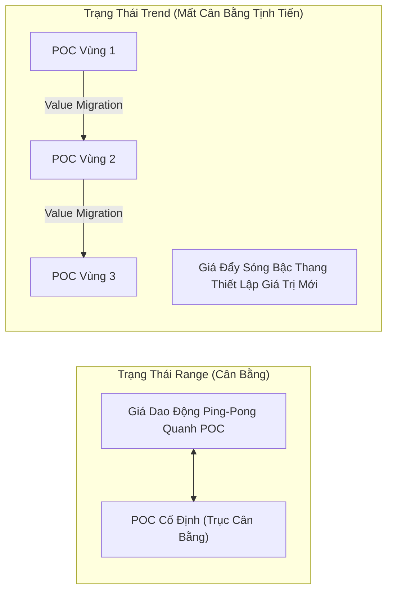
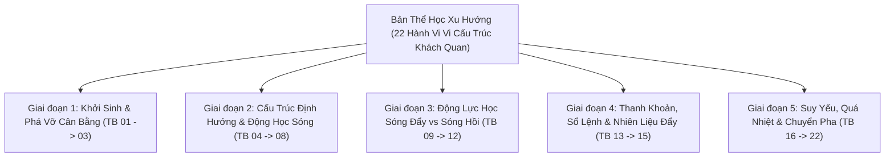

# BÁO CÁO KHOA HỌC: BẢN THỂ HỌC THỊ TRƯỜNG TREND ĐỘC LẬP & BẢN ĐỒ VÉT CẠN CÁC HÀNH VI VI CẤU TRÚC
**File tài liệu:** `39_pure_trending_market_behavioral_ontology.md`  
**Chuyên đề:** Phân lập toàn diện Trạng thái Thị trường Có Xu Hướng (Pure Trending Market State) độc lập khỏi mọi Scanner và Indicator; Bản đồ 24 hành vi vi cấu trúc, động lực học và dòng chảy lệnh thực chiến  
**Mục tiêu:** Cung cấp cơ sở lý luận và định lượng khách quan cho toàn bộ vòng đời của một xu hướng (Trend Lifecycle) từ khi hình thành, phát triển, bão hòa cho đến khi kiệt sức và chuyển pha sang Range.  

---

## 🏛️ PHẦN 1: BẢN CHẤT VẬT LÝ & LÝ THUYẾT ĐẤU GIÁ CỦA THỊ TRƯỜNG "TRENDING"

### 1. Trending Thực Sự Là Gì Trong Thực Tế Sàn Đấu Giá?
Trong **Lý thuyết Đấu giá Thị trường (Auction Market Theory - Steidlmayer, 1986)** và **Kinh tế học Vi cấu trúc (Market Microstructure)**:
- **Thị trường không bao giờ tự nhiên di chuyển:** Giá chỉ dịch chuyển khi có sự **Mất Cân Bằng Cung Cầu Chủ Động (Initiative Imbalance)**.
- **Bản chất của Trend:** Một trạng thái thị trường Trending là **một phiên đấu giá một chiều chưa hoàn tất (One-Sided Unbalanced Auction)**, nơi người mua và người bán đồng thuận rằng mức giá hiện tại là không công bằng (Unfair Price) và thị trường buộc phải di chuyển để **tìm kiếm vùng giá trị mới (Price Discovery)**.
- **Sự khác biệt cốt tử với Range:**
  - Ở **Range**: Trục giá trị công bằng ($POC$) đứng yên cố định; giá đi xa sẽ bị lực đối kháng kéo giật ngược về tâm ($Mean\ Reversion$).
  - Ở **Trend**: Trục giá trị công bằng ($POC$) **liên tục dịch chuyển tịnh tiến (Continuous Value Migration)**; giá đi xa khỏi mốc cũ không quay đầu mà tiếp tục thiết lập các mặt bằng giá mới ($Momentum\ Continuation$).

---

## 🧭 PHẦN 2: 5 GIAI ĐOẠN TIẾN HÓA CỦA MỘT XU HƯỚNG THUẦN TÚY (TREND LIFECYCLE)

Một xu hướng hoàn chỉnh ngoài đời thực vận hành qua 5 giai đoạn sinh học tự nhiên:

---

## 📋 PHẦN 3: BẢNG DANH MỤC VÉT CẠN 22 HÀNH VI VI CẤU TRÚC CỦA TRẠNG THÁI "TRENDING"

| Mã Hành Vi | Tên Hành Vi (Behavior Name) | Cơ Chế Vi Cấu Trúc & Sổ Lệnh (Order Flow & Microstructure) | Biểu Hiện Trên Dữ Liệu Giá / Nến | Ý Nghĩa Chiến Thuật & Định Lượng |
| :--- | :--- | :--- | :--- | :--- |
| **Giai đoạn 1** | **Khởi Sinh & Phá Vỡ Cân Bằng** | | | |
| **TB-01** | **Phá vỡ cân bằng & Khởi tạo một chiều** *(Initiative Imbalance)* | Lệnh Market chủ động ăn thấu qua toàn bộ các tường Limit tại biên hộp tích lũy, phá vỡ thế cân bằng cung cầu. | Nến thân dài đóng dứt khoát ngoài vùng tích lũy cũ, biên độ nến vượt $2 \times ATR$. | Xác nhận kết thúc Range, bước vào pha khám phá giá trị mới. |
| **TB-02** | **Dịch chuyển trục giá trị liên tục** *(Continuous Value Migration)* | Khối lượng không còn tích tụ tại một điểm mà tạo thành các cụm $POC$ nối tiếp nhau tịnh tiến dần theo hướng xu hướng. | Trục giá trị $VAH, VAL, POC$ của Volume Profile dịch chuyển liên tục theo thời gian. | Phân biệt Trend bền vững với các cú Spikes ảo (bơm thổi tức thời). |
| **TB-03** | **Mất cân bằng tích lũy Delta** *(Aggressive CVD Drift)* | Khối lượng lệnh chủ động mua vượt trội hoàn toàn lệnh bán (hoặc ngược lại trong downtrend). | Đường $CVD$ dốc đứng một chiều cùng hướng với giá, không có dấu hiệu phân kỳ. | Dòng tiền chủ động (Aggressive Capital) đang kiểm soát tuyệt đối cuộc chơi. |
| **Giai đoạn 2** | **Cấu Trúc Định Hướng & Động Học Sóng** | | | |
| **TB-04** | **Cấu trúc bậc thang phân cấp** *(Fractal Dow Structure)* | Giá liên tục thiết lập các đỉnh cao hơn và đáy cao hơn ($HH/HL$) trong uptrend, hoặc đỉnh thấp hơn và đáy thấp hơn ($LH/LL$) trong downtrend. | Chuỗi sóng bậc thang rõ ràng trên biểu đồ; các mốc cực trị không bị vi phạm. | Cấu trúc hình học cơ bản nhất khẳng định xu hướng đang tồn tại. |
| **TB-05** | **Bất đối xứng Không gian** *(Spatial Asymmetry)* | Quãng đường của sóng đẩy ($L_{impulse}$) luôn dài hơn đáng kể so với bước sóng hồi ($L_{retrace}$). | Tỷ lệ thoái lui của sóng hồi thường nông ($< 38.2\% \sim 50\%$), hiếm khi vượt quá $61.8\%$. | Thể hiện phe đối kháng rất yếu ớt, không đủ lực đẩy giá lùi sâu. |
| **TB-06** | **Bất đối xứng Thời gian & Tốc độ** *(Temporal & Velocity Asymmetry)* | Sóng đẩy di chuyển cực nhanh trong thời gian ngắn (vận tốc lớn), trong khi sóng hồi diễn ra chậm chạp, lê thê qua nhiều cây nến. | Số lượng nến của nhịp đẩy ít nhưng biên độ lớn; số lượng nến nhịp hồi nhiều nhưng biên độ hẹp. | Động lực học phản ánh sự tự tin của phe dẫn dắt vs sự lưỡng lự của phe đối lập. |
| **TB-07** | **Hiệu quả hành trình giá cao** *(High Efficiency Ratio - ER)* | Giá di chuyển theo quỹ đạo thẳng, ít bị nhiễu loạn zíc zắc qua lại, mức độ phân tán hình học (fractal dimension) thấp. | Kaufman Efficiency Ratio tiệm cận $1.0$ ($ER \ge 0.60 \sim 0.80$); đường giá bám dốc mượt mà. | Cho phép sử dụng các đường trung bình thích ứng nhạy bén (KAMA) mà không sợ whipsaw. |
| **TB-08** | **Lật cực tính cấu trúc** *(Polarity Flip / Role Reversal)* | Đỉnh cũ sau khi bị phá vỡ sẽ chuyển hóa thành ngưỡng hỗ trợ mới (hoặc đáy cũ biến thành kháng cự mới). | Giá hồi về chạm đúng đỉnh/đáy cũ vừa phá vỡ rồi bật tăng/giảm mạnh mẽ trở lại. | Điểm tựa cấu trúc an toàn tuyệt đối để mở vị thế thuận xu hướng ($Pullback\ Entry$). |
| **Giai đoạn 3** | **Động Lực Học Sóng Đẩy vs Sóng Hồi** | | | |
| **TB-09** | **Phân kỳ khối lượng sóng đẩy vs hồi** *(Volume Asymmetry)* | Phe dẫn dắt đổ tiền lớn khi đẩy giá (Volume nở rộng), trong khi nhịp hồi chỉ là các lệnh chốt lời nhỏ lẻ (Volume teo tóp). | Khối lượng các nến đẩy cao đột biến ($> 1.5 \times MA_{vol}$); khối lượng các nến hồi cạn kiệt ($< 0.7 \times MA_{vol}$). | Dấu hiệu sống còn để xác định nhịp hồi lành mạnh (Healthy Retracement). |
| **TB-10** | **Vùng đệm bảo vệ Swing Pivot** *(Swing Invalidation Defense)* | Đáy sóng hồi gần nhất ($Higher\ Low$) được bảo vệ nghiêm ngặt bằng các lệnh Limit thụ động lớn. | Nến không thể đóng cửa bên dưới đáy sóng hồi gần nhất; nếu thò râu xuống thì lập tức rút chân mạnh ($CLV > 0.50$). | Mốc đặt Stop Loss logic và chuẩn xác nhất cho mọi chiến lược Trend. |
| **TB-11** | **Xu hướng dốc đứng không hồi** *(Runaway / Parabolic Supertrend)* | Phe mua/bán quá cuồng nhiệt, không cho giá cơ hội thoái lui về các vùng hỗ trợ sâu; lực cầu nuốt chửng mọi đợt bán. | Giá bám trần/sàn Bollinger Bands liên tục, nến hồi chỉ là 1-2 nến nhỏ đi ngang rồi vọt tiếp. | Cần cơ chế Trailing Stop bám sát ATR động để không bị rớt hàng non. |
| **TB-12** | **Khoảng trống thanh khoản & Mất cân bằng nội nến** *(Fair Value Gap - FVG)* | Tốc độ đẩy quá khủng khiếp khiến sổ lệnh không kịp khớp lệnh đối ứng hai chiều, để lại vùng thanh khoản mỏng (Liquidity Void). | Chuỗi nến thân dài liên tiếp có khoảng hở giữa râu nến thứ nhất và râu nến thứ ba. | Vùng nam châm thu hút giá thoái lui về kiểm tra (Rebalancing) trước khi tăng tiếp. |
| **Giai đoạn 4** | **Thanh Khoản, Sổ Lệnh & Nhiên Liệu Đẩy** | | | |
| **TB-13** | **Dòng thác thanh lý nhiên liệu** *(Cascading Liquidations Fuel)* | Động cơ đẩy trend mạnh mẽ nhất đến từ việc các vị thế cản tàu bị thanh lý cưỡng bức hoặc dính Stop Loss hàng loạt. | Cột râu nến quét dốc đứng kèm khối lượng đột biến, làm giá bay vọt trong tích tắc. | Bẫy chết người cho phe đánh đảo chiều non kinh nghiệm. |
| **TB-14** | **Mở rộng vị thế mở phái sinh** *(Open Interest Expansion)* | Dòng tiền mới (New Money) liên tục bơm vào thị trường để mở vị thế mới cùng chiều với xu hướng. | Giá tăng kèm $OI$ tăng trưởng ổn định (hoặc giá giảm kèm $OI$ tăng). | Xác nhận xu hướng được hậu thuẫn bởi dòng vốn tổ chức thực thụ, không phải ảo giác. |
| **TB-15** | **Tường lệnh Limit bám đuổi** *(Trailing Passive Orderbook Walls)* | Các thuật toán Market Maker dời các cụm lệnh Limit đối ứng tịnh tiến theo giá để chặn sàn/trần bảo vệ xu hướng. | Độ sâu sổ lệnh (Depth of Market) dày đặc ở phía sau lưng xu hướng, tạo lực đỡ liên tục. | Ngăn chặn giá rơi tự do khi có các nhịp chốt lời cục bộ. |
| **TB-23** | **Xuyên nhanh vùng thanh khoản mỏng** *(Low Volume Node - LVN Traversal)* | Giá di chuyển qua các vùng giá có ít khối lượng giao dịch tích lũy trước đó với vận tốc cực lớn mà không gặp bất kỳ cản trở nào. | Thân nến dài, không có râu phản ứng, đi xuyên qua các dải LVN trong Volume Profile. | Nhận diện các đường cao tốc thanh khoản để gồng lãi tối đa không chốt non. |
| **TB-24** | **Lệch pha phí tài trợ & Lực cản vốn** *(Funding Skew & Carry Drag)* | Đòn bẩy phái sinh đổ dồn một chiều khiến Funding Rate bị lệch cực hạn (dương đậm trong uptrend hoặc âm đậm trong downtrend). | Funding Rate tăng vọt $0.05\% \sim 0.10\%$ mỗi chu kỳ, tạo áp lực bào mòn vốn (Carry Drag) lên phe mua/bán. | Cảnh báo áp lực chốt lời kỹ thuật từ phe Long/Short khi chi phí giữ lệnh quá đắt đỏ. |
| **Giai đoạn 5** | **Suy Yếu, Quá Nhiệt & Chuyển Pha** | | | |
| **TB-16** | **Phân kỳ giảm tốc động lượng** *(Momentum Deceleration)* | Giá vẫn rướn tạo đỉnh/đáy mới nhưng gia tốc di chuyển chậm lại rõ rệt do lực mua/bán chủ động suy yếu. | Giá tạo đỉnh cao hơn nhưng RSI/KAMA Slope tạo đỉnh thấp hơn (Regular Bearish Divergence). | Cảnh báo sớm xu hướng sắp bước vào giai đoạn thoái trào hoặc đi ngang. |
| **TB-17** | **Nhịp hồi mở rộng & Xâm thực sâu** *(Deep Retracement / Structural Fatigue)* | Sóng hồi bắt đầu ăn sâu vào thân sóng đẩy ($> 70\% \sim 90\%$), thể hiện phe đối lập đã lấy lại quyền kiểm soát cục bộ. | Nhịp giảm/tăng hồi phá vỡ các ngưỡng hỗ trợ/kháng cự động (KAMA, EMA20), đâm thủng sâu. | Báo hiệu sức mạnh xu hướng đã bị tổn thương nghiêm trọng. |
| **TB-18** | **Cao trào mua/bán kiệt sức** *(Buying / Selling Climax)* | Cú đẩy rướn cuối cùng với biên độ nến khổng lồ và khối lượng kỷ lục, nhưng nến đóng cửa rút râu mạnh hoặc nến sau phủ định ngay lập tức. | Cây nến biên độ gấp $3 \sim 5 \times ATR$ với volume cực đại, tạo thành đỉnh/đáy nhọn hoắt. | Sự chuyển giao tài sản (Distribution) từ Smart Money sang Retail FOMO; báo hiệu Trend sắp chết. |
| **TB-19** | **Gãy cấu trúc thị trường** *(Market Structure Break - MSB / CHoCH)* | Lần đầu tiên trong chuỗi xu hướng, giá đóng cửa nến xuyên thủng dứt khoát mốc đáy sóng hồi gần nhất ($Higher\ Low$). | Nến đóng cửa bên dưới đáy $HL$ (trong uptrend) hoặc bên trên đỉnh $LH$ (trong downtrend). | **XU HƯỚNG HIỆN TẠI CHÍNH THỨC KẾT THÚC** về mặt cấu trúc toán học! |
| **TB-20** | **Cạm bẫy phá vỡ thất bại ở đỉnh/đáy** *(Terminal Upthrust / Trap)* | Giá cố gắng rướn vượt đỉnh cũ để kích hoạt lệnh Buy Stop của Retail, sau đó quay xe cắm đầu ngay lập tức. | Nến thò râu vượt đỉnh cũ rồi đóng nến rút chân đỏ đậm bên dưới đỉnh cũ ($CLV < -0.60$). | Xác nhận mô hình phân phối đỉnh/đáy, chuẩn bị cho cú đảo chiều sâu. |
| **TB-21** | **Mất tính kết nối đa khung thời gian** *(MTF Coherence Breakdown)* | Khung vi mô (1m, 5m) đã gãy cấu trúc và chuyển sang đi ngang hoặc giảm, trong khi khung vĩ mô (1h, 4h) vẫn còn trớn tăng. | Chỉ báo xu hướng trên 1m đối đầu trực diện với 1h/4h; xuất hiện hiện tượng nhiễu sóng và tranh chấp gay gắt. | Thời điểm hệ thống phải siết chặt Trailing SL và tạm ngừng mở lệnh mới. |
| **TB-22** | **Tái cân bằng & Chuyển pha sang Range** *(Transition to Equilibrium / Consolidation)* | Sau cú gãy cấu trúc, giá không đảo chiều chữ V mà bắt đầu dao động tắt dần quanh một trục $POC$ mới. | Biên độ dao động thu hẹp, đường trung bình KAMA nằm ngang phẳng lì, volume hạ nhiệt. | **TREND CHÍNH THỨC TỬ TRẬN $\implies$ THỊ TRƯỜNG TÁI SINH THÀNH RANGE MỚI!** |

---

## 🎯 PHẦN 4: NGUYÊN TẮC BẢN THỂ HỌC DÀNH CHO BỘ NÃO HỆ THỐNG

1. **Tính Bất Khả Xâm Phạm Của Cấu Trúc Khách Quan:**
   - Một thị trường chỉ được coi là có Trend khi thỏa mãn tối thiểu: **Tính bất đối xứng không gian/thời gian (TB-05, TB-06)**, **Cấu trúc Dow (TB-04)**, và **Dịch chuyển trục giá trị (TB-02)**.
   - Nếu không thỏa mãn các điều kiện này, thị trường đang ở trạng thái Range hoặc Chaos, tuyệt đối không được ép buộc mở lệnh Trend.
2. **Quy Tắc Thoát Vị Thế Dựa Trên Cấu Trúc (Structural Invalidation First):**
   - Không có chỉ báo nào đáng tin cậy bằng hành vi **Gãy Cấu Trúc Thị Trường (TB-19 - MSB)**. Khi đáy $HL$ bị đóng nến xuyên thủng, bất kỳ vị thế Long nào cũng phải bị thanh lý hoặc dời SL về điểm hòa vốn ngay lập tức.
3. **Phân Định Chiến Thuật Vào Lệnh Phù Hợp Từng Giai Đoạn:**
   - **Giai đoạn 1 (Khởi sinh):** Chiến thuật săn sóng bứt phá động lượng (*Momentum Ignition*).
   - **Giai đoạn 2 & 3 (Định hướng & Hồi phục lành mạnh):** Chiến thuật săn sóng hồi thuận xu hướng (*Trend Pullback* tại vùng Polarity Flip TB-08).
   - **Giai đoạn 5 (Kiệt sức & Chuyển pha):** Chiến thuật đảo chiều cạn kiệt (*Reversal* sau Climax TB-18 và MSB TB-19).
