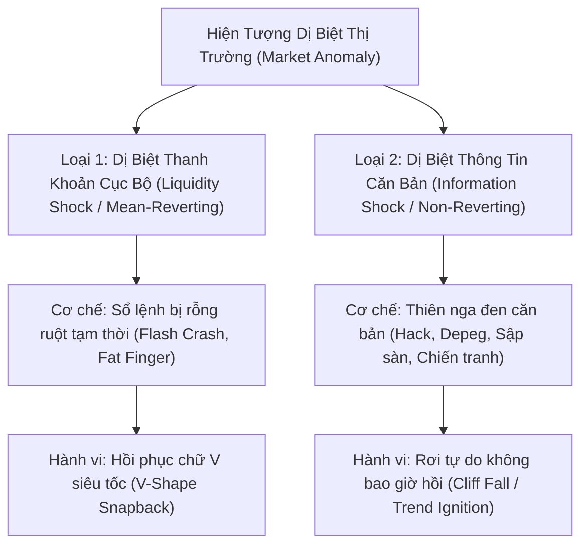
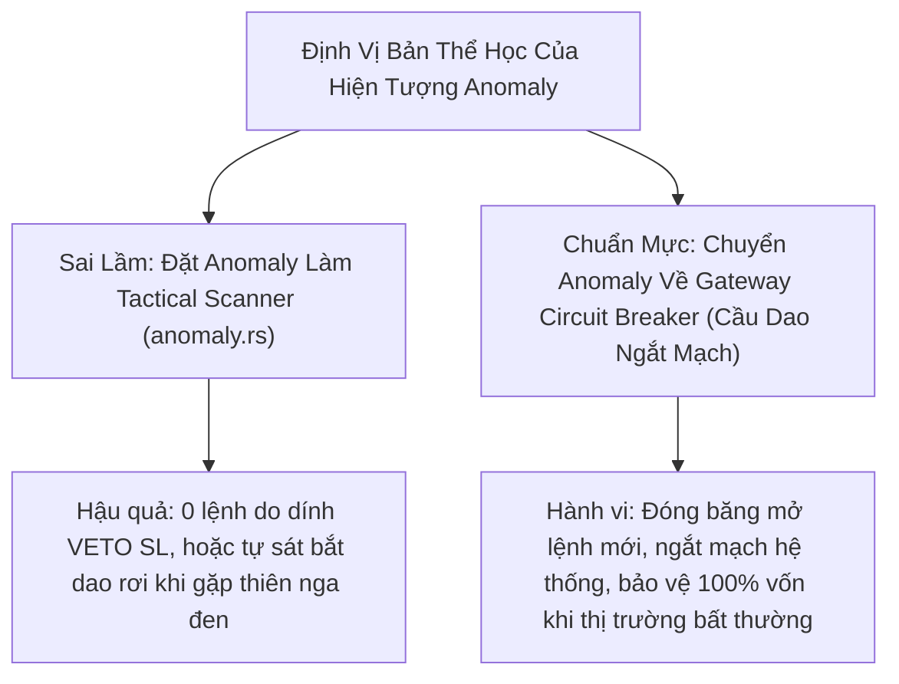

# BÁO CÁO KHOA HỌC: BẢN THỂ HỌC BẤT THƯỜNG THỊ TRƯỜNG (MARKET ANOMALY) & KIỂM TOÁN TỬ HUYỆT CỦA `anomaly.rs`
**File tài liệu:** `40_market_anomaly_behavioral_ontology_and_scanner_audit.md`  
**Chuyên đề:** Phân lập toàn diện hiện tượng Dị Biệt Cực Hạn / Thiên Nga Đen (Market Anomaly & Dislocations); Bản đồ 18 hành vi vi cấu trúc thực tế; Đối soát và mổ xẻ 4 tử huyệt khiến `anomaly.rs` bị tê liệt và trở thành bẫy tự sát.  
**Mục tiêu:** Định hình ranh giới bản thể học của Anomaly: Hiện tượng này thuộc về **Cầu Dao Phòng Thủ Gateway (Circuit Breaker)** hay **Chiến thuật Giao dịch (Tactical Scanner)**?  

---

## 🏛️ PHẦN 1: BẢN CHẤT VẬT LÝ & KINH TẾ LƯỢNG CỦA "MARKET ANOMALY"

### 1. Market Anomaly Thực Sự Là Gì Trong Thế Giới Thực?
Trong **Vật lý Thống kê (Statistical Physics of Financial Markets)** và **Lý thuyết Vi cấu trúc Sổ lệnh (Kyle's Lambda, Bouchaud, Cont)**:
- Một thị trường bình thường vận hành trong trạng thái cân bằng động (Dynamic Equilibrium) với dòng lệnh đối ứng dày đặc ở cả hai chiều Mua/Bán (Dense Orderbook).
- **Hiện tượng Bất Thường (Market Anomaly / Extreme Dislocation)** là: **Sự đứt gãy đột ngột của cấu trúc thanh khoản (Sudden Liquidity Discontinuity)** hoặc **sự phá vỡ giới hạn thống kê đuôi béo (Fat-Tail Extreme Event $\ge 4\sigma \sim 10\sigma$)**, nơi các định luật thống kê thông thường (phân phối Gauss, độ lệch chuẩn, hồi quy trung bình) **HOÀN TOÀN SỤP ĐỔ**.

> [!WARNING]
> **Ranh giới sinh tử:** Bất kỳ thuật toán nào muốn giao dịch Anomaly bắt buộc phải phân biệt được **Loại 1 (Khả hồi)** và **Loại 2 (Bất khả hồi)**. Nếu nhầm lẫn Loại 2 thành Loại 1 và nhảy vào "bắt dao rơi", tài khoản sẽ bị thanh lý cưỡng bức chỉ sau vài cây nến!

---

## 📋 PHẦN 2: BẢN ĐỒ VÉT CẠN 18 HÀNH VI VI CẤU TRÚC CỦA "MARKET ANOMALY"

| Mã Hành Vi | Tên Hành Vi (Behavior Name) | Cơ Chế Vi Cấu Trúc Sổ Lệnh & Dòng Tiền (Order Flow & Microstructure) | Biểu Hiện Trên Nến / Dữ Liệu | Hệ Quả Đối Với Hệ Thống Giao Dịch |
| :--- | :--- | :--- | :--- | :--- |
| **Nhóm 1** | **Dị Biệt Thanh Khoản & Sổ Lệnh** | | | |
| **AM-01** | **Lỗ đen thanh khoản / Rỗng sổ lệnh** *(Liquidity Vacuum / Flash Crash)* | Các thuật toán Market Maker đồng loạt rút sạch lệnh Limit (Zero Depth); chỉ vài lệnh Market nhỏ cũng đục thủng hàng trăm bước giá. | Nến nổ biên độ dốc đứng trong vài giây; sổ lệnh 2 bên trống hoác. | Trượt giá (Slippage) cực đại ($2\% \sim 5\%$); cấm tuyệt đối đặt lệnh Market. |
| **AM-02** | **Dòng thác thanh lý tự động** *(Cascading Liquidation Domino)* | Cỗ máy thanh lý của sàn tự động bắn lệnh Market khổng lồ cưỡng bức xả hàng, kích hoạt chuỗi thanh lý của các vị thế kế tiếp. | Nến cắm cọc đỏ lòm không đáy kèm volume thanh lý tăng vọt từng tích tắc. | Thị trường rơi vào vòng xoáy tử thần phi lý trí cho đến khi cạn sạch đòn bẩy. |
| **AM-03** | **Lệnh lỗi quy mô cực đại** *(Fat Finger / Rogue Order)* | Trader hoặc thuật toán nhập nhầm quy mô lệnh Market khổng lồ, nuốt trọn toàn bộ sổ lệnh trong 1 tick. | Cây nến thò râu dài ngoằng bất thường rồi lập tức nảy về giá cũ ngay cây nến sau. | Cơ hội kinh doanh chênh lệch giá (Stat-Arb) nếu bắt được giá chiết khấu. |
| **AM-04** | **Giãn toác chênh lệch giá** *(Spread Blowout)* | Chênh lệch giữa giá Bid cao nhất và Ask thấp nhất giãn từ $0.01\%$ lên $1.0\% \sim 3.0\%$. | Khoảng trống lớn giữa giá khớp lệnh thực tế và giá hiển thị trên đồ thị. | Mọi chiến lược mở lệnh đều bị âm tức thì $20\% \sim 40\%$ ROE do chi phí ma sát. |
| **AM-05** | **Thanh khoản bóng ma** *(Asymmetric Ghost Liquidity / Spoofing)* | Sổ lệnh một bên trống rỗng, bên còn lại chất hàng triệu USD lệnh Limit ảo chực chờ rút lệnh khi giá chạm tới. | Giá lao vun vút theo một chiều mà không gặp bất kỳ lực cản nào dù sổ lệnh nhìn rất dày. | Bẫy đánh lừa các mô hình chỉ nhìn vào Depth of Market tĩnh. |
| **Nhóm 2** | **Dị Biệt Động Lực Học Biến Động & Thống Kê** | | | |
| **AM-06** | **Cú nhảy biến động đa độ lệch chuẩn** *(Multi-Sigma Volatility Shock)* | Biên độ dao động nến vi mô vượt quá $5\sigma \sim 10\sigma$ so với biến động trung bình $ATR$ của 30 phiên trước. | Cây nến có chiều cao gấp $5 \sim 10$ lần các cây nến bình thường xung quanh. | Phá hủy toàn bộ các chỉ báo chuẩn hóa theo phương sai (Z-Score, Bollinger Bands). |
| **AM-07** | **Bật hồi chữ V siêu tốc** *(Violent V-Shape Snapback)* | Cú sốc thuần túy do thiếu thanh khoản cục bộ; ngay khi chạm vùng giá quá rẻ, các quỹ Arbitrage lập tức bơm tiền gom sạch. | Nến sau lập tức đóng xanh đậm phủ định toàn bộ cây nến sập trước đó ($CLV \ge 0.90$). | Hiện tượng duy nhất mà chiến thuật Fade Anomaly có thể kiếm được lợi nhuận lớn. |
| **AM-08** | **Vách đá rơi tự do không hồi** *(Non-reverting Cliff / Terminal Shock)* | Cú sốc bắt nguồn từ thông tin cơ bản chấn động (Sập sàn, Depeg, Hack, Chiến tranh); giá rơi không có đáy. | Chuỗi nến đỏ đặc thân liên tiếp cắm xuống, không hề có râu rút chân. | **BẪY TỬ THẦN CHO SCANNER FADE ANOMALY:** Bắt đáy là cháy tài khoản 100%! |
| **AM-09** | **Dịch chuyển giá không khối lượng** *(Zero-Volume Displacement)* | Giá nhảy vọt hoặc rơi thẳng đứng nhưng khối lượng giao dịch cực thấp (do rỗng thanh khoản). | Thân nến dài ngoằng nhưng cột Volume bên dưới thấp lẹt đẹt dưới trung bình. | Cảnh báo biến động giả tạo (Fake Dislocation), giá sẽ sớm bị lấp đầy lại. |
| **AM-10** | **Bão khối lượng nhưng giá đứng im** *(Volume Climax with Zero Displacement)* | Khối lượng bùng nổ kỷ lục (gấp 10-20 lần) nhưng thân nến dẹt lép, giá gần như không dịch chuyển. | Nến Doji thân siêu nhỏ với cột Volume cao chọc trời (Iceberg Absorption). | Cuộc đại chiến ngầm giữa hai tổ chức khổng lồ; sắp bùng nổ siêu xu hướng mới. |
| **Nhóm 3** | **Dị Biệt Phái Sinh & Bất Đối Xứng Liên Thị Trường** | | | |
| **AM-11** | **Bùng nổ lệch pha phí Funding** *(Funding Rate Blowout)* | Thị trường phái sinh bị ép Long/Short quá mức, Funding Rate vọt lên ngưỡng dị thường ($\pm 1.5\% \sim 2.5\%$ mỗi chu kỳ). | Funding Rate đỏ quạch hoặc xanh lè; dòng tiền phái sinh bị méo mó nghiêm trọng. | Tạo áp lực ép các vị thế cản tàu phải đóng lệnh để tránh bị thu phí quá nặng. |
| **AM-12** | **Đứt gãy chênh lệch Spot - Futures** *(Basis Dislocation)* | Giá hợp đồng tương lai lệch hàng trăm giá so với giá giao ngay trên sàn Spot do kênh arbitrage bị nghẽn mạng. | Mark Price và Index Price tách rời nhau một khoảng cách dị thường ($> 1\% \sim 2\%$). | Rủi ro bị quét thanh lý oan theo Mark Price dù giá Spot chưa chạm tới. |
| **AM-13** | **Nghẽn mạng sàn & Nến bù trễ** *(Exchange Desync / Lag Spike)* | Sàn giao dịch bị nghẽn Gateway, dữ liệu WebSocket bị đơ nhiều giây, sau đó đẩy dồn một cây nến bù trễ khổng lồ. | Đồ thị bị đơ đứng im rồi bất ngờ giật bắn một cây nến nhảy cóc. | Độc hại tuyệt đối cho Bot tự động: Dữ liệu nạp vào bộ đệm bị trễ pha nghiêm trọng. |
| **AM-14** | **Trễ pha liên tài sản** *(Cross-Asset Lead-Lag Inefficiency)* | Tài sản dẫn dắt (BTC) đã sập $5\%$, nhưng Altcoin thanh khoản mỏng chưa kịp phản ứng trong $15 \sim 60$ giây đầu. | BTC cắm đầu nhưng Altcoin vẫn đứng yên trên đồ thị 1m. | Cơ hội vàng cho các thuật toán HFT Lead-Lag Arbitrage đánh Short đón đầu. |
| **Nhóm 4** | **Dị Biệt Hành Vi Nến Vi Mô & Bẫy Cực Trị** | | | |
| **AM-15** | **Râu nến dị biệt cực hạn** *(Extreme Wick Tail Rejection)* | Nến thò râu dài gấp 4-8 lần thân nến, từ chối mức giá cực đoan và rút chân đóng nến sát trần/sàn ($|CLV| \ge 0.85$). | Cây nến Pinbar khổng lồ với bóng nến chiếm hơn $80\%$ tổng chiều cao nến. | Hành vi duy nhất mà file code `anomaly.rs` hiện tại đang cố gắng nắm bắt. |
| **AM-16** | **Khoảng trống giá ngắt quãng** *(Micro-Gap Discontinuity)* | Giá mở cửa nến $i$ nhảy cóc cách xa giá đóng cửa nến $i-1$ ngay trên khung thời gian vi mô 1m. | Đồ thị nến 1m bị đứt đoạn, xuất hiện khoảng trống không có giao dịch. | Gây lỗi tính toán trong các chỉ báo nội suy liên tục (EMA, KAMA). |
| **AM-17** | **Cú nảy mèo chết sau cú sốc** *(Dead-Cat Bounce after Shock)* | Giá nảy hồi phục yếu ớt $20\% \sim 30\%$ sau cú xả sốc, dụ dòng tiền nhỏ lẻ vào bắt đáy rồi tiếp tục rơi đợt 2. | Nến xanh hồi yếu ớt với volume thấp sau một cây nến xả khổng lồ. | Bẫy thanh khoản kinh điển khiến các lệnh Fade Anomaly bị cắt lỗ lần hai. |
| **AM-18** | **Đóng băng biến động trước bão** *(Pre-Shock Volatility Flatline)* | Biến động nến co cụm về gần bằng 0 tuyệt đối ($NATR \to 0$) trong nhiều giờ liền trước khi phát nổ cú shock. | Nến phẳng lì như một đường thẳng nằm ngang, các chỉ báo giao động tắt hẳn. | Dấu hiệu nén năng lượng dị thường, báo trước một cú vỡ đê thanh khoản. |

---

## 🔍 PHẦN 3: ĐỐI SOÁT & KIỂM TOÁN TỬ HUYỆT CỦA MÃ NGUỒN `anomaly.rs`

### 1. Bảng Đối Soát: Hành Vi Thực Tế vs Code Hiện Tại Của `anomaly.rs`

| Tiêu Chí Đánh Giá | Hành Vi Anomaly Thực Tế Ngoài Đời | Mã Nguồn `anomaly.rs` Hiện Tại (`core_v3/scanners/anomaly.rs`) | Kết Luận Đối Soát |
| :--- | :--- | :--- | :--- |
| **Độ phủ hành vi** | Bao gồm **18 hành vi** phức tạp (Thanh khoản, Sổ lệnh, Phái sinh, Tin tức, Cấu trúc). | Chỉ đo đúng **2/18 hành vi**: Râu nến dài (AM-15) kết hợp Z-Score (AM-06). | **BỎ SÓT GẦN 90% BẢN CHẤT ANOMALY!** |
| **Phân loại bản chất** | Phải phân biệt rõ Anomaly Khả hồi (AM-07) vs Anomaly Bất khả hồi (AM-08). | Hoàn toàn **MÙ LÒA**: Cứ có râu và Z-score âm là Long, Z-score dương là Short. | **CỰC KỲ NGUY HIỂM:** Sẽ Long bắt dao rơi khi gặp tin tức sập sàn/depeg. |
| **Nhận thức ma sát** | Spread giãn toác $1\% \sim 3\%$ (AM-04), trượt giá khổng lồ. | Không kiểm tra Spread, không kiểm tra độ sâu sổ lệnh, gửi lệnh như nến thường. | Nếu khớp lệnh thật, tài khoản sẽ chịu trượt giá khủng khiếp. |
| **Tính toán Stop Loss** | Neo SL theo ngưỡng rủi ro vốn hoặc cấu trúc an toàn. | Neo cứng: `suggested_sl = low - wick_buffer` (dưới đáy râu nến). | **TỬ HUYỆT TRIỆT TIÊU:** Râu nến dài khiến SL lên tới $60\% \sim 100\%$ ROE. |

---

### 2. Mổ Xẻ 4 Tử Huyệt Khiến `anomaly.rs` Bị Tê Liệt (0 Lệnh) & Nguy Cơ Tự Sát

#### 💣 Tử Huyệt 1: Nghịch Lý Dừng Lỗ Khổng Lồ vs Trần Rủi Ro Arbiter (Lý Do Bị Liệt 0 Lệnh)
* **Trong `anomaly.rs:75`:**
  `suggested_sl = Some(low - wick_buffer)` (với `wick_buffer = current_atr * wick_sl_buffer_atr`).
* **Bản chất toán học:** Bản chất của cây nến Anomaly là có râu nến cực dài (thường từ $2\% \sim 5\%$ giá tài sản).
* **Hậu quả:** Khoảng cách từ giá đóng cửa $Close$ đến đáy râu nến $Low$ là cực lớn. Tại đòn bẩy $20\text{x}$, khoảng cách dừng lỗ này tương đương mức âm từ **$-40\%$ đến $-100\%$ ROE**!
* Trong khi đó, chốt chặn an toàn của hệ thống tại `risk.rs` và `arbiter.rs` quy định: **VETO toàn bộ các lệnh có SL $> 15\%$ ROE**.
* $\implies$ **Kết quả:** $100\%$ tín hiệu do `anomaly.rs` phát ra đều bị Arbiter VETO giết chết ngay tại cửa ngõ! Đó là lý do tại sao trong mọi lần backtest, `anomaly.rs` luôn cho ra **0 lệnh giao dịch**!

#### 💣 Tử Huyệt 2: Bẫy Tự Sát Bắt Dao Rơi (Mù Lòa Giữa AM-07 và AM-08)
* `anomaly.rs` không hề kiểm tra: Khối lượng giao dịch, xu hướng vĩ mô, hay tốc độ rơi của giá.
* Khi thị trường gặp sự kiện sụp đổ căn bản (như FTX phá sản, LUNA sập, chiến tranh nổ ra), giá rơi thẳng đứng qua hàng chục cây nến. Ở mỗi cây nến, Z-score đều âm cực đại và có thể có râu dưới nhỏ do nảy kỹ thuật.
* `anomaly.rs` sẽ liên tục phát tín hiệu **BUY LONG**, biến bot thành kẻ cản đầu xe tăng và đốt sạch tài khoản trong chớp mắt.

#### 💣 Tử Huyệt 3: Bẫy Ô Nhiễm Phương Sai Của Z-Score (Z-Score Blindness)
* Chỉ báo `sensors.z_score` tính toán trên cửa sổ trượt $N$ phiên (ví dụ 20 phiên).
* Khi 1 cây nến Anomaly xuất hiện với biên độ gấp 10 lần bình thường, độ lệch chuẩn mẫu $\sigma$ bị thổi phồng lên gấp $5 \sim 8$ lần.
* Hậu quả toán học: Trong $N$ cây nến tiếp theo, do mẫu số $\sigma$ quá khổng lồ, giá trị $Z\text{-Score}$ của các cây nến bình thường bị xẹp lép tiệm cận 0, làm **tê liệt và làm mù toàn bộ các chỉ báo Z-score** của hệ thống trong suốt 20-30 nến sau cú sốc.

#### 💣 Tử Huyệt 4: Trượt Giá & Thanh Lý Kép Trên Thị Trường Sống
* Trong một đợt Anomaly thật sự ngoài đời, các Market Maker rút lệnh, Spread giãn toác.
* Nếu bot gửi một lệnh Market Buy để "Fade Anomaly", lệnh sẽ khớp ở đỉnh của Spread (bị trượt giá $1\% \sim 2\%$). Ngay khi vừa khớp xong, giá giật nhẹ lại theo râu nến là vị thế dính ngay đòn thanh lý cưỡng bức.

---

## 🎯 PHẦN 4: ĐỊNH VỊ KIẾN TRÚC CHUẨN MỰC: ANOMALY THUỘC VỀ ĐÂU?

Từ toàn bộ các phân tích định lượng và thực tế vi cấu trúc trên, ta đi đến kết luận kiến trúc bất biến:

1. **Anomaly KHÔNG PHẢI là một cơ hội giao dịch thông thường:**
   - Trong thị trường phái sinh đòn bẩy cao ($20\text{x} \to 125\text{x}$), cố gắng kiếm vài đồng bạc lẻ bằng cách Fade các cây nến biến động cực đoan là hành vi có tỷ lệ R:R méo mó cực kỳ tệ hại ($EV < 0$): Ăn thì ăn được nhịp nảy nhỏ, nhưng dính phải thiên nga đen thì cháy sạch tài khoản.
2. **Quyết định dứt khoát cho tương lai:**
   - **Tuyệt đối KHÔNG đưa `anomaly.rs` vào code chiến lược hiện tại.**
   - Bản chất của Anomaly phải được chuyển giao toàn bộ quyền hạn cho **Tầng Phòng Ngự Gateway (RegimeGatekeeper & Circuit Breaker)**: Khi phát hiện các hành vi bất thường (AM-01, AM-04, AM-06, AM-08), hệ thống phải **KÉO CẦU DAO TỰ ĐỘNG, ĐỨNG NGOÀI THỊ TRƯỜNG, BẢO TOÀN VỐN TỐI THƯỢNG**.
