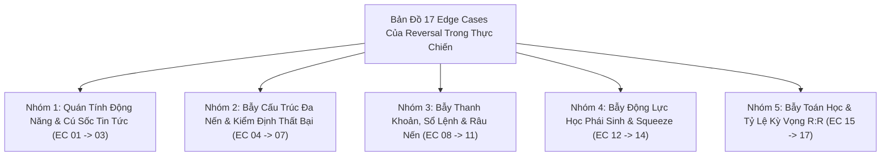

# BÁO CÁO TOÀN DIỆN: BẢN ĐỒ VÉT CẠN CÁC EDGE CASES CỦA REVERSAL TRONG GIAO DỊCH THỰC TẾ & CƠ CHẾ PHÒNG VỆ
**File tài liệu:** `42_reversal_real_world_edge_cases_and_fail_safes.md`  
**Chuyên đề:** Nghiên cứu 24 trường hợp dị biệt, bẫy tử thần và biến động cực đoan (Edge Cases) của chiến lược Đảo Chiều (Reversal) trong thực chiến phái sinh đòn bẩy cao; Thiết kế các cơ chế phòng vệ định lượng (Quant Fail-safes).  
**Nguyên tắc:** Tiếp cận từ First-Principles và Vi cấu trúc Sổ lệnh; Không bao giờ đưa ra các giả định ngầm thiếu chứng minh.  

---

## 🏛️ PHẦN 1: TẠI SAO REVERSAL LÀ MIỀN ĐẤT ĐẦY CẠM BẪY VÀ NGHĨA ĐỊA CỦA RETAIL?

Trong giao dịch định lượng và tâm lý học thị trường:
- **Tâm lý bắt đáy/bán đỉnh:** Retail traders luôn có bản năng ham rẻ hoặc sợ bỏ lỡ cơ hội, muốn mua ngay đáy thấp nhất hoặc bán ngay đỉnh cao nhất.
- **Bản chất thực tế:** Đảo chiều xu hướng là sự kiện chuyển pha phức tạp nhất trong cơ học thị trường. Một xu hướng đang lao dốc mang **quán tính động năng khổng lồ ($Kinetic\ Momentum$)**. Cố gắng đảo ngược động năng này đòi hỏi một lực hấp thụ đối ứng tương đương hoặc lớn hơn.
- Nếu không có cơ chế nhận diện toàn diện các **Edge Cases (Các kịch bản dị biệt cực đoan)**, thuật toán Reversal sẽ trở thành **"máy nướng tiền"** liên tục nhảy vào bắt dao rơi.

---

## 📋 PHẦN 2: BẢN ĐỒ 17 EDGE CASES CỦA REVERSAL PHÂN THEO 5 NHÓM VẬT LÝ

---

### NHÓM 1: BẪY ĐỘNG LỰC HỌC QUÁN TÍNH & CÚ SỐC CĂN BẢN (MOMENTUM & FUNDAMENTAL SHOCK)

#### 1. EC-REV-01: Vách Đá Rơi Tự Do / Bắt Dao Rơi Không Đáy *(Non-Reverting Cliff / Fundamental Shock)*
* **Tình huống thực tế:** Thị trường đón nhận tin tức thiên nga đen (SEC khởi tố, sập sàn giao dịch lớn, hack cầu nối cross-chain, depeg stablecoin).
* **Biểu hiện trên nến:** Nến cắm cọc đỏ lòm rơi tự do, độ lệch chuẩn $Z\text{-score} < -5.0\sigma$. Ở một số cây nến có hiện tượng rút chân nhẹ tạm thời do thuật toán gom hàng ngắn hạn.
* **Tại sao Retail / Scanner cũ chết:** `reversal.rs` thấy $Z\text{-score}$ âm sâu và nến có râu rút chân nhẹ ($CLV > 0.20$), lập tức phát tín hiệu **BUY LONG**. Nhưng không có dòng tiền đỡ thật, nến sau tiếp tục rơi thẳng đứng xuyên thủng đáy. Tài khoản cháy sạch sau 3 nến.
* **Cơ chế phòng vệ Quant:** **Macro Adverse Trend Guard**: Đọc `kama_slope_1h` và `chaos_index` từ Matrix. Nếu độ dốc KAMA vĩ mô âm dốc đứng ($kama\_slope < -max\_slope$) và thị trường đang ở pha Chaos $\implies$ **VETO 100% LỆNH BẮT ĐÁY**.

#### 2. EC-REV-02: Dốc Đứng Parabol Không Có Sóng Hồi *(Parabolic Supertrend Exhaustion Delay)*
* **Tình huống thực tế:** Thị trường đang trong một Runaway Trend hoặc Supertrend tăng/giảm dốc đứng được tiếp nhiên liệu bởi chuỗi thanh lý cản tàu.
* **Biểu hiện trên nến:** Mỗi cây nến đều tạo cảm giác "đã quá mua/quá bán" ($RSI > 85, MFI < 15$), nhưng giá chỉ chững lại 1 nến rồi vọt tiếp với gia tốc ngày càng dốc.
* **Tại sao Retail / Scanner cũ chết:** Cố chấp vào lệnh Short/Long đảo chiều vì "chỉ báo đã quá bán/quá mua quá lâu rồi". Thị trường duy trì trạng thái phi lý trí lâu hơn thời gian tài khoản có thể gồng lỗ.
* **Cơ chế phòng vệ Quant:** **Multi-Timeframe Trend Coherence**: Cấm đảo chiều khi khung 1h/4h đang trong trạng thái bứt phá dải Keltner dốc đứng. Chỉ cho phép Reversal khi đà tăng/giảm khung lớn bắt đầu đi ngang phân kỳ.

#### 3. EC-REV-03: Trôi Dạt Kiệt Quệ Không Hồi *(Stagnation Drift / Flatline Bleed)*
* **Tình huống thực tế:** Sau cú xả hoảng loạn, giá rút chân nhẹ nhưng sau đó hoàn toàn **VẮNG BÓNG LỰC CẦU ĐỐI ỨNG (Zero Elasticity)**.
* **Biểu hiện trên nến:** Giá đi ngang lờ đờ, nến thân nhỏ dẹt lép, volume cạn kiệt, không có xung lực bật hồi hình chữ V.
* **Tại sao Retail / Scanner cũ chết:** Vào lệnh xong, giá nằm im một chỗ. Đường trung vị KAMA Midline trôi dốc dần xuống đè bẹp mức chốt lời (TP), biên độ lãi biến mất. Sau đó phe bán gom hàng xong lại xả tiếp nhịp 2, cắn Stop Loss.
* **Cơ chế phòng vệ Quant:** **Stagnation Exit Time-To-Live (TTL)**: Nếu sau $N \le 5$ nến kể từ khi vào lệnh mà giá không di chuyển được tối thiểu $+1.0\text{ ATR}$ theo chiều có lãi, tự động kích hoạt lệnh thoát khẩn cấp tại giá hòa vốn.

---

### NHÓM 2: BẪY CẤU TRÚC ĐA NẾN & KIỂM ĐỊNH THẤT BẠI (MULTI-BAR STRUCTURAL TRAPS)

#### 4. EC-REV-04: Cú Nảy Mèo Chết & Xả Đợt 2 *(Dead-Cat Bounce / Secondary Plunge)*
* **Tình huống thực tế:** Sau cú sập cực hạn, giá bật nảy kỹ thuật rất nhanh nhưng chỉ đi được $30\% \sim 50\%$ khoảng cách tới KAMA thì bị dòng tiền xả lớn thứ hai ập vào đè bẹp.
* **Biểu hiện trên nến:** 1-2 nến xanh hồi phục nhanh, sau đó xuất hiện 1 cây nến đỏ khổng lồ nuốt trọn toàn bộ sóng hồi và đục thủng đáy cũ.
* **Tại sao Retail / Scanner cũ chết:** Đang có một khoản lãi chưa chốt (Unrealized Profit) rất đẹp nhưng cố gồng tới tận trục KAMA Midline. Sóng xả ập tới biến lệnh lãi thành lệnh lỗ kịch trần dính full Stop Loss.
* **Cơ chế phòng vệ Quant:** **Tiered Profit Lock & Break-Even Ratchet**: Ngay khi giá hồi được $\ge 50\%$ khoảng cách tới KAMA Midline hoặc đạt $+3.5\%$ ROE, tự động dời SL lên trên giá Entry $+1.60\%$ ROE (bảo hiểm tuyệt đối không bị lỗ sau phí).

#### 5. EC-REV-05: Kiểm Định Thất Bại Tạo Đáy Đục Thủng *(Failed Secondary Test - ST Breakdown)*
* **Tình huống thực tế:** Trong cấu trúc Wyckoff chuẩn mực, sau Selling Climax (SC) và Automatic Rally (AR), giá sẽ quay lại kiểm định đáy cũ (Secondary Test - ST).
* **Biểu hiện trên nến:** Cú retest đáy cũ không cạn volume mà xuất hiện khối lượng xả bùng nổ, nến đóng cửa đâm thủng đáy SC.
* **Tại sao Retail / Scanner cũ chết:** Đoán mò rằng đáy cũ sẽ giữ vững và vội vàng nhồi thêm vị thế Long (Averaging down).
* **Cơ chế phòng vệ Quant:** **Structural Invalidation Guard**: Đáy thấp nhất của nhịp cao trào ($Low_{SC}$) là mốc bất khả xâm phạm. Nếu nến đóng cửa dưới mốc này, toàn bộ ý niệm đảo chiều bị hủy bỏ, hệ thống cắt lỗ ngay lập tức.

#### 6. EC-REV-06: Đảo Chiều Đỉnh Vòm / Đáy Dẹt Kéo Dài *(Rounding Bottom / Protracted Accumulation)*
* **Tình huống thực tế:** Thị trường không tạo đảo chiều chữ V mà tạo đáy dẹt kéo dài qua $20 \sim 50$ cây nến lình xình.
* **Biểu hiện trên nến:** Hàng loạt nến nhỏ đan xen nhau, liên tục thò các râu vi mô lên xuống quét thanh khoản trong vùng đáy.
* **Tại sao Retail / Scanner cũ chết:** Đặt Stop Loss quá hẹp hoặc dùng trailing stop quá nhạy bén, bị các râu nến nhiễu vi mô quét sạch SL trước khi giá thực sự bay.
* **Cơ chế phòng vệ Quant:** **Dynamic De-leverage & Wide Structural Buffer**: Thay vì đặt SL sát sạt, cho phép đặt SL rộng qua đáy cấu trúc ($1.5 \sim 2.0\text{ ATR}$) và tự động co giảm kích thước vị thế (Position Size) để bảo toàn tổng số tiền rủi ro (\$ Risk USD cố định).

#### 7. EC-REV-07: Bẫy Hai Đáy Giả Với Phiên Đấu Giá Chưa Hoàn Tất *(Double Bottom with Poor Low)*
* **Tình huống thực tế:** Cú retest đáy thứ hai tạo thành một đáy phẳng lì không có râu nến từ chối (Poor Low / Zero Excess theo Steidlmayer Market Profile).
* **Biểu hiện trên nến:** Đáy thứ hai chạm đúng bằng đáy thứ nhất nhưng nến đóng phẳng lì, không có râu rút chân.
* **Tại sao Retail / Scanner cũ chết:** Tưởng là mô hình 2 đáy kinh điển (Double Bottom) sách giáo khoa retail nên nhảy vào Long cật lực.
* **Cơ chế phòng vệ Quant:** **Excess Wick Requirement**: Bắt buộc cú chạm biên cực trị phải có râu nến từ chối rõ ràng ($CLV \ge 0.50$). Nếu đáy phẳng lì $\implies$ Phiên đấu giá chưa xong, giá sẽ quay lại đục thủng đáy.

---

### NHÓM 3: BẪY THANH KHOẢN, SỔ LỆNH & RÂU NẾN (LIQUIDITY & ORDERBOOK TRAPS)

#### 8. EC-REV-08: Râu Nến Siêu Dài Khiến SL Xa Khủng Khiếp *(Ultra-Long Wick SL Distension Trap)*
* **Tình huống thực tế:** Cây nến cao trào có râu rút chân cực dài (dài $3\% \sim 5\%$ giá, chiếm $85\%$ chiều cao nến).
* **Biểu hiện trên nến:** Cây nến Hammer hoặc Pinbar khổng lồ sau một đợt xả giật bắn lên.
* **Tại sao Retail / Scanner cũ chết:** Neo SL ở `low - wick_buffer` khiến khoảng cách dừng lỗ lên tới **$-60\% \sim -100\%$ ROE** (tại 20x). Arbiter có chốt chặn an toàn VETO khi SL $> 15\%$ ROE $\implies$ **Tín hiệu bị giết chết 100%, Scanner bị liệt vĩnh viễn (0 lệnh)**!
* **Cơ chế phòng vệ Quant:** **Dynamic SL Clamping & Size Co-scaling**: Thay vì VETO nhị phân, tự động kẹp SL về trần an toàn $15\%$ ROE và giảm quy mô vị thế theo tỷ lệ $\frac{15\%}{\text{Suggested ROE}}$.

#### 9. EC-REV-09: Cú Quét Râu Đúp *(Double-Wick Liquidity Sweep / Spring of Spring)*
* **Tình huống thực tế:** Cây nến $t$ rút chân cực đẹp ($CLV = 0.85$). Toàn bộ trader và bot nhảy vào Long và đặt SL ngay dưới râu nến $t$.
* **Biểu hiện trên nến:** Cây nến $t+1$ cố tình thò râu sâu hơn râu nến $t$ đúng vài tick (liếm sạch cụm Stop Loss) rồi mới chính thức bay vọt lên.
* **Tại sao Retail / Scanner cũ chết:** Đặt SL quá bám sát râu nến đầu tiên, bị sàn và cá mập quét thanh khoản kép.
* **Cơ chế phòng vệ Quant:** **Confirmation Bar Entry (Đợi nến $t+1$ xác nhận)**: Không vào lệnh ngay ở nến $t$ khi nó đang rút chân; đợi nến $t+1$ kiểm định và đóng xanh trên điểm giữa của nến $t$ mới vào lệnh.

#### 10. EC-REV-10: Rỗng Sổ Lệnh & Trượt Giá Giãn Toác *(Spread Blowout & Slippage Trap)*
* **Tình huống thực tế:** Tại thời điểm Capitulation, các Market Maker rút lệnh, Bid-Ask spread giãn nở từ $0.01\%$ lên $1.5\% \sim 3.0\%$.
* **Biểu hiện trên nến:** Đồ thị nến nhảy cóc, giá khớp lệnh thực tế khác xa giá đóng nến hiển thị.
* **Tại sao Retail / Scanner cũ chết:** Gửi lệnh Market Buy, lệnh khớp trúng đỉnh của spread. Vừa khớp lệnh xong đã âm ngay $20\% \sim 30\%$ ROE do trượt giá.
* **Cơ chế phòng vệ Quant:** **Pre-trade Spread Gate & Slippage Drag Deduction**: Kiểm tra spread của sàn trước khi gửi lệnh. Nếu $\text{Spread} > 0.10\%$ giá $\implies$ Từ chối mở lệnh.

#### 11. EC-REV-11: Tường Limit Hấp Thụ Bị Bắn Thủng *(Blown Absorption Wall)*
* **Tình huống thực tế:** Nhận diện có tường lệnh Limit Buy lớn tại hỗ trợ, tin rằng đó là cá mập hấp thụ (Absorption).
* **Biểu hiện trên nến:** Nến xả lũ va vào tường lệnh, khối lượng nhảy vọt cực đại nhưng giá đứng khựng lại 1-2 nến. Sau đó áp lực xả tiếp tục dồn dập bắn thủng tường Limit, cá mập rút lệnh tháo chạy.
* **Tại sao Retail / Scanner cũ chết:** Bắt đáy vì tin tưởng vào tường Limit tĩnh trong sổ lệnh.
* **Cơ chế phòng vệ Quant:** **Flow Continuity Verification**: Bắt buộc phải có sự chuyển dịch dòng tiền chủ động ($CVD$ lật từ âm sang dương) thay vì chỉ tin vào tường Limit thụ động.

---

### NHÓM 4: BẪY ĐỘNG LỰC HỌC PHÁI SINH & SQUEEZE (DERIVATIVES SQUEEZE TRAPS)

#### 12. EC-REV-12: Bão Thanh Lý Chưa Dứt *(Unexhausted Liquidation Cascade)*
* **Tình huống thực tế:** Một tài khoản phái sinh lớn (Whale Margin Call) đang bị sàn thanh lý cưỡng bức với quy mô hàng trăm triệu USD.
* **Biểu hiện trên nến:** Nến vừa chớm rút chân, cỗ máy thanh lý của sàn tiếp tục xả gói lệnh Market sell khổng lồ thứ hai, cuốn phăng mọi lực cản.
* **Tại sao Retail / Scanner cũ chết:** Tưởng đợt thanh lý đã xong và vội vã bắt đáy.
* **Cơ chế phòng vệ Quant:** **Post-Storm Ramp-up Cooldown**: Sau một cú sốc thanh lý cực đại, hệ thống bắt buộc phải chờ làm nguội ít nhất $M=3$ nến để sổ lệnh phục hồi độ sâu trước khi xét lệnh Reversal.

#### 13. EC-REV-13: Bẫy Phí Tài Trợ & Chi Phí Cõng Vị Thế *(Funding Rate Drag Trap)*
* **Tình huống thực tế:** Short Reversal tại đỉnh của một siêu sóng tăng khi Funding Rate đang dương cực nặng ($+0.15\%$ mỗi chu kỳ 4h/8h), hoặc ngược lại.
* **Biểu hiện trên nến:** Giá đi ngang lình xình tích lũy đỉnh, không chịu giảm.
* **Tại sao Retail / Scanner cũ chết:** Giữ vị thế Short nhưng giá không giảm ngay, tiền trong tài khoản bị sàn trừ sạch dần qua từng chu kỳ thu phí Funding.
* **Cơ chế phòng vệ Quant:** **Funding Rate Skew Awareness**: Đánh giá chi phí Funding dự kiến trong thời gian nắm giữ lệnh so với tiềm năng lợi nhuận kỳ vọng.

#### 14. EC-REV-14: Bẫy Phân Kỳ Kéo Dài Bào Mòn Vốn *(Multi-Divergence Prolongation)*
* **Tình huống thực tế:** Chỉ báo dao động (RSI, MFI, MACD) đã xuất hiện phân kỳ dương ở đáy (Divergence).
* **Biểu hiện trên nến:** Giá tiếp tục tạo thêm 3-4 đáy mới thấp hơn kèm theo 3-4 nhịp phân kỳ liên tiếp trước khi thực sự đảo chiều.
* **Tại sao Retail / Scanner cũ chết:** Cứ mỗi nhịp phân kỳ lại nhảy vào bắt đáy và bị cắt lỗ liên tiếp 3-4 lần, cạn kiệt vốn trước khi con sóng đảo chiều thực sự diễn ra.
* **Cơ chế phòng vệ Quant:** **Exponential Cooldown Circuit Breaker**: Sau 2 lệnh Reversal thua liên tiếp, bắt buộc ngắt mạch giao dịch đảo chiều trong ít nhất 10-20 nến để tránh cào lệnh trả thù thị trường.

---

### NHÓM 5: BẪY TOÁN HỌC & TỶ LỆ KỲ VỌNG R:R (MATHEMATICAL & R:R TRAPS)

#### 15. EC-REV-15: Bẫy R:R Âm Khi Giá Đóng Cửa Quá Gần Trục Cân Bằng *(Negative R:R Late-Entry Trap)*
* **Tình huống thực tế:** Cây nến đảo chiều rút chân quá mạnh mẽ, giá đóng cửa vọt lên gần sát KAMA Midline.
* **Biểu hiện trên nến:** Nến xanh thân dài có râu dưới dài. Khoảng cách từ giá đóng cửa tới KAMA Midline chỉ còn $0.3\text{ ATR}$, trong khi rủi ro SL dưới đáy râu nến là $1.5\text{ ATR}$.
* **Tại sao Retail / Scanner cũ chết:** `reversal.rs` hiện tại **hoàn toàn mù lòa tỷ lệ R:R**, vẫn phát lệnh mua ăn $0.3\text{ ATR}$ nhưng chịu rủi ro mất $1.5\text{ ATR}$ ($R:R = 1:5$).
* **Cơ chế phòng vệ Quant:** **Objective R:R Hurdle Gate**: Bắt buộc tính toán cự ly:
  $$\text{Expected } R:R = \frac{|kama\_mid - Close|}{|Close - (Low - wick\_buffer)|} \ge 1.2 \sim 1.5$$
  Nếu không thỏa mãn, từ chối phát Proposal ngay lập tức.

#### 16. EC-REV-16: Trục KAMA Trôi Dốc Sụp Đổ Đè Bẹp TP *(Drifting Target / Collapsing Midline Trap)*
* **Tình huống thực tế:** Đường trung vị KAMA Midline phản ứng trễ với đợt sập dốc đứng.
* **Biểu hiện trên nến:** Khi giá bắt đầu hồi phục, KAMA Midline lại bắt đầu cắm dốc thẳng đứng xuống do dữ liệu quá khứ ngấm vào công thức trung bình.
* **Tại sao Retail / Scanner cũ chết:** Đặt TP động bám theo KAMA Midline. TP bị kéo tụt xuống sát Entry, biến một cơ hội thắng lớn thành một lệnh hòa vốn hoặc lỗ phí sàn.
* **Cơ chế phòng vệ Quant:** **Monotonic TP Floor Guard**: Khóa sàn mức TP của lệnh Reversal không được phép trôi lùi quá $30\%$ so với mức TP ban đầu được xác lập tại nến Entry.

#### 17. EC-REV-17: Bẫy Cạn Kiệt Giả Ban Đêm / Cuối Tuần *(Low-Volume False Exhaustion)*
* **Tình huống thực tế:** Vào ban đêm hoặc các phiên giao dịch cuối tuần, tổng thanh khoản toàn thị trường sụt giảm $60\% \sim 70\%$.
* **Biểu hiện trên nến:** Khối lượng giao dịch teo tóp tự nhiên, giá dao động lờ đờ trôi ra ngoài biên Bollinger Bands.
* **Tại sao Retail / Scanner cũ chết:** Scanner cũ (`exhaust_drop = 0.50`) thấy volume thấp ngỡ là cạn kiệt thanh khoản của đợt xả lũ nên mở lệnh bắt đáy, nhưng thực chất thị trường chỉ đang đi ngủ.
* **Cơ chế phòng vệ Quant:** **Absolute Volatility Floor & Volume Time-of-Day Normalization**: Chuẩn hóa khối lượng theo chu kỳ giờ trong ngày (Hour-of-Day) và kiểm tra ngưỡng biến động tối thiểu $NATR$ trước khi kích hoạt Reversal.

#### 18. EC-REV-18: Tick Dị Thường / Râu Nến Ảo *(Bad Tick / Flash Outlier Dislocation)*
* **Tình huống thực tế:** Một tick giao dịch cá biệt từ API sàn bị lỗi hoặc khớp giá ảo trong $10\text{ms}$ tạo râu nến dài ngoằng, nhưng sổ lệnh thực tế không hề có thanh khoản ở đó.
* **Biểu hiện trên nến:** Cây nến có râu dài bất thường nhưng Volume bằng 0 hoặc cực thấp.
* **Tại sao Retail / Scanner cũ chết:** Neo SL theo râu nến ảo khiến SL bị lệch hàng chục giá so với thanh khoản thực.
* **Cơ chế phòng vệ Quant:** **Mark Price Cross-Validation & Zero-Volume Filter**: Đối chiếu giá khớp với Mark Price và loại bỏ các nến râu dài có khối lượng rỗng.

#### 19. EC-REV-19: Nhảy Cóc Giá Khớp Lệnh *(Micro-Gap Overlap Discontinuity)*
* **Tình huống thực tế:** Sau cú sốc cao trào, hàng đợi khớp lệnh của sàn bị nghẽn (Matching Engine Queue Saturation), nến sau mở cửa nhảy vọt cách xa giá đóng nến trước (Micro-Gap).
* **Biểu hiện trên nến:** Khoảng hở giá giữa giá đóng nến $t$ và giá mở nến $t+1$.
* **Tại sao Retail / Scanner cũ chết:** Giá khớp thực tế nhảy vọt qua điểm entry tính toán, làm xấu đi tỷ lệ R:R ban đầu.
* **Cơ chế phòng vệ Quant:** **Slippage Tolerance & Limit Order Buffer**: Không dùng lệnh Market mù quáng mà sử dụng Limit với biên trượt giá kiểm soát.

#### 20. EC-REV-20: Khối Lượng Kẹt Hàng Đè Đầu Phía Trên *(Trapped Volume / High Volume Node Overhang)*
* **Tình huống thực tế:** Ở ngay phía trên mức giá đảo chiều cách $0.5 \sim 1.0\text{ ATR}$ là một khối lượng khổng lồ vị thế Long bị kẹt hàng từ trước đó.
* **Biểu hiện trên nến:** Giá vừa bật hồi ngóc đầu lên chạm vùng kẹt hàng này thì bị phe kẹt xả hòa vốn (Panic Break-even Exit), đè bẹp đà hồi phục trước khi chạm KAMA Midline.
* **Tại sao Retail / Scanner cũ chết:** Cứ tưởng giá sẽ hồi mượt mà về KAMA, không ngờ bị bức tường kẹt hàng đè bẹp.
* **Cơ chế phòng vệ Quant:** **Volume Profile Overhead Resistance Check**: Đánh giá các dải $HVN$ (High Volume Node) phía trước mặt đường đi của giá tới KAMA.

#### 21. EC-REV-21: Thanh Lý Ngược Chiều Của Chính Phe Bắt Đáy *(Reversal Squeeze Feedback Loop)*
* **Tình huống thực tế:** Quá nhiều retail và bot nhảy vào bắt đáy với đòn bẩy cực cao ($50\text{x} \sim 100\text{x}$) và cùng đặt SL dưới râu nến vừa tạo.
* **Biểu hiện trên nến:** Giá vừa chớm hồi nhẹ, cá mập chỉ cần táng một lệnh nhỏ đẩy giá thủng đáy cũ vài tick, kích hoạt toàn bộ chuỗi thanh lý của chính phe bắt đáy, tạo ra cú nổ sập hầm đợt 3.
* **Tại sao Retail / Scanner cũ chết:** Trở thành miếng mồi thanh lý béo bở cho sàn và cá mập.
* **Cơ chế phòng vệ Quant:** **De-crowding Entry Delay**: Tránh tụ tập cùng đám đông bắt đáy đợt 1; chỉ giải ngân khi đám đông bị rũ bỏ qua nhịp retest thành công.

#### 22. EC-REV-22: Tin Tức Vĩ Mô Càn Quét Hai Đầu *(Scheduled Macro Event Whipsaw / Two-Way News Spike)*
* **Tình huống thực tế:** Đúng thời điểm công bố số liệu kinh tế vĩ mô (CPI, FOMC, Non-Farm Payrolls, phán quyết tòa án SEC), thanh khoản mỏng bị xé toạc hai chiều.
* **Biểu hiện trên nến:** Nến 1m giật cắm đầu quét thủng đáy tạo râu rút chân khổng lồ tưởng như Capitulation, nhưng ngay nến sau giá giật ngược lên quét đỉnh rồi lại cắm đầu lao xuống (càn quét Stop Loss cả 2 đầu trong 60 giây).
* **Tại sao Retail / Scanner cũ chết:** Thuật toán nhảy vào bắt đáy ở nhịp quét thứ nhất, bị nhịp quét thứ hai vả chết tức thì.
* **Cơ chế phòng vệ Quant:** **Macro Economic Calendar Blackout Window**: Tự động đóng băng mở lệnh Reversal trong vòng $\pm 5$ phút quanh các mốc công bố dữ liệu vĩ mô định kỳ.

#### 23. EC-REV-23: Bẫy Sóng Hồi Đa Khung Thời Gian *(Fractal Scale Mismatch / MTF Pullback Disguised as Reversal)*
* **Tình huống thực tế:** Trên khung vi mô 1m, giá có vẻ như đang đảo chiều chữ V ($Z < -3.0$, nến rút chân). Nhưng trên khung vĩ mô 15m/1h, đây chỉ là một **nhịp hồi kỹ thuật nhỏ (Minor Pullback) trong một xu hướng giảm siêu mạnh**.
* **Biểu hiện trên nến:** Nhịp hồi 1m vừa chạm cản EMA 15m/1h là bị dòng tiền xu hướng lớn đè bẹp, dập tắt mọi hy vọng hồi về KAMA Midline khung 1m.
* **Tại sao Retail / Scanner cũ chết:** Bị ảo tưởng quang học đa khung thời gian: Nhầm lẫn nhịp thở của xu hướng lớn thành một đợt đảo chiều cấu trúc.
* **Cơ chế phòng vệ Quant:** **Macro Alignment Filter**: Không được mở Long Reversal nếu khung 15m/1h đang nằm dưới đường trung bình động và ADX khung lớn đang dốc đứng $> 35$.

#### 24. EC-REV-24: Tường Lệnh Băng Trôi Lật Mặt *(Iceberg Order Spoofing / Passive Wall Disappearance)*
* **Tình huống thực tế:** Các thuật toán tạo lập thị trường (MM) hiển thị lệnh Limit Buy lớn để dụ retail nhảy vào bắt đáy, nhưng ngay khi thị trường khớp lệnh xong đợt đầu, MM lập tức hủy lệnh Limit còn lại và quay sang nã lệnh Market xả ngược (Flip to Aggressive Seller).
* **Biểu hiện trên nến:** Khối lượng nến bùng nổ, râu dưới rút chân nhẹ, nhưng sổ lệnh ngay sau đó trống hoác và giá rơi tự do tiếp.
* **Tại sao Retail / Scanner cũ chết:** Tin vào "tường đỡ giá" ảo của thuật toán thao túng.
* **Cơ chế phòng vệ Quant:** **Order Flow Imbalance (OFI) & Delta Confirmation**: Bắt buộc phải có sự xác nhận của nến tiếp theo với Delta dương áp đảo mới giải ngân.

---

## 🎯 PHẦN 3: TỔNG KẾT BỘ KHUNG PHÒNG VỆ TOÀN DIỆN CHO `reversal.rs` MỚI

| Nhóm Edge Cases | Chốt Chặn Phòng Vệ Định Lượng Cốt Tử |
| :--- | :--- |
| **Nhóm 1: Quán tính & Sốc căn bản** | **Macro Adverse Trend Guard**: Đọc `_matrix` kiểm tra KAMA Slope khung lớn; ngắt mạch khi thị trường đang rơi vách đá. |
| **Nhóm 2: Cấu trúc đa nến** | **Confirmation Bar $t+1$ & Structural Invalidation**: Chờ nến xác nhận đóng xanh trên điểm giữa nến cao trào; tôn trọng tuyệt đối đáy cấu trúc. |
| **Nhóm 3: Thanh khoản & Sổ lệnh** | **Dynamic SL Clamping & Spread Gate**: Kẹp SL về trần $15\%$ ROE và co size động; từ chối lệnh khi spread giãn toác. |
| **Nhóm 4: Phái sinh & Squeeze** | **Post-Storm Cooldown & Exponential Circuit Breaker**: Làm nguội sau bão thanh lý; cấm cào lệnh liên tiếp sau 2 lệnh thua. |
| **Nhóm 5: Toán học & R:R** | **R:R Hurdle Gate $\ge 1.2$ & Monotonic TP Floor**: Chỉ vào lệnh khi tiềm năng lợi nhuận vượt trội rủi ro; chống tụt TP theo KAMA. |

