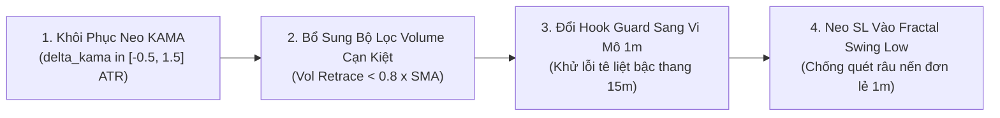

# BÁO CÁO KIỂM TOÁN: ĐỐI SOÁT `trend_pb.rs` THEO PHƯƠNG PHÁP LUẬN QUANT CHUẨN MỰC (NOTE 23)
**File tài liệu:** `43_trend_pb_quant_methodology_audit_and_architectural_gaps.md`  
**Chuyên đề:** Kiểm toán chuyên sâu scanner `trend_pb.rs` đối chiếu với Phương pháp luận Trạng thái Thị trường Khoa học (`23_standard_quant_methodology_market_regimes.md`); Vạch trần 5 dị tật kiến trúc và định lượng cốt tử.  
**Mã nguồn kiểm toán:** `strategies_backtests/helios/src/strategy/core_v3/scanners/trend_pb.rs`  
**Trạng thái:** Hoàn thành kiểm toán chi tiết từng dòng code.  

---

## 🏛️ PHẦN 1: BẢN CHẤT KHOA HỌC CỦA TREND PULLBACK (THEO NOTE 23)

Trong **Lý thuyết Vi phân Ngẫu nhiên SDE** ($dP_t = \mu dt + \sigma dW_t$) và **Lý thuyết Đấu giá Thị trường (AMT)**:
1. **Trạng thái Xu hướng (State 1):** Thị trường sở hữu hệ số định hướng bền bỉ (**Persistent Drift $\mu \gg 0$** hoặc $\mu \ll 0$), tỷ số tín hiệu trên nhiễu $\text{SNR} = \frac{|\mu|}{\sigma} \gg 1$, và hiệu quả hành trình giá cao ($KER > 0.45$).
2. **Bản chất của Pullback (Sóng hồi):** Đó là một sự xáo trộn vi mô ngẫu nhiên tạm thời ($\sigma_{micro} dW_t$) đi ngược chiều với $\mu_{macro}$ do áp lực chốt lời ngắn hạn.
3. **Tiêu chuẩn Khoa học của một Điểm Vào Pullback Hợp Lệ:**
   * **Cạn kiệt khối lượng (Volume Dry-up):** Nhịp hồi bắt buộc phải có khối lượng thấp ($Vol < 0.7 \times SMA_{vol}$), chứng minh tổ chức lớn không hề xả hàng.
   * **Điểm tựa hồi quy cấu trúc (Structural Polarity Anchor):** Nhịp hồi phải tìm về kiểm định một vùng giá trị công bằng có ý nghĩa (Đường trung vị KAMA, dải Keltner, hoặc Đỉnh/Đáy cũ vừa phá vỡ - Polarity Flip).
   * **Bảo toàn Cấu trúc Bậc thang Dow:** Đáy của nhịp hồi ($Higher\ Low$) không được đâm thủng đáy sóng trước.

---

## ⚖️ PHẦN 2: BẢNG ĐỐI CHIẾU CHUẨN MỰC QUANT vs. HIỆN TRẠNG `trend_pb.rs`

| Trụ Cột Khoa Học | Chuẩn Mực Định Lượng (Note 23) | Hiện Trạng Trong File `trend_pb.rs` | Đánh Giá & Hậu Quả Thực Tế |
| :--- | :--- | :--- | :--- |
| **1. Điểm Tựa Hồi Quy Cấu Trúc (Anchor / Polarity Flip)** | Giá phải hồi về một vùng neo có ý nghĩa (Đường KAMA Midline, dải Keltner hoặc Đỉnh cũ bị phá vỡ) để đảm bảo biên độ R:R an toàn. | **MẤT HOÀN TOÀN NEO KHOẢNG CÁCH (Ghost Pullback):** Biến `delta_kama` đã bị xóa bỏ hoàn toàn. Scanner không đo khoảng cách từ giá tới KAMA! | ❌ **TỬ HUYỆT MUA ĐU ĐỈNH GIỮA TRỜI:**<br>Giá cách KAMA 5 ATR ở tít trên trời, chỉ cần nến 1m rút chân nhẹ là nhảy vào mua Long, biến thành hành vi đu đỉnh không điểm tựa! |
| **2. Động Lực Học Khối Lượng (Volume Mechanics)** | Sóng hồi lành mạnh **bắt buộc volume phải cạn kiệt** ($Vol < 0.7 \times SMA_{vol}$). Nếu hồi mà volume xả lớn $\implies$ Phân phối đỉnh/Gãy trend. | **HOÀN TOÀN MÙ LÒA TRƯỚC VOLUME:** Trong toàn bộ 185 dòng code logic của `trend_pb.rs`, **không có 1 dòng nào đọc `vol_current` hay `vol_sma`**! | ❌ **BẪY GÃY TREND PHÂN PHỐI:**<br>Cá mập xả hàng với volume kỷ lục gấp 5 lần, nến 1m có râu dưới nhỏ, scanner vẫn thản nhiên duyệt lệnh Long cản tàu! |
| **3. Nhận Thức Mô Hình Cờ Tích Lũy (Continuation Squeeze)** | Khi trend mạnh, giá thường tích lũy trong mô hình cờ (Bull Flag) làm dải Bollinger co thắt lại trong Keltner (Squeeze) trước khi bung tiếp. | **CHẶN NGANG XƯƠNG CỜ TĂNG:**<br>`if squeeze > pb_cfg.max_squeeze_intensity { return None; }`<br>Cấm tiệt khi có Squeeze! | ❌ **TỰ BÓP CHẾT CƠ HỘI ĐẸP:**<br>Chốt chặn nhị phân cứng nhắc giết chết $100\%$ các điểm vào lệnh mô hình Cờ Tiếp Diễn Xu Hướng (Bull/Bear Flag) kinh điển! |
| **4. Cơ Chế Chống Bắt Dao Rơi (Hook Guard Dynamics)** | Phải phát hiện được sự bẻ lái (Hook) của động lượng vi mô khi nến kết thúc nhịp rơi tự do. | **TÊ LIỆT DO FORWARD-FILL 15M:**<br>`stoch_k < 10.0 && stoch_k < prev_stoch_k`<br>Stoch 15m forward-fill sang 1m là đường nằm phẳng lì trong 15 nến liên tiếp! | 🔴 **MÙ TRONG 93.3% SỐ NẾN:**<br>Biểu thức so sánh vô tác dụng vì `stoch_k == prev_stoch_k` trên hầu hết các nến 1m, không bảo vệ được bot khi thác lũ xả hàng. |
| **5. Cấu Trúc Bậc Thang Dow (HH/HL Integrity)** | Xu hướng tăng chỉ tồn tại khi đáy sóng hồi không đâm thủng đáy Swing Low trước đó ($Higher\ Low$). | **HOÀN TOÀN MÙ LÒA CẤU TRÚC SWING:** Scanner không lưu trữ đáy cũ, chỉ nhìn vào độ dốc KAMA vốn dĩ bị trễ pha so với giá nến. | ❌ **BẮT DAO RƠI KHI TREND ĐÃ CHẾT:**<br>Giá đã đục thủng đáy cũ và gãy cấu trúc xu hướng, nhưng KAMA vẫn còn dốc lên $\implies$ Scanner vẫn tiếp tục Long! |

---

## 🔬 PHẦN 3: MỔ XẺ 5 DỊ TẬT KIẾN TRÚC & TOÁN HỌC CỤ THỂ TRONG `trend_pb.rs`

### 💣 Dị Tật 1: Mất Điểm Tựa Hồi Quy Cấu Trúc (The Ghost Pullback Flaw)
* **Trong code hiện tại:**
  ```rust
  if kama_slope > slope_thresh {
      if z_score > pb_cfg.max_boundary_z { return None; }
      if stoch_k > stoch_thresh || rsi > pb_cfg.rsi_max_cap { return None; }
      if clv < pb_cfg.min_clv { return None; }
      ...
  }
  ```
* **Bản chất lỗi:** Không có bất kỳ dòng nào kiểm tra: `(close - kama_mid).abs()`.
* **Hậu quả:** Scanner ngộ nhận bất kỳ một nến xanh rút chân nào trong Uptrend đều là "Pullback", kể cả khi giá đang bay lơ lửng ở tít trên trời cách xa KAMA hàng trăm giá. Mua tại đây là mua ngay đỉnh ngắn hạn trước khi nhịp điều chỉnh thực sự diễn ra.

### 💣 Dị Tật 2: Mù Lòa Khối Lượng Toàn Phần (Complete Volume Blindness)
* Ngược lại với `reversal.rs` bị nghịch lý ép volume về 0.50, `trend_pb.rs` lại **bỏ qua hoàn toàn dữ liệu khối lượng**.
* Một nhịp giảm trong uptrend có 2 bản chất hoàn toàn trái ngược:
  1. *Healthy Retracement:* Volume teo tóp $\to$ Lực bán cạn kiệt $\to$ **ĐIỂM MUA VÀNG**.
  2. *Distribution Dump:* Volume bùng nổ $\to$ Cá mập xả tháo chạy $\to$ **CẤM TUYỆT ĐỐI MUA**.
* `trend_pb.rs` hoàn toàn không phân biệt được 2 tình huống này, dẫn tới việc lao vào hứng trọn các cây nến xả lũ của phe đối lập.

### 💣 Dị Tật 3: Bẫy Squeeze Cứng Nhắc (The Flag Squeeze Execution Trap)
* Dòng 64: `if squeeze > pb_cfg.max_squeeze_intensity { return None; }`
* Thiết kế này xuất phát từ ý niệm: Squeeze là đi ngang, để cho `range_osc` đánh.
* Nhưng trong một siêu xu hướng, giá tăng một đoạn rồi đi ngang co thắt tích lũy (Squeeze) để nạp thêm năng lượng trước khi bứt phá tiếp (Mô hình cờ Bull Flag). Chặn cứng khi `squeeze > 0.40` khiến bot bị tê liệt ngay trước các nhịp bung sóng mạnh nhất của xu hướng.

### 💣 Dị Tật 4: Lỗi Tê Liệt Stochastic Hook Guard (`STOCH-15M-BLIND`)
* Dòng 109: `if stoch_k < 10.0 && stoch_k < prev_stoch_k { return None; }`
* `sensors.stoch_trend_k` được lấy từ khung 15m. Trong cơ chế forward-fill, giá trị của 15 cây nến 1m trong cùng 1 nến 15m là hoàn toàn giống hệt nhau (`stoch_k == prev_stoch_k`).
* Do đó, điều kiện `stoch_k < prev_stoch_k` chỉ có cơ hội kích hoạt đúng 1 lần duy nhất tại nến phút thứ 15, còn lại **14 nến phút khác bị vô hiệu hóa hoàn toàn**. Chốt chặn này chỉ mang tính bù nhìn trên lý thuyết!

### 💣 Dị Tật 5: Neo SL Theo Nến Vi Mô Bị Quét Nhiễu (`low - buffer`)
* Dòng 124: `let mut sl = low - buffer;` (với `buffer = current_atr * buffer_mult`).
* Khi nhịp hồi gồm nhiều nến nhỏ, `low` của nến 1m hiện tại rất nông. Đặt SL ngay dưới râu nến 1m khiến khoảng cách SL chỉ vỏn vẹn $0.3\% \sim 0.5\%$ giá.
* Trên sàn Binance Futures, các râu nến vi mô 1m quét nhiễu liên tục sẽ cắn sạch mức Stop Loss này trước khi xu hướng lớn tiếp diễn. SL phải được neo vào **Đáy Swing Low vi mô thực sự (Fractal Swing Low)** chứ không thể neo vu vơ theo nến 1m đơn lẻ!

---

## 🎯 PHẦN 4: LỘ TRÌNH NÂNG CẤP CHUẨN MỰC QUANT CHO `trend_pb.rs`



1. **Khôi phục Neo Khoảng cách KAMA:** Bắt buộc giá phải hồi về vùng lân cận KAMA Midline hoặc Keltner Channel: $\text{delta\_kama} \in [-0.5\text{ ATR}, +1.5\text{ ATR}]$ mới được coi là Pullback.
2. **Bổ sung Bộ lọc Khối lượng Cạn Kiệt:** Yêu cầu khối lượng nến hồi phải nhỏ hơn trung bình ($vol\_ratio < 0.80$) để bảo đảm cạn kiệt nguồn cung.
3. **Đồng bộ Hook Guard trên nến 1m:** Tính toán độ uốn cong (Hook) trực tiếp từ nến vi mô 1m thay vì dựa vào bậc thang forward-fill 15m.
4. **Neo SL theo Đáy Cấu Trúc Swing Low:** Trích xuất mốc đáy thấp nhất của cả nhịp hồi trong $N=5 \sim 10$ nến thay vì chỉ lấy `low` của 1 nến đơn lẻ.
