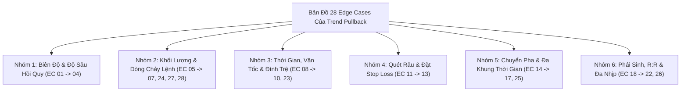

# BÁO CÁO TOÀN DIỆN: BẢN ĐỒ VÉT CẠN 28 EDGE CASES CỦA TREND PULLBACK (TREND_PB) TRONG GIAO DỊCH THỰC TẾ & CƠ CHẾ PHÒNG VỆ
**File tài liệu:** `44_trend_pb_real_world_edge_cases_and_fail_safes.md`  
**Chuyên đề:** Nghiên cứu 28 trường hợp dị biệt, cạm bẫy cấu trúc và biến động cực đoan (Edge Cases) của chiến lược Thuận Xu Hướng Hồi Quy (Trend Pullback) trong thực chiến phái sinh đòn bẩy cao; Thiết kế các cơ chế phòng vệ định lượng (Quant Fail-safes).  
**Nguyên tắc:** Tiếp cận từ First-Principles, Lý thuyết Đấu giá Thị trường (AMT), Động lực học Ngẫu nhiên (SDE) và Vi cấu trúc Sổ lệnh; Tuyệt đối không đưa ra các giả định ngầm thiếu chứng minh.  

---

## 🏛️ PHẦN 1: BẢN CHẤT VẬT LÝ CỦA SÓNG HỒI THUẬN XU HƯỚNG (TREND PULLBACK)

Trong **Kinh tế lượng Vi cấu trúc** và **Lý thuyết Đấu giá Thị trường**:
- **Bản chất của Trend Pullback:** Là một sự **dao động ngẫu nhiên vi mô tạm thời (Micro-Dispersion $\sigma_{micro} dW_t$)** đi ngược chiều với **hệ số trôi dạt vĩ mô (Macro Drift $\mu_{macro}$)** do các vị thế ngắn hạn thực hiện chốt lời cục bộ.
- **Điều kiện cần và đủ của một Pullback hợp lệ:**
  1. *Cạn kiệt lực cản:* Áp lực bán (trong uptrend) hoặc mua (trong downtrend) phải cạn kiệt hoàn toàn (Volume Dry-up).
  2. *Điểm tựa hồi quy cấu trúc:* Giá phải tìm về kiểm định một vùng giá trị có ý nghĩa (Đường KAMA Midline, dải Keltner, hoặc Đỉnh cũ vừa bị phá vỡ - Polarity Flip).
  3. *Bảo tồn cấu trúc Dow:* Đáy sóng hồi ($Higher\ Low$) không được phép đâm thủng đáy sóng đẩy trước đó.
- Nếu một trong các điều kiện này bị vi phạm, cú hồi vi mô sẽ biến chất thành **Phân phối đỉnh, Bẫy thanh lý hoặc Gãy cấu trúc xu hướng**.

---

## 📋 PHẦN 2: BẢN ĐỒ VÉT CẠN 28 EDGE CASES CỦA TREND PULLBACK

---

### NHÓM 1: BẪY BIÊN ĐỘ & ĐỘ SÂU HỒI QUY (SPATIAL & DEPTH TRAPS)

#### 1. EC-TPB-01: Nhịp Hồi Nông / Bay Lơ Lửng Giữa Không Trung *(Shallow / Mid-Air Floating Trap)*
* **Tình huống thực tế:** Giá chỉ thoái lui 1-2 nến nhỏ ($< 15\%$ sóng đẩy), còn cách KAMA hoặc hỗ trợ cấu trúc rất xa ($> 3 \sim 5\text{ ATR}$).
* **Biểu hiện trên nến:** Nến đỏ nhỏ xuất hiện giữa không trung rồi rút chân nhẹ.
* **Tại sao Retail / Scanner cũ chết:** `trend_pb.rs` bị mất biến `delta_kama`, ngộ nhận đây là Pullback và nhảy vào Long. Ngay sau đó nhịp điều chỉnh thực sự mới diễn ra, kéo giá rơi thêm 3 ATR quét sạch Stop Loss.
* **Cơ chế phòng vệ Quant:** **KAMA Anchor Guard**: Bắt buộc khoảng cách giá tới KAMA phải nằm trong hộp an toàn: $\text{delta\_kama} = \frac{Close - KAMA}{ATR} \in [-0.5, +1.5]$.

#### 2. EC-TPB-02: Nhịp Hồi Xâm Thực Quá Sâu *(Deep Retracement / Structural Fatigue)*
* **Tình huống thực tế:** Sóng hồi ăn sâu quá $78.6\% \sim 95\%$ chiều dài sóng đẩy trước đó.
* **Biểu hiện trên nến:** Chuỗi nến đỏ liên tiếp kéo dài, giá cắm sát về đáy cũ của sóng trước.
* **Tại sao Retail / Scanner cũ chết:** Cố chấp mua vì "giá đã chiết khấu rất rẻ". Nhưng sóng hồi quá sâu chứng minh phe mua đã kiệt quệ, phe bán đã chiếm lại quyền kiểm soát.
* **Cơ chế phòng vệ Quant:** **Max Retracement Ratio Gate**: Tỷ lệ thoái lui không được vượt quá $61.8\%$ chiều dài bước sóng đẩy trước đó ($L_{retrace} \le 0.618 \times L_{impulse}$).

#### 3. EC-TPB-03: Nhịp Hồi Đâm Thủng KAMA *(KAMA Piercing & Freefall)*
* **Tình huống thực tế:** Giá hồi về KAMA nhưng không nảy lên mà xuyên thủng đường trung vị KAMA như một tờ giấy mỏng.
* **Biểu hiện trên nến:** Nến đỏ thân dài đóng cửa dứt khoát bên dưới đường KAMA Midline.
* **Tại sao Retail / Scanner cũ chết:** Bắt dao rơi ngay tại đường KAMA mà không chờ nến phản ứng.
* **Cơ chế phòng vệ Quant:** **Polarity Piercing Rejection**: Nếu giá đóng cửa bên dưới KAMA quá $-0.5\text{ ATR}$, hủy bỏ trạng thái Pullback và chuyển sang trạng thái theo dõi vỡ cản.

#### 4. EC-TPB-04: Đứt Gãy Cấu Trúc Bậc Thang Dow *(Market Structure Break / CHoCH Trap)*
* **Tình huống thực tế:** Nhịp hồi đóng nến xuyên thủng mốc đáy Swing Low gần nhất ($Higher\ Low$).
* **Biểu hiện trên nến:** Xuất hiện Lower Low mới trên cấu trúc nến.
* **Tại sao Retail / Scanner cũ chết:** KAMA do có độ trễ tự nhiên vẫn còn dốc lên trong $5 \sim 10$ nến tiếp theo. Scanner chỉ nhìn độ dốc KAMA nên vẫn tiếp tục phát lệnh Long khi xu hướng tăng đã CHÍNH THỨC TỬ TRẬN.
* **Cơ chế phòng vệ Quant:** **Dow Swing Tracker**: Lưu trữ mốc Swing Low gần nhất. Cấm $100\%$ lệnh Long nếu giá đã đóng nến dưới mốc Swing Low này.

---

### NHÓM 2: BẪY KHỐI LƯỢNG & DÒNG CHẢY LỆNH (VOLUME & ORDER FLOW TRAPS)

#### 5. EC-TPB-05: Sóng Hồi Bão Khối Lượng Xả Lũ *(High-Volume Distribution Retrace)*
* **Tình huống thực tế:** Giá giảm hồi nhưng kèm theo cột Volume xả hàng khổng lồ (gấp 3-5 lần trung bình), Delta âm dốc đứng.
* **Biểu hiện trên nến:** Nến đỏ thân dài volume cao chọc trời.
* **Tại sao Retail / Scanner cũ chết:** `trend_pb.rs` hoàn toàn không đọc khối lượng, thấy nến có râu dưới một chút là nhảy vào mua, hứng trọn đợt phân phối tháo chạy của Smart Money.
* **Cơ chế phòng vệ Quant:** **Volume Dry-up Filter**: Bắt buộc khối lượng của nhịp hồi phải nhỏ hơn trung bình ($Vol_{retrace} < 0.80 \times SMA_{vol}$). Nếu volume bùng nổ $\implies$ VETO ngay lập tức.

#### 6. EC-TPB-06: Sóng Hồi Cạn Kiệt Thanh Khoản Giả *(Ghost Liquidity / Thin Orderbook Trap)*
* **Tình huống thực tế:** Khối lượng hồi có vẻ thấp nhưng là do các Market Maker rút lệnh (sổ lệnh mỏng tan).
* **Biểu hiện trên nến:** Nến thân nhỏ volume thấp nhưng chênh lệch Bid-Ask (Spread) giãn toác.
* **Tại sao Retail / Scanner cũ chết:** Tưởng là cạn cung, nhưng khi vào lệnh thì bị trượt giá nặng và chỉ một lệnh bán nhỏ cũng làm thủng sàn.
* **Cơ chế phòng vệ Quant:** **Depth of Market & Spread Check**: Đảm bảo độ sâu sổ lệnh và spread $\le 0.05\%$ trước khi khớp lệnh.

#### 7. EC-TPB-07: Hấp Thụ Ngược Chiều Tại Đỉnh Cũ *(Overhead Absorption Wall / Double Top)*
* **Tình huống thực tế:** Giá nảy nhẹ ở hỗ trợ KAMA rồi bật lên, nhưng ngay tại đỉnh cũ xuất hiện bức tường Limit Sell khổng lồ nuốt trọn lực mua.
* **Biểu hiện trên nến:** Giá chạm đỉnh cũ thò râu trên dài ngoằng ($CLV < -0.50$), tạo mô hình 2 đỉnh (Double Top).
* **Tại sao Retail / Scanner cũ chết:** Kỳ vọng giá sẽ vượt đỉnh tạo Higher High, không ngờ bị cá mập chặn đầu xả ngược.
* **Cơ chế phòng vệ Quant:** **Breakeven Defense on Rejection**: Nếu giá tiếp cận đỉnh cũ mà xuất hiện nến từ chối mạnh ($CLV \le -0.40$), tự động dời SL về hòa vốn ngay lập tức.

---

### NHÓM 3: BẪY THỜI GIAN, VẬN TỐC & ĐÌNH TRỆ (TEMPORAL & VELOCITY TRAPS)

#### 8. EC-TPB-08: Sóng Hồi Kéo Dài Lê Thê Bào Mòn Động Lượng *(Protracted Complex Retracement)*
* **Tình huống thực tế:** Sóng đẩy chỉ mất 5 nến, nhưng nhịp hồi kéo dài lê thê qua 30-50 nến zíc zắc.
* **Biểu hiện trên nến:** Chuỗi nến nhỏ đi ngang trôi dốc từ từ, đường KAMA phẳng lì ra.
* **Tại sao Retail / Scanner cũ chết:** Động năng của xu hướng đã bị tiêu biến hoàn toàn. Cú bật sau một nhịp hồi quá dài thường rất yếu ớt và dễ thất bại.
* **Cơ chế phòng vệ Quant:** **Temporal Ratio Guard**: Số lượng nến của nhịp hồi không được vượt quá gấp 3 lần số lượng nến của bước sóng đẩy trước đó ($T_{retrace} \le 3 \times T_{impulse}$).

#### 9. EC-TPB-09: Hồi Tốc Độ Cao / Sập Chữ V *(Violent Flash Pullback / Velocity Inversion)*
* **Tình huống thực tế:** Giá rơi thẳng đứng như một viên đá với vận tốc lớn hơn cả sóng đẩy trước đó.
* **Biểu hiện trên nến:** 1 cây nến đỏ khổng lồ nuốt trọn thành quả của 5 cây nến xanh trước đó.
* **Tại sao Retail / Scanner cũ chết:** Quán tính rơi quá mạnh khiến bất kỳ nỗ lực rút chân đầu tiên nào cũng chỉ là điểm dừng tạm thời trước khi sập tiếp.
* **Cơ chế phòng vệ Quant:** **Kinematic Velocity Comparison**: Vận tốc của sóng hồi ($\frac{\Delta P}{\Delta t}$) bắt buộc phải nhỏ hơn vận tốc của sóng đẩy ($v_{retrace} < v_{impulse}$).

#### 10. EC-TPB-10: Đình Trệ Sau Hồi *(Post-Pullback Stagnation / Dead Wave)*
* **Tình huống thực tế:** Giá nảy nhẹ ở KAMA nhưng sau đó nằm im một chỗ, không chịu bùng nổ tiếp diễn xu hướng.
* **Biểu hiện trên nến:** Biên độ nến co cụm dẹt lép sau khi vào lệnh.
* **Tại sao Retail / Scanner cũ chết:** Vốn bị chôn chân trong lệnh, sau đó thị trường chuyển pha sang sideway và quét Stop Loss.
* **Cơ chế phòng vệ Quant:** **Stagnation Exit TTL**: Nếu sau $N \le 6$ nến kể từ khi vào lệnh mà giá không tạo được đỉnh cao hơn, tự động đóng lệnh tại hòa vốn.

---

### NHÓM 4: BẪY THANH KHOẢN QUÉT RÂU & ĐẶT STOP LOSS (WICK SWEEPS & SL TRAPS)

#### 11. EC-TPB-11: Cú Quét Râu Đáy Nhịp Hồi *(Swing Low Liquidity Sweep / Spring of Pullback)*
* **Tình huống thực tế:** Giá tạo đáy nhịp hồi tại nến $t$. Cây nến $t+1$ thò râu sâu hơn đáy $t$ đúng vài tick để cắn sạch Stop Loss của phe mua sớm rồi mới bay vọt lên.
* **Biểu hiện trên nến:** Râu nến $t+1$ quét qua đáy nến $t$ rồi rút chân đóng nến xanh mạnh mẽ.
* **Tại sao Retail / Scanner cũ chết:** Vào lệnh ngay nến $t$ và đặt SL sát râu nến $t$.
* **Cơ chế phòng vệ Quant:** **Confirmation Bar Entry (Đợi nến $t+1$)**: Chờ nến xác nhận $t+1$ kiểm định và đóng nến xanh vượt điểm giữa nến trước mới kích hoạt lệnh.

#### 12. EC-TPB-12: Neo SL Quá Nông Theo Nến Đơn Lẻ Bị Quét Nhiễu *(Micro-Wick Fragility)*
* **Tình huống thực tế:** Neo SL ở `low - 0.5 ATR` của nến 1m đơn lẻ.
* **Biểu hiện trên nến:** Nến 1m có râu rất ngắn, khoảng cách SL chỉ vỏn vẹn $0.2\% \sim 0.4\%$ giá.
* **Tại sao Retail / Scanner cũ chết:** Độ nhiễu nến 1m của sàn Binance cắn sạch mức Stop Loss này trước khi xu hướng 15m/1h tiếp diễn.
* **Cơ chế phòng vệ Quant:** **Fractal Swing Low Anchor**: Neo SL vào đáy thấp nhất của toàn bộ cấu trúc nhịp hồi ($N=5 \sim 10$ nến) thay vì chỉ nhìn vào 1 cây nến đơn lẻ.

#### 13. EC-TPB-13: Lật Kèo Kháng Cự Cũ Thất Bại *(Failed Polarity Flip / Breakout-Retest Failure)*
* **Tình huống thực tế:** Đỉnh cũ vừa bị phá vỡ được kỳ vọng là hỗ trợ mới. Giá hồi về nhưng không nảy mà đâm thủng luôn trở lại bên dưới.
* **Biểu hiện trên nến:** Nến đóng cửa lọt ngược trở lại vào bên trong vùng tích lũy cũ (Bull Trap).
* **Tại sao Retail / Scanner cũ chết:** Mua thụ động tại đỉnh cũ mà không chờ phản ứng xác nhận.
* **Cơ chế phòng vệ Quant:** **Close Rejection Requirement**: Bắt buộc nến chạm đỉnh cũ phải đóng cửa bên trên mốc này kèm $CLV \ge 0.40$.

---

### NHÓM 5: BẪY CHUYỂN PHA THỊ TRƯỜNG & ĐA KHUNG THỜI GIAN (REGIME SHIFT & MTF TRAPS)

#### 14. EC-TPB-14: Bẫy Chuyển Pha Sang Đi Ngang Biên Độ *(Transition to Range-Bound / Chop)*
* **Tình huống thực tế:** Xu hướng lớn đã kết thúc, thị trường bước vào pha tích lũy Range đi ngang.
* **Biểu hiện trên nến:** Đường KAMA nằm ngang phẳng lì, giá dao động ping-pong giữa 2 biên.
* **Tại sao Retail / Scanner cũ chết:** Cứ mỗi nhịp chạm KAMA lại tưởng là Pullback để đánh trend, bị thị trường đi ngang vả cắt lỗ liên tiếp 2 đầu.
* **Cơ chế phòng vệ Quant:** **Macro Regime Classifier**: Khóa hoàn toàn `trend_pb` khi thị trường ở chế độ Range ($KER < 0.30$ hoặc KAMA Slope phẳng $\approx 0$).

#### 15. EC-TPB-15: Bẫy Squeeze Nén Cờ Bị Ngăn Chặn *(Continuation Squeeze Lockout)*
* **Tình huống thực tế:** Sau sóng đẩy dốc, giá tích lũy nén biên độ tạo mô hình cờ Bull Flag (dải Bollinger co thắt trong Keltner).
* **Biểu hiện trên nến:** `squeeze_intensity` tăng cao ($> 0.50$).
* **Tại sao Retail / Scanner cũ chết:** `trend_pb.rs:64` có dòng lệnh `if squeeze > max_squeeze { return None; }`, tự tay bóp chết $100\%$ các điểm vào lệnh cờ tăng tiếp diễn.
* **Cơ chế phòng vệ Quant:** **Continuation Squeeze Exception**: Cho phép mở lệnh trong Squeeze nếu độ dốc KAMA vẫn dương mạnh và giá nằm ở nửa trên của dải nén.

#### 16. EC-TPB-16: Phân Kỳ Đa Khung Thời Gian Đối Nghịch *(MTF Counter-Trend Conflict)*
* **Tình huống thực tế:** Khung 1m KAMA dốc lên nhẹ, nhưng khung 1h/4h đang là một xu hướng giảm khổng lồ (giá 1m chỉ đang hồi về EMA 1h).
* **Biểu hiện trên nến:** Khung 1m tăng nhưng khung 1h nến đỏ đặc.
* **Tại sao Retail / Scanner cũ chết:** Mua thuận trend 1m nhưng đối đầu trực diện với dòng tiền cá mập khung 1h, bị đè bẹp ngay lập tức.
* **Cơ chế phòng vệ Quant:** **MTF Phase Coherence Gate**: Bắt buộc KAMA 15m và 1h phải cùng chiều dương với khung 1m mới cho phép mở Long.

#### 17. EC-TPB-17: Cú Sập Khung Thời Gian Lớn Đè Bẹp Khung Vi Mô *(Higher-Timeframe Cascade)*
* **Tình huống thực tế:** Khung 4h vừa đóng nến gãy cản lớn và bắt đầu xả lũ.
* **Biểu hiện trên nến:** Khung 1m vừa xuất hiện nến rút chân Pullback lập tức bị cuốn phăng bởi lệnh Market sell khung 4h.
* **Tại sao Retail / Scanner cũ chết:** Tầm nhìn hạn hẹp chỉ nhìn vào nến 1m.
* **Cơ chế phòng vệ Quant:** **Macro Cascade Invalidation**: Tạm ngừng mở lệnh 1m trong $15 \sim 30$ phút ngay sau khi khung 1h/4h vừa gãy cản cấu trúc.

---

### NHÓM 6: BẪY PHÁI SINH, R:R & DỊ TẬT KỸ THUẬT (DERIVATIVES & TECHNICAL TRAPS)

#### 18. EC-TPB-18: Funding Rate Ngược Chiều Bào Mòn Lợi Nhuận *(Extreme Funding Drag)*
* **Tình huống thực tế:** Mua thuận trend tăng nhưng Funding Rate đang dương cực nặng ($+0.10\%$ mỗi chu kỳ).
* **Biểu hiện trên nến:** Giá tăng chậm chạp theo bậc thang.
* **Tại sao Retail / Scanner cũ chết:** Tiền lời giá không bù nổi phí Funding bị sàn trừ định kỳ.
* **Cơ chế phòng vệ Quant:** **Funding Rate Drag Gate**: Khấu trừ chi phí Funding dự kiến vào hàm mục tiêu $EV$.

#### 19. EC-TPB-19: Bẫy R:R Teo Tóp Khi Vào Lệnh Quá Muộn *(Diminishing R:R on Exhausted Trend)*
* **Tình huống thực tế:** Xu hướng đã trải qua 4-5 bước sóng đẩy (con sóng cuối cùng).
* **Biểu hiện trên nến:** Tiềm năng tăng tiếp tới đỉnh cũ chỉ còn $0.5\text{ ATR}$, trong khi rủi ro SL dưới đáy sóng hồi là $1.5\text{ ATR}$ ($R:R < 1:3$).
* **Tại sao Retail / Scanner cũ chết:** Cố chấp vào lệnh khi tỷ lệ R:R đã quá méo mó bất lợi.
* **Cơ chế phòng vệ Quant:** **Objective R:R Gate**: Bắt buộc $\frac{\text{Distance to Prior High}}{\text{Distance to SL}} \ge 1.5$.

#### 20. EC-TPB-20: Đòn Bẩy Quá Tải Chạm Ngưỡng Thanh Lý Sàn Trước Khi Chạm SL *(MMR Breach)*
* **Tình huống thực tế:** Dùng đòn bẩy quá cao ($50\text{x} \sim 100\text{x}$) trong khi nhịp nhúng của sóng hồi vượt quá mức ký quỹ duy trì (MMR).
* **Biểu hiện trên nến:** Râu nến nhúng nhẹ chưa chạm Stop Loss nhưng tài khoản đã bị sàn Binance thanh lý cưỡng bức.
* **Tại sao Retail / Scanner cũ chết:** Không tính toán khoảng cách thanh lý thực tế so với Stop Loss.
* **Cơ chế phòng vệ Quant:** **Liquidation Distance Guard**: Bắt buộc $Dist_{Liq} \ge 1.5 \times Dist_{SL}$.

#### 21. EC-TPB-21: Tê Liệt Chỉ Báo Do Forward-Fill 15m Bậc Thang *(Forward-Fill Flatline Blindness)*
* **Tình huống thực tế:** Chỉ báo `stoch_trend_k` lấy từ khung 15m forward-fill sang nến 1m là một đường thẳng nằm ngang trong 15 nến liên tiếp.
* **Biểu hiện trên nến:** `stoch_k == prev_stoch_k` trong $93.3\%$ số nến.
* **Tại sao Retail / Scanner cũ chết:** Điều kiện `stoch_k < prev_stoch_k` bị tê liệt, không bảo vệ được bot khi giá rơi tự do.
* **Cơ chế phòng vệ Quant:** **Native 1m Micro-Hook Detection**: Tính toán độ dốc uốn cong của Stochastic trực tiếp trên nến vi mô 1m.

#### 22. EC-TPB-22: Tick Dị Thường Quét Đáy Ảo *(Bad Outlier Tick on Pullback)*
* **Tình huống thực tế:** Một tick lỗi từ API sàn giật xuống sâu trong $10\text{ms}$ tạo râu nến ảo dài ngoằng.
* **Biểu hiện trên nến:** Cây nến có râu dưới dài bất thường nhưng Volume bằng 0.
* **Tại sao Retail / Scanner cũ chết:** Neo SL theo râu nến ảo khiến SL bị kéo quá xa hoặc bị quét oan.
* **Cơ chế phòng vệ Quant:** **Mark Price Cross-Validation**: So sánh giá đáy với Mark Price của sàn để lọc bỏ râu ảo.

#### 23. EC-TPB-23: Cú Sốc Thanh Khoản Mở Phiên *(Session Open Liquidity Volatility Shock)*
* **Tình huống thực tế:** Vào thời điểm giao phiên London (14:00 VN) hoặc New York (20:30 VN), dòng tiền lớn ồ ạt đổ vào đẩy volume tăng vọt, tạo các nhịp quét râu 2 đầu với biên độ gấp đôi ATR thông thường.
* **Biểu hiện trên nến:** Nến biến động cực mạnh, quét thủng cả hỗ trợ lẫn kháng cự trong vài phút đầu mở phiên.
* **Tại sao Retail / Scanner cũ chết:** Cú pullback đang êm đềm bị bẻ gãy do cú shock thanh khoản mở phiên.
* **Cơ chế phòng vệ Quant:** **Session Open Volatility Buffer**: Nới rộng đệm SL hoặc tạm dừng vào lệnh trong 5 phút đầu mở phiên lớn.

#### 24. EC-TPB-24: Nhồi Lệnh Sớm Của Phe Trend Bị Hấp Thụ *(Trapped Trend Add-on / Fake Re-ignition)*
* **Tình huống thực tế:** Sau nhịp hồi nhẹ, giá vừa nhú xanh được nửa nến, phe theo trend ồ ạt nhảy vào mua Market. Lực mua này bị cá mập dùng lệnh Limit hấp thụ ngay tại chỗ (Absorption), sau đó giá quay đầu xả đợt 2.
* **Biểu hiện trên nến:** Nến xanh có râu trên dài, Delta mua rất lớn nhưng giá không thể bứt phá (Effort without Result).
* **Tại sao Retail / Scanner cũ chết:** Mua đuổi khi cú hồi chưa thực sự hoàn tất.
* **Cơ chế phòng vệ Quant:** **Order Flow Delta Confirmation & Re-ignition Bar**: Chỉ giải ngân khi có nến đóng cửa vượt qua đỉnh của nến hồi trước đó.

#### 25. EC-TPB-25: Lây Nhiễm Bán Tháo Liên Tài Sản *(Cross-Asset Lead-Lag Drag / BTC Contagion)*
* **Tình huống thực tế:** Cặp Altcoin đang tạo nhịp Pullback tuyệt đẹp đúng sách giáo khoa, nhưng đúng lúc đó BTC (tài sản dẫn dắt thị trường) bất ngờ xả một cây nến đỏ sập $2\%$.
* **Biểu hiện trên nến:** Toàn bộ thị trường Altcoin lập tức bị bán tháo hoảng loạn theo hiệu ứng bầy đàn (Contagion), cuốn phăng mọi hỗ trợ kỹ thuật của Altcoin.
* **Tại sao Retail / Scanner cũ chết:** Phân tích hoàn hảo trên biểu đồ Altcoin đơn lẻ nhưng bị dòng tiền vĩ mô BTC nghiền nát.
* **Cơ chế phòng vệ Quant:** **BTC Lead-Lag Drag Guardian**: Đọc biến động tức thời của BTC; cấm mở Long Altcoin nếu BTC đang trong nến xả dốc $> 1.5\text{ ATR}$.

#### 26. EC-TPB-26: Bẫy Sóng Hồi Phức Hạp Đa Nhịp *(Complex ABC Correction / B-Wave Headfake)*
* **Tình huống thực tế:** Nhịp hồi không phải là sóng đơn mà là cấu trúc $A-B-C$. Sóng $A$ giảm nhẹ, sóng $B$ bật lên tạo bẫy tăng giả (Headfake). Phe mua nhảy vào Long ở sóng $B$ và bị sóng $C$ quét sạch thanh khoản phá vỡ đáy sóng $A$.
* **Biểu hiện trên nến:** Nến xanh bật lên ở giữa nhịp hồi nhưng volume suy kiệt, sau đó xuất hiện cụm nến đỏ dìm giá sâu hơn.
* **Tại sao Retail / Scanner cũ chết:** Ngộ nhận sóng $B$ là sự tiếp diễn của xu hướng chính, vội vã mở vị thế sớm khi chu kỳ hiệu chỉnh chưa hoàn thành.
* **Cơ chế phòng vệ Quant:** **Two-Leg Retracement Structure Awareness**: Chỉ kích hoạt tín hiệu khi nhịp hồi đã kiểm định lại (Retest) đáy cũ hoặc có nến phá vỡ cấu trúc đỉnh của sóng $B$ ($Breakout\ of\ B$).

#### 27. EC-TPB-27: Cú Quét Văng Hỗ Trợ Do Đốt Lệnh Mở *(High Open Interest Long-Squeeze Overshoot)*
* **Tình huống thực tế:** Open Interest (OI) ở mức cao kỷ lục do phe đòn bẩy cao gom lệnh quá dày đặc. Khi giá thoái lui nhẹ chạm KAMA, lượng lệnh thanh lý bị kích hoạt dây chuyền làm giá rơi xuyên thủng hỗ trợ 2-3 ATR trước khi hồi phục.
* **Biểu hiện trên nến:** Nến đỏ cắm sâu xuyên qua mọi chỉ báo hỗ trợ kỹ thuật trong chớp mắt rồi rút chân thành râu dài.
* **Tại sao Retail / Scanner cũ chết:** Đặt Limit buy chặn ở KAMA bị cuốn trôi và thanh lý tài khoản.
* **Cơ chế phòng vệ Quant:** **OI Acceleration Filter & Post-Liquidation Stabilization**: Tạm dừng mở vị thế nếu OI sụt giảm đột biến kèm giá giảm mạnh (Long Squeeze in progress); chỉ vào lệnh sau khi tốc độ thanh lý hạ nhiệt.

#### 28. EC-TPB-28: Phân Kỳ Tiềm Ẩn Suy Yếu Động Lượng Sóng Đẩy *(Exhaustion Divergence on Impulse Leg)*
* **Tình huống thực tế:** Trước khi pullback diễn ra, sóng đẩy trước đó thực chất đã cạn kiệt lực mua (Exhaustion): Volume sóng đẩy suy giảm rõ rệt so với sóng trước đó, chỉ số xung lực phân kỳ âm lớn. Nhịp hồi sau đó không phải là cơ hội mua mà là tiền đề cho cú đảo chiều gãy trend.
* **Biểu hiện trên nến:** Giá tạo đỉnh cao hơn ($Higher\ High$) nhưng volume và gia tốc động lượng ($KER$, MACD/RSI) tạo đỉnh thấp hơn ($Lower\ High$).
* **Tại sao Retail / Scanner cũ chết:** Mua pullback của một xu hướng đã "hết xăng", vừa mua xong là thị trường gãy cấu trúc toàn diện.
* **Cơ chế phòng vệ Quant:** **Impulse Momentum Quality Check**: Kiểm tra tính lành mạnh của sóng đẩy trước đó; cấm mua pullback nếu sóng đẩy xuất hiện phân kỳ cạn kiệt nghiêm trọng.

---

## 🎯 PHẦN 3: TỔNG KẾT BỘ KHUNG PHÒNG VỆ TOÀN DIỆN CHO `trend_pb.rs` MỚI

| Nhóm Edge Cases | Chốt Chặn Phòng Vệ Định Lượng Cốt Tử |
| :--- | :--- |
| **Nhóm 1: Biên độ & Độ sâu** | **KAMA Anchor Box $\in [-0.5, +1.5]\text{ ATR}$** & **Dow Swing Tracker** chặn bắt dao rơi khi trend đã gãy cấu trúc. |
| **Nhóm 2: Khối lượng & Dòng lệnh** | **Volume Dry-up Gate ($Vol < 0.8\text{ SMA}$)** & **OI Squeeze Filter** loại bỏ hoàn toàn bão xả hàng phân phối đỉnh. |
| **Nhóm 3: Thời gian & Vận tốc** | **Temporal & Velocity Asymmetry** đảm bảo sóng hồi chậm chạp, cạn kiệt; Stagnation Exit sau 6 nến. |
| **Nhóm 4: Quét râu & Stop Loss** | **Confirmation Bar $t+1$** & **Fractal Swing Low Anchor** chống quét nhiễu nến 1m đơn lẻ. |
| **Nhóm 5: Chuyển pha & Đa khung** | **MTF Phase Coherence (15m/1h cùng chiều)** & **Continuation Squeeze Exception** cho mô hình cờ tăng. |
| **Nhóm 6: Phái sinh, R:R & Đa nhịp** | **Objective R:R Gate $\ge 1.5$**, **Two-Leg Retracement Structure Awareness** & **BTC Lead-Lag Drag Guardian**. |

