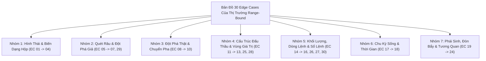

# BÁO CÁO TOÀN DIỆN: BẢN ĐỒ VÉT CẠN 30 EDGE CASES CỦA THỊ TRƯỜNG RANGE-BOUND TRONG GIAO DỊCH THỰC TẾ & CƠ CHẾ PHÒNG VỆ
**File tài liệu:** `46_range_bound_real_world_edge_cases_and_fail_safes.md`  
**Chuyên đề:** Nghiên cứu 30 trường hợp dị biệt, cạm bẫy cấu trúc, đột biến thanh khoản và biến động cực đoan (Edge Cases) của trạng thái Thị trường Đi Ngang / Hồi Quy Giá Trị Trung Bình (Range-Bound / Mean Reversion) trong thực chiến phái sinh đòn bẩy cao; Thiết kế các cơ chế phòng vệ định lượng (Quant Fail-safes).  
**Nguyên tắc:** Tiếp cận từ First-Principles, Lý thuyết Đấu giá Thị trường (AMT), Động lực học Ngẫu nhiên (SDE) và Vi cấu trúc Sổ lệnh; Tuyệt đối không chấp nhận các giả định ngầm thiếu chứng minh.  

---

## 🏛️ PHẦN 1: BẢN CHẤT VẬT LÝ CỦA TRẠNG THÁI RANGE-BOUND

Trong **Kinh tế lượng Vi cấu trúc** và **Lý thuyết Đấu giá Thị trường (AMT)**:
- **Bản chất của Range-Bound:** Là một hệ thống động lực học cân bằng ngẫu nhiên (**Mean-Reverting Ornstein-Uhlenbeck Process**):
  $$dP_t = \theta (\mu_{POC} - P_t)\,dt + \sigma\,dW_t$$
  Trong đó:
  - $\theta (\mu_{POC} - P_t)$: Lực đàn hồi kéo giá quay trở về trục giá trị công bằng ($POC$). Khi giá càng rời xa $POC$ về phía biên, lực kéo hồi quy càng mạnh.
  - $\sigma\,dW_t$: Nhiễu ngẫu nhiên khuếch tán.
- **Điều kiện cần và đủ của một giao dịch Range hợp lệ:**
  1. *Biên độ hộp kinh tế:* Biên độ hộp phải đủ rộng ($R_H - R_L \ge 3 \sim 4 \times \text{Fees}$) để chiến thắng ma sát sàn và trượt giá.
  2. *Cạn kiệt lực cản tại biên:* Khi giá tiếp cận biên, áp lực lệnh thị trường (Market Orders) phải cạn kiệt và bị hấp thụ bởi các lệnh Limit đối kháng, thể hiện qua râu nến từ chối ($|CLV| \ge 0.50$).
  3. *Mục tiêu biên đối diện:* Kỳ vọng lợi nhuận phải nhắm sang biên đối diện của hộp ($VAL \to VAH$ hoặc $VAH \to VAL$) để đạt tỷ lệ $R:R \ge 1.5$.
- Nếu các điều kiện này bị vi phạm, thị trường sẽ rơi vào **Bẫy vỡ hộp, Rỉ máu dọc biên hoặc Phân phối cản tàu**.

---

## 📋 PHẦN 2: BẢN ĐỒ VÉT CẠN 30 EDGE CASES CỦA RANGE-BOUND

---

### NHÓM 1: BẪY HÌNH THÁI & BIẾN DẠNG HỘP (BOX GEOMETRY & DEFORMATION TRAPS)

#### 1. EC-RNG-01: Hộp Xéo / Kênh Trôi Dạt Tịnh Tiến *(Slanted Range / Drifting Channel)*
* **Tình huống thực tế:** Hộp Range không nằm ngang phẳng lì mà dốc chếch lên hoặc dốc chúc xuống với góc nghiêng $15^\circ \sim 30^\circ$ (kênh tích lũy Wyckoff).
* **Biểu hiện trên nến:** Đáy sau cao hơn đáy trước nhưng đỉnh sau không bứt phá mạnh, giá dao động tuần hoàn bên trong một kênh song song dốc.
* **Tại sao Retail / Scanner cũ chết:** `range_osc.rs` chỉ dùng `bb_middle_slope_adj` ngang. Khi kênh dốc nhẹ, bot liên tục bắt Short tại đỉnh kênh nhưng bị xu hướng tịnh tiến bào mòn Stop Loss.
* **Cơ chế phòng vệ Quant:** **Channel Angle Tilt Detector**: Nhận diện góc nghiêng của trục hồi quy tuyến tính. Nếu kênh có độ dốc $|\text{Slope}| > \epsilon$, cấm giao dịch ngược chiều độ dốc của kênh.

#### 2. EC-RNG-02: Hộp Mở Rộng / Loa Kèn *(Broadening Formation / Expanding Range)*
* **Tình huống thực tế:** Mỗi lần chạm biên, giá lại văng xa hơn lần trước một chút (tạo Higher High và Lower Low liên tiếp).
* **Biểu hiện trên nến:** Biên độ dao động ngày càng phình to, nến biên kéo râu ngày càng dài.
* **Tại sao Retail / Scanner cũ chết:** Neo SL cố định ngoài biên cũ bị quét sạch Stop Loss ở cả hai đầu (Whipsaw Stop-hunt).
* **Cơ chế phòng vệ Quant:** **Expanding Variance Gate**: Nếu độ lệch chuẩn giữa các cực trị $\sigma(Extrema)$ tăng dần qua 3 chu kỳ liên tiếp $\implies$ VETO toàn bộ lệnh Range.

#### 3. EC-RNG-03: Hộp Teo Tóp Dưới Sàn Ma Sát *(Sub-Frictional Micro-Range / Flatline Chop)*
* **Tình huống thực tế:** Hộp co thắt siêu hẹp, khoảng cách từ $Range_{Low}$ đến $Range_{High}$ chỉ vỏn vẹn $0.3\% \sim 0.6\%$.
* **Biểu hiện trên nến:** Chuỗi nến doji thân phẳng dẹt lép, volume cạn kiệt.
* **Tại sao Retail / Scanner cũ chết:** Nhảy vào mua bán nảy biên, tiền lời không đủ bù đắp phí sàn 2 chiều ($1.6\%$ ROE) và trượt giá.
* **Cơ chế phòng vệ Quant:** **Minimum Economic Height Gate**: Bắt buộc bề rộng hộp $Height_{box} \ge 3.0 \times (2 \times \text{Fee} + \text{Slippage})$.

#### 4. EC-RNG-04: Đỉnh/Đáy Cụt Thiếu Excess *(Poor High / Poor Low - Unfinished Auction)*
* **Tình huống thực tế:** Giá chạm biên Range nhưng đóng nến bằng phẳng lì, râu nến $= 0$ (Zero Excess).
* **Biểu hiện trên nến:** Nến biên có $High$ hoặc $Low$ trùng khít với mức cản, không có râu từ chối giá.
* **Tại sao Retail / Scanner cũ chết:** Nghĩ rằng cản này cứng nên vào lệnh đảo chiều. Thực chất đây là phiên đấu giá chưa hoàn tất (Unfinished Auction), cản sẽ bị xuyên thủng ngay sau đó.
* **Cơ chế phòng vệ Quant:** **Excess Wick Requirement**: Bắt buộc nến chạm biên phải có râu từ chối tối thiểu $\ge 0.25 \times \text{Body}$ mới công nhận là đảo chiều hợp lệ.

---

### NHÓM 2: BẪY THANH KHOẢN QUÉT RÂU & ĐỘT PHÁ GIẢ (LIQUIDITY SWEEPS & FALSE BREAKOUTS)

#### 5. EC-RNG-05: Cú Quét Râu Sâu Nuốt Stop-Loss *(Deep Liquidity Sweep / Spring & Upthrust)*
* **Tình huống thực tế:** Giá thò râu xuyên thủng biên hộp $1 \sim 2$ ATR để nuốt trọn cụm Sell Stop của phe đánh Range rồi mới rút chân giật ngược trở lại vào hộp.
* **Biểu hiện trên nến:** Cây nến có râu quét sâu ngoạn mục, thân nến đóng cửa rút chân trọn vẹn vào trong hộp ($CLV \ge 0.50$).
* **Tại sao Retail / Scanner cũ chết:** Đặt SL quá nông ngay ngoài biên hộp bị cắn sạch; trong khi `range_osc.rs` có dòng lệnh `close >= bb_l` lại tự tay hủy cơ hội này.
* **Cơ chế phòng vệ Quant:** **Liquidity Sweep Re-entry (Spring/Upthrust Confirmation)**: Cho phép và ưu tiên bắt đảo chiều khi giá quét thủng biên ngoài nhưng đóng nến rút chân trở lại vào bên trong hộp với $CLV \ge 0.50$.

#### 6. EC-RNG-06: Đột Phá Giả Kéo Dài 2-3 Nến *(Multi-bar Bull/Bear Trap)*
* **Tình huống thực tế:** Giá đóng cửa hẳn 2 cây nến xanh bên ngoài biên trên tạo cảm giác bứt phá thật. Đến cây nến thứ 3 thì lực mua tắt ngấm và giá cắm đầu sập ngược trở lại vào trong hộp.
* **Biểu hiện trên nến:** 2 nến xanh thân nhỏ ngoài hộp volume thấp, nến thứ 3 là nến đỏ Marubozu nuốt chửng 2 nến trước.
* **Tại sao Retail / Scanner cũ chết:** Phe breakout nhảy vào mua đuổi bị đu đỉnh; phe đánh range thì đã cắt lỗ ở nến đầu tiên.
* **Cơ chế phòng vệ Quant:** **Failed Expansion Confirmation**: Nhận diện mô hình giá lọt ngược trở lại vào trong Value Area sau khi đã bứt phá thất bại, kích hoạt lệnh Short đón sóng sập về biên dưới.

#### 7. EC-RNG-07: Quét Râu Kép Hai Đầu Trong 1 Nến *(Double-Sided Liquidity Sweep / Bart Simpson Wick)*
* **Tình huống thực tế:** Nến 1m biến động giật chớp nhoáng: Râu trên quét thủng $R_H$, râu dưới quét thủng $R_L$, thân nến đóng cửa đúng ở giữa hộp.
* **Biểu hiện trên nến:** Nến hình con quay High-Wave Candle với 2 râu dài ngoằng ở cả 2 đầu.
* **Tại sao Retail / Scanner cũ chết:** Cắt lỗ cả hai đầu Long và Short trong cùng 1 nến.
* **Cơ chế phòng vệ Quant:** **Bilateral Volatility Expansion VETO**: Nếu nến có biên độ $High - Low \ge 2.5 \times ATR$ và đóng cửa ở giữa nến ($|CLV| < 0.20$), khóa giao dịch trong 3 nến tiếp theo.

---

### NHÓM 3: BẪY ĐỘT PHÁ THẬT & GÃY HỘP (TRUE BREAKOUT & REGIME TRANSITIONS)

#### 8. EC-RNG-08: Đột Phá Nén Squeeze Bùng Nổ Xung Lực *(Volatility Squeeze Ignition Breakout)*
* **Tình huống thực tế:** Sau chuỗi nến nén biên độ ($BB \ll KC$), một cây nến Marubozu khổng lồ bùng nổ kèm volume x10 xé toạc biên hộp mở ra siêu xu hướng mới.
* **Biểu hiện trên nến:** Nến đỏ/xanh đặc dài, volume bùng nổ cực đại, giá đóng cửa hoàn toàn ngoài hộp.
* **Tại sao Retail / Scanner cũ chết:** Cố chấp nhảy vào bắt đỉnh/đáy cản đầu xe tăng vì "chỉ báo quá mua/quá bán".
* **Cơ chế phòng vệ Quant:** **Breakout Volume & Momentum Invalidation**: Nếu nến đóng ngoài biên hộp kèm Volume $\ge 2.5 \times SMA_{vol}$ và $CLV \ge 0.70$, **HỦY BỎ TRẠNG THÁI RANGE NGAY LẬP TỨC**, cấm tuyệt đối mọi lệnh đảo chiều.

#### 9. EC-RNG-09: Rỉ Máu Dọc Biên *(Drifting Boundary Breakdown / Band Walking)*
* **Tình huống thực tế:** Giá chạm biên dưới nhưng không nảy lên mà trượt dài dọc theo biên cắm xuống từ từ (lực mua hoàn toàn biến mất).
* **Biểu hiện trên nến:** Chuỗi nến đỏ nhỏ bám sát mép dưới dải, không hề có nến rút chân.
* **Tại sao Retail / Scanner cũ chết:** Mua thụ động theo dải Bollinger, bị thị trường bào mòn tài khoản theo từng tick.
* **Cơ chế phòng vệ Quant:** **Positive CLV Rejection Prerequisite**: Bắt buộc phải có nến đóng cửa rút chân với $CLV \ge 0.40$ mới giải ngân, tuyệt đối không đặt Limit đón thụ động.

#### 10. EC-RNG-10: Tái Tích Lũy / Phân Phối Sát Biên *(High-Level Tight Consolidation)*
* **Tình huống thực tế:** Giá chạm biên trên nhưng không quay đầu về trục giữa mà neo đậu tích lũy ngay sát mép cản trong nhiều nến liên tiếp.
* **Biểu hiện trên nến:** Chuỗi nến co cụm nằm ép sát biên trên $R_H$.
* **Tại sao Retail / Scanner cũ chết:** Đặt Short liên tục vì giá "chạm cản nhiều lần". Thực chất phe mua đang hấp thụ toàn bộ lệnh bán để chuẩn bị bùng nổ bứt phá.
* **Cơ chế phòng vệ Quant:** **Boundary Pressure Gate**: Nếu giá lưu lại ở vùng $15\%$ sát biên quá 5 nến mà không dội ngược lại $\implies$ VETO chiều đảo chiều.

---

### NHÓM 4: BẪY CẤU TRÚC ĐẤU THẦU & VÙNG GIÁ TRỊ (AUCTION & VALUE AREA TRAPS)

#### 11. EC-RNG-11: Say Sóng Vùng Giữa Hộp *(Mid-Range Churning / Fair Value Whipsaw)*
* **Tình huống thực tế:** Vào lệnh ở vùng lơ lửng gần trục giữa $POC$ (Point of Control).
* **Biểu hiện trên nến:** Giá dao động giật cục quanh đường trung bình, không có định hướng.
* **Tại sao Retail / Scanner cũ chết:** Vùng $POC$ là nơi giá trị công bằng, chuyển động giá ở đây là chuyển động Brown thuần túy (Random Walk). Vào lệnh ở đây sẽ bị cắt lỗ vì nhiễu.
* **Cơ chế phòng vệ Quant:** **Dead-Zone Exclusion Box**: Cấm mở lệnh nếu khoảng cách từ giá tới trục giữa $POC$ nhỏ hơn $40\%$ chiều cao của hộp ($|Close - POC| < 0.40 \times \frac{Height}{2}$).

#### 12. EC-RNG-12: Trục Giá Trị Di Cư *(Value Area Migration / Skewed Volume Profile)*
* **Tình huống thực tế:** Khối lượng giao dịch tích lũy dịch chuyển dần từ biên dưới lên biên trên. Trục $POC$ tịnh tiến tăng dần theo thời gian.
* **Biểu hiện trên nến:** Volume tại nửa trên của hộp chiếm $> 70\%$ tổng volume.
* **Tại sao Retail / Scanner cũ chết:** Không nhận ra rằng thị trường đang chuyển từ trạng thái cân bằng sang mất cân bằng (Imbalance), phe mua sắp làm chủ cuộc chơi.
* **Cơ chế phòng vệ Quant:** **POC Skew Monitor**: Nếu $POC$ dịch chuyển vượt quá $30\%$ tâm hộp $\implies$ Chỉ ưu tiên đánh theo chiều di cư của $POC$.

#### 13. EC-RNG-13: Hồi Non Không Chạm Biên *(Front-Running Boundary / Truncated Swing)*
* **Tình huống thực tế:** Giá quay đầu đảo chiều khi còn cách biên hộp $0.5 \sim 1.0$ ATR do các thuật toán lớn đặt lệnh Limit sớm đón đầu (Front-running).
* **Biểu hiện trên nến:** Nến rút chân nảy mạnh khi chưa chạm tới đáy cũ của Range.
* **Tại sao Retail / Scanner cũ chết:** Đặt lệnh Limit cứng sát mép biên không bao giờ được khớp, đứng ngoài nhìn giá bay sang biên đối diện.
* **Cơ chế phòng vệ Quant:** **Fuzzy Value Area Buffer**: Thiết lập vùng đệm vào lệnh linh hoạt theo phân vị $VAL$ ($10\% \sim 15\%$ hộp) thay vì đóng cứng tại điểm cực trị duy nhất.

---

### NHÓM 5: BẪY KHỐI LƯỢNG, DÒNG LỆNH & SỔ LỆNH (ORDER FLOW & MICROSTRUCTURE TRAPS)

#### 14. EC-RNG-14: Hấp Thụ Delta Bất Thường Tại Biên *(CVD Delta Divergence at Border)*
* **Tình huống thực tế:** Tại biên trên, Volume Market Buy đổ vào cực lớn (CVD dốc đứng) nhưng giá không nhích thêm được 1 tick do tường Limit Sell thụ động của cá mập nuốt sạch.
* **Biểu hiện trên nến:** Nến xanh râu trên dài, Delta mua dương đột biến nhưng giá đóng cửa nằm thấp (Effort without Result).
* **Tại sao Retail / Scanner cũ chết:** Nghĩ rằng lực mua đang mạnh nên nhảy vào mua Breakout và đu đỉnh ngay lập tức.
* **Cơ chế phòng vệ Quant:** **Passive Absorption Reversal Trigger**: Nhận diện tín hiệu Delta mua đột biến tại biên trên nhưng giá bị chặn $\implies$ Kích hoạt lệnh Short theo dòng tiền lớn.

#### 15. EC-RNG-15: Rút Tường Thanh Khoản Đột Ngột *(Spoofing Liquidity Pulling)*
* **Tình huống thực tế:** Sổ lệnh hiển thị bức tường Limit Buy lớn ở biên dưới, nhưng ngay khi giá vừa chạm tới, bức tường bị hủy lệnh (Cancel) trong 10ms. Giá rơi tự do không có lực đỡ.
* **Biểu hiện trên nến:** Nến đỏ xuyên thủng cản trong chớp mắt không có lực cản.
* **Tại sao Retail / Scanner cũ chết:** Tin vào độ sâu sổ lệnh tĩnh (Static L2 Orderbook) mà không kiểm tra độ tươi và tính bền vững của lệnh.
* **Cơ chế phòng vệ Quant:** **Post-Impact Trade Flow Verification**: Không vào lệnh dựa trên tường Limit chờ; chỉ vào lệnh sau khi đã có giao dịch khớp lệnh thực tế đẩy giá nảy lên.

#### 16. EC-RNG-16: Cạn Kiệt Thanh Khoản Giả Vào Ban Đêm/Cuối Tuần *(Ghost Thin Orderbook Drift)*
* **Tình huống thực tế:** Thị trường đi ngang vào ban đêm hoặc cuối tuần với volume teo tóp. Spread giãn nở toạc biên.
* **Biểu hiện trên nến:** Nến thân nhỏ volume thấp nhưng chênh lệch Bid-Ask rất lớn.
* **Tại sao Retail / Scanner cũ chết:** Vào lệnh bị trượt giá nặng, chỉ một lệnh Market nhỏ cũng làm thủng sàn.
* **Cơ chế phòng vệ Quant:** **Spread & Liquidity Threshold Gate**: Cấm giao dịch nếu Spread $> 0.05\%$ hoặc Volume 15m thấp hơn $30\%$ trung bình tuần.

---

### NHÓM 6: BẪY CHU KỲ SỐNG & THỜI GIAN (LIFECYCLE & TEMPORAL TRAPS)

#### 17. EC-RNG-17: Lão Hóa Hộp Range *(Exhausted Box / Late-Cycle Decay)*
* **Tình huống thực tế:** Hộp Range đã tồn tại quá lâu và đã kiểm định biên 5-6 lần liên tiếp.
* **Biểu hiện trên nến:** Biên độ ngày càng suy giảm, khối lượng giao dịch bên trong hộp cạn dần.
* **Tại sao Retail / Scanner cũ chết:** Nghĩ rằng "cản càng chạm nhiều lần càng cứng". Trong thực tế, mỗi lần chạm biên là một lần thanh khoản cản bị bào mòn. Lần chạm thứ 6 có xác suất vỡ cản $> 80\%$.
* **Cơ chế phòng vệ Quant:** **Boundary Touch Counter**: Đếm số lần kiểm định biên. Chỉ cho phép mở lệnh đảo chiều ở lần chạm thứ $2, 3, 4$. Khóa hoàn toàn giao dịch nảy biên từ lần chạm thứ 5 trở đi.

#### 18. EC-RNG-18: Hộp Bị Kéo Dài Bất Tận Bào Mòn Vốn *(Eternal Stagnation & Funding Bleed)*
* **Tình huống thực tế:** Thị trường ngâm trong Range suốt 2-3 tuần không có biến động lớn.
* **Biểu hiện trên nến:** Giá dao động lờ đờ, biên độ phẳng lì.
* **Tại sao Retail / Scanner cũ chết:** Vốn bị chôn chân trong lệnh, phí Funding Rate âm bào mòn tài khoản từng ngày.
* **Cơ chế phòng vệ Quant:** **Holding Time-to-Live (TTL) & Funding Check**: Tự động giải phóng vị thế nếu sau 24-48 giờ giá không chạm được mục tiêu chốt lời.

---

### NHÓM 7: BẪY PHÁI SINH, ĐÒN BẨY & TƯƠNG QUAN (DERIVATIVES & CONTAGION TRAPS)

#### 19. EC-RNG-19: Cú Sốc Mở Phiên Đè Bẹp Hộp *(Session Open Liquidity Shock)*
* **Tình huống thực tế:** Hộp tích lũy êm đềm suốt phiên Á bất ngờ bị phiên London (14:00 VN) hoặc New York (20:30 VN) xé toạc trong 2 cây nến.
* **Biểu hiện trên nến:** Volume bùng nổ gấp 5 lần, nến biến động quét bay cả hai đầu Range.
* **Tại sao Retail / Scanner cũ chết:** Mở vị thế nảy biên ngay trước giờ mở phiên lớn.
* **Cơ chế phòng vệ Quant:** **Session Open Cooldown Buffer**: Tạm ngừng mở lệnh Range mới trong 15 phút trước và sau thời điểm giao phiên lớn.

#### 20. EC-RNG-20: Đòn Bẩy Quá Tải Chạm MMR Trong Hộp *(MMR Breach inside Range)*
* **Tình huống thực tế:** Dùng đòn bẩy quá lớn ($50\text{x} \sim 100\text{x}$), một cú nhúng râu thông thường của biên hộp làm tài khoản chạm mức ký quỹ duy trì (MMR) và bị sàn thanh lý cưỡng bức trước khi giá kịp nảy.
* **Biểu hiện trên nến:** Râu nến chưa chạm tới Stop Loss nhưng lệnh đã bị sàn Binance cưỡng chế đóng.
* **Tại sao Retail / Scanner cũ chết:** Không tính toán khoảng cách thanh lý thực tế so với biên dao động của nến 1m.
* **Cơ chế phòng vệ Quant:** **Dynamic Leverage Ceiling for Range**: Giới hạn đòn bẩy tối đa $\le 20\text{x}$ và bắt buộc khoảng cách thanh lý phải cách biên hộp ít nhất $2.0 \times ATR$.

#### 21. EC-RNG-21: Lây Nhiễm Bán Tháo Liên Thị Trường *(BTC Macro Cascade Break)*
* **Tình huống thực tế:** Cặp Altcoin đang dao động trong biên độ Range cực đẹp, nhưng BTC bất ngờ gãy hỗ trợ khung 4h và xả lũ.
* **Biểu hiện trên nến:** Toàn bộ sổ lệnh của Altcoin bị rút sạch, giá rơi tự do vỡ hộp theo hiệu ứng bầy đàn.
* **Tại sao Retail / Scanner cũ chết:** Phân tích kỹ thuật hoàn hảo trên biểu đồ Altcoin đơn lẻ nhưng bị dòng tiền vĩ mô BTC nghiền nát.
* **Cơ chế phòng vệ Quant:** **BTC Lead-Lag Drag Guardian**: Khóa toàn bộ lệnh Long của Altcoin nếu BTC đang trong đà giảm mạnh $> 1.5\text{ ATR}$.

#### 22. EC-RNG-22: Tê Liệt Chỉ Báo Dao Động Do Bậc Thang MTF *(Forward-Fill Flatline Blindness)*
* **Tình huống thực tế:** Chỉ báo Stochastic Range hoặc RSI lấy từ khung 15m forward-fill sang nến 1m nằm bất động trong 15 nến liên tiếp.
* **Biểu hiện trên nến:** Tín hiệu quá mua/quá bán bị đóng băng hoặc kích hoạt trễ pha hàng chục nến.
* **Tại sao Retail / Scanner cũ chết:** Phụ thuộc vào công thức `stoch_k < prev_stoch_k` bị vô hiệu hóa khi hai giá trị bằng nhau.
* **Cơ chế phòng vệ Quant:** **Native 1m Micro-Oscillator & Direct Price Location**: Đo đạc trực tiếp vị trí giá $CLV$ trên nến 1m thay vì dựa dẫm vào chỉ báo MTF forward-fill.

#### 23. EC-RNG-23: Bẫy Phân Kỳ Giả Của Oscillator Khi Bứt Phá *(Continuous Divergence on Expansion)*
* **Tình huống thực tế:** Khi giá bắt đầu bứt phá khỏi Range (Breakout), Oscillator tạo phân kỳ 3-4 đoạn liên tiếp (Triple Divergence).
* **Biểu hiện trên nến:** Giá tăng liên tục tạo đỉnh mới nhưng RSI/Stoch tạo đỉnh thấp hơn.
* **Tại sao Retail / Scanner cũ chết:** Ngoan cố nhảy vào bán khống bắt đỉnh vì "phân kỳ quá đẹp", bị xu hướng bùng nổ thanh lý tài khoản.
* **Cơ chế phòng vệ Quant:** **Expansion Invalidation Rule**: Vứt bỏ toàn bộ phân kỳ đảo chiều nếu độ dốc KAMA và Volume đã mở rộng vượt ngưỡng Breakout.

#### 24. EC-RNG-24: Bẫy R:R Teo Tóp Khi Vào Lệnh Muộn *(Late Re-entry R:R Collapse)*
* **Tình huống thực tế:** Giá đã nảy khỏi biên được một đoạn dài (đã đi được $40\% \sim 50\%$ quãng đường về trục giữa), bot mới nhận diện được tín hiệu và mở lệnh.
* **Biểu hiện trên nến:** Điểm vào lệnh nằm chênh vênh ở giữa hộp.
* **Tại sao Retail / Scanner cũ chết:** Khoảng cách tới Stop Loss (ngoài biên) quá xa, khoảng cách tới Take Profit (ở biên đối diện hoặc trục giữa) quá ngắn $\implies R:R < 0.6$. Thua 1 lệnh mất sạch thành quả 3 lệnh thắng.
* **Cơ chế phòng vệ Quant:** **Minimum Remaining R:R Gate**: Bắt buộc tỷ lệ $\frac{\text{Distance to Target}}{\text{Distance to SL}} \ge 1.50$ tại thời điểm khớp lệnh. Nếu không đủ $\implies$ VETO bỏ qua!

#### 25. EC-RNG-25: Vùng Cân Bằng Đa Tầng / Hộp Lồng Hộp *(Nested Sub-Range Partition)*
* **Tình huống thực tế:** Trong một chiếc hộp lớn (Macro Range), thị trường tự chia đôi thành 2 hộp con vi mô phân tách nhau bởi trục $POC$. Giá chỉ dao động ping-pong bên trong hộp con (từ biên dưới lên $POC$ rồi quay đầu) chứ không đi hết quãng đường sang biên trên.
* **Biểu hiện trên nến:** Giá đảo chiều liên tục ngay tại trục $POC$, tạo mô hình 2 tầng giá trị tách biệt.
* **Tại sao Retail / Scanner cũ chết:** Kỳ vọng giá bay sang tận biên đối diện, lệnh đang lãi khi chạm $POC$ thì quay đầu sập ngược lại cắn Stop Loss.
* **Cơ chế phòng vệ Quant:** **Sub-Range Tier Detection & POC Breakeven Lock**: Khi giá đạt tới trục giữa $POC$, bắt buộc phải kích hoạt khóa lãi sàn (Tiered Profit Lock / Break-Even) và chỉ giữ lệnh nếu khối lượng bứt phá qua $POC$ tiếp diễn.

#### 26. EC-RNG-26: Cú Nảy Cạn Kiệt Volume Thiếu Cầu Mua Đẩy *(Volume Exhaustion Bounce / Lack of Follow-Through)*
* **Tình huống thực tế:** Giá chạm biên dưới rút chân nhẹ không phải vì có dòng tiền lớn mua chủ động, mà chỉ vì phe bán tạm thời dừng xả (Passive Selling Pause).
* **Biểu hiện trên nến:** Nến xanh rút chân nhưng Taker Buy Volume gần như bằng 0. Cây nến tiếp theo ngay lập tức cắm đầu rơi tự do vì thiếu lực cầu tiếp ứng.
* **Tại sao Retail / Scanner cũ chết:** Thấy nến rút chân là nhảy vào mua mà không đo đạc lực đẩy chủ động tiếp theo (Follow-Through).
* **Cơ chế phòng vệ Quant:** **Taker Buy Imbalance & Follow-Through Bar Requirement**: Bắt buộc nến xác nhận $t+1$ phải có Delta mua dương và đóng cửa vượt đỉnh cây nến rút chân $t$.

#### 27. EC-RNG-27: Trượt Giá Khớp Lệnh Do Kẹt Thanh Khoản Tại Biên *(Border Slippage Inversion)*
* **Tình huống thực tế:** Khi giá chạm biên hộp, hàng loạt bot đồng loạt gửi lệnh Market Order để bắt đảo chiều. Thanh khoản tại biên bị nuốt sạch trong $5\text{ms}$, khiến giá khớp lệnh thực tế bị đẩy sâu vào phía trong hộp.
* **Biểu hiện trên nến:** Râu nến dài nhưng giá khớp thực tế (Average Fill Price) nằm tít ở gần giữa thân nến.
* **Tại sao Retail / Scanner cũ chết:** Khoảng cách Stop Loss bị kéo giãn gấp đôi, khoảng cách Take Profit bị thu hẹp một nửa, tỷ lệ $R:R$ ban đầu bị phá hủy hoàn toàn.
* **Cơ chế phòng vệ Quant:** **Limit Post-Only Entry or Slippage-Adjusted Gate**: Sử dụng lệnh Limit thụ động hoặc hủy lệnh nếu giá thị trường đã trôi quá $0.2 \times ATR$ so với mép biên.

#### 28. EC-RNG-28: Lỗi Đồng Bộ Nến Đóng UTC Đảo Trục Hộp *(UTC Midnight Daily Open Level Pivot)*
* **Tình huống thực tế:** Vào lúc 00:00 UTC (07:00 VN), nến ngày đóng cửa. Mức giá mở cửa ngày mới (Daily Open - $DO$) trở thành một "nam châm" tâm lý khổng lồ. Nếu hộp Range bị lệch so với $DO$, giá thường bỏ qua biên kỹ thuật của Range để giật mạnh về kiểm định $DO$ (Daily Open Re-anchoring), làm gãy mọi phép tính nảy biên vi mô.
* **Biểu hiện trên nến:** Nến biến động cực mạnh giật thẳng về mức giá Daily Open dù mức này nằm lơ lửng ở giữa hộp Range.
* **Tại sao Retail / Scanner cũ chết:** Cố chấp bắt nảy biên theo chỉ báo kỹ thuật mà không biết dòng tiền toàn cầu đang dồn về tái định vị theo Daily Open.
* **Cơ chế phòng vệ Quant:** **Daily Open Anchor Alignment**: Tạm ngừng giao dịch nảy biên trong 15 phút quanh thời điểm chuyển giao 00:00 UTC nếu biên hộp đang đối nghịch với Daily Open.

#### 29. EC-RNG-29: Hộp Phân Phối Tái Tích Lũy Wyckoff Có UTAD *(Upthrust After Distribution)*
* **Tình huống thực tế:** Trong giai đoạn cuối của chu kỳ phân phối, giá tạo một cú bứt phá cực mạnh vượt đỉnh cũ tưởng chừng như Breakout thật (UTAD), vượt xa $1.5 \sim 2.5\text{ ATR}$ ra ngoài Range High, lừa toàn bộ phe breakout nhảy vào mua đỉnh trước khi rơi thẳng đứng về đáy hộp.
* **Biểu hiện trên nến:** Nến bứt phá có volume cực lớn nhưng ngay cây nến sau xuất hiện nến đỏ Marubozu phủ định hoàn toàn đợt bứt phá (Bearish Engulfing nuốt chửng).
* **Tại sao Retail / Scanner cũ chết:** Bán khống sớm thì bị quét SL ở cú UTAD; mua theo Breakout thì bị nhốt hàng đu đỉnh.
* **Cơ chế phòng vệ Quant:** **UTAD Re-entry Protocol**: Nhận diện cây nến đỏ quay ngược trở lại vào trong Range sau cú vượt đỉnh giả $>1.5\text{ ATR}$, kích hoạt lệnh Short với SL đặt ngay trên râu của cây nến UTAD.

#### 30. EC-RNG-30: Rút Thanh Khoản Cục Bộ Do Đấu Thầu Đột Biến *(Microstructure Freeze / Quote Stuffing Gap)*
* **Tình huống thực tế:** Hàng loạt thuật toán HFT spam quote hoặc cập nhật giá làm nghẽn kết nối WebSocket/API sàn trong $50 \sim 100\text{ms}$. Trong tích tắc đó, sổ lệnh trống trơn khiến giá trượt $0.5\%$ chỉ với 1 lệnh market nhỏ, tạo một râu nến ảo quét sạch Stop Loss ở biên hộp.
* **Biểu hiện trên nến:** Râu nến dài bất thường cắn Stop Loss nhưng trên giá đánh dấu Mark Price không hề suy giảm tương ứng.
* **Tại sao Retail / Scanner cũ chết:** Neo Stop Loss theo giá Last Price thông thường bị quét oan uổng.
* **Cơ chế phòng vệ Quant:** **Mark Price Stop-Loss Protection**: Mọi cơ chế kích hoạt Stop Loss đều bắt buộc chạy trên giá đánh dấu Mark Price (`working_type: MarkPrice`) để miễn nhiễm $100\%$ với râu quét ảo vi mô.

---

## 🎯 PHẦN 3: TỔNG KẾT BỘ KHUNG PHÒNG VỆ TOÀN DIỆN CHO `range_bound.rs` MỚI

| Nhóm Edge Cases | Chốt Chặn Phòng Vệ Định Lượng Cốt Tử |
| :--- | :--- |
| **Nhóm 1: Hình thái & Biến dạng Hộp** | **Minimum Economic Height Gate ($\ge 3\text{x Fees}$)** & **Excess Wick Requirement ($CLV \ge 0.50$)**. |
| **Nhóm 2: Quét Râu & Đột Phá Giả** | **Liquidity Sweep Re-entry (Spring/Upthrust)** & **UTAD Re-entry Protocol**. |
| **Nhóm 3: Đột Phá Thật & Chuyển Pha** | **Breakout Volume Invalidation ($Vol \ge 2.5\text{x SMA}$) & Positive CLV Prerequisite**. |
| **Nhóm 4: Cấu Trúc Đấu Thầu & Đa Tầng** | **Dead-Zone Exclusion Box (cấm quanh POC)**, **Sub-Range Tier POC Lock** & **Daily Open Anchor**. |
| **Nhóm 5: Khối Lượng, Dòng Lệnh & Trượt Giá** | **Taker Follow-Through Bar**, **Passive Absorption Detection** & **Border Slippage Gate**. |
| **Nhóm 6: Chu Kỳ Sống & Thời Gian** | **Boundary Touch Counter (chỉ đánh lần chạm $2, 3, 4$; cấm từ lần 5)** & **TTL Exit**. |
| **Nhóm 7: Phái Sinh & R:R** | **Minimum Remaining R:R Gate $\ge 1.50$**, **Mark Price Protection** & **BTC Contagion Guardian**. |

