# BÁO CÁO KIỂM TOÁN HẠ TẦNG KIẾN TRÚC: CẤU HÌNH CONFIG, BẢN ĐỒ GEN DNA & PROCEDURAL MACRO
**Tài liệu:** Note 48  
**Chủ đề:** Giải phẫu Hạ Tầng Cấu Hình (`config.rs`), Cơ Chế Ánh Xạ DNA (`DnaMappableMacro`), Bẫy Bùng Nổ Số Chiều (Curse of Dimensionality), Gen Ma Cảm Biến Trong Live Hot-Swap và Kế Hoạch Tinh Giản Không Gian DNA Về 2 Scanners Cốt Lõi  
**Mục tiêu kiểm toán:**
- `strategies_backtests/helios/src/strategy/core_v3/config.rs` (1482 dòng)
- `ferro_trade/ferro_trade_derive/src/lib.rs` (Procedural Macro `derive_dna_mappable`)
- `ferro_trade/src/optimizer/params.rs` (Trait `DnaMappable`, `ParamDefinition`)
- Đối chiếu trạng thái với:
  - `strategies_backtests/helios/docs/audit_01/06_config/` & `09_core_v3_config/`
  - `strategies_backtests/helios/docs/audit_01/ROADMAP.md` (`TODO-CFG-01` đến `TODO-CFG-08`, `TODO-COR-09`)
  - `strategies_backtests/helios/docs/unfinished_tasks/05_systemic_stability_and_quant_architecture_flaws/`

---

## 🏛️ 1. TỔNG QUAN KIẾN TRÚC BẢN ĐỒ GEN DNA TRONG HELIOS V3.3

Trong hệ sinh thái Helios V3, [`config.rs`](file:///e:/Projects/Automations/trading_backtest/strategies_backtests/helios/src/strategy/core_v3/config.rs) đóng vai trò là **Bộ khung định danh tham số (Parametric Schema)** kiêm **Bản đồ gen tối ưu hóa (Genetic Search Space Blueprint)**.

Toàn bộ cây cấu hình được ánh xạ tự động thành vector số thực $D$-chiều (hiện tại $D = 102$) thông qua Procedural Macro `#[derive(DnaMappableMacro)]` được phát triển riêng trong `ferro_trade_derive`:

```mermaid
graph TD
    Root["HeliosConfigV3 (102 Chiều DNA)"] --> IND["IndicatorsConfig (34 Gens)"]
    Root --> MAT["MatrixConfig (3 Gens)"]
    Root --> ARB["ArbiterConfig (3 Gens)"]
    Root --> TAC["TacticalSniperConfig (39 Gens)"]
    Root --> RSK["RiskManagementConfig (23 Gens)"]

    IND --> IND_KAMA["KAMA (3)"]
    IND --> IND_ADX["ADX (2)"]
    IND --> IND_RSI["RSI Multi (6)"]
    IND --> IND_BB["BBands (3)"]
    IND --> IND_KC["Keltner (4)"]
    IND --> IND_STOCH["Stoch Trend (7)"]
    IND --> IND_ATR["ATR / NATR (4)"]
    IND --> IND_MFI["MFI (2)"]
    IND --> IND_VWMA["VWMA (2)"]
    IND --> IND_Z["Price / Vol Z-Score (4)"]

    TAC --> TAC_PB["Trend PB (11)"]
    TAC --> TAC_MOM["Momentum (9)"]
    TAC --> TAC_REV["Reversal (10)"]
    TAC --> TAC_ABS["Absorption (9)"]
    TAC -.-> TAC_FROZEN["Range & Anomaly (ĐÃ ĐÓNG BĂNG GEN)"]

    RSK --> RSK_BASE["RiskBaseParams (0 Gen - Fixed User Config)"]
    RSK --> RSK_STOP["RiskStopParams (23 Gens - Dynamic TSL/BE/TTP)"]
```



Tuy nhiên, kiểm toán chuyên sâu theo nguyên lý First-Principles đã phát hiện **9 lỗ hổng kiến trúc và toán học nghiêm trọng** ở cả tầng Procedural Macro lẫn tầng thiết kế không gian tìm kiếm.

---

## 🚨 2. CÁC TỬ HUYỆT HẠ TẦNG CỦA HỆ THỐNG DNA MAPPING & CONFIG

### 🔴 Flaw 1 (H-CFG-01): Bẫy Bùng Nổ Số Chiều DNA (Curse of Dimensionality - 102 Chiều) & Nguy Cơ Quần Thể GA Bị Loãng
- **Tình trạng:** 🔴 **LỖI KIẾN TRÚC MỚI PHÁT HIỆN / CHƯA XỬ LÝ**.
- **Vị trí mã nguồn:** [`core_v3/config.rs:8–21`](file:///e:/Projects/Automations/trading_backtest/strategies_backtests/helios/src/strategy/core_v3/config.rs#L8-L21), [`core_v3/mod.rs:962`](file:///e:/Projects/Automations/trading_backtest/strategies_backtests/helios/src/strategy/core_v3/mod.rs#L962).
- **Bản chất toán học:**
  - Không gian tìm kiếm hiện tại có số chiều $D = 102$.
  - Nếu mỗi chiều chỉ chia thô làm 5 nấc phân vị, kích thước không gian tổ hợp là:
    $$\Omega = 5^{102} \approx 1.57 \times 10^{71}\ \text{trạng thái}$$
  - Trong khi đó, bộ tối ưu hóa GA (`ga_worker.rs`) vận hành với quy mô quần thể $P = 200 - 400$ cá thể, chạy qua $G = 30$ thế hệ (tổng số lượt đánh giá tối đa $\approx 6,000 - 12,000$ cá thể).
  - Tỷ lệ bao phủ không gian tìm kiếm là xấp xỉ bằng $0$:
    $$\frac{N_{\text{eval}}}{|\Omega|} \approx \frac{10^4}{10^{71}} = 10^{-67}$$
  - Thuật toán Latin Hypercube Sampling (LHS) trong không gian $102$ chiều chịu hiện tượng **Sparsity cực hạn**: Các điểm lấy mẫu cách nhau vô cùng xa trong khoảng cách Euclid.
- **Hậu quả thực tế:**
  1. GA hội tụ cực kỳ chậm chạp và ngẫu nhiên, kết quả tối ưu mang tính may rủi theo hạt giống ngẫu nhiên (seed).
  2. Nguy cơ **Overfitting In-Sample cực nặng**: GA nhặt được một cá thể có DNA 102 chiều khớp hoàn hảo với 30 ngày quá khứ nhưng hoàn toàn sụp đổ ngoài thực tế (OOS Gate Reject $100\%$).
  3. Mâu thuẫn trực tiếp với chiến lược đã chốt: Ta đang tập trung đưa hệ thống về **2 Scanners cốt lõi (`trend_pb` + `absorption`)** để làm sạch hạ tầng, nhưng DNA vẫn đang phải "cõng" cả 4 scanners và hàng chục cảm biến phụ trợ.

---

### 🔴 Flaw 2 (H-CFG-02): Lỗ Hổng Gen Cảm Biến Ma Trong Live Hot-Swapping (Zombie Indicator Genes under Dynamic Update)
- **Tình trạng:** 🔴 **TỬ HUYỆT HẠ TẦNG GIAO THOA (Liên đới trực tiếp H-MOD-01 trong Note 47)**.
- **Vị trí mã nguồn:**
  - [`core_v3/config.rs:24–70`](file:///e:/Projects/Automations/trading_backtest/strategies_backtests/helios/src/strategy/core_v3/config.rs#L24-L70) (34 gen indicators trong DNA).
  - [`core_v3/mod.rs:67–79`](file:///e:/Projects/Automations/trading_backtest/strategies_backtests/helios/src/strategy/core_v3/mod.rs#L67-L79) (`update_from_dna`).
- **Bản chất kỹ thuật:**
  - `IndicatorsConfig` tiêu thụ **34 gen DNA** để tối ưu hóa chu kỳ và khung thời gian của các chỉ báo (`kama.short_period`, `kama.long_period`, `adx.period`, `bbands.period`, `keltner.period`, `stoch.period`, `atr.period`, `natr.period`, `mfi.period`, `vwma.period`, `price_z_score.lookback`, `vol_z_score.lookback`...).
  - Trong Backtest: Mỗi cá thể GA được chạy qua `init(&mut InitContext)` tính toán lại toàn bộ vector chỉ báo trong `sensors` theo chu kỳ mới $\implies$ Chu kỳ chỉ báo có tác dụng.
  - Nhưng trong **Thực chiến Bot Engine (`AssetActor` & `HeliosBridge`)**:
    - Khi nhận DNA mới từ kênh `tokio::sync::watch`, `AssetActor` gọi `strategy.update_from_dna(dna)`.
    - Hàm này **chỉ cập nhật struct `config` và tái tạo `matrix`**, **HOÀN TOÀN KHÔNG TÍNH LẠI CÁC VECTOR TRONG `sensors`**!
    - Toàn bộ mảng `sensors.kama_mid`, `sensors.adx`, `sensors.bb_upper`, `sensors.rsi_*`, `sensors.atr_sl` tiếp tục chạy theo bộ chu kỳ cũ đã được nạp lúc bot khởi động!
- **Hậu quả tàn khốc:**
  - Trong thực chiến, **toàn bộ 34 gen chỉ báo trong DNA bị vô hiệu hóa $100\%$ (trở thành gen bù nhìn / Zombie Genes)**!
  - Thay đổi DNA chỉ đổi được các ngưỡng số nổi trong `tactical_sniper` và `risk_management`, nhưng các chỉ báo kỹ thuật vẫn trơ trơ không đổi.
  - Phá vỡ tính tương thích $1:1$ giữa môi trường tối ưu hóa (Backtest) và môi trường vận hành thực tế (Live/Paper Trading).

---

### 🔴 Flaw 3 (H-CFG-03): Lỗi Toán Học Lệch Xác Suất Phân Bổ Khi Ánh Xạ Enum/Categorical trong `derive_dna_mappable`
- **Tình trạng:** 🔴 **LỖI TOÁN HỌC TRONG PROCEDURAL MACRO CORE (`ferro_trade_derive`)**.
- **Vị trí mã nguồn:**
  - [`ferro_trade/ferro_trade_derive/src/lib.rs:172, 181, 187`](file:///e:/Projects/Automations/trading_backtest/ferro_trade/ferro_trade_derive/src/lib.rs#L172-L187)
- **Bản chất toán học:**
  - Trong macro sinh code ánh xạ DNA:
    ```rust
    let idx = (dna[offset].round() as usize).min(options.len() - 1);
    ```
  - Giá trị gene $X \in [0.0, N-1.0]$ được sinh ra từ Latin Hypercube Sampling hoặc Uniform Random.
  - Giả sử có $N = 4$ lựa chọn (ví dụ Timeframe: `5m`, `15m`, `1h`, `4h`), dải giá trị là $[0.0, 3.0]$:
    - `idx = 0` khi $X \in [0.0, 0.5) \implies$ Độ rộng miền xác suất $= 0.5$ (Xác suất $= 0.5 / 3.0 = 16.67\%$).
    - `idx = 1` khi $X \in [0.5, 1.5) \implies$ Độ rộng miền xác suất $= 1.0$ (Xác suất $= 1.0 / 3.0 = 33.33\%$).
    - `idx = 2` khi $X \in [1.5, 2.5) \implies$ Độ rộng miền xác suất $= 1.0$ (Xác suất $= 1.0 / 3.0 = 33.33\%$).
    - `idx = 3` khi $X \in [2.5, 3.0] \implies$ Độ rộng miền xác suất $= 0.5$ (Xác suất $= 0.5 / 3.0 = 16.67\%$).
- **Hậu quả:**
  - Lựa chọn ở hai biên đầu mút (lựa chọn đầu tiên và lựa chọn cuối cùng) **chỉ có xác suất được chọn bằng một nửa** so với các lựa chọn ở giữa!
  - Thuật toán GA bị lệch thiên kiến (systemic bias), ưu tiên các Timeframe hoặc MA Type ở giữa danh sách và kỳ thị các lựa chọn ở 2 đầu biên.
- **Giải pháp toán học:**
  - Chuẩn hóa phân phối rời rạc đều (Uniform Discrete Binning):
    ```rust
    let idx = (dna[offset].floor() as usize).min(options.len() - 1);
    ```
    (khi dải định nghĩa là `[0.0, N]`) hoặc ánh xạ qua tỷ lệ phần trăm `[0.0, 1.0)`.

---

### 🟠 Flaw 4 (H-CFG-04): Thiếu `#[serde(default)]` Cấp Struct Con Gây Nguy Cơ Crash/Panic Khi Deserialize JSON Cấu Hình
- **Tình trạng:** ❌ **CHƯA FIX - TỒN TẠI TỪ AUDIT CŨ (`TODO-CFG-08`)**.
- **Vị trí mã nguồn:** [`core_v3/config.rs:23, 392, 537, 612, 750, 852, 924, 1011`](file:///e:/Projects/Automations/trading_backtest/strategies_backtests/helios/src/strategy/core_v3/config.rs).
- **Bản chất kỹ thuật:**
  - Hàng loạt struct con (`IndicatorsConfig`, `MatrixConfig`, `TacticalPullbackParams`, `TacticalMomentumParams`, `TacticalReversalParams`, `TacticalAbsorptionParams`, `RiskStopParams`...) chỉ derive `Deserialize, Default`, nhưng **không có attribute `#[serde(default)]` ở cấp độ struct**.
  - Khi Desktop Client (Tauri IPC) hoặc API gửi bản tin JSON cấu hình cập nhật (ví dụ người dùng chỉ muốn chỉnh `leverage` hoặc `min_order_usd`), Serde yêu cầu phải có đầy đủ $100\%$ các trường bên trong các struct con.
  - Nếu thiếu dù chỉ 1 trường, Serde sẽ báo lỗi parse failure khiến bot từ chối nạp cấu hình hoặc panic crash nếu dùng `.unwrap()`.

---

### 🟠 Flaw 5 (H-CFG-05): Nghịch Lý Phân Tầng Thứ Bậc Trailing Stop (`tsl_atr_tight / normal / loose` Cùng Chung Dải)
- **Tình trạng:** ❌ **CHƯA FIX - TỒN TẠI TỪ AUDIT CŨ (`TODO-CFG-03`)**.
- **Vị trí mã nguồn:** [`core_v3/config.rs:1071–1080`](file:///e:/Projects/Automations/trading_backtest/strategies_backtests/helios/src/strategy/core_v3/config.rs#L1071-L1080).
- **Hiện trạng code:**
  ```rust
  #[dna(min = 0.5, max = 4.5, step = 0.10)]
  pub tsl_atr_tight: f64,
  #[dna(min = 0.5, max = 4.5, step = 0.10)]
  pub tsl_atr_normal: f64,
  #[dna(min = 0.5, max = 4.5, step = 0.10)]
  pub tsl_atr_loose: f64,
  ```
- **Nghịch lý toán học:**
  - Cả 3 tầng độc lập hoàn toàn và có cùng dải $[0.5, 4.5]$.
  - GA có thể sinh ra:
    $$\text{tsl\_tight} = 4.2\ \text{ATR},\quad \text{tsl\_normal} = 2.5\ \text{ATR},\quad \text{tsl\_loose} = 0.6\ \text{ATR}$$
  - Phân tầng "Siết Chặt" (Tight) cho thị trường Range lại thả diều SL tít mù (4.2 ATR), trong khi phân tầng "Nới Lỏng" (Loose) cho siêu sóng lại kẹp nghẹt thở (0.6 ATR)!
  - Đảo lộn hoàn toàn thứ tự bảo vệ vốn, phá hủy tính phân tầng của hệ thống.

---

### 🟠 Flaw 6 (H-CFG-06): Bẫy Sàn Biến Động Vi Mô Cố Định `min_natr_threshold` (Tê Liệt Forex, Bị Nhiễu Memecoin)
- **Tình trạng:** ✅ **ĐÃ FIX (`TODO-AUDIT-NEW-61`, 2026-10-19)** — dải DNA mới `#[dna(min = 0.0002, max = 0.0300, step = 0.0002)]` (150 nấc). *(Trước đó: CHƯA FIX - TỒN TẠI TỪ AUDIT CŨ `TODO-CFG-02`)*.
- **Vị trí mã nguồn:** [`core_v3/config.rs:441`](file:///e:/Projects/Automations/trading_backtest/strategies_backtests/helios/src/strategy/core_v3/config.rs#L441).
- **Hiện trạng:**
  ```rust
  #[dna(min = 0.0008, max = 0.0030, step = 0.0002)]
  pub min_natr_threshold: f64,
  ```
- **Hệ quả thực tế:**
  - Dải giá trị chỉ từ $0.08\%$ đến $0.30\%$.
  - Khi chạy trên tài sản biến động thấp như Forex (EUR/USD, GBP/USD với NATR 1m $\approx 0.02\% - 0.04\%$), Gatekeeper coi toàn bộ dữ liệu là `VolatilityFlatline` và **VETO 100% nến, bot không mở bất kỳ lệnh nào**!
  - Khi chạy trên Memecoin hoặc Mid-Cap Altcoin biến động dữ dội (NATR 1m $> 0.50\%$), trần $0.30\%$ quá thấp khiến GA không thể thiết lập bộ lọc né bão hiệu quả.

---

### 🟡 Flaw 7 (H-CFG-07): Gen Ma Tàn Dư & Biến Chết Không Được Sử Dụng trong Cấu Trúc
- **Tình trạng:** ❌ **CHƯA FIX HOÀN TOÀN - TỒN TẠI TỪ AUDIT CŨ (`TODO-CFG-01`, `TODO-CFG-07`)**.
- **Vị trí mã nguồn:**
  - [`core_v3/config.rs:461–477`](file:///e:/Projects/Automations/trading_backtest/strategies_backtests/helios/src/strategy/core_v3/config.rs#L461-L477): `ArbiterConfig` vẫn giữ 7 trường rác: `min_multiplier_veto`, `scanner_weight`, `min_confidence_trending`, `min_confidence_ranging`, `min_confidence_compression`, `min_confidence_chaos`, `max_chaos_penalty`. Toàn bộ các trường này đã bị bỏ rơi khi Arbiter chuyển sang chấm điểm O(1).
  - [`core_v3/config.rs:1338–1347`](file:///e:/Projects/Automations/trading_backtest/strategies_backtests/helios/src/strategy/core_v3/config.rs#L1338-L1347): `WarmupConfig` là struct mồ côi không thuộc bất kỳ cây cấu hình nào.
  - [`core_v3/config.rs:1090`](file:///e:/Projects/Automations/trading_backtest/strategies_backtests/helios/src/strategy/core_v3/config.rs#L1090): `mega_trend_max_cycles` được khai báo nhưng **không có bất kỳ dòng code nào trong `risk.rs` kiểm tra biến này** (`TASK-CFG-08`).

---

### 🟡 Flaw 8 (H-CFG-08): Cứng Nhắc Trần Rủi Ro Toàn Cục `GLOBAL_HARD_MAX_ROE = 15%` & `RiskBaseParams` Thiếu Khả Năng Thích Ứng Sàn
- **Tình trạng:** ❌ **CHƯA FIX - TỒN TẠI TỪ AUDIT CŨ (`TODO-CFG-04`)**.
- **Vị trí mã nguồn:** [`core_v3/risk.rs:10`](file:///e:/Projects/Automations/trading_backtest/strategies_backtests/helios/src/strategy/core_v3/risk.rs#L10), [`core_v3/config.rs:934–978`](file:///e:/Projects/Automations/trading_backtest/strategies_backtests/helios/src/strategy/core_v3/config.rs#L934-L978).
- **Hệ quả kiến trúc:**
  - `GLOBAL_HARD_MAX_ROE = 0.15` (15%) bị gắn cứng cố định trong file `risk.rs`. Nếu trade Spot/Margin nhỏ (1x - 3x) với Altcoins, khoảng cách cắt lỗ kỹ thuật $2\% - 3\%$ giá tương đương $2\% - 6\%$ ROE thì thỏa mãn, nhưng khi trade đòn bẩy 20x thì $2\%$ giá $= 40\%$ ROE và bị VETO toàn bộ!
  - `min_order_usd: 21.0` bị gắn cứng, không tự thích ứng theo `minNotional` thực tế của từng sàn giao dịch (`MarketFilter`).

---

### 🔴 Flaw 9 (H-CFG-09): Không Gian DNA Cồng Kềnh Không Tương Thích Với Chiến Lược 2 Scanner Cốt Lõi
- **Tình trạng:** 🔴 **YÊU CẦU CẢI TỔ CHIẾN LƯỢC MỚI**.
- **Hiện trạng:**
  - Ta đã thống nhất: Tạm thời đóng băng `momentum_ignition`, `reversal`, `range_osc`, `anomaly`, chỉ giữ lại **2 Scanners cốt lõi (`trend_pb` + `absorption`)** làm vật dẫn kiểm toán và thông luồng hệ thống.
  - Nhưng trong `config.rs`, `TacticalSniperConfig` vẫn đang bật gen DNA cho `momentum` (9 gen) và `reversal` (10 gen).
  - Thêm vào đó, `IndicatorsConfig` vẫn đang duy trì:
    - `rsi_reversal`, `rsi_momentum` (4 gen).
    - `stoch_trend`: 7 gen (trong đó có 2 gen chọn 15 loại MA type `k_ma_type` và `d_ma_type` hoàn toàn vô bổ, gây loãng không gian tìm kiếm).
  - **Mục tiêu:** Cần cắt giảm ngay lập tức các nhánh không dùng, đưa tổng số gen DNA từ **102 gen** xuống còn **~36 gen**!

---

### 🔴 Flaw 10 (H-CFG-10): `dna_signature()` Mù Trước Thay Đổi Dải Min/Max/Step & Triệt Tiêu Hash Bằng Phép XOR
- **Tình trạng:** 🔴 **LỖI HẠ TẦNG PROCEDURAL MACRO CORE (`ferro_trade_derive`)**.
- **Vị trí mã nguồn:** [`ferro_trade/ferro_trade_derive/src/lib.rs:100–132, 260–273`](file:///e:/Projects/Automations/trading_backtest/ferro_trade/ferro_trade_derive/src/lib.rs#L100-L132).
- **Bản chất kỹ thuật:**
  - Trong macro sinh mã băm `dna_signature()`:
    ```rust
    sig_logic.push(quote! {
        hash ^= string_hash(#field_name_str);
        hash ^= string_hash(#field_ty_str);
    });
    ```
  - **Điểm mù 1:** Macro chỉ băm tên trường (`field_name`) và tên kiểu dữ liệu (`field_ty`). Nó **HOÀN TOÀN KHÔNG BĂM `min`, `max`, `step`, `options` hay `subset`**!
    - Khi developer thay đổi dải tìm kiếm (ví dụ nới rộng `kama_slope_threshold` từ `[0.01, 0.40]` thành `[0.05, 0.80]`), mã băm `dna_signature()` **hoàn toàn không đổi**!
    - SQLite Storage (`storage.rs`) dựa vào `dna_signature` để nhận biết code thay đổi nhằm dọn sạch cache fitness cũ và migrate schema. Do mã băm không đổi, hệ thống nhầm tưởng cấu trúc cũ vẫn hợp lệ, dẫn tới việc **đọc lại các cá thể Champion cũ không còn tương thích với dải gen mới**!
  - **Điểm mù 2 (Triệt tiêu XOR):** Phép toán XOR (`^=`) có tính chất tự triệt tiêu ($A \oplus A = 0$). Nếu có hai trường cùng tên trong các struct lồng nhau hoặc struct con có mã băm trùng nhau, phép XOR sẽ triệt tiêu về $0$, gây ra va chạm hash (hash collision) trên diện rộng.

---

### 🟡 Flaw 11 (H-CFG-11): Lệch Pha Default Timeframe Keltner (5m) vs BBands (15m) Khi Bỏ Qua `init()`
- **Tình trạng:** ⚠️ **LỖI ĐỒNG BỘ DEFAULT CONFIG**.
- **Vị trí mã nguồn:** [`core_v3/config.rs:148, 172, 192`](file:///e:/Projects/Automations/trading_backtest/strategies_backtests/helios/src/strategy/core_v3/config.rs#L148).
- **Bản chất:**
  - `BbandsParams::default()` chọn `timeframe: Timeframe::T15m`.
  - `KeltnerParams::default()` chọn `timeframe: Timeframe::T15m`, nhưng hàm fallback `default_timeframe()` tại dòng 192 lại trả về `Timeframe::T5m`!
  - `keltner.timeframe` bị gắn `#[dna(skip)]` và phụ thuộc vào lệnh ép đồng bộ thủ công `keltner.timeframe = bbands.timeframe` trong `mod.rs:init()` và `update_from_dna()`.
  - Nếu một thành phần bên ngoài (như test suite, Python API, hoặc bridge) tạo `HeliosConfigV3::default()` mà không gọi qua `mod.rs`, BBands và Keltner Channel sẽ chạy trên hai khung thời gian cọc cạch (15m vs 5m), phá hỏng công thức Squeeze!

---

## 📊 3. BẢNG ĐỐI SOÁT TRẠNG THÁI VỚI TÀI LIỆU CŨ (`audit_01` & `ROADMAP.md`)

| Mã Lỗi / Task | Nội dung | Phân Loại Đối Soát | Hiện Trạng Trong Mã Nguồn Thực Tế |
| :--- | :--- | :---: | :--- |
| `TODO-CFG-01` | Triệt tiêu Magic Numbers trong toàn bộ Scanners | [ĐÃ CÓ TRONG AUDIT CŨ] | 🔴 **CHƯA FIX** (Nhiều hằng số vẫn bị gán cứng trong scanner/matrix) |
| `TODO-CFG-02` | Mở rộng dải DNA `min_natr` cho mọi asset | [ĐÃ CÓ TRONG AUDIT CŨ] | 🔴 **CHƯA FIX** (Vẫn bị khóa hẹp $[0.0008, 0.0030]$) |
| `TODO-CFG-03` | Tách dải phân tầng Trailing Stop có thứ bậc | [ĐÃ CÓ TRONG AUDIT CŨ] | 🔴 **CHƯA FIX** (Cả 3 tầng vẫn dùng chung $[0.5, 4.5]$) |
| `TODO-CFG-04` | Độc lập hóa `min_order_usd` nạp động từ sàn | [ĐÃ CÓ TRONG AUDIT CŨ] | 🔴 **CHƯA FIX** (Vẫn gán cứng default $21.0) |
| `TODO-CFG-05` | Loại bỏ Gen Ma `volume_lookback` & dọn MatrixConfig | [ĐÃ CÓ TRONG AUDIT CŨ] | 🟢 **ĐÃ SỬA XONG** (Đã bỏ gen ma, DNA từ 103 về 102) |
| `TODO-CFG-06` | Sửa dải gen RSI Momentum $[52, 88]$ chống nghịch lý | [ĐÃ CÓ TRONG AUDIT CŨ] | 🟢 **ĐÃ SỬA XONG** (Đã khóa cận dưới $\ge 52.0$) |
| `TODO-CFG-07` | Rút ngắn dải gen `struct_sl_buffer_atr` $[0.20, 2.50]$ | [ĐÃ CÓ TRONG AUDIT CŨ] | 🟢 **ĐÃ SỬA XONG** (Trong code đã chỉnh về $[0.10, 2.50]$) |
| `TODO-CFG-08` | Bổ sung `#[serde(default)]` cho tất cả struct con | [ĐÃ CÓ TRONG AUDIT CŨ] | 🔴 **CHƯA FIX** (Nhiều struct con vẫn thiếu) |
| `H-CFG-01` | Bùng nổ số chiều DNA 102D & Loãng Quần Thể GA | 🔴 **LỖI HẠ TẦNG MỚI** | Cần cắt giảm từ 102 gen về ~36 gen cho 2 Scanners |
| `H-CFG-02` | Zombie Indicator Genes trong Live Hot-Swapping | 🔴 **LỖI HẠ TẦNG MỚI** | DNA đổi chu kỳ nhưng `sensors` không recompute trong Live |
| `H-CFG-03` | Lệch xác suất Discrete Binning trong `DnaMappableMacro` | 🔴 **LỖI HẠ TẦNG MỚI** | Hai đầu mút chỉ nhận $1/2$ xác suất so với phần tử ở giữa |
| `H-CFG-09` | Tinh giản không gian DNA đồng bộ chiến lược 2 Scanners | 🔴 **LỖI HẠ TẦNG MỚI** | Tắt gen của `momentum` và `reversal` để thông luồng kiến trúc |

---

## 🛠️ 4. BẢNG THIẾT KẾ KHÔNG GIAN DNA TINH GIẢN: 2 SCANNERS (~36 CHIỀU)

Để giải quyết triệt để **Bẫy bùng nổ số chiều (Curse of Dimensionality)** và giúp GA hội tụ nhanh, thích nghi chuẩn xác, không gian DNA được cơ cấu lại:

| Nhóm Cấu Hình | Các Gen Giữ Lại (Active) | Số Gen Cũ | Số Gen Mới Đề Xuất | Ghi Chú Tinh Giản |
| :--- | :--- | :---: | :---: | :--- |
| **Indicators** | KAMA (3), ADX (2), RSI Trend (2), BBands (3), Keltner (3 - bỏ 15 MA type), ATR vi mô (2), NATR vĩ mô (2), MFI (2), VWMA (2), Price Z-Score (2), Vol Z-Score (2) | 34 | **25** | Khóa Keltner MA Type = EMA; Tắt RSI Momentum & Reversal; Tắt Stoch Trend (hoặc tinh giản chỉ còn 2 gen) |
| **Matrix** | `trend_lookback` (1), `squeeze_lookback` (1), `kama_slope_scale_atr` (1) | 3 | **3** | Giữ nguyên 3 gen chuẩn hóa cốt lõi |
| **Arbiter** | `min_confidence_threshold` (1), `chaos_veto_threshold` (1), `min_natr_threshold` (1) | 3 | **3** | Giữ nguyên 3 chốt chặn đấu thầu tuyến tính |
| **Tactical 1: Trend_PB** | `max_initial_sl_pct` (1), `rsi_max_cap` (1), `stoch_pullback_thresh` (1), `kama_slope_threshold` (1), `max_pullback_dist_atr` (1), `invalidation_buffer_atr` (1), `struct_sl_buffer_atr` (1), `max_boundary_z` (1), `max_squeeze_intensity` (1), `min_clv` (1) | 11 | **10** | Tinh giản đệm, giữ trọn bộ chốt chặn vi cấu trúc |
| **Tactical 2: Absorption** | `max_initial_sl_pct` (1), `squeeze_threshold` (1), `vol_z_threshold` (1), `struct_sl_buffer_atr` (1), `max_adverse_slope` (1), `spring_tolerance` (1), `min_clv` (1), `max_boundary_pct_b` (1), `squeeze_weight` (1) | 9 | **9** | Độc lập hoàn toàn, chuẩn hóa săn nén bứt phá |
| **Tactical Khác** | `Momentum`, `Reversal`, `Range`, `Anomaly` | 19 | **0** | **TẮT HOÀN TOÀN KHỎI DNA** (Dùng default trong code) |
| **Risk & Stop** | TSL Tiered (3 có thứ bậc), Break-Even (3), Dynamic TP (3), Hold Bars (2) | 23 | **11** | Gộp các tham số trùng lặp, bỏ gen ma |
| **TỔNG CỘNG** | | **102** | **~61 $\to$ ~36** | **Giảm 65% số chiều tìm kiếm, GA hội tụ gấp 10 lần!** |

---

## 🎯 5. KẾT LUẬN & HÀNH ĐỘNG TIẾP THEO

1. Không gian cấu hình `config.rs` và Procedural Macro `DnaMappableMacro` đang chịu sự cồng kềnh quá mức (102 chiều), trong khi nhiều gen chỉ báo bị biến thành **gen ma vô dụng trong Live Hot-Swapping** vì hạ tầng `mod.rs` không recompute `sensors`.
2. Procedural Macro có lỗi toán học thiên kiến xác suất (Discrete Binning Bias) làm méo mó việc chọn Timeframe và MA Types.
3. Cần đồng bộ sửa đổi `config.rs` và `DnaMappableMacro` cùng lúc với việc dọn dẹp hạ tầng `mod.rs` và `risk.rs`.
