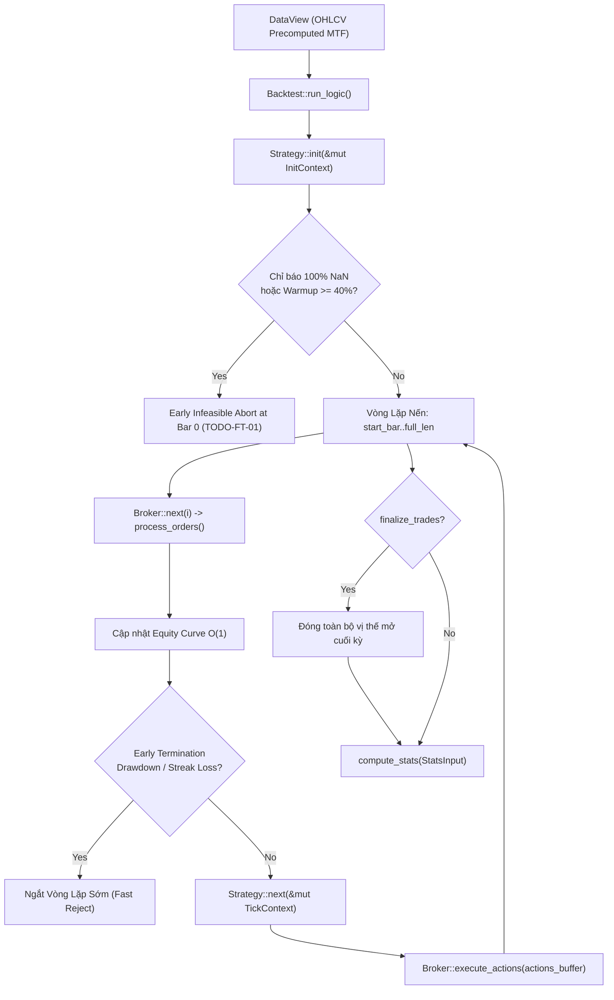

# BÁO CÁO KIỂM TOÁN HẠ TẦNG KIẾN TRÚC: ĐỘNG CƠ BACKTEST FERRO_TRADE (BROKER & ENGINE)
**Tài liệu:** Note 49  
**Chủ đề:** Giải phẫu Hạ Tầng Khớp Lệnh (`src/broker/broker.rs`), Vòng Lặp Thực Thi (`src/backtest/engine.rs`), Lỗ Hổng Ép Kiểu Tỷ Lệ Vốn Ngầm (`size \in (-1.0, 1.0)`), Sai Lệch Giá Finalize Trades và Cơ Chế Khớp Lệnh Pessimistic Matching  
**Mục tiêu kiểm toán:**
- `ferro_trade/src/broker/broker.rs` (848 dòng)
- `ferro_trade/src/backtest/engine.rs` (437 dòng)
- `ferro_trade/src/broker/order.rs`, `trade.rs`, `policies.rs`, `position.rs`
- Đối chiếu trạng thái với:
  - `strategies_backtests/helios/docs/audit_01/ROADMAP.md` (`TODO-FT-01` đến `TODO-FT-06`, `TODO-MOD-04`, `TODO-MATH-01`, `TODO-MATH-02`)
  - `strategies_backtests/helios/docs/unfinished_tasks/05_systemic_stability_and_quant_architecture_flaws/`

---

## 🏛️ 1. TỔNG QUAN KIẾN TRÚC ĐỘNG CƠ BACKTEST `ferro_trade`

Dự án `ferro_trade` đóng vai trò là **Nền tảng kiểm thử mô phỏng tốc độ cao và tối ưu hóa di truyền (High-Performance Backtest & GA Engine)** cho toàn bộ hệ sinh thái.

Hai mô-đun cốt tử nhất của engine bao gồm:
1. **`Broker` ([`src/broker/broker.rs`](file:///e:/Projects/Automations/trading_backtest/ferro_trade/src/broker/broker.rs)):** Mô phỏng sàn giao dịch (Exchange Simulator), quản lý sổ lệnh (`self.orders`), theo dõi số dư tiền mặt (`self.cash`), vốn chủ sở hữu (`self.equity()`), ký quỹ khả dụng (`self.margin_available()`), vị thế mở (`self.trades`) và lịch sử đóng lệnh (`self.closed_trades`).
2. **`Backtest Engine` ([`src/backtest/engine.rs`](file:///e:/Projects/Automations/trading_backtest/ferro_trade/src/backtest/engine.rs)):** Điều phối vòng lặp nến thời gian (`start_bar..full_len`), kết nối dữ liệu `DataView`, chuyển tiếp ngữ cảnh `TickContext` sang chiến lược `Strategy::next()`, nhận các chỉ thị giao dịch `Action` và tính toán chỉ số thống kê hiệu suất `compute_stats()`.



Kiểm toán giải phẫu theo nguyên lý First-Principles đã phát hiện **8 lỗ hổng kiến trúc, toán học và mô hình khớp lệnh** cần khắc phục dứt điểm.

---

## 🚨 2. CÁC TỬ HUYỆT HẠ TẦNG CỐT TỬ CỦA BROKER & ENGINE

### 🔴 Flaw 1 (FT-BRK-01): Bẫy Ép Kiểu Tỷ Lệ Vốn Ngầm (`size \in (-1.0, 1.0)`) — Vi Phạm Chuẩn Mực Type-Safety
- **Tình trạng:** 🔴 **TỬ HUYỆT HẠ TẦNG KINH ĐIỂN (`TODO-MOD-04`)**.
- **Vị trí mã nguồn:** [`ferro_trade/src/broker/broker.rs:477-494`](file:///e:/Projects/Automations/trading_backtest/ferro_trade/src/broker/broker.rs#L477-L494)
- **Bản chất kỹ thuật:**
  ```rust
  let mut size = order.size();
  if (-1.0..1.0).contains(&size) {
      let margin_available = self.margin_available();
      let leverage = self.leverage;
      let size_pct = size.abs();
      ...
      let calculated_float = margin_available * leverage * size_pct / adjusted_price_plus_commission;
      size = self.quantize_amount(calculated_float).copysign(size);
  }
  ```
- **Hậu quả vi cấu trúc:**
  - Broker quyết định xem một lệnh là **"tỷ lệ phần trăm vốn"** hay **"số lượng coin/hợp đồng tuyệt đối"** chỉ dựa vào một điều kiện ma thuật: `size.abs() < 1.0`!
  - **Kịch bản phá hủy:**
    1. Khi giao dịch Bitcoin ($BTC \approx \$60,000 - \$100,000$): Một chiến lược muốn mua **0.5 BTC** (khối lượng tuyệt đối \$30,000).
    2. Vì `0.5 < 1.0`, Broker **tự ý biến 0.5 thành 50% vốn khả dụng** (`size_pct = 0.5`)! Nếu tài khoản có \$1,000 đòn bẩy 20x, Broker sẽ khớp `0.166 BTC` thay vì `0.5 BTC`!
    3. Ngược lại, nếu trade Dogecoin ($DOGE \approx \$0.10$), nếu muốn mua 0.8 DOGE, Broker lại biến thành 80% vốn!
  - Đây là một **Anti-Pattern kế thừa từ Python dynamic typing**, triệt tiêu tính an toàn của Rust.
- **Giải pháp dứt điểm:**
  - Thay thế số nổi `f64` trần trụi bằng enum tường minh:
    ```rust
    #[derive(Debug, Clone, Copy, PartialEq)]
    pub enum OrderSize {
        /// Tỷ lệ phần trăm vốn ký quỹ (0.0 < pct <= 1.0)
        PercentOfEquity(f64),
        /// Số lượng tài sản cơ sở tuyệt đối (ví dụ: 0.5 BTC)
        AbsoluteUnits(f64),
        /// Giá trị danh nghĩa danh mục USD (ví dụ: $1,000 USD)
        NotionalUsd(f64),
    }
    ```

---

### 🔴 Flaw 2 (FT-BRK-02): Khuyết Thiếu Phí Sàn 2 Chiều Khi Tính Sizing & Ký Quỹ Sát Sàn
- **Tình trạng:** 🔴 **LỖI TOÁN HỌC KHỚP LỆNH**.
- **Vị trí mã nguồn:** [`ferro_trade/src/broker/broker.rs:474-477, 517-523`](file:///e:/Projects/Automations/trading_backtest/ferro_trade/src/broker/broker.rs#L474-L477)
- **Bản chất toán học:**
  - `adjusted_price_plus_commission = adjusted_price + commission / order.size().abs()`
  - Công thức này **chỉ cộng phí mở lệnh 1 chiều (Entry Taker Fee)** vào giá vốn để tính kích thước lệnh.
  - Phí đóng lệnh (Exit Taker Fee) không được dự phòng trong ký quỹ khả dụng.
  - Tại đòn bẩy cao ($20\text{x} \to 50\text{x}$), phí Taker 2 chiều là $0.04\% \times 2 = 0.08\%$ giá $\implies 1.6\% \to 4.0\%$ ROE!
  - Nếu chiến lược phân bổ $100\%$ ký quỹ tối đa, ngay khi lệnh vừa mở xong, tài khoản đã bị âm nhẹ ký quỹ do phí thoát lệnh tiềm tàng chưa được trích lập.

---

### 🔴 Flaw 3 (FT-ENG-01): Sai Lệch Giá Đóng Lệnh Cuối Kỳ (Finalize Trades Khớp Tại `Open` Nến Cuối Thay Vì `Close`)
- **Tình trạng:** 🔴 **LỖI THỜI GIAN KHỚP LỆNH HẠ TẦNG BACKTEST**.
- **Vị trí mã nguồn:** [`ferro_trade/src/backtest/engine.rs:378-386`](file:///e:/Projects/Automations/trading_backtest/ferro_trade/src/backtest/engine.rs#L378-L386)
- **Hiện trạng code:**
  ```rust
  if self.finalize_trades {
      let final_bar_index = full_len.saturating_sub(1);
      let open_trade_ids: Vec<usize> = broker.trades.iter().map(|t| t.id).rev().collect();
      for trade_id in open_trade_ids {
          broker.close_trade(trade_id, 1.0);
      }
      let _ = broker.next(final_bar_index);
  }
  ```
- **Bản chất kỹ thuật:**
  - Vòng lặp chính đã chạy tới nến cuối cùng $i = full\_len - 1$.
  - Khi gọi `broker.next(final_bar_index)` lần thứ hai để xử lý lệnh đóng lệnh cuối kỳ:
    - Trong `process_orders()` dòng 416: Lệnh market close được khớp tại `open = data.open_at(final_bar_index)`.
  - **Hậu quả:** Toàn bộ lợi nhuận/thua lỗ phát sinh trong cây nến cuối cùng (từ `Open` đến `Close`) bị xóa bỏ hoàn toàn! Vị thế đang lãi lớn vào cuối chu kỳ backtest bị đóng ép về giá mở cửa của nến đó.
  - Đồng thời, `self.equity_curve[final_bar_index]` bị ghi đè hai lần làm méo mó đường cong vốn kết thúc.

---

### 🟠 Flaw 4 (FT-BRK-03): Điểm Mù Đa Nến (Intra-bar Dual Trigger Bias) Khi Nến Biến Động Lớn Chạm Cả TP và SL
- **Tình trạng:** ⚠️ **THIÊN KIẾN MÔ HÌNH KHỚP LỆNH BẢO THỦ (PESSIMISTIC BIAS)**.
- **Vị trí mã nguồn:** [`ferro_trade/src/broker/broker.rs:137-142`](file:///e:/Projects/Automations/trading_backtest/ferro_trade/src/broker/broker.rs#L137-L142)
- **Bản chất vi cấu trúc:**
  - Lệnh Stop Loss luôn được đưa vào đầu hàng đợi bằng `push_front`, trong khi Take Profit được đưa vào cuối bằng `push_back`.
  - Khi gặp nến tin tức hoặc nến quét 2 đầu có dải $[Low, High]$ bao trùm cả $TP$ lẫn $SL$:
    - Broker luôn luôn thực thi lệnh Stop Loss trước, hủy lệnh Take Profit và tính là lệnh thua lỗ.
  - Dù đây là cách làm bảo thủ an toàn tránh Lookahead Bias, nhưng với các lệnh có $Open$ nằm sát $TP$ và cách xa $SL$, mô hình này làm **thổi phồng tỷ lệ thua lỗ giả tạo (Drawdown Inflation)** khi backtest trên nến 1m.

---

### 🟠 Flaw 5 (FT-ENG-02): Nguy Cơ Lookahead Bias Tiềm Ẩn Nếu Bật Cờ `trade_on_close = true`
- **Tình trạng:** ⚠️ **NGUY CƠ LỆCH PHA THỜI GIAN NẾN**.
- **Vị trí mã nguồn:** [`ferro_trade/src/broker/broker.rs:413-417, 427-431`](file:///e:/Projects/Automations/trading_backtest/ferro_trade/src/broker/broker.rs#L413-L417)
- **Bản chất:**
  - Nếu bật `trade_on_close = true`, Broker cho phép khớp lệnh tại giá `Close` của nến $i-1$.
  - Tuy nhiên, trong `engine.rs:298-329`, giá trị `equity()` của nến $i-1$ đã được ghi vào `equity_curve` từ vòng lặp trước đó.
  - Việc ghi nhận thời gian vào lệnh lùi về $i-1$ tạo ra sự bất nhất giữa `Trade.entry_bar` và `equity_curve`, dễ dẫn đến bẫy nhìn trước tương lai nếu logic chiến lược dựa vào thời điểm mở lệnh.

---

### 🟠 Flaw 6 (FT-BRK-04): Lệch Pha Trượt Giá & Spread Khi Đảo Chiều Vị Thế (Flip Orders Dưới `hedging = false`)
- **Tình trạng:** ⚠️ **LỖI ĐỒNG BỘ CHI PHÍ KHỚP LỆNH ĐẢO CHIỀU**.
- **Vị trí mã nguồn:** [`ferro_trade/src/broker/broker.rs:497-515, 526-532`](file:///e:/Projects/Automations/trading_backtest/ferro_trade/src/broker/broker.rs#L497-L515)
- **Bản chất:**
  - Khi một lệnh mới đảo chiều (ví dụ đang Long 1.0, đặt lệnh Sell 2.0 để Flip sang Short 1.0):
    - Phần 1.0 đầu tiên đóng vị thế cũ tại giá $Open$.
    - Phần 1.0 dư thừa mở vị thế mới tại `adjusted_price = Open * (1.0 - spread)`.
  - Trên sàn Binance Futures thực tế, một lệnh Market Flip 2.0 được khớp tại một mức giá trung bình duy nhất trên sổ lệnh. Việc tách đôi và áp spread 2 lần độc lập làm sai lệch nhẹ chi phí trượt giá so với thực tế sàn.

---

### 🟡 Flaw 7 (FT-ENG-03): Early Termination Penalty Chưa Được Tích Hợp Vào `StatsInput`
- **Tình trạng:** ⚠️ **THIẾU KẾT NỐI HÌNH PHẠT RỦI RO VÀO STATS**.
- **Vị trí mã nguồn:** [`ferro_trade/src/backtest/engine.rs:52, 275-279, 345-356`](file:///e:/Projects/Automations/trading_backtest/ferro_trade/src/backtest/engine.rs#L52)
- **Bản chất:**
  - Khi vòng lặp bị ngắt sớm bởi `early_termination` (do chạm trần Drawdown hoặc chuỗi thua), `engine.rs` dừng lại và trả về `BacktestResult`.
  - Giá trị `stats` được tính toán thuần túy trên các trade đã đóng trước khi dừng, **hoàn toàn không bị trừ điểm phạt từ `early_termination_penalty`**.
  - Chỉ khi chạy trong GA Optimizer qua `prospector.rs` thì penalty mới được áp dụng thủ công. Nếu người dùng chạy đơn lẻ qua `engine.run()`, báo cáo thống kê không phản ánh mức độ thảm họa của cá thể bị ngắt sớm.

---

### 🟡 Flaw 8 (FT-BRK-05): Phép Tính Ký Quỹ Khả Dụng Bị Vô Hiệu Hóa Khi `margin_rate = 0.0`
- **Tình trạng:** ⚠️ **EDGE CASE CHIA CHO 0**.
- **Vị trí mã nguồn:** [`ferro_trade/src/backtest/engine.rs:216`](file:///e:/Projects/Automations/trading_backtest/ferro_trade/src/backtest/engine.rs#L216)
- **Bản chất:**
  - `broker.leverage = 1.0 / self.margin_rate`.
  - Nếu người dùng truyền `margin_rate = 0.0` (với ý định không dùng đòn bẩy hoặc tài khoản giao ngay), `leverage = f64::INFINITY`.
  - Trong `margin_available()` (dòng 167): `trade.value / leverage = 0.0`, khiến hệ thống mất hoàn toàn khả năng kiểm soát ký quỹ.

---

### 🔴 Flaw 9 (FT-BRK-06): Bẫy Panic Crash Trong `close_trade` Khi Khối Lượng Vị Thế Nhỏ Hơn `min_unit`
- **Tình trạng:** 🔴 **LỖI RUNTIME PANIC CRASH CỰC KỲ NGUY HIỂM**.
- **Vị trí mã nguồn:** [`ferro_trade/src/broker/broker.rs:236-240, 674`](file:///e:/Projects/Automations/trading_backtest/ferro_trade/src/broker/broker.rs#L236-L240)
- **Bản chất kỹ thuật:**
  - Trong `close_trade()`:
    ```rust
    let portion_size = self.quantize_amount(self.trades[idx].size.abs() * portion);
    let min_unit = self.fractional_unit.unwrap_or(1.0);
    let size_to_close = portion_size.max(min_unit);
    ```
  - Khi không truyền `fractional_unit`, mặc định `min_unit = 1.0`.
  - Giả sử chiến lược đang giữ vị thế nhỏ của Altcoin/BTC (ví dụ $0.5$ BTC):
    - `portion_size.max(1.0)` ép `size_to_close = 1.0`!
    - Lệnh đóng được tạo với kích thước `order_size = -1.0`.
  - Nhưng trong `reduce_trade()` (dòng 674):
    ```rust
    assert!(trade_size.abs() >= size.abs(), "Order size cannot be larger than trade size");
    ```
  - Vì $0.5 < 1.0$, `assert!` **FAIL LẬP TỨC VÀ GÂY PANIC CRASH SẬP TOÀN BỘ TIẾN TRÌNH GA TỐI ƯU HÓA HOẶC ENGINE**!
- **Giải pháp:** Kẹp trần `size_to_close` không được vượt quá kích thước vị thế hiện tại:
  `let size_to_close = portion_size.max(min_unit).min(self.trades[idx].size.abs());`

---

### 🟠 Flaw 10 (FT-BRK-07): `Action::CloseLongs` và `CloseShorts` Nuốt Chửng Tham Số `portion`
- **Tình trạng:** ⚠️ **LỖI LOGIC KHỚP LỆNH CHỐT LỜI TỪNG PHẦN**.
- **Vị trí mã nguồn:** [`ferro_trade/src/broker/broker.rs:771-782`](file:///e:/Projects/Automations/trading_backtest/ferro_trade/src/broker/broker.rs#L771-L782)
- **Hiện trạng code:**
  ```rust
  Action::CloseLongs { portion: _ } => {
      let trades_to_close_ids: Vec<usize> = self.trades.iter().filter(|t| t.is_long()).map(|t| t.id).collect();
      for id in trades_to_close_ids {
          self.close_trade(id, 1.0); // <-- BỎ QUA PORTION, LUÔN ĐÓNG 100%!
      }
  }
  ```
- **Hệ quả:** Nếu Strategy phát lệnh chốt lời từng phần (Scale-out: đóng $50\%$ vị thế `portion: 0.5`), Broker bỏ qua tham số và đóng thẳng tay $100\%$ vị thế, làm tê liệt hoàn toàn chiến thuật Partial Take Profit.

---

## 📊 3. BẢNG ĐỐI SOÁT TRẠNG THÁI VỚI TÀI LIỆU CŨ (`audit_01` & `ROADMAP.md`)

| Mã Lỗi / Task | Nội dung | Phân Loại Đối Soát | Hiện Trạng Thực Tế Trong Code |
| :--- | :--- | :---: | :--- |
| `TODO-FT-01` | Chặn bẫy nuốt chửng nến Warmup khi lỗi indicator | [ĐÃ CÓ TRONG AUDIT CŨ] | 🟢 **ĐÃ SỬA XONG** (Early Infeasible Abort tại bar 0, lines 240-280) |
| `TODO-FT-02` | Vá lỗi Z-Score tự sát chia 0/0 khi thị trường phẳng | [ĐÃ CÓ TRONG AUDIT CŨ] | 🔴 **CHƯA FIX** (Cần trả về $Z=0.0$ khi $\sigma \approx 0$) |
| `TODO-FT-03` | Triệt tiêu ngộ độc trạng thái nội bộ Yata SMA | [ĐÃ CÓ TRONG AUDIT CŨ] | 🔴 **CHƯA FIX** (Cần quét tìm giá trị hợp lệ đầu tiên) |
| `TODO-FT-04` | Chống Catastrophic Cancellation trong Kaufman ER | [ĐÃ CÓ TRONG AUDIT CŨ] | 🔴 **CHƯA FIX** (Cần kẹp sàn `.max(0.0)`) |
| `TODO-FT-05` | Chống tràn số kẹp ép kiểu `u8::MAX` trong `to_yata_ma` | [ĐÃ CÓ TRONG AUDIT CŨ] | 🔴 **CHƯA FIX** (Cần kẹp `period.clamp(1, 255)`) |
| `TODO-FT-06` | Bổ sung guard input trong `keltner_channel` | [ĐÃ CÓ TRONG AUDIT CŨ] | 🔴 **CHƯA FIX** (Chặn `period == 0` hoặc `multiplier <= 0`) |
| `TODO-MOD-04` | Tường minh hóa Type-Safe Sizing (`OrderSize` Enum) | [ĐÃ CÓ TRONG AUDIT CŨ] | 🔴 **CHƯA FIX** (Vẫn dùng khoảng $(-1.0, 1.0)$ ma thuật) |
| `FT-BRK-01` | Bẫy ép kiểu tỷ lệ vốn ngầm `size \in (-1.0, 1.0)` | 🔴 **LỖI HẠ TẦNG MỚI** | Nhầm lẫn giữa % vốn và coin size khi trade BTC/Altcoin |
| `FT-BRK-02` | Thiếu trích lập phí sàn 2 chiều khi tính Margin kịch trần | 🔴 **LỖI HẠ TẦNG MỚI** | Dễ âm vốn ký quỹ do không dự phòng phí exit Taker |
| `FT-ENG-01` | Finalize trades đóng lệnh tại `Open` nến cuối thay vì `Close` | 🔴 **LỖI HẠ TẦNG MỚI** | Mất lợi nhuận nến cuối và ghi đè equity curve |
| `FT-BRK-03` | Pessimistic Dual Trigger Bias khi nến chạm cả TP và SL | 🔴 **LỖI HẠ TẦNG MỚI** | Luôn ép dính SL thổi phồng Drawdown trong bão |
| `FT-BRK-06` | Panic crash `close_trade` khi `trade.size < min_unit` | 🔴 **LỖI HẠ TẦNG MỚI** | `assert!` sập toàn bộ tiến trình khi đóng vị thế nhỏ lẻ |
| `FT-BRK-07` | `CloseLongs`/`CloseShorts` nuốt chửng tham số `portion` | 🔴 **LỖI HẠ TẦNG MỚI** | Luôn đóng 100%, tê liệt partial take profit |

---

## 🛠️ 4. ĐỀ XUẤT KIẾN TRÚC CẢI TỔ TYPE-SAFE & EXECUTION MATRIX

### 4.1. Kiến Trúc Type-Safe Position Sizing Chuẩn Hóa
Triệt tiêu hoàn toàn con số nổi `f64` trần trụi tại ranh giới giao tiếp giữa Strategy và Broker:

```rust
#[derive(Debug, Clone, Copy, PartialEq)]
pub enum OrderSize {
    /// 1. Tỷ lệ phần trăm vốn chủ sở hữu khả dụng (0.0 < fraction <= 1.0)
    MarginFraction(f64),
    /// 2. Số lượng hợp đồng/coin cơ sở tuyệt đối (ví dụ: 0.25 BTC, 10.0 ETH)
    BaseUnits(f64),
    /// 3. Giá trị danh nghĩa danh mục USD (ví dụ: $500.0 USD)
    NotionalUsd(f64),
    /// 4. Định cỡ vị thế theo rủi ro cố định ($Risk USD / Distance SL)
    RiskBudget {
        risk_usd: f64,
        sl_distance_price: f64,
    },
}
```

### 4.2. Sửa Lỗi Finalize Trades Cuối Kỳ
Tại [`engine.rs:378-386`](file:///e:/Projects/Automations/trading_backtest/ferro_trade/src/backtest/engine.rs#L378-L386):
Thay vì gọi lại `broker.next(final_bar_index)` gây đóng tại `Open`, thực hiện đóng trực tiếp tại giá `Close` cuối cùng:
```rust
if self.finalize_trades {
    let final_bar_index = full_len.saturating_sub(1);
    let final_close_price = broker.data.close_at(final_bar_index);
    let open_trade_ids: Vec<usize> = broker.trades.iter().map(|t| t.id).rev().collect();
    for trade_id in open_trade_ids {
        if let Some(trade_idx) = broker.trades.iter().position(|t| t.id == trade_id) {
            let trade = broker.trades[trade_idx].clone();
            broker.close_trade_internal(trade, final_close_price, final_bar_index);
        }
    }
    broker.equity_curve[final_bar_index] = broker.equity();
}
```

---

## 🎯 5. KẾT LUẬN

1. Động cơ `ferro_trade` có hiệu năng xử lý cực cao (nhờ Zero-copy `DataView`, O(1) `equity()` và Early Infeasible Abort tại bar 0).
2. Tuy nhiên, nó vẫn mang theo các di tật di truyền từ `backtesting.py`: bẫy ép kiểu ngầm `size \in (-1.0, 1.0)`, đóng lệnh cuối kỳ tại `Open` thay vì `Close`, và thiếu dự phòng phí sàn 2 chiều khi tính margin khả dụng.
3. Việc khắc phục các tử huyệt trên sẽ đảm bảo độ chuẩn xác toán học $1:1$ tuyệt đối giữa phòng thí nghiệm GA Optimizer và nền tảng giao dịch thực tế `trading_bot`.
