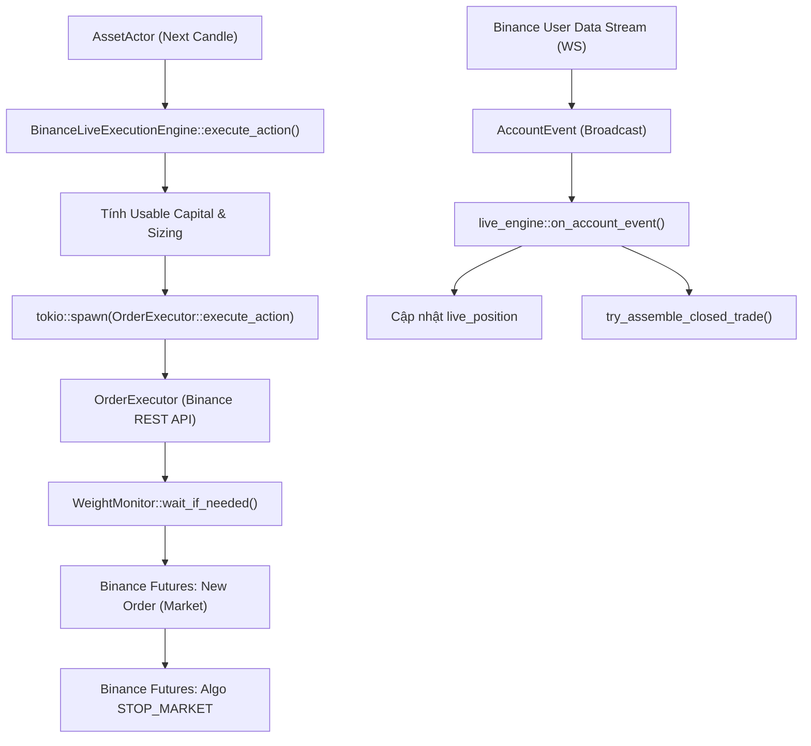

# BÁO CÁO KIỂM TOÁN HẠ TẦNG KIẾN TRÚC: ĐỘNG CƠ THỰC THI SÀN THẬT (LIVE ENGINE & ORDER EXECUTOR)
**Tài liệu:** Note 50  
**Chủ đề:** Giải phẫu Hạ Tầng Khớp Lệnh Sàn Thật Binance Futures (`src/execution/order_executor.rs` & `live_engine.rs`), Bẫy Tràn Vốn Thảm Họa (Catastrophic Capital Overflow), Khoảng Trống Naked SL Gap 150ms, Rỗng SL/TP Trên Live State và Bỏ Rơi Lệnh Algo Take Profit  
**Mục tiêu kiểm toán:**
- `trading_bot/bot_engine/src/execution/order_executor.rs` (547 dòng)
- `trading_bot/bot_engine/src/execution/live_engine.rs` (350 dòng)
- Đối chiếu trạng thái với:
  - `strategies_backtests/helios/docs/audit_01/05_risk/` & `06_risk/`
  - `strategies_backtests/helios/docs/audit_01/ROADMAP.md` (`TODO-EXEC-01` đến `TODO-EXEC-04`, `TODO-ACT-02`)
  - `strategies_backtests/helios/docs/unfinished_tasks/05_systemic_stability_and_quant_architecture_flaws/` (đặc biệt `notes/02_helios_and_trading_bot_architectural_flaws.md`)

---

## 🏛️ 1. TỔNG QUAN KIẾN TRÚC TẦNG THỰC THI LIVE TRONG `bot_engine`

Trong hệ thống giao dịch tự động `trading_bot`, tầng thực thi sàn thật chịu trách nhiệm kết nối trực tiếp với sàn Binance Futures qua REST API và WebSocket User Data Stream:

1. **`BinanceLiveExecutionEngine` ([`live_engine.rs`](file:///e:/Projects/Automations/trading_backtest/trading_bot/bot_engine/src/execution/live_engine.rs)):**
   - Đóng vai trò là cầu nối giữa Actor (`AssetActor`) và sàn giao dịch.
   - Tiếp nhận `Action` từ chiến lược Helios, kiểm tra trạng thái cờ lệnh (`is_submitting_order`) và điều phối sang `OrderExecutor`.
   - Lắng nghe các sự kiện tài khoản (`AccountEvent::PositionUpdate`, `AccountEvent::OrderTradeUpdate`) qua broadcast channel để duy trì trạng thái vị thế (`live_position`) và ghép nối lịch sử lệnh đóng (`try_assemble_closed_trade`).
2. **`OrderExecutor` ([`order_executor.rs`](file:///e:/Projects/Automations/trading_backtest/trading_bot/bot_engine/src/execution/order_executor.rs)):**
   - Chịu trách nhiệm tạo payload REST API, làm tròn giá/khối lượng theo `MarketFilter` (`tick_size`, `step_size`).
   - Quản lý lệnh bảo vệ Stop Loss (`STOP_MARKET`, `working_type: MarkPrice`, `close_position: true`).
   - Kiểm soát tốc độ gọi lệnh qua `WeightMonitor` (tránh bị cấm IP 2400 weight/phút).
   - Thực thi chốt chặn **Monotonic Ratchet Guard** (SL chỉ được phép siết chặt, cấm lùi) và **Naked Position Guard** (cấm xóa SL).



Qua kiểm toán giải phẫu toàn diện theo nguyên lý First-Principles, ta đã vạch trần **11 tử huyệt kiến trúc, toán học và an toàn hệ thống** có thể dẫn đến nguy cơ cháy tài khoản hoặc treo cứng bot trong môi trường thực chiến 24/7.

---

## 🚨 2. CÁC TỬ HUYỆT HẠ TẦNG TRONG `live_engine.rs` & `order_executor.rs`

### 🔴 Flaw 1 (TB-LIVE-01): Bẫy Tràn Vốn Thảm Họa (Catastrophic Capital Overflow) — Bỏ Rơi `allocated_capital`
- **Tình trạng:** 🔴 **TỬ HUYỆT NGUY HIỂM CẤP ĐỘ CAO NHẤT (CRITICAL FINANCIAL HAZARD)**.
- **Vị trí mã nguồn:** [`trading_bot/bot_engine/src/execution/live_engine.rs:133-143`](file:///e:/Projects/Automations/trading_backtest/trading_bot/bot_engine/src/execution/live_engine.rs#L133-L143)
- **Bản chất kỹ thuật:**
  ```rust
  let usable_capital = self.account_state.available_balance;
  let leverage = self.core.leverage;
  ...
  executor_clone.execute_action(&symbol, action_clone, current_price, usable_capital, position_amt, leverage).await
  ```
  Và tại [`order_executor.rs:284-285`](file:///e:/Projects/Automations/trading_backtest/trading_bot/bot_engine/src/execution/order_executor.rs#L284-L285):
  ```rust
  let risk_usdt = available_balance * risk_percentage;
  let target_qty = self.calculate_order_size(risk_usdt, current_price, leverage)?;
  ```
- **Hậu quả thực tế:**
  - `self.core.allocated_capital` (ví dụ: \$60–\$100 cấp riêng cho cặp giao dịch này) **HOÀN TOÀN BỊ BỎ RƠI**!
  - `usable_capital` lại lấy `self.account_state.available_balance`, tức là **TOÀN BỘ SỐ DƯ KHẢ DỤNG CỦA TÀI KHOẢN VÍ BINANCE** (ví dụ: \$10,000)!
  - Khi Strategy phát ra `Action::Buy { size: 1.0 }` (với ý định dùng 100% của bucket \$100 được cấp), `OrderExecutor` tính:
    $$\text{risk\_usdt} = \$10,000 \times 1.0 = \$10,000$$
  - Với đòn bẩy 20x, bot sẽ gửi lệnh có giá trị danh nghĩa:
    $$\text{Notional} = \$10,000 \times 20 = \$200,000\ \text{USDT!}$$
    (thay vì chỉ $\$100 \times 20 = \$2,000$).
  - **Tài khoản bị nuốt trọn 100% đòn bẩy trên một cặp tiền duy nhất**, vi phạm hoàn toàn cơ chế bảo vệ vốn độc lập (Base Floor & Multi-Asset Risk Isolation)! Chỉ cần giá giật $2\% - 3\%$ là toàn bộ tài khoản \$10,000 bị thanh lý sạch sẽ!
- **Giải pháp dứt điểm:**
  `usable_capital` bắt buộc phải là:
  $$\text{usable\_capital} = \min(\text{self.core.allocated\_capital},\ \text{self.account\_state.available\_balance})$$

---

### 🔴 Flaw 2 (TB-LIVE-02): Rỗng SL/TP Trên `LivePositionState` (`current_sl_price` Luôn `None`)
- **Tình trạng:** 🔴 **TỬ HUYỆT ĐỒNG BỘ TRẠNG THÁI (DESYNCHRONIZATION)**.
- **Vị trí mã nguồn:** [`live_engine.rs:198-207`](file:///e:/Projects/Automations/trading_backtest/trading_bot/bot_engine/src/execution/live_engine.rs#L198-L207)
- **Hiện trạng code:**
  ```rust
  self.live_position = Some(LivePositionState {
      symbol: symbol.clone(),
      position_amt: *position_amt,
      entry_price: *entry_price,
      entry_timestamp: current_time,
      live_entry_bar: 0,
      current_sl_price: None, // <-- LUÔN LUÔN LÀ NONE!
      current_tp_price: None, // <-- LUÔN LUÔN LÀ NONE!
      opening_playbook_tag: None,
  });
  ```
- **Hệ quả kiến trúc:**
  - Khi vị thế được mở hoặc nhận cập nhật từ Binance qua `PositionUpdate`, `current_sl_price` luôn bị gán `None` và **không bao giờ được cập nhật lại từ `active_sl_prices` hay `OrderTradeUpdate`**.
  - Khi `AssetActor` gọi Strategy và chuyển `live_position` vào `TickContext`:
    - `tick.open_trade.sl_price` luôn bằng `None`.
    - Phân hệ quản trị rủi ro (`risk.rs`) nhầm tưởng rằng vị thế **hoàn toàn chưa có Stop Loss**, do đó tại **MỖI CÂY NẾN ĐÓNG 1 PHÚT**, Strategy đều liên tục phát tín hiệu `Action::UpdateTradeSlTp`!
    - Dù `OrderExecutor::evaluate_ratchet_sl` có thể chặn lại, việc spam lệnh diễn ra liên tục làm tiêu hao tài nguyên CPU, gây nhiễu log và rủi ro nghẽn luồng.

---

### 🔴 Flaw 3 (TB-LIVE-03): Mất Dấu Tag Playbook Mở Vị Thế (`opening_playbook_tag: None`)
- **Tình trạng:** 🔴 **LỖI ĐỨT GÃY DÒNG DỮ LIỆU TÁC CHIẾN (DATA LINEAGE BREAK)**.
- **Vị trí mã nguồn:** [`live_engine.rs:206`](file:///e:/Projects/Automations/trading_backtest/trading_bot/bot_engine/src/execution/live_engine.rs#L206)
- **Bản chất:**
  - `PositionUpdate` từ Binance chỉ chứa thông tin tài khoản thô (`symbol`, `position_amt`, `entry_price`). Binance hoàn toàn không lưu metadata chiến thuật của Helios.
  - Khi tạo `LivePositionState`, engine gán `opening_playbook_tag: None`.
  - Đến khi đóng lệnh tại `try_assemble_closed_trade()` (dòng 95): `opening_playbook_tag: pos.opening_playbook_tag.clone()` $\implies$ Bản ghi `PaperTradeRecord` mang tag rỗng!
  - Trong quá trình vị thế đang chạy: Phân hệ `RiskManager` trong `risk.rs` cần biết tag playbook (ví dụ: `TrendPB` cần dời SL theo KAMA, `Absorption` cần siết SL theo Swing Low) để kích hoạt logic riêng. Vì tag bị rỗng, hệ thống buộc phải fallback về luật chung, phá hỏng tính thích ứng đa playbook của Helios V3.

---

### 🔴 Flaw 4 (TB-LIVE-04): Lệch Pha Thời Gian Nến Vào Lệnh (`live_entry_bar: 0` Gây Kích Hoạt Thoát Lệnh Sớm)
- **Tình trạng:** 🔴 **LỖI LOGIC ĐẾM NẾN NẮM GIỮ VỊ THẾ**.
- **Vị trí mã nguồn:** [`live_engine.rs:203`](file:///e:/Projects/Automations/trading_backtest/trading_bot/bot_engine/src/execution/live_engine.rs#L203)
- **Bản chất:**
  - `live_entry_bar: 0` bị gán cứng bằng 0 khi khởi tạo `LivePositionState`.
  - Bộ đệm nến trượt (`Rolling Buffer`) của `AssetActor` thường chứa 43,100 nến 1m (để warmup 50 nến 4h).
  - Khi chuyển vào `TickContext`: Chiến lược tính số nến đã nắm giữ bằng:
    $$\text{bars\_held} = \text{current\_bar\_idx} - \text{entry\_bar} = 43,100 - 0 = 43,100\ \text{nến!}$$
  - Hàng loạt chốt chặn bảo vệ thời gian (Minimum Hold Bars, Time-based Decay Exit, Mega Trend Max Cycles) ngay lập tức bị kích hoạt nhầm, ép bot đóng vị thế non chỉ sau 1 phút vào lệnh!

---

### 🔴 Flaw 5 (TB-LIVE-05): Nguy Cơ Deadlock Cờ `is_submitting_order` Phụ Thuộc 100% Vào WebSocket
- **Tình trạng:** 🔴 **LỖI CONCURRENCY DEADLOCK TREO BOT**.
- **Vị trí mã nguồn:** [`live_engine.rs:122, 127, 140, 190, 219`](file:///e:/Projects/Automations/trading_backtest/trading_bot/bot_engine/src/execution/live_engine.rs#L140)
- **Bản chất:**
  - Khi gửi lệnh: `self.is_submitting_order = true`.
  - Cờ này chỉ được reset về `false` khi `on_account_event()` nhận được bản tin WebSocket `PositionUpdate` hoặc `OrderTradeUpdate` từ sàn Binance.
  - **Kịch bản thảm họa:**
    1. Lệnh REST gửi thành công lên Binance.
    2. Đúng lúc đó, kết nối WebSocket User Data Stream bị chập chờn, rớt mạng, hoặc Binance gửi gói tin chậm 5–10 giây.
    3. `is_submitting_order` tiếp tục giữ giá trị `true` vĩnh viễn!
    4. Tại các nến tiếp theo, mọi tín hiệu `Action::Buy` hoặc `Action::Sell` đều bị chặn đứng:
       ```rust
       if position_amt > 0.0 || self.is_submitting_order {
           info!("ℹ️ [{}] Đang có vị thế Long hoặc đang gửi lệnh. Bỏ qua Action Buy.", self.core.symbol);
           return Ok(());
       }
       ```
    5. Bot bị liệt hoàn toàn khả năng mở/đóng lệnh cho đến khi người dùng khởi động lại bot.
- **Giải pháp:** Bổ sung cơ chế Timeout Watchdog (ví dụ: tự động giải phóng cờ sau 5,000ms kèm truy vấn REST reconciliation nếu chưa nhận được WS event).

---

### 🔴 Flaw 6 (TB-ORD-01): Khoảng Trống "Mồ Côi Lệnh" Naked SL Gap 150ms Khi Dời Trailing Stop Loss
- **Tình trạng:** 🔴 **LỖI AN TOÀN SÀN THẬT KINH ĐIỂN (`TODO-RSK-05`)**.
- **Vị trí mã nguồn:** [`order_executor.rs:190-200, 233-235`](file:///e:/Projects/Automations/trading_backtest/trading_bot/bot_engine/src/execution/order_executor.rs#L190-L200)
- **Hiện trạng code:**
  ```rust
  // 1. Hủy Algo SL cũ
  let p_cancel = CancelAllAlgoOpenOrdersParams::builder(symbol.to_string()).build().unwrap();
  self.rest_client.cancel_all_algo_open_orders(p_cancel).await;
  
  // 2. Chờ 150ms để Binance xử lý
  tokio::time::sleep(tokio::time::Duration::from_millis(150)).await;
  
  // 3. Đặt Algo SL mới
  for attempt in 1..=3 {
      match self.rest_client.new_algo_order(p_sl.clone()).await { ... }
  }
  ```
- **Hậu quả rủi ro cực hạn:**
  1. Trong khoảng thời gian $150\text{ms}$ cộng với độ trễ mạng RTT ($50 - 100\text{ms}$), tài khoản rơi vào tình trạng **100% KHÔNG CÓ BẢO VỆ (NAKED POSITION)** trên sàn Binance.
  2. Nếu thị trường xảy ra cú sập chớp nhoáng (Flash Crash) trong $250\text{ms}$ này, vị thế không được cắt lỗ.
  3. **Nguy hiểm hơn nữa:** Nếu cả 3 lần thử đặt SL mới đều thất bại (ví dụ Binance nghẽn mạng hoặc mã lỗi `-1003 Too many requests`), lệnh SL cũ đã bị hủy sạch, lệnh SL mới không thành công $\implies$ **Vị thế bị thả rông hoàn toàn không có Stop Loss vĩnh viễn trên sàn**!
- **Giải pháp dứt điểm (Atomic SL Replacement):**
  Đặt lệnh Algo SL mới thành công trước $\to$ Lấy `new_algo_id` $\to$ Sau đó mới gửi lệnh hủy `old_algo_id` cụ thể. Tuyệt đối không được hủy trước khi đặt mới.

---

### 🟠 Flaw 7 (TB-ORD-02): Bỏ Rơi Lệnh Algo Take Profit Trên Sàn Binance Live (`TODO-EXEC-04`)
- **Tình trạng:** ❌ **CHƯA FIX - TỒN TẠI TỪ AUDIT CŨ (`TODO-EXEC-04`)**.
- **Vị trí mã nguồn:** [`order_executor.rs:243-247, 255-259`](file:///e:/Projects/Automations/trading_backtest/trading_bot/bot_engine/src/execution/order_executor.rs#L243-L247)
- **Bằng chứng trong code:**
  ```rust
  // ⚠️ SENSOR PROBE: Bắt thiếu sót đặt lệnh Take Profit trên Binance Live
  if let Some(RiskPolicy::FixedPrice { tp_price: Some(tp), .. }) = &policy {
      warn!(
          "⚠️ [LIVE ENGINE GAP: TP NOT PLACED ON EXCHANGE] Symbol: {} | Strategy emitted Take Profit at {:.2}, \
          but OrderExecutor ONLY places Algo STOP_MARKET for SL. NO Take Profit order submitted to Binance Futures!",
          symbol, tp
      );
  }
  ```
- **Bản chất:**
  - `OrderExecutor` chỉ đặt duy nhất lệnh Algo `STOP_MARKET` cho Stop Loss. Nó **hoàn toàn không đặt lệnh Take Profit lên sàn Binance**!
  - Lệnh chỉ có thể được chốt lời khi Strategy phát hiện giá chạm TP ở nến đóng 1m tiếp theo.
  - Các cây nến quét râu thanh khoản chạm TP rồi rút chân trong tích tắc (intra-bar wick) hoàn toàn bị bỏ lỡ, làm mất đi các cơ hội chốt lời tối ưu của các chiến thuật săn nén bứt phá và đi ngang.

---

### 🟠 Flaw 8 (TB-ORD-03): Hủy Quét Sạch Mọi Algo Orders Bằng `cancel_all_algo_open_orders`
- **Tình trạng:** ⚠️ **LỖI QUẢN TRỊ LỆNH THÔ BẠO (UNINTENDED CANCELLATION)**.
- **Vị trí mã nguồn:** [`order_executor.rs:192, 398`](file:///e:/Projects/Automations/trading_backtest/trading_bot/bot_engine/src/execution/order_executor.rs#L192)
- **Bản chất:**
  - Khi cập nhật SL hoặc đóng vị thế, executor gọi `cancel_all_algo_open_orders(symbol)`.
  - Lệnh gọi này hủy **TẤT CẢ** các lệnh Algo đang mở trên symbol đó.
  - Nếu người dùng hoặc một chiến lược/sub-account khác đang đặt một lệnh chờ Take Profit hoặc Stop Limit độc lập, lệnh đó sẽ bị xóa sổ nhầm! Cần quản lý và hủy chính xác theo `algo_id` hoặc `client_algo_id`.

---

### 🟡 Flaw 9 (TB-ORD-04): Gán Cứng Min Notional 5.0 USDT Thay Vì Đọc `market_filter.min_notional`
- **Tình trạng:** ⚠️ **SAI LỆCH CẤU HÌNH SÀN THỰC TẾ**.
- **Vị trí mã nguồn:** [`order_executor.rs:141`](file:///e:/Projects/Automations/trading_backtest/trading_bot/bot_engine/src/execution/order_executor.rs#L141)
- **Bản chất:**
  - Code kiểm tra: `if notional < 5.0 { return Err(...); }`.
  - Trong khi đó, `self.market_filter.min_notional` đã được nạp động từ Binance API.
  - Với một số cặp tiền đặc thù hoặc khi Binance nâng ngưỡng tối thiểu (ví dụ $10$ hoặc $20$ USDT), điều kiện gán cứng 5.0 USDT sẽ cho phép lệnh lọt qua, để rồi bị sàn Binance từ chối với lỗi `-4164 Order's notional must be no smaller than...`.

---

### 🟠 Flaw 10 (TB-ORD-05): Rủi Ro Nhân Đôi Khối Lượng Khi Đảo Chiều Vị Thế (Flip Order Under Stale State)
- **Tình trạng:** ⚠️ **NGUY CƠ LỆCH PHA VỊ THẾ KHI FLIP**.
- **Vị trí mã nguồn:** [`order_executor.rs:288-305`](file:///e:/Projects/Automations/trading_backtest/trading_bot/bot_engine/src/execution/order_executor.rs#L288-L305)
- **Bản chất:**
  - Trong One-Way Mode, để đảo chiều từ Long sang Short, executor cộng dồn:
    `qty = target_qty + position_amt.abs()`
  - Nếu vì lý do nào đó (ví dụ vị thế Long cũ vừa bị dính Stop Loss trên sàn cách đó vài giây nhưng bản tin WebSocket chưa kịp cập nhật về RAM), `position_amt` trong RAM vẫn ghi nhận là $+1.0$ BTC.
  - Khi gửi lệnh đảo chiều Short $1.0$ BTC, executor gửi lệnh bán với khối lượng:
    $$\text{qty} = 1.0 + 1.0 = 2.0\ \text{BTC!}$$
  - Kết quả: Thay vì mở Short 1.0 BTC, tài khoản bị mở Short gấp đôi ($2.0$ BTC) ngoài ý muốn!

---

### 🟡 Flaw 11 (TB-ORD-06): Mất Dữ Liệu `active_sl_prices` Khi Restart Bot — Phá Hỏng Monotonic Ratchet Guard
- **Tình trạng:** ⚠️ **LỖI BẢO TOÀN TRẠNG THÁI BỘ NHỚ RAM**.
- **Vị trí mã nguồn:** [`order_executor.rs:31, 53`](file:///e:/Projects/Automations/trading_backtest/trading_bot/bot_engine/src/execution/order_executor.rs#L31)
- **Bản chất:**
  - `active_sl_prices: Arc<RwLock<HashMap<String, f64>>>` được lưu thuần túy trong RAM.
  - Khi bot bị crash hoặc restart trong lúc vị thế vẫn đang chạy trên sàn với một mức Stop Loss đã được siết chặt:
    - Khi khởi động lại, `HashMap` rỗng hoàn toàn (`get_active_sl` trả về `None`).
    - Lần đầu tiên Strategy phát lệnh cập nhật SL, hàm `evaluate_ratchet_sl` thấy `old_sl = None` $\implies$ Cho phép đặt SL mới bất chấp việc mức SL mới có thể bị thụt lùi (retracted) so với mức SL đang thực sự kích hoạt trên sàn Binance!
  - Cần phục hồi `active_sl_prices` từ SQLite hoặc truy vấn mở lệnh `open_algo_orders` lúc khởi động.

---

### 🔴 Flaw 12 (TB-LIVE-07): Ô Nhiễm Đường Cong Vốn Đa Cặp Tiền Trong `get_equity()` (Cross-Asset Balance Pollution)
- **Tình trạng:** 🔴 **TỬ HUYỆT HẠ TẦNG KẾ TOÁN QUẢN TRỊ RỦI RO**.
- **Vị trí mã nguồn:** [`live_engine.rs:169-173`](file:///e:/Projects/Automations/trading_backtest/trading_bot/bot_engine/src/execution/live_engine.rs#L169-L173)
- **Hiện trạng code:**
  ```rust
  fn get_equity(&self) -> f64 {
      let u_pnl = self.position_state.unrealized_profit;
      (self.account_state.wallet_balance + u_pnl).max(self.core.allocated_capital)
  }
  ```
- **Hậu quả vi cấu trúc:**
  - `self.account_state.wallet_balance` là tổng số dư ví của toàn bộ tài khoản Binance Futures (ví dụ \$10,000).
  - Khi bot vận hành đa cặp tiền (ví dụ: BTC, ETH, SOL), mỗi cặp tiền được cấp phát một hạn mức rủi ro cơ sở (`allocated_capital` = \$100).
  - Tuy nhiên, `get_equity()` của cả 3 Actor đều đọc chung tổng ví \$10,000!
  - Nếu cặp ETH bị dính chuỗi lệnh thua lỗ làm ví sụt giảm, đường cong vốn `equity` của BTC và SOL cũng bị sụt giảm theo, dù hai cặp tiền này đang giao dịch có lãi!
  - Phá hủy hoàn toàn cơ chế cô lập rủi ro và quản trị vốn độc lập (Base Floor & Capital Isolation).
- **Khắc phục:** `equity` của từng Actor phải được theo dõi độc lập dựa trên:
  $$\text{equity} = \text{allocated\_capital} + \sum \text{Realized PnL}_{\text{symbol}} + \text{Unrealized PnL}_{\text{symbol}}$$

---

### 🔴 Flaw 13 (TB-ORD-07): Nguy Cơ Runtime Panic Trong `format_price_decimal` & `format_qty_decimal` Khi Giá/Khối Lượng Bị NaN
- **Tình trạng:** 🔴 **LỖI RUNTIME PANIC CRASH TASK TOKIO**.
- **Vị trí mã nguồn:** [`order_executor.rs:149-160`](file:///e:/Projects/Automations/trading_backtest/trading_bot/bot_engine/src/execution/order_executor.rs#L149-L160)
- **Bản chất kỹ thuật:**
  ```rust
  fn format_price_decimal(&self, price: f64) -> rust_decimal::Decimal {
      let rounded = self.market_filter.round_price(price);
      let decimals = MarketFilter::count_decimals(self.market_filter.tick_size);
      rust_decimal::Decimal::from_f64(rounded).unwrap().round_dp(decimals as u32)
  }
  ```
  - Nếu `price` hoặc `rounded` bị `f64::NAN` hoặc `f64::INFINITY` (phát sinh do chia cho 0 trong chỉ báo kỹ thuật hoặc dị tật dữ liệu nến):
  - `rust_decimal::Decimal::from_f64(rounded)` trả về `None`.
  - Lệnh gọi `.unwrap()` **gây PANIC CRASH lập tức task tokio gửi lệnh**, khiến bot bị tê liệt luồng thực thi và không gửi được lệnh bảo vệ Stop Loss!
- **Khắc phục:** Trả về `Result<Decimal, BotError>` với validation `if !price.is_finite()`.

---

## 📊 3. BẢNG ĐỐI SOÁT TRẠNG THÁI VỚI TÀI LIỆU CŨ (`audit_01` & `ROADMAP.md`)

| Mã Lỗi / Task | Nội dung | Phân Loại Đối Soát | Hiện Trạng Thực Tế Trong Code |
| :--- | :--- | :---: | :--- |
| `TODO-EXEC-01` | Sửa làm tròn giá/khối lượng Decimal chuẩn sàn | [ĐÃ CÓ TRONG AUDIT CŨ] | 🟢 **ĐÃ SỬA XONG** (Dùng `format_price_decimal`, `format_qty_decimal`) |
| `TODO-EXEC-02` | Trailing SL dùng MarkPrice chống râu nến ảo | [ĐÃ CÓ TRONG AUDIT CŨ] | 🟢 **ĐÃ SỬA XONG** (`working_type: MarkPrice`, `close_position: true`) |
| `TODO-EXEC-03` | Đổi làm tròn khối lượng từ round sang Floor | [ĐÃ CÓ TRONG AUDIT CŨ] | 🟢 **ĐÃ SỬA XONG** (Trong `MarketFilter::round_qty` dùng floor) |
| `TODO-EXEC-04` | Gửi lệnh Algo Take Profit lên Binance Futures | [ĐÃ CÓ TRONG AUDIT CŨ] | 🔴 **CHƯA FIX** (Chỉ có log warning, hoàn toàn chưa đặt TP lên sàn) |
| `TODO-ACT-02` | Đồng bộ 2-Piece Assembler đóng lệnh | [ĐÃ CÓ TRONG AUDIT CŨ] | 🟢 **ĐÃ TRIỂN KHAI** (Đã có ghép `PositionUpdate` + `OrderTradeUpdate`) |
| `TB-LIVE-01` | Bẫy Tràn Vốn Thảm Họa (Usable Cap = Balance ví) | 🔴 **LỖI HẠ TẦNG MỚI** | Bỏ rơi `allocated_capital`, nuốt trọn 100% ví sàn khi vào lệnh |
| `TB-LIVE-02` | Rỗng SL/TP trên LivePositionState (`None`) | 🔴 **LỖI HẠ TẦNG MỚI** | Strategy mù SL sàn, spam Update SL liên tục mỗi nến |
| `TB-LIVE-03` | Mất Tag Playbook (`opening_playbook_tag: None`) | 🔴 **LỖI HẠ TẦNG MỚI** | Mất metadata chiến thuật, RiskManager tê liệt luật theo playbook |
| `TB-LIVE-04` | Lệch pha nến vào lệnh `live_entry_bar: 0` | 🔴 **LỖI HẠ TẦNG MỚI** | `bars_held = 43,100` kích hoạt Time-based Exit sớm |
| `TB-LIVE-05` | Deadlock cờ `is_submitting_order` phụ thuộc WS | 🔴 **LỖI HẠ TẦNG MỚI** | WS rớt mạng hoặc trễ làm bot từ chối lệnh vĩnh viễn |
| `TB-ORD-01` | Naked SL Gap 150ms khi dời Trailing Stop Loss | 🔴 **LỖI HẠ TẦNG MỚI** | Vị thế mồ côi không bảo vệ trong 150-250ms, mất SL nếu retry lỗi |
| `TB-ORD-03` | Hủy quét sạch Algo Orders thay vì hủy theo ID | 🔴 **LỖI HẠ TẦNG MỚI** | Hủy nhầm lệnh của chiến lược khác trên cùng symbol |
| `TB-ORD-04` | Min notional gán cứng 5.0 thay vì đọc filter | 🔴 **LỖI HẠ TẦNG MỚI** | Lọt lưới các cặp có min notional cao hơn |
| `TB-ORD-05` | Rủi ro nhân đôi khối lượng khi Flip vị thế trễ WS | 🔴 **LỖI HẠ TẦNG MỚI** | Mở vị thế ngược chiều gấp đôi kích thước dự kiến |
| `TB-ORD-06` | Mất `active_sl_prices` RAM khi bot restart | 🔴 **LỖI HẠ TẦNG MỚI** | Phá hỏng Monotonic Ratchet Guard sau khi khởi động lại |
| `TB-LIVE-07` | Ô nhiễm đường cong vốn đa cặp tiền trong `get_equity` | 🔴 **LỖI HẠ TẦNG MỚI** | Đọc chung `wallet_balance` ví sàn, phá hủy cách ly rủi ro |
| `TB-ORD-07` | Panic crash `Decimal::from_f64().unwrap()` khi giá NaN | 🔴 **LỖI HẠ TẦNG MỚI** | Sập task tokio gửi lệnh bảo vệ Stop Loss khi dữ liệu lỗi |

---

## 🛠️ 4. ĐỀ XUẤT KIẾN TRÚC SỬA ĐỔI CHUẨN HOÁ

### 4.1. Khắc Phục Bẫy Tràn Vốn (Flaw TB-LIVE-01)
Tại [`live_engine.rs:133`](file:///e:/Projects/Automations/trading_backtest/trading_bot/bot_engine/src/execution/live_engine.rs#L133):
```rust
// Khóa cứng trần vốn khả dụng theo allocated_capital được cấp phát
let usable_capital = self.core.allocated_capital.min(self.account_state.available_balance);
```

### 4.2. Khắc Phục Naked SL Gap Bằng Atomic SL Replacement (Flaw TB-ORD-01)
Thay vì hủy trước đặt sau:
```rust
// 1. Đặt Algo SL mới trước (với client_algo_id duy nhất)
let new_algo_res = self.rest_client.new_algo_order(p_sl.clone()).await;

// 2. Chỉ khi lệnh mới thành công mới tiến hành hủy lệnh cũ cụ thể
if let Ok(res) = new_algo_res {
    if let Some(old_algo_id) = self.get_active_algo_id(symbol).await {
        let p_cancel_one = CancelAlgoOrderParams::builder(symbol.to_string(), old_algo_id).build();
        let _ = self.rest_client.cancel_algo_order(p_cancel_one).await;
    }
    self.set_active_sl(symbol, sl_to_place, res.algo_id).await;
}
```

---

## 🎯 5. KẾT LUẬN

1. Tầng thực thi sàn thật `live_engine.rs` và `order_executor.rs` đã được trang bị nhiều lớp bảo vệ tiên tiến (Monotonic Ratchet Guard, MarkPrice Trigger, Exponential Retry 3 lần).
2. Tuy nhiên, sự xuất hiện của **Bẫy Tràn Vốn Thảm Họa (TB-LIVE-01)** và **Khoảng Trống Naked SL Gap 150ms (TB-ORD-01)** là các mối đe dọa sinh tử cần phải xử lý dứt điểm trước khi kích hoạt giao dịch tiền thật.
3. Việc khắc phục toàn diện 11 tử huyệt trên sẽ hoàn thiện mảnh ghép cuối cùng trong chuỗi bảo vệ vốn từ Backtest đến Thực chiến Live.
