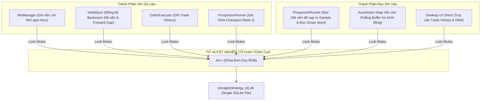

# BÁO CÁO KIỂM TOÁN HẠ TẦNG KIẾN TRÚC: CƠ SỞ DỮ LIỆU SQLITE & DATA ENGINE
**Tài liệu:** Note 51  
**Chủ đề:** Giải phẫu Hạ Tầng Lưu Trữ CSDL SQLite (`src/data_engine/sqlite_impl.rs`), Bẫy Khóa Đơn `Arc<Mutex<Connection>>` (Global Mutex Bottleneck), Blocking Disk I/O Làm Nghẽn Worker Threads Tokio, Thiếu B-Tree Index Gây Full Table Scan, Nuốt Lỗi DNA Rỗng Bằng `unwrap_or_default()` và Mã Mồ Côi `duckdb_impl.rs`  
**Mục tiêu kiểm toán:**
- `trading_bot/bot_engine/src/data_engine/sqlite_impl.rs` (341 dòng)
- `trading_bot/bot_engine/src/data_engine/duckdb_impl.rs` (308 dòng - Dead Code)
- Các điểm kết nối dữ liệu: `InitialSync`, `ProspectorRunner`, `WsManager`, `OrderExecutor`, `AssetActor`
- Đối chiếu trạng thái với:
  - `strategies_backtests/helios/docs/audit_01/12_prospector_runner/`
  - `strategies_backtests/helios/docs/audit_01/ROADMAP.md` (`TODO-AUDIT-TB-01`, `TODO-PROS-01`)
  - `strategies_backtests/helios/docs/unfinished_tasks/05_systemic_stability_and_quant_architecture_flaws/` (đặc biệt `notes/03`, `notes/04`, `notes/18`).

---

## 🏛️ 1. TỔNG QUAN HẠ TẦNG CƠ SỞ DỮ LIỆU TRONG HỆ SINH THÁI

Hạ tầng lưu trữ dữ liệu trong toàn bộ hệ thống được phân định rõ ràng như sau:

1. **`ferro_trade` (Backtest & GA Engine):**
   - Đã được nâng cấp toàn diện sang cơ chế In-Memory (`BacklogStorage` tại [`storage.rs`](file:///e:/Projects/Automations/trading_backtest/ferro_trade/src/optimizer/storage.rs)), sử dụng `parking_lot::Mutex` và cấu trúc `BinaryHeap` để miễn nhiễm hoàn toàn với lỗi tranh chấp khóa file của Windows OS (`Os { code: 33 }`). Không còn phụ thuộc trực tiếp vào CSDL vật lý.
2. **`trading_bot` (Execution Engine & Live Platform):**
   - Sử dụng SQLite (`rusqlite`) thông qua [`SqliteStore`](file:///e:/Projects/Automations/trading_backtest/trading_bot/bot_engine/src/data_engine/sqlite_impl.rs) làm kho lưu trữ trung tâm cho 3 mục đích cốt tử:
     - **Bảng `candles_1m`:** Lưu trữ lịch sử nến 1m (phục vụ bộ tối ưu hóa tịnh tiến `ProspectorRunner` chạy Walk-Forward 30-90 ngày và `InitialSync` lấp đầy khoảng trống khi rớt mạng).
     - **Bảng `optimized_params`:** Lưu trữ bộ gen DNA Champion (Rank 1), điểm Fitness và siêu dữ liệu Mapping để phục vụ Smart Seeding 0.5% và nạp nhanh lúc khởi động bot.
     - **Bảng `trade_history`:** Lưu trữ nhật ký khớp lệnh thật trên sàn Binance.
3. **Mã Mồ Côi `duckdb_impl.rs`:**
   - Tồn tại một file triển khai CSDL DuckDB (`DuckDbStore` 308 dòng), nhưng **hoàn toàn không được bất kỳ module nào trong dự án import hay sử dụng**.



Kiểm toán giải phẫu First-Principles đã phát hiện **10 lỗ hổng kiến trúc và hiệu năng nghiêm trọng** đe dọa sự ổn định của hệ thống.

---

## 🚨 2. CÁC TỬ HUYỆT HẠ TẦNG CỐT TỬ CỦA TẦNG DỮ LIỆU SQLITE

### 🔴 Flaw 1 (TB-DB-01): Bẫy Khóa Chết Toàn Cục `Arc<Mutex<rusqlite::Connection>>` — Vô Hiệu Hóa Đọc Ghi Đồng Thời Của WAL Mode
- **Tình trạng:** 🔴 **TỬ HUYỆT NGHẼN CỔ CHAI CONCURRENCY (`TODO-AUDIT-TB-01`)**.
- **Vị trí mã nguồn:** [`sqlite_impl.rs:10-12, 76, 82, 98, 111, 128, 157, 185, 213, 231, 243, 263`](file:///e:/Projects/Automations/trading_backtest/trading_bot/bot_engine/src/data_engine/sqlite_impl.rs#L10-L12)
- **Bản chất kỹ thuật:**
  ```rust
  pub struct SqliteStore {
      conn: Arc<Mutex<Connection>>,
  }
  ```
  - Dù cấu hình `PRAGMA journal_mode = WAL;` (cho phép nhiều reader đọc đồng thời mà không chặn writer), toàn bộ kiến trúc lại bọc duy nhất **MỘT kết nối `rusqlite::Connection`** bên trong một chiếc khóa `std::sync::Mutex` duy nhất!
  - Mọi thao tác đọc (SELECT) và ghi (INSERT/UPDATE/DELETE) đều phải tranh chấp chiếc chìa khóa Mutex này.
- **Kịch bản tê liệt:**
  1. `ProspectorRunner` hoặc `InitialSync` thực hiện truy vấn đọc 43,200 nến:
     `get_candles_by_range(symbol, start, end)` mất từ $50\text{ms} \to 300\text{ms}$ disk I/O.
  2. Trong suốt $300\text{ms}$ đó, `Mutex` bị giữ chặt!
  3. Đúng lúc đó, `WsManager` nhận nến 1m đóng từ sàn Binance $\to$ gọi `save_candle()` $\to$ BỊ TREO CHỜ MUTEX!
  4. `OrderExecutor` vừa khớp lệnh $\to$ gọi `save_trade_history()` $\to$ BỊ TREO CHỜ MUTEX!
  5. Khi chạy đa cặp tiền (ví dụ 5 cặp), số lượng Actor tranh chấp khóa tăng gấp bội, dẫn đến lỗi timeout `database is locked` hoặc đơ nghẽn toàn bộ hệ thống.
- **Giải pháp dứt điểm:**
  Chuyển sang mô hình **Connection Pool** (ví dụ: `r2d2_sqlite` với 1 Writer Connection riêng biệt và N Reader Connections độc lập) hoặc kiến trúc **Actor/MPSC Decoupled Writer** (toàn bộ tác vụ ghi đẩy qua kênh mpsc không bao giờ block luồng đọc).

---

### 🔴 Flaw 2 (TB-DB-02): Blocking Disk I/O Bên Trong Tokio Worker Threads (Tokio Thread Starvation)
- **Tình trạng:** 🔴 **VI PHẠM NGUYÊN TẮC BẤT BIẾN ASYNC TOKIO RUNTIME**.
- **Vị trí mã nguồn:** [`sqlite_impl.rs:94-238`](file:///e:/Projects/Automations/trading_backtest/trading_bot/bot_engine/src/data_engine/sqlite_impl.rs#L94-L238)
- **Bản chất:**
  - Các hàm của trait `CandleRepository` và `StrategyRepository` được gắn mác `async fn`, nhưng bên trong lại **thực thi $100\%$ các lệnh gọi đồng bộ (Synchronous Blocking)**:
    - `self.conn.lock().unwrap()` (Synchronous Mutex lock).
    - `conn.execute()` / `tx.commit()` (Synchronous Disk Write / Fsync).
    - `stmt.query_map()` (Synchronous Disk Read).
  - Không có bất kỳ lệnh gọi nào được bọc trong `tokio::task::spawn_blocking`!
- **Hậu quả thực tế:**
  - Khi `save_candles` thực hiện commit transaction hàng ngàn nến hoặc `get_candles_by_range` đọc khối lượng lớn, luồng thực thi Worker Thread của Tokio bị **đóng băng (Starvation)**.
  - Tokio không thể context-switch để xử lý các gói tin mạng WebSocket Ping/Pong của sàn Binance.
  - Sàn Binance phát hiện client không gửi Pong đúng hạn và **ngắt kết nối WebSocket (Keepalive Timeout Drop)**, làm gián đoạn dòng dữ liệu nến thời gian thực của bot!

---

### 🔴 Flaw 3 (TB-DB-03): Thiếu B-Tree Index Trên Cột `open_time` Gây Full Table Scan Hàng Triệu Nến
- **Tình trạng:** 🔴 **TỬ HUYỆT HIỆU NĂNG CƠ SỞ DỮ LIỆU**.
- **Vị trí mã nguồn:** [`sqlite_impl.rs:31-43, 230-236`](file:///e:/Projects/Automations/trading_backtest/trading_bot/bot_engine/src/data_engine/sqlite_impl.rs#L31-L43)
- **Bản chất toán học & CSDL:**
  - Bảng `candles_1m` có Primary Key tổng hợp: `PRIMARY KEY (symbol, open_time)`.
  - Trong cấu trúc B-Tree, chỉ mục được sắp xếp ưu tiên theo `symbol` trước rồi mới đến `open_time`.
  - Tuy nhiên, hãy nhìn vào hàm dọn dẹp dữ liệu cũ `cleanup_old_data()`:
    ```rust
    conn.execute(
        "DELETE FROM candles_1m WHERE open_time < ?1",
        params![older_than],
    )
    ```
  - Mệnh đề `WHERE open_time < ?1` **HOÀN TOÀN KHÔNG CÓ `symbol`**!
  - Vì `open_time` là cột đứng thứ 2 trong composite primary key, SQLite **KHÔNG THỂ SỬ DỤNG B-TREE INDEX** cho truy vấn này!
  - SQLite buộc phải thực hiện **QUÉT TOÀN BỘ BẢNG (FULL TABLE SCAN)** qua hàng triệu bản ghi nến của tất cả các symbol để tìm nến cũ cần xóa.
  - Thao tác này gây khóa độc quyền (Exclusive Lock) toàn bộ file database trong nhiều giây, làm treo cứng bot.
- **Giải pháp:** Bổ sung ngay chỉ mục đơn:
  `CREATE INDEX IF NOT EXISTS idx_candles_open_time ON candles_1m (open_time);`

---

### 🔴 Flaw 4 (TB-DB-04): Nuốt Chửng Lỗi Serialization Bằng `.unwrap_or_default()` Trong `get_best_dna`
- **Tình trạng:** 🔴 **LỖI LÀM SẬP CHIẾN LƯỢC TRONG IM LẶNG (SILENT DATA CORRUPTION)**.
- **Vị trí mã nguồn:** [`sqlite_impl.rs:278-286`](file:///e:/Projects/Automations/trading_backtest/trading_bot/bot_engine/src/data_engine/sqlite_impl.rs#L278-L286)
- **Hiện trạng code:**
  ```rust
  Ok(Some(OptimizedDna {
      symbol: symbol.to_string(),
      strategy_id: strategy_id.to_string(),
      dna: serde_json::from_str(&dna_json).unwrap_or_default(),
      mapping: serde_json::from_str(&mapping_json).unwrap_or_default(),
      fitness: row.get(2)?,
      stats: serde_json::from_str(&stats_json).unwrap_or_default(),
      updated_at: row.get(4)?,
  }))
  ```
- **Bản chất & Hậu quả:**
  - Nếu trường `dna_json` trong CSDL bị lỗi cú pháp, bị cắt cụt do mất điện, hoặc định dạng không tương thích:
  - Hàm `serde_json::from_str` trả về `Err`. Lệnh `.unwrap_or_default()` nuốt chửng lỗi và trả về **vector rỗng `vec![]` (0 phần tử)**!
  - `AssetActor` hoặc `ProspectorRunner` nhận được `OptimizedDna` với `dna: []`.
  - Khi gọi `strategy.update_from_dna(&dna)`: Chiến lược Helios yêu cầu vector DNA phải đủ số chiều (hiện tại là 102 chiều). Vector rỗng 0 chiều sẽ gây **PANIC CRASH** (Out of bounds index) hoặc đưa toàn bộ hệ thống vào trạng thái dị tật không xác định!
- **Khắc phục:** Bắt buộc trả về `Err(BotError::DatabaseError)` khi deserialize thất bại để hệ thống phát hiện và kích hoạt GA tối ưu lại.

---

### 🟠 Flaw 5 (TB-DB-05): Thiếu Bảng Quản Lý Phiên Bản Schema (`schema_version`) & Cơ Chế Migration
- **Tình trạng:** ⚠️ **LỖI TIẾN HÓA CƠ SỞ DỮ LIỆU (SCHEMA DRIFT)**.
- **Vị trí mã nguồn:** [`sqlite_impl.rs:30-71`](file:///e:/Projects/Automations/trading_backtest/trading_bot/bot_engine/src/data_engine/sqlite_impl.rs#L30-L71)
- **Bản chất:**
  - Hệ thống chỉ dựa vào các câu lệnh `CREATE TABLE IF NOT EXISTS`.
  - Khi hệ thống nâng cấp thêm cột (ví dụ bảng `trade_history` cần lưu thêm `realized_pnl`, `commission`, `opening_playbook_tag`, `exit_reason` theo chuẩn mới):
  - Lệnh `CREATE TABLE IF NOT EXISTS` sẽ bị SQLite bỏ qua vì bảng đã tồn tại!
  - Các code mới cố gắng INSERT vào các cột mới sẽ gặp lỗi runtime:
    `no such column: realized_pnl` và bot từ chối lưu lịch sử giao dịch.

---

### 🟡 Flaw 6 (TB-DB-06): Tồn Tại Mã Mồ Côi `duckdb_impl.rs` (308 Dòng Code Chết)
- **Tình trạng:** 🟡 **DEAD CODE / TECHNICAL DEBT**.
- **Vị trí mã nguồn:** [`trading_bot/bot_engine/src/data_engine/duckdb_impl.rs`](file:///e:/Projects/Automations/trading_backtest/trading_bot/bot_engine/src/data_engine/duckdb_impl.rs)
- **Bản chất:**
  - File `duckdb_impl.rs` chứa struct `DuckDbStore` triển khai đầy đủ các trait nhưng hoàn toàn **không được import hay gọi ở bất kỳ đâu trong toàn bộ codebase**.
  - Việc duy trì dependency `duckdb` làm tăng thời gian biên dịch (compile time) và phình to kích thước binary của bot mà không mang lại giá trị thực tế.

---

### 🟠 Flaw 7 (TB-DB-07): Gộp Chung Dữ Liệu Đa Cặp Tiền Vào Một File DB Duy Nhất (`storage/{strategy_id}.db`)
- **Tình trạng:** ⚠️ **LỖI TRANH CHẤP DỮ LIỆU ĐA TÀI SẢN (CROSS-ASSET DB CONTENTION)**.
- **Vị trí mã nguồn:** [`trading_bot/bot_engine/src/main.rs:55`](file:///e:/Projects/Automations/trading_backtest/trading_bot/bot_engine/src/main.rs#L55)
- **Bản chất:**
  - Tên file CSDL là `storage/{strategy_id}.db` (ví dụ: `helios.db`).
  - Mọi cặp tiền (`BTCUSDT`, `ETHUSDT`, `SOLUSDT`...) đều lưu chung vào bảng `candles_1m` trong cùng 1 file duy nhất này.
  - Khi vận hành danh mục 10-20 cặp tiền, mỗi cây nến 1m đóng đồng loạt:
    - 20 Actor đồng loạt ghi nến vào 1 file DB.
    - Cạnh tranh khóa đĩa và ghi nhật ký WAL tăng vọt theo cấp số nhân, làm nghẽn luồng xử lý của các Actor.
- **Khắc phục:** Tách CSDL theo từng cặp tiền (ví dụ: `storage/candles_BTCUSDT.db`, `storage/candles_ETHUSDT.db`) hoặc chuyển sang connection pool bất đồng bộ chuyên dụng.

---

### 🟠 Flaw 8 (TB-DB-08): Bảng `trade_history` Khuyết Thiếu Các Cột Kế Toán Cốt Lõi
- **Tình trạng:** ⚠️ **THIẾU SÓT THÔNG TIN AUDIT GIAO DỊCH**.
- **Vị trí mã nguồn:** [`sqlite_impl.rs:62-71`](file:///e:/Projects/Automations/trading_backtest/trading_bot/bot_engine/src/data_engine/sqlite_impl.rs#L62-L71)
- **Hiện trạng bảng:**
  ```sql
  CREATE TABLE IF NOT EXISTS trade_history (
      order_id TEXT PRIMARY KEY,
      symbol TEXT,
      side TEXT,
      price DOUBLE,
      qty DOUBLE,
      timestamp BIGINT
  )
  ```
- **Thiếu sót:**
  - Hoàn toàn không lưu `realized_pnl` (Lãi/lỗ thực tế của lệnh đóng).
  - Không lưu `commission` (Phí sàn Binance đã thu).
  - Không lưu `opening_playbook_tag` (Tag chiến thuật: TrendPB, Absorption...).
  - Không lưu `exit_reason` (Lý do thoát lệnh: HardSL, TrailingSL, TakeProfit...).
  - Khi Desktop Client (Tauri UI) truy vấn lịch sử lệnh để hiển thị cho người dùng, UI không thể hiển thị PnL từng lệnh, tỷ lệ Winrate hay biểu đồ hiệu quả theo từng Playbook.

---

### 🟡 Flaw 9 (TB-DB-09): Bẫy Đếm Số Lượng Nến Giả Tạo `SELECT COUNT(*)` (Candle Hole Blindness)
- **Tình trạng:** ⚠️ **ĐIỂM MÙ TÍNH TOÀN VẸN CHUỖI THỜI GIAN**.
- **Vị trí mã nguồn:** [`sqlite_impl.rs:212-227`](file:///e:/Projects/Automations/trading_backtest/trading_bot/bot_engine/src/data_engine/sqlite_impl.rs#L212-L227)
- **Bản chất:**
  - Để kiểm tra CSDL đã đủ nến lịch sử chưa, `InitialSync` và `ProspectorRunner` gọi `count_candles(symbol)` (`SELECT COUNT(*)`).
  - Nếu kết quả $\ge 43,200$ nến, hệ thống coi như "đủ dữ liệu".
  - **Điểm mù:** Nếu CSDL có 43,200 nến nhưng trong đó có một khoảng trống mất kết nối kéo dài 3 ngày (Data Hole), số lượng nến vẫn có thể đủ (do cộng dồn từ các tháng trước).
  - Bot sẽ vận hành trên một chuỗi thời gian bị đứt gãy, làm méo mó nghiêm trọng các chỉ báo KAMA, ATR và EMA.

---

### 🟡 Flaw 10 (TB-DB-10): Thiếu Tự Động Tạo Thư Mục Cha Khi Khởi Tạo CSDL Tùy Biến
- **Tình trạng:** ⚠️ **LỖI RUNTIME IO ERROR KHI KHỞI TẠO**.
- **Vị trí mã nguồn:** [`sqlite_impl.rs:16-28`](file:///e:/Projects/Automations/trading_backtest/trading_bot/bot_engine/src/data_engine/sqlite_impl.rs#L16-L28)
- **Bản chất:**
  - `SqliteStore::new(db_path)` gọi trực tiếp `Connection::open(db_path)`.
  - Nếu đường dẫn truyền vào là một thư mục con chưa tồn tại (ví dụ: `storage/sub_account/helios.db`), SQLite sẽ báo lỗi `CantOpen / unable to open database file`.
  - Cần thêm `if let Some(parent) = Path::new(db_path).parent() { std::fs::create_dir_all(parent)?; }`.

---

## 📊 3. BẢNG ĐỐI SOÁT TRẠNG THÁI VỚI TÀI LIỆU CŨ (`audit_01` & `ROADMAP.md`)

| Mã Lỗi / Task | Nội dung | Phân Loại Đối Soát | Hiện Trạng Thực Tế Trong Code |
| :--- | :--- | :---: | :--- |
| `TODO-AUDIT-TB-01` | Rủi ro SQLite Lock đa luồng trong live | [ĐÃ CÓ TRONG AUDIT CŨ] | 🔴 **CHƯA FIX** (Vẫn dùng single `Arc<Mutex<Connection>>`) |
| `TB-DB-01` | Khóa đơn vô hiệu hóa đọc đồng thời WAL | 🔴 **LỖI HẠ TẦNG MỚI** | Reader và Writer chặn đứng lẫn nhau qua 1 Mutex |
| `TB-DB-02` | Blocking Disk I/O làm nghẽn worker Tokio | 🔴 **LỖI HẠ TẦNG MỚI** | Rớt WebSocket Pong do thread bị đóng băng |
| `TB-DB-03` | Thiếu B-Tree Index trên `open_time` | 🔴 **LỖI HẠ TẦNG MỚI** | `cleanup_old_data` Full Table Scan hàng triệu nến |
| `TB-DB-04` | Nuốt lỗi bằng `unwrap_or_default()` trong DNA | 🔴 **LỖI HẠ TẦNG MỚI** | Trả về DNA rỗng `[]` làm sập chiến lược Helios |
| `TB-DB-05` | Thiếu quản lý phiên bản `schema_version` | 🔴 **LỖI HẠ TẦNG MỚI** | Lỗi runtime khi nâng cấp thêm cột vào bảng |
| `TB-DB-06` | Mã mồ côi `duckdb_impl.rs` không sử dụng | 🟡 **DEAD CODE** | 308 dòng code rác làm tăng thời gian compile |
| `TB-DB-07` | Gộp chung đa cặp tiền vào 1 file CSDL | 🔴 **LỖI HẠ TẦNG MỚI** | Tranh chấp ghi nến tăng theo số lượng cặp tiền |
| `TB-DB-08` | `trade_history` thiếu PnL, fee, playbook tag | 🔴 **LỖI HẠ TẦNG MỚI** | UI không hiển thị được PnL và Winrate |
| `TB-DB-09` | `SELECT COUNT(*)` mù trước khoảng trống dữ liệu | 🔴 **LỖI HẠ TẦNG MỚI** | Bot chạy trên chuỗi thời gian bị đứt đoạn |
| `TB-DB-10` | Thiếu tự động tạo thư mục cha khi mở DB | 🟡 **LỖI HẠ TẦNG MỚI** | Báo lỗi `CantOpen` nếu thư mục chưa tồn tại |

---

## 🛠️ 4. ĐỀ XUẤT KIẾN TRÚC SỬA ĐỔI CHUẨN HOÁ

### 4.1. Kiến Trúc Decoupled Async Connection Pool
Chuyển đổi `SqliteStore` sang mô hình Connection Pool với `spawn_blocking`:
```rust
pub struct SqliteStore {
    writer_pool: Arc<Mutex<Connection>>,
    reader_pool: Arc<r2d2::Pool<r2d2_sqlite::SqliteConnectionManager>>,
}
```
Mọi truy vấn đọc/ghi lớn đều được bọc trong `tokio::task::spawn_blocking`:
```rust
pub async fn get_candles_by_range(&self, symbol: String, start: i64, end: i64) -> Result<Vec<Candle>, BotError> {
    let pool = self.reader_pool.clone();
    tokio::task::spawn_blocking(move || {
        let conn = pool.get().map_err(|e| BotError::DatabaseError(e.to_string()))?;
        // Thực thi truy vấn đọc đồng thời an toàn không block Tokio worker
        ...
    }).await.map_err(|e| BotError::Internal(e.to_string()))?
}
```

### 4.2. Bổ Sung B-Tree Indexes & Schema Versioning
```sql
-- Đảm bảo xóa nến cũ O(log N) thay vì O(N)
CREATE INDEX IF NOT EXISTS idx_candles_open_time ON candles_1m (open_time);
CREATE INDEX IF NOT EXISTS idx_trade_history_symbol_time ON trade_history (symbol, timestamp);

-- Bổ sung bảng quản lý phiên bản
CREATE TABLE IF NOT EXISTS schema_version (
    version INTEGER PRIMARY KEY,
    applied_at BIGINT
);
```

---

## 🎯 5. KẾT LUẬN

1. Dự án `ferro_trade` đã hoàn toàn thoát ly khỏi SQLite và hoạt động an toàn với `BacklogStorage` In-Memory.
2. Tuy nhiên, `trading_bot` vẫn đang sử dụng một lớp CSDL SQLite sơ khai với bẫy khóa chết đơn `Arc<Mutex<Connection>>` và thực thi blocking I/O trực tiếp trên luồng Tokio worker.
3. Việc tái cấu trúc tầng dữ liệu theo mô hình Asynchronous Decoupled Pool và bổ sung đầy đủ B-Tree Index sẽ triệt tiêu hoàn toàn nguy cơ rớt kết nối mạng WebSocket và đảm bảo bot vận hành trơn tru trên hàng chục cặp tiền đồng thời.
