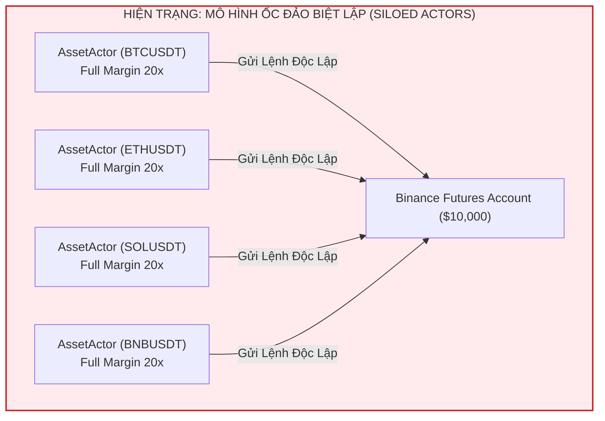

# BÁO CÁO KIỂM TOÁN HẠ TẦNG KIẾN TRÚC: ĐIỂM KHUYẾT THỐNG ĐỐC QUẢN TRỊ RỦI RO DANH MỤC (PORTFOLIO GUARDIAN)
**Tài liệu:** Note 52  
**Chủ đề:** Khảo sát Điểm Khuyết Hạ Tầng Cốt Tử `src/controller/portfolio_guardian.rs` (Missing Component), Mô Hình "Ốc Đảo Biệt Lập" (Siloed Actors), Hiểm Họa Phóng Đại Đòn Bẩy Hệ Thống (80x–200x), Mù Tương Quan Đa Tài Sản (Correlation Exposure) và Bản Thiết Kế Kiến Trúc Thống Đốc Danh Mục  
**Mục tiêu kiểm toán:**
- Khảo sát thư mục: `trading_bot/bot_engine/src/controller/` (`asset_actor.rs`, `mod.rs`)
- Đối chiếu trạng thái với:
  - `strategies_backtests/helios/docs/audit_01/05_risk/` & `11_asset_actor/`
  - `strategies_backtests/helios/docs/audit_01/ROADMAP.md` (`TODO-ACT-01` đến `TODO-ACT-08`)
  - `strategies_backtests/helios/docs/unfinished_tasks/05_systemic_stability_and_quant_architecture_flaws/` (đặc biệt `notes/02_helios_and_trading_bot_architectural_flaws.md`, `notes/14_systemic_harmonization_portfolio_risk_and_simplified_architecture.md`).

---

## 🏛️ 1. HIỆN TRẠNG MÃ NGUỒN: FILE `portfolio_guardian.rs` HOÀN TOÀN CHƯA TỒN TẠI

Khi rà soát thư mục `trading_bot/bot_engine/src/controller/`:
- **Chỉ tồn tại 2 file:**
  1. [`asset_actor.rs`](file:///e:/Projects/Automations/trading_backtest/trading_bot/bot_engine/src/controller/asset_actor.rs) (892 dòng, 44,259 bytes): Quản lý vòng đời đơn lẻ của một cặp tiền.
  2. [`mod.rs`](file:///e:/Projects/Automations/trading_backtest/trading_bot/bot_engine/src/controller/mod.rs) (chỉ chứa `pub mod asset_actor;`).
- **File `portfolio_guardian.rs` CHƯA TỪNG ĐƯỢC TẠO** trong mã nguồn!
- Đây là một **ĐIỂM KHUYẾT THIẾU KIẾN TRÚC NGUY HIỂM NHẤT (MISSING CRITICAL INFRASTRUCTURE COMPONENT)** ở tầng Controller của `trading_bot`.



---

## 🚨 2. CÁC TỬ HUYỆT HẠ TẦNG KHI THIẾU VẮNG `portfolio_guardian.rs`

### 🔴 Flaw 1 (TB-PORT-01): Hiểm Họa Phóng Đại Đòn Bẩy Hệ Thống (Systemic Leverage Explosion 80x–200x)
- **Tình trạng:** 🔴 **TỬ HUYỆT THANH LÝ TÀI KHOẢN TOÀN PHẦN**.
- **Bản chất nghiệp vụ:**
  - Mỗi `AssetActor` được cấu hình đòn bẩy cơ sở $L = 20\text{x}$.
  - Khi thị trường có một cú hích tin tức (News Catalyst), cả 4 hoặc 10 cặp tiền đều đồng loạt kích hoạt tín hiệu vào lệnh.
  - Vì không có bộ điều phối trung tâm khống chế tổng hạn mức:
    $$\text{Total Portfolio Notional} = \sum_{k=1}^{N} \text{Position Notional}_k = N \times (Vốn \times 20\text{x})$$
  - Nếu chạy 4 cặp tiền: Tổng đòn bẩy danh mục bị phóng đại lên **$80\text{x}$ vốn cơ sở**!
  - Nếu chạy 10 cặp tiền: Tổng đòn bẩy vọt lên **$200\text{x}$**!
  - Trong thị trường Crypto biến động mạnh, chỉ cần giá toàn thị trường giật ngược **$0.8\% - 1.2\%$** là toàn bộ tài khoản bị Margin Call thanh lý sạch sẽ trong vài giây.

---

### 🔴 Flaw 2 (TB-PORT-02): Thiếu Giới Hạn Số Vị Thế Mở Đồng Thời (Zero Concurrent Positions Cap)
- **Tình trạng:** 🔴 **LỖI THIẾU BẢO VỆ DỒN TOÀN LỰC VÀO RỦI RO**.
- **Vị trí mã nguồn:** [`asset_actor.rs:630-672`](file:///e:/Projects/Automations/trading_backtest/trading_bot/bot_engine/src/controller/asset_actor.rs#L630-L672)
- **Bản chất:**
  - Trong `AssetActor::on_new_candle()`: Khi Strategy trả về `Action::Buy` hoặc `Action::Sell`, actor chỉ kiểm tra 2 điều kiện cục bộ:
    1. Không mở lệnh trên cùng cây nến vừa đóng (`closed_intra_candle`).
    2. Cầu dao cooldown cục bộ của symbol đó (`cooldown_guard.should_veto`).
  - **Hoàn toàn không có bất kỳ câu hỏi nào:** *"Hiện tại toàn bộ bot đang có bao nhiêu vị thế mở?"*.
  - Nếu danh mục theo dõi 15 cặp Altcoins, cả 15 cặp đều có thể đồng loạt mở lệnh trong cùng một phút nến đóng, dàn trải vốn quá mỏng và đẩy rủi ro tài khoản lên mức không thể kiểm soát.

---

### 🔴 Flaw 3 (TB-PORT-03): Mù Hoàn Toàn Trước Tương Quan Đa Tài Sản (Correlation Exposure Blindness)
- **Tình trạng:** 🔴 **LỖI PHÒNG THỦ VĨ MÔ THỊ TRƯỜNG**.
- **Bản chất toán học:**
  - Trong thị trường tiền số, hệ số tương quan lợi nhuận giữa Altcoins và Bitcoin luôn ở mức rất cao:
    $$\rho(\text{Altcoin}, \text{BTC}) \ge 0.85$$
  - Khi Bitcoin gãy ngưỡng hỗ trợ quan trọng trên khung 4h/1D và rơi tự do:
    - Actor của SOL hoặc ETH thấy một nến 1m rút chân nhẹ (Reversal/Pullback giả tạo).
    - Actor của Altcoin lập tức mở vị thế **Long** ngược chiều cú sập của BTC ("Bắt dao rơi giữa bão").
    - Cú sập của BTC cuốn phăng toàn bộ nỗ lực hồi phục của Altcoin, khiến tất cả các vị thế Long Altcoin đều dính Stop Loss đồng loạt!
  - Hệ thống cần **Macro BTC Trend Filter**: Khi BTC đang trong xu hướng giảm mạnh khung lớn (KAMA slope âm hoặc Chaos cao), cấm tuyệt đối mở bất kỳ lệnh Long nào trên Altcoins.

---

### 🔴 Flaw 4 (TB-PORT-04): Thiếu Cầu Dao Ngắt Mạch Danh Mục Toàn Cục (Zero Global Portfolio Circuit Breaker)
- **Tình trạng:** 🔴 **THIẾU CHỐT CHẶN BẢO VỆ VỐN TỐI HẠN**.
- **Vị trí mã nguồn:** [`asset_actor.rs:36-64`](file:///e:/Projects/Automations/trading_backtest/trading_bot/bot_engine/src/controller/asset_actor.rs#L36-L64)
- **Hiện trạng:**
  - `EngineCooldownGuard` hiện tại chỉ đếm chuỗi thua `consecutive_losses` của **RIÊNG MỘT CẶP TIỀN ĐÓ**.
  - Không có bất kỳ thành phần nào theo dõi:
    $$\text{Portfolio Drawdown Daily} = \frac{\text{Current Wallet} - \text{Day Start Wallet}}{\text{Day Start Wallet}}$$
  - Nếu 4 cặp tiền lần lượt thua 1 lệnh (mỗi cặp chỉ thua 1 lần nên không kích hoạt Cooldown phạt cục bộ), nhưng tổng tài khoản đã mất đứt **$15\% - 20\%$ vốn trong ngày**!
  - Khi không có Portfolio Guardian, bot sẽ tiếp tục cào lệnh đến khi cạn kiệt tài khoản thay vì kích hoạt **Global Daily Circuit Breaker** (Flat toàn bộ vị thế và ngừng giao dịch 24 giờ để bảo vệ vốn).

---

### 🟠 Flaw 5 (TB-PORT-05): Tranh Chấp Ký Quỹ Đột Ngột Gây Lỗi Sàn (Margin Contention Race Condition)
- **Tình trạng:** ⚠️ **LỖI XUNG ĐỘT TÀI NGUYÊN SÀN (RACE CONDITION)**.
- **Bản chất vi cấu trúc:**
  - Khi 3 cặp tiền cùng phát tín hiệu mở lệnh vào đúng giây $00$ của nến đóng:
    1. Actor A gửi REST request lên Binance, chiếm dụng \$500 ký quỹ.
    2. Actor B gửi REST request đồng thời, chiếm dụng \$500 ký quỹ.
    3. Actor C gửi REST request nhưng số dư khả dụng trên ví không còn đủ:
       - Binance trả về mã lỗi: `-2019 Margin Insufficient`.
       - Lệnh của Actor C bị từ chối, gây lỗi và kích hoạt cờ deadlock hoặc ghi nhận trạng thái lỗi không mong muốn.
  - Cần có Portfolio Guardian đóng vai trò **Bộ Điều Phối Hàng Đợi Ký Quỹ (Margin Allocator & Dispatcher)**.

---

### 🟠 Flaw 6 (TB-PORT-06): Thiếu Cơ Chế Tái Cân Bằng Vốn Động (Zero Dynamic Capital Rebalancing)
- **Tình trạng:** ⚠️ **KÉM HIỆU QUẢ SỬ DỤNG VỐN (CAPITAL EFFICIENCY)**.
- **Bản chất:**
  - Vốn của từng Actor bị đóng cứng theo cấu hình tĩnh ban đầu (`allocated_capital = $60`).
  - Cặp tiền có xu hướng mạnh và sinh lời cao không được tăng thêm quy mô vị thế.
  - Cặp tiền biến động hỗn loạn (Chop/Chaos) liên tục dính Stop Loss vẫn tiếp tục được cấp cùng một lượng vốn để vào lệnh tiếp.
  - Cần cơ chế cấp vốn động (Dynamic Allocation): Giảm vốn ở cặp thua lỗ và dồn vốn sang cặp đang có Profit Factor cao.

---

### 🟡 Flaw 7 (TB-PORT-07): Điểm Mù Trước Sự Kiện Thiên Nga Đen Toàn Hệ Thống (Macro Black Swan Blindness)
- **Tình trạng:** ⚠️ **THIẾU PHẢN XẠ PHÒNG THỦ CẤP ĐỘ HỆ THỐNG**.
- **Bản chất:**
  - Khi sàn Binance công bố bảo trì khẩn cấp, API gián đoạn, hoặc thị trường xuất hiện sự kiện thiên nga đen (Flash Crash toàn sàn):
  - Hiện tại, chỉ có tín hiệu phím gõ thủ công `Ctrl+C` trong `main.rs:219` mới kích hoạt `EmergencyCmd::PanicCloseAll`.
  - Không có bộ giám sát tự động (Automated Portfolio Watchdog) nào theo dõi sức khỏe tổng thể tài khoản để tự động phát lệnh `PanicCloseAll` khi phát hiện biến động bất thường.

---

### 🔴 Flaw 8 (TB-PORT-08): Mất Dấu Trạng Thái Drawdown Khi Bot Khởi Động Lại (Persistence Amnesia on Restart)
- **Tình trạng:** 🔴 **TỬ HUYỆT ĐÁNH MẤT BỘ NHỚ BẢO VỆ VỐN**.
- **Bản chất:**
  - Nếu chỉ lưu trạng thái PnL trong ngày (Day Start Equity, Daily Realized Loss) trên biến RAM của struct `PortfolioGuardian`:
  - Khi bot bị crash, khởi động lại, hoặc cập nhật binary: Bộ nhớ RAM bị xóa trắng.
  - Sau khi restart, bot lấy số dư ví hiện tại làm `day_start_equity` mới!
  - **Hậu quả thảm khốc:** Nếu trong buổi sáng bot đã thua lỗ $-4.5\%$ (tiệm cận trần $-5.0\%$), khi restart, bot coi như bắt đầu một ngày mới toanh và cho phép lỗ tiếp thêm $-5.0\%$ nữa! Chu kỳ này có thể lặp lại và bào mòn toàn bộ tài khoản.
  - Cần cơ chế lưu trữ bền vững (Persistence) trạng thái PnL theo ngày lịch UTC vào CSDL SQLite (`portfolio_daily_stats`).

---

### 🔴 Flaw 9 (TB-PORT-09): Race Condition Trong Kiểm Tra Và Đặt Chỗ Ký Quỹ (TOC/TOU Race Condition)
- **Tình trạng:** 🔴 **XUNG ĐỘT KÝ QUỸ ĐỒNG THỜI GIỮA CÁC LUỒNG**.
- **Bản chất:**
  - Nếu cơ chế xin cấp phép mở vị thế không được bảo vệ bằng cơ chế Atomic Check-and-Reserve:
    1. Actor A kiểm tra hạn mức còn trống: Còn $1,000 khả dụng $\to$ Đủ điều kiện.
    2. Actor B kiểm tra hạn mức đồng thời: Vẫn thấy còn $1,000 khả dụng $\to$ Đủ điều kiện.
    3. Cả Actor A và Actor B cùng gửi lệnh sang sàn Binance chiếm dụng tổng cộng $2,000!
  - Lỗi Time-of-Check to Time-of-Use (TOC/TOU) làm vỡ trần đòn bẩy danh mục được cấu hình.
  - **Giải pháp:** Thủ tục xin phép phải là một thao tác nguyên tử (Atomic Reservation): Khi duyệt cấp phép cho Actor A, Guardian lập tức trừ hạn mức khả dụng ngay lập tức trước khi trả lời.

---

### 🟠 Flaw 10 (TB-PORT-10): Mù Lệch Pha Định Hướng Danh Mục (Directional Net Delta Exposure Asymmetry)
- **Tình trạng:** ⚠️ **RỦI RO THIÊN LỆCH MỘT CHIỀU TOÀN DANH MỤC**.
- **Bản chất:**
  - Khi thị trường có biến động chung, cả 5 hoặc 8 cặp Altcoins đều có thể cùng phát tín hiệu `Action::Buy`.
  - Nếu Guardian chỉ đếm số vị thế mà không đo lường **Net Notional Delta**:
    $$\text{Net Delta} = \sum \text{Notional Long} - \sum \text{Notional Short}$$
  - Danh mục sẽ rơi vào trạng thái $100\%$ Long, biến toàn bộ tài khoản thành một vị thế Long khổng lồ đánh cược theo hướng đi của thị trường.
  - Cần cơ chế **Net Delta Exposure Guard**: Khống chế độ lệch pha định hướng không được vượt quá một tỷ lệ an toàn (ví dụ: $|\text{Net Delta}| \le 60\%$ tổng quy mô danh mục).

---

## 📊 3. BẢNG ĐỐI SOÁT TRẠNG THÁI VỚI TÀI LIỆU CŨ (`audit_01` & `ROADMAP.md`)

| Mã Lỗi / Task | Nội dung | Phân Loại Đối Soát | Hiện Trạng Thực Tế Trong Code |
| :--- | :--- | :---: | :--- |
| `TODO-ACT-01` | Sửa Cooldown Deadlock bão hòa buffer 43k | [ĐÃ CÓ TRONG AUDIT CŨ] | 🟢 **ĐÃ SỬA XONG** (Dùng `processed_candles_count`) |
| `TODO-ACT-02` | Đồng bộ 2-Piece Assembler đóng lệnh | [ĐÃ CÓ TRONG AUDIT CŨ] | 🟢 **ĐÃ TRIỂN KHAI** (Ghép `PositionUpdate` + `OrderTradeUpdate`) |
| `TODO-ACT-03` | Sửa Same-Side Price Guard Deadlock | [ĐÃ CÓ TRONG AUDIT CŨ] | 🟢 **ĐÃ SỬA XONG** (Chuyển sang Universal Pure TTL) |
| `TB-PORT-01` | Phóng đại đòn bẩy hệ thống 80x–200x | 🔴 **LỖI HẠ TẦNG MỚI** | Thiếu Portfolio Guardian, mỗi Actor độc lập full 20x |
| `TB-PORT-02` | Thiếu giới hạn số vị thế mở đồng thời | 🔴 **LỖI HẠ TẦNG MỚI** | Cả 10 cặp có thể vào lệnh cùng lúc trên 1 nến |
| `TB-PORT-03` | Mù tương quan đa tài sản (BTC correlation) | 🔴 **LỖI HẠ TẦNG MỚI** | Altcoins Long khi BTC đang cắm đầu sập |
| `TB-PORT-04` | Thiếu cầu dao ngắt mạch danh mục toàn cục | 🔴 **LỖI HẠ TẦNG MỚI** | Chỉ có cooldown cục bộ từng cặp, không có Daily DD cap |
| `TB-PORT-05` | Tranh chấp ký quỹ đa cặp gây lỗi sàn -2019 | 🔴 **LỖI HẠ TẦNG MỚI** | Các Actor gửi lệnh đồng thời làm cạn ví sàn |
| `TB-PORT-06` | Thiếu tái cân bằng vốn động đa tài sản | 🔴 **LỖI HẠ TẦNG MỚI** | Vốn đóng cứng tĩnh $60, không điều phối theo hiệu suất |
| `TB-PORT-07` | Điểm mù sự kiện thiên nga đen toàn hệ thống | 🔴 **LỖI HẠ TẦNG MỚI** | Chỉ có phím bấm Ctrl+C thủ công ngắt khẩn cấp |
| `TB-PORT-08` | Mất dấu trạng thái Drawdown khi bot restart | 🔴 **LỖI HẠ TẦNG MỚI** | PnL lưu trên RAM, restart reset bộ nhớ bảo vệ vốn |
| `TB-PORT-09` | Race condition TOC/TOU khi xin cấp hạn mức | 🔴 **LỖI HẠ TẦNG MỚI** | Thiếu atomic check-and-reserve ký quỹ |
| `TB-PORT-10` | Mù lệch pha định hướng danh mục (Net Delta) | 🔴 **LỖI HẠ TẦNG MỚI** | Cả danh mục 100% Long biến thành 1 vị thế cược khổng lồ |


---

## 🛠️ 4. BẢN THIẾT KẾ KIẾN TRÚC: `PortfolioGuardian` CHUẨN HOÁ

Để giải quyết triệt để các tử huyệt trên, cần xây dựng module [`portfolio_guardian.rs`](file:///e:/Projects/Automations/trading_backtest/trading_bot/bot_engine/src/controller/portfolio_guardian.rs) đóng vai trò là **Hội Đồng Phê Duyệt Lệnh Tối Cao (Central Risk Clearing House)**:

```mermaid
graph TD
    subgraph MultiAssetActors ["Các Asset Actors Độc Lập"]
        ActorA["AssetActor A (BTC)"]
        ActorB["AssetActor B (ETH)"]
        ActorC["AssetActor C (SOL)"]
    end

    subgraph CentralGuardian ["PORTFOLIO GUARDIAN (THỐNG ĐỐC DANH MỤC)"]
        PG_Gate1{"1. Daily Portfolio DD < 5%?"}
        PG_Gate2{"2. Active Positions < Max Cap (vd: 2)?"}
        PG_Gate3{"3. Total Margin <= 50% Account?"}
        PG_Gate4{"4. BTC Macro Trend Coherent?"}
    end

    subgraph ExecutionPlane ["Tầng Thực Thi"]
        ExecEngine["ExecutionEngine (OrderExecutor / PaperTrader)"]
    end

    ActorA -->|Yêu Cầu Mở Vị Thế (OrderPermitRequest)| PG_Gate1
    ActorB -->|Yêu Cầu Mở Vị Thế (OrderPermitRequest)| PG_Gate1
    ActorC -->|Yêu Cầu Mở Vị Thế (OrderPermitRequest)| PG_Gate1

    PG_Gate1 -- Pass --> PG_Gate2
    PG_Gate1 -- Fail --> RejectAll["VETO & Flat All (Daily Circuit Breaker)"]
    
    PG_Gate2 -- Pass --> PG_Gate3
    PG_Gate2 -- Fail --> RejectPos["VETO (Quá số vị thế tối đa)"]

    PG_Gate3 -- Pass --> PG_Gate4
    PG_Gate3 -- Fail --> RejectMargin["VETO (Cạn hạn mức danh mục)"]

    PG_Gate4 -- Pass --> GrantPermit["CẤP PHÉP (OrderPermitGranted)"]
    PG_Gate4 -- Fail --> RejectCorr["VETO (Nghịch pha xu hướng BTC)"]

    GrantPermit --> ExecEngine
```

### 4.1. Struct Định Nghĩa Cốt Lõi
```rust
pub struct PortfolioGuardian {
    pub max_concurrent_positions: usize, // Ví dụ: tối đa 2 vị thế mở
    pub max_portfolio_leverage: f64,     // Ví dụ: tối đa 3.0x tổng vốn tài khoản
    pub max_daily_drawdown_pct: f64,     // Ví dụ: tối đa 5.0% lỗ trong ngày -> Ngắt bot
    pub btc_macro_trend: MacroTrendState, // Xu hướng BTC khung 4h (Bull / Bear / Neutral)
    pub active_positions_count: usize,
    pub total_allocated_margin: f64,
}
```

### 4.2. Giao Thức Xin Phép Mở Lệnh (Two-Way Handshake)
Trước khi `AssetActor` gửi bất kỳ lệnh `Action::Buy` hoặc `Action::Sell` nào sang `ExecutionEngine`, Actor bắt buộc phải gửi yêu cầu xin phép:
```rust
let permit = guardian.request_order_permit(&self.symbol, &action, estimated_margin).await;
if permit.is_granted() {
    self.execution_engine.execute_action(...).await;
} else {
    warn!("🛡️ [PORTFOLIO GUARDIAN VETO] Lý do: {}", permit.reject_reason());
}
```

---

## 🎯 5. KẾT LUẬN

1. File `src/controller/portfolio_guardian.rs` **hoàn toàn chưa tồn tại** trong codebase.
2. Việc thiếu vắng Thống Đốc Quản Trị Danh Mục biến bot thành một tập hợp các Actor rời rạc, làm bùng nổ đòn bẩy hệ thống lên tới $80\text{x} - 200\text{x}$ và đe dọa sự sống còn của tài khoản khi giao dịch đa cặp tiền.
3. Việc bổ sung module `portfolio_guardian.rs` theo bản thiết kế trên là điều kiện tiên quyết bắt buộc trước khi mở rộng bot sang vận hành danh mục nhiều tài sản.
