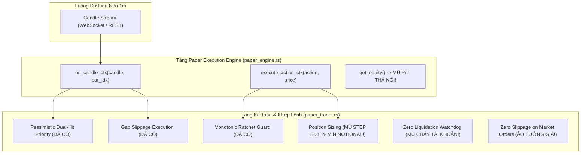
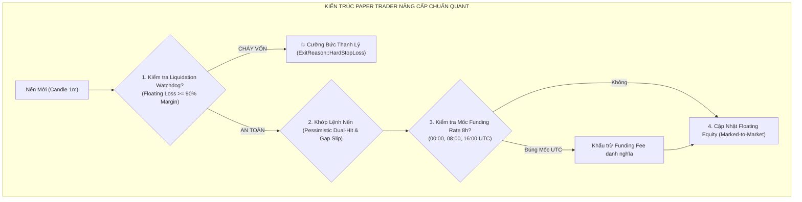

# BÁO CÁO KIỂM TOÁN HẠ TẦNG KIẾN TRÚC: ĐỘNG CƠ KHỚP LỆNH GIẢ LẬP (PAPER ENGINE & PAPER TRADER)
**Tài liệu:** Note 53  
**Chủ đề:** Khảo sát Toàn Diện Động Cơ Khớp Lệnh Giả Lập Tiền Thật (`paper_engine.rs`, `paper_trader.rs`), Lỗ Hổng Mù PnL Thả Nổi (`Floating Equity Blindness`), Thiếu Cơ Chế Thanh Lý Cưỡng Bức (`Liquidation Watchdog`), Mù Bước Giá Sàn (`MarketFilter Step Size`), Ảo Tưởng Trượt Giá Bằng Không (`Zero Slippage Illusion`) Và Nguy Cơ Rò Rỉ Bộ Nhớ Lịch Sử Lệnh  
**Mục tiêu kiểm toán:**
- Khảo sát mã nguồn:
  - [`trading_bot/bot_engine/src/execution/paper_engine.rs`](file:///e:/Projects/Automations/trading_backtest/trading_bot/bot_engine/src/execution/paper_engine.rs) (157 dòng)
  - [`trading_bot/bot_engine/src/execution/paper_trader.rs`](file:///e:/Projects/Automations/trading_backtest/trading_bot/bot_engine/src/execution/paper_trader.rs) (1045 dòng)
- Đối chiếu trạng thái với:
  - `strategies_backtests/helios/docs/audit_01/13_paper_matching_engine/` (`technical_audit.md`, `TODO.md`)
  - `strategies_backtests/helios/docs/audit_01/ROADMAP.md` (`TODO-PPR-03`, `TODO-PPR-05`)
  - `strategies_backtests/helios/docs/unfinished_tasks/05_systemic_stability_and_quant_architecture_flaws/`

---

## 🏛️ 1. TỔNG QUAN KIẾN TRÚC TẦNG PAPER EXECUTION

Động cơ Paper Execution đóng vai trò là **"Sàn Giao Dịch Thu Nhỏ Trong Bộ Nhớ" (In-Memory Micro-Exchange)**, được thiết kế để:
1. Mô phỏng khớp lệnh thời gian thực dựa trên luồng nến đóng 1m từ WebSocket hoặc Gap Filler.
2. Kiểm tra tính sống còn và tỷ lệ sống sót của chiến lược trước khi cấp quyền giao dịch tiền thật (`LiveEngine`).
3. Đảm bảo tính toán chính xác 1:1 phí giao dịch 2 chiều ($0.04\% \times 2 = 0.08\%$), trượt giá và cơ chế bảo vệ vốn.



---

## 🚨 2. CÁC TỬ HUYỆT HẠ TẦNG KIẾN TRÚC TRONG `paper_engine.rs` & `paper_trader.rs`

### 🔴 Flaw 1 (TB-PPR-01): `get_equity()` Trả Về Số Dư Tiền Mặt, "Mù" Hoàn Toàn PnL Thả Nổi (Floating Unrealized PnL Blindness)
- **Tình trạng:** 🔴 **TỬ HUYỆT SAI LỆCH QUẢN TRỊ VỐN VÀ ĐO ĐẠC DRAWDOWN**.
- **Vị trí mã nguồn:** [`paper_engine.rs:113-115`](file:///e:/Projects/Automations/trading_backtest/trading_bot/bot_engine/src/execution/paper_engine.rs#L113-L115)
  ```rust
  fn get_equity(&self) -> f64 {
      self.paper_trader.equity
  }
  ```
- **Bản chất nghiệp vụ:**
  - `self.paper_trader.equity` là **số dư tiền mặt đã chốt (Realized Cash Balance)**, đã bị trừ phí mở lệnh ngay khi vào vị thế (`open_position`).
  - Khi vị thế đang chạy (chưa đóng): Floating PnL (lãi/lỗ trên giấy Marked-to-Market) hoàn toàn KHÔNG được tính vào vốn!
  - **Hậu quả nghiêm trọng:**
    - Khi `AssetActor` hoặc `Strategy` gọi `execution_engine.get_equity()`, nó chỉ thấy số tiền mặt tĩnh.
    - Nếu vị thế đang gánh khoản lỗ nặng $-40\%$ ROE hoặc đang có lãi khủng $+100\%$ ROE, hệ thống vẫn tưởng vốn không đổi.
    - Sai lệch hoàn toàn việc tính toán Compounding, đo đạc Max Drawdown trong quá trình Paper Trading và làm tê liệt các bộ lọc rủi ro dựa trên vốn tức thời.
- **Giải pháp chuẩn hóa:**
  Lưu `last_close: f64` trong `PaperExecutionEngine::on_candle_ctx` và tính vốn Marked-to-Market:
  ```rust
  fn get_equity(&self) -> f64 {
      if self.paper_trader.position_type != PositionType::None && self.last_close > 0.0 {
          self.paper_trader.get_total_equity(self.last_close)
      } else {
          self.paper_trader.equity
      }
  }
  ```

---

### 🔴 Flaw 2 (TB-PPR-02): Thiếu Cơ Chế Thanh Lý Cưỡng Bức (Zero Liquidation Watchdog / Negative Equity Fantasy)
- **Tình trạng:** 🔴 **ẢO TƯỞNG KHÔNG THỰC TẾ SO VỚI SÀN GIAO DỊCH**.
- **Vị trí mã nguồn:** [`paper_trader.rs:477-575`](file:///e:/Projects/Automations/trading_backtest/trading_bot/bot_engine/src/execution/paper_trader.rs#L477-L575)
- **Bản chất vi cấu trúc:**
  - Trên sàn Binance Futures với đòn bẩy $L = 20\text{x}$ (Maintenance Margin Rate MMR $\approx 1\% - 2.5\%$), khi khoản lỗ chưa chốt chạm ngưỡng $\ge 90\% - 95\%$ tiền ký quỹ (tương đương giá đi ngược $\approx 4.5\% - 5.0\%$), vị thế **BẮT BUỘC BỊ SÀN CƯỠNG BỨC THANH LÝ (LIQUIDATION)**.
  - Trong `PaperTrader`: Nếu nến giật mạnh xuyên qua mức Stop Loss mà không dính SL hoặc nếu một chiến lược không cài SL kịp thời, `PaperTrader` **KHÔNG CÓ BẤT KỲ CƠ CHẾ THANH LÝ NÀO**!
  - Vị thế có thể tiếp tục gánh lỗ đến $-200\%$, làm số dư vốn `self.equity` bị âm ($\text{Equity} < 0$)!
  - Trong tài khoản Isolated Margin thực tế, bạn chỉ mất tối đa số tiền ký quỹ đã cấp cho vị thế đó. Việc PaperTrader cho phép âm vốn vô tận mà không kích hoạt thanh lý tạo ra kết quả kiểm thử sai lệch hoàn toàn so với thực tế sàn.

---

### 🔴 Flaw 3 (TB-PPR-03): Mù Hoàn Toàn Quy Cách Hợp Đồng Sàn (Market Filter Ignorance - Fractional Unit & Min Notional)
- **Tình trạng:** 🔴 **LỆCH PHA KHỚP LỆNH GIỮA PAPER VÀ LIVE TRADING**.
- **Vị trí mã nguồn:** [`paper_trader.rs:440-450`](file:///e:/Projects/Automations/trading_backtest/trading_bot/bot_engine/src/execution/paper_trader.rs#L440-L450)
  ```rust
  let size_ratio = size_pct.filter(|&s| s > 0.0).unwrap_or(1.0);
  let trade_value = self.equity * size_ratio * self.leverage;
  ...
  self.position_size = trade_value / current_price;
  ```
- **Bản chất kỹ thuật:**
  - `self.position_size` là một số thực float 64-bit tự do với độ chính xác vô hạn (ví dụ `0.00142984572918 BTC` hoặc `13.82910481 DOGE`).
  - Trong khi trên Binance Futures:
    - BTC có `step_size = 0.001`.
    - DOGE có `step_size = 1.0`.
    - Sàn quy định `min_notional` tối thiểu là \$5 hoặc \$21.
  - `PaperTrader` không kiểm tra `min_notional` và không làm tròn theo `step_size`.
  - **Hậu quả:** Paper Trade test thấy chạy rất mượt và có lãi với các lệnh \$2.5 hoặc số lẻ thập phân vô tận, nhưng khi chuyển sang `LiveEngine` thì Binance API **TỪ CHỐI 100% CÁC LỆNH NÀY** với lỗi `-1013 Filter failure: LOT_SIZE / MIN_NOTIONAL`!

---

### 🟠 Flaw 4 (TB-PPR-04): Khớp Lệnh Thị Trường Không Trượt Giá (Zero Slippage & Fixed Spread Illusion)
- **Tình trạng:** ⚠️ **ẢO TƯỞNG HIỆU SUẤT MÀU HỒNG (PINK PERFORMANCE MIRAGE)**.
- **Vị trí mã nguồn:** [`paper_trader.rs:450`](file:///e:/Projects/Automations/trading_backtest/trading_bot/bot_engine/src/execution/paper_trader.rs#L450)
  ```rust
  self.entry_price = current_price;
  ```
- **Bản chất thực tế:**
  - Khi phát lệnh `Action::Buy` hoặc `Action::Sell`, `PaperTrader` khớp lệnh tại đúng giá `current_price` ($Close[i]$) với **$0.0\%$ trượt giá** và không có chênh lệch giá mua/bán (Bid-Ask Spread).
  - Trong thị trường phái sinh thực tế, đặc biệt là các cặp Altcoins khi có nến biến động mạnh, việc quét lệnh Market với đòn bẩy $20\text{x}$ luôn bị trượt giá từ $0.05\% - 0.20\%$ (tương đương mất ngay $1\% - 4\%$ ROE ngay tại thời điểm khớp).
  - Việc `PaperTrader` bỏ qua hoàn toàn trượt giá làm phóng đại tỷ lệ thắng và lợi nhuận ròng so với giao dịch thực chiến.

---

### 🟠 Flaw 5 (TB-PPR-05): Hardcode `unrealized_profit: 0.0` Và `available_balance` Đánh Lừa UI Dashboard
- **Tình trạng:** ⚠️ **SAI LỆCH THÔNG ĐIỆP TELEMETRY SANG GIAO DIỆN**.
- **Vị trí mã nguồn:** [`paper_trader.rs:179-188`](file:///e:/Projects/Automations/trading_backtest/trading_bot/bot_engine/src/execution/paper_trader.rs#L179-L188)
  ```rust
  let pos_evt = AccountEvent::PositionUpdate {
      symbol: self.symbol.clone(),
      position_amt,
      entry_price: self.entry_price,
      unrealized_profit: 0.0, // <-- GÁN CỨNG 0.0!
  };
  let acc_evt = AccountEvent::AccountUpdate {
      wallet_balance: self.equity,
      available_balance: self.equity, // <-- KHÔNG TRỪ KÝ QUỸ!
  };
  ```
- **Bản chất:**
  - Khi broadcast trạng thái vị thế ra EventBus cho Tauri UI:
    - `unrealized_profit` bị gán cứng là `0.0`.
    - `available_balance` bị gán bằng toàn bộ `self.equity` mà không trừ đi lượng ký quỹ đang bị giam (`margin_used = (entry_price * position_size) / leverage`).
  - Hậu quả: Giao diện Desktop Client hiển thị số dư khả dụng sai, người dùng hoặc hệ thống giám sát tưởng tài khoản vẫn còn nguyên 100% tiền mặt để tiếp tục mở lệnh mới.

---

### 🟠 Flaw 6 (TB-PPR-06): Mù Hoàn Toàn Phí Funding Rate Chu Kỳ 8 Giờ (Perpetual Funding Rate Blindness)
- **Tình trạng:** ⚠️ **SAI LỆCH KẾ TOÁN CHI PHÍ GIỮ LỆNH DÀI HẠN**.
- **Vị trí mã nguồn:** [`paper_trader.rs:477-575`](file:///e:/Projects/Automations/trading_backtest/trading_bot/bot_engine/src/execution/paper_trader.rs#L477-L575)
- **Bản chất:**
  - Hợp đồng USDT-M Perpetual Futures trên Binance tính phí Funding Rate định kỳ mỗi 8 giờ (00:00, 08:00, 16:00 UTC).
  - Khi một vị thế ngâm lệnh qua nhiều ngày (Zombie Trade hoặc Trend-following 2–3 ngày qua 6–9 chu kỳ funding), nếu tỷ lệ funding là $+0.05\%$, đòn bẩy 20x sẽ ngốn từ $6\% - 12\%$ ROE chỉ riêng tiền phí funding!
  - `PaperTrader` không mô phỏng phí Funding Rate, khiến các chiến lược giữ lệnh lâu trông có vẻ lãi nhưng thực chiến lại bị bào mòn vốn bởi phí sàn.

---

### 🟡 Flaw 7 (TB-PPR-07): Gán Cứng `bar_idx = 0` Trong `execute_action()` Làm Méo Mó Thống Kê `bars_held`
- **Tình trạng:** ⚠️ **LỖI THỐNG KÊ ĐO ĐẠC ĐỊNH LƯỢNG**.
- **Vị trí mã nguồn:** [`paper_engine.rs:94-97`](file:///e:/Projects/Automations/trading_backtest/trading_bot/bot_engine/src/execution/paper_engine.rs#L94-L97)
  ```rust
  async fn execute_action(&mut self, action: &Action, current_price: f64) -> Result<(), BotError> {
      let now_ts = chrono::Utc::now().timestamp_millis();
      self.execute_action_ctx(action, current_price, now_ts, 0).await
  }
  ```
- **Bản chất:**
  - Khi `execute_action` được gọi thay vì `execute_action_ctx`, `bar_idx` bị truyền là `0`.
  - Vị thế được ghi nhận `entry_bar_index = 0`.
  - Khi đóng lệnh tại nến thứ 35,000 của đợt test, hệ thống ghi nhận `bars_held = 35,000 bars` thay vì số nến thực tế mà lệnh đã chạy!

---

### 🟡 Flaw 8 (TB-PPR-08): Rò Rỉ Bộ Nhớ Heap & Phân Mảnh Khi Clone Toàn Bộ Vector `closed_trades`
- **Tình trạng:** ⚠️ **NGUY CƠ HIỆU NĂNG KHI CHẠY DÀI HẠN 24/7**.
- **Vị trí mã nguồn:** [`paper_trader.rs:85`](file:///e:/Projects/Automations/trading_backtest/trading_bot/bot_engine/src/execution/paper_trader.rs#L85), [`paper_engine.rs:152-154`](file:///e:/Projects/Automations/trading_backtest/trading_bot/bot_engine/src/execution/paper_engine.rs#L152-L154)
  ```rust
  fn get_closed_trades(&self) -> Vec<crate::execution::paper_trader::PaperTradeRecord> {
      self.paper_trader.closed_trades.clone()
  }
  ```
- **Bản chất:**
  - `closed_trades: Vec<PaperTradeRecord>` phình to vô hạn theo thời gian.
  - Mỗi lần caller gọi `get_closed_trades()`, engine thực hiện phép clone toàn bộ vector hàng ngàn phần tử trên heap.
  - Cần cơ chế RingBuffer (giới hạn 500 lệnh gần nhất trong RAM) và đẩy các lệnh cũ xuống SQLite.

---

### 🟡 Flaw 9 (TB-PPR-09): Lãi Kép Vô Độ Thiếu Cơ Chế Bảo Vệ Vốn Sàn (Uncapped Compounding Fragility)
- **Tình trạng:** ⚠️ **RỦI RO CUỐN PHĂNG THÀNH QUẢ KHI CHUYỂN PHA THỊ TRƯỜNG**.
- **Vị trí mã nguồn:** [`paper_trader.rs:441`](file:///e:/Projects/Automations/trading_backtest/trading_bot/bot_engine/src/execution/paper_trader.rs#L441)
  ```rust
  let trade_value = self.equity * size_ratio * self.leverage;
  ```
- **Bản chất:**
  - Toàn bộ `self.equity` (bao gồm toàn bộ lợi nhuận tích lũy) được dồn 100% vào tính toán `trade_value` cho lệnh tiếp theo.
  - Sau một chuỗi 10 lệnh thắng, `equity` tăng từ $1,000 lên $3,000 $\to$ quy mô vị thế tăng gấp 3.
  - Khi thị trường đảo pha sang vùng hỗn loạn (Chop/Chaos), chỉ cần 2 lệnh thua liên tiếp là thổi bay toàn bộ lợi nhuận đã tích lũy của 10 lệnh trước đó!
  - Cần cơ chế khóa lợi nhuận (Profit Floor Retention / Compounding Ceiling Cap).

---

### 🟡 Flaw 10 (TB-PPR-10): Sự Cô Lập Tuyệt Đối Của `PaperEngine` Bỏ Qua `on_account_event`
- **Tình trạng:** ⚠️ **BẤT KHẢ KHÁNG VỚI ĐIỀU PHỐI DANH MỤC TẬP TRUNG**.
- **Vị trí mã nguồn:** [`paper_engine.rs:132-134`](file:///e:/Projects/Automations/trading_backtest/trading_bot/bot_engine/src/execution/paper_engine.rs#L132-L134)
  ```rust
  async fn on_account_event(&mut self, _event: &AccountEvent) {
      // Paper Engine tự chủ 100%, bỏ qua các sự kiện từ ngoài để tránh ô nhiễm state
  }
  ```
- **Bản chất:**
  - Khi Portfolio Guardian muốn phát lệnh giảm vốn, tái cân bằng hoặc cưỡng bức ngắt khẩn cấp trên toàn danh mục, `PaperExecutionEngine` hoàn toàn phớt lờ các thông điệp này.

---

## 📊 3. BẢNG ĐỐI SOÁT TRẠNG THÁI VỚI TÀI LIỆU CŨ (`audit_01` & `ROADMAP.md`)

| Mã Lỗi / Task | Nội dung | Phân Loại Đối Soát | Hiện Trạng Thực Tế Trong Code |
| :--- | :--- | :---: | :--- |
| `P0.1` (`TODO-PPR-01`) | `get_equity()` mù Floating PnL | [ĐÃ CÓ TRONG AUDIT CŨ] | 🔴 **CHƯA SỬA** (`paper_engine.rs:113` vẫn chỉ trả về `paper_trader.equity`) |
| `P0.2` (`TODO-PPR-02`) | Mù Step Size & Min Notional | [ĐÃ CÓ TRONG AUDIT CŨ] | 🔴 **CHƯA SỬA** (`position_size` là float tự do, không check sàn) |
| `TODO-PPR-03` | Liquidation Watchdog tự động thanh lý | [ĐÃ CÓ TRONG AUDIT CŨ] | 🔴 **CHƯA SỬA** (Không có check cháy tài khoản khi lỗ $\ge 90\%$) |
| `P1.2` (`TODO-PPR-04`) | Hardcode `unrealized_profit: 0.0` | [ĐÃ CÓ TRONG AUDIT CŨ] | 🔴 **CHƯA SỬA** (`paper_trader.rs:183` vẫn hardcode 0.0) |
| `TODO-PPR-05` | Mô hình trượt giá giả lập (Slippage) | [ĐÃ CÓ TRONG AUDIT CŨ] | 🔴 **CHƯA SỬA** (Khớp Market tại đúng giá Close với 0 trượt giá) |
| `TB-PPR-06` | Mù phí Funding Rate chu kỳ 8 giờ | 🔴 **LỖI HẠ TẦNG MỚI** | Không mô phỏng phí Funding Rate, méo mó lệnh giữ dài |
| `TB-PPR-07` | Gán cứng `bar_idx = 0` trong `execute_action` | 🔴 **LỖI HẠ TẦNG MỚI** | Làm sai lệch toàn bộ chỉ số `bars_held` của trade |
| `TB-PPR-08` | Rò rỉ RAM khi clone `closed_trades` | 🔴 **LỖI HẠ TẦNG MỚI** | Vector không giới hạn, clone toàn bộ mảng trên heap |
| `TB-PPR-09` | Lãi kép không trần (Uncapped Compounding) | 🔴 **LỖI HẠ TẦNG MỚI** | 2 lệnh thua cuốn bay sạch thành quả 10 lệnh thắng trước |
| `TB-PPR-10` | Bỏ qua `on_account_event` cô lập tuyệt đối | 🔴 **LỖI HẠ TẦNG MỚI** | Không thể phối hợp với Portfolio Guardian |

---

## 🛠️ 4. BẢN THIẾT KẾ KIẾN TRÚC NÂNG CẤP CHUẨN QUANT CHO `PaperTrader`



### Chi Tiết Cải Tiến Cốt Lõi:
1. **Marked-to-Market Equity:** `get_equity(&self)` luôn cộng `unrealized_pnl` từ `last_close`.
2. **Liquidation Watchdog:** Tự động thanh lý khi khoản lỗ $\ge 90\%$ ký quỹ.
3. **Step Size & Min Notional Enforcement:** Làm tròn theo `market_filter.round_qty()` và từ chối lệnh $<\$21$.
4. **Slippage Modeling:** Trừ hao $0.05\% - 0.10\%$ giá vào lệnh đối với lệnh Market.
5. **Funding Rate Simulation:** Khấu trừ phí funding danh nghĩa $0.01\%$ mỗi khi bước qua các mốc 00:00, 08:00, 16:00 UTC.

---

## 🎯 5. KẾT LUẬN

Động cơ `PaperTrader` và `PaperExecutionEngine` đã có những bước tiến xuất sắc về mặt phòng thủ vi cấu trúc (Monotonic Ratchet Guard, Pessimistic Dual-Hit Priority, Gap Slippage Execution).  
Tuy nhiên, sự tồn tại của 10 tử huyệt hạ tầng trên (đặc biệt là việc **mù PnL thả nổi**, **mù cơ chế thanh lý** và **mù quy cách hợp đồng sàn**) đang tạo ra một "môi trường giả lập màu hồng", làm mất đi tính chân thực khi đối chiếu với môi trường giao dịch tiền thật của Binance Futures.  
Việc vá 10 tử huyệt này sẽ hoàn thiện mắt xích kiểm thử giả lập đạt chuẩn Quant cấp độ tổ chức.
