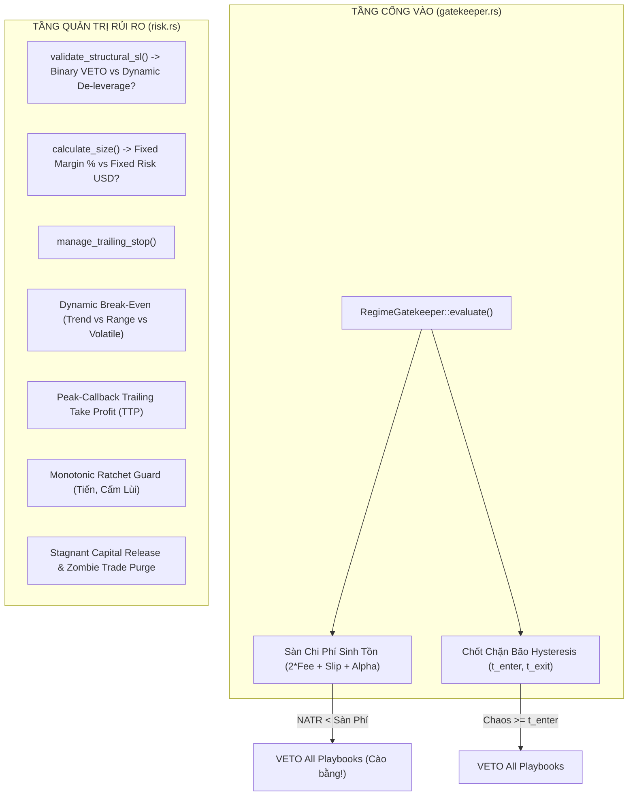
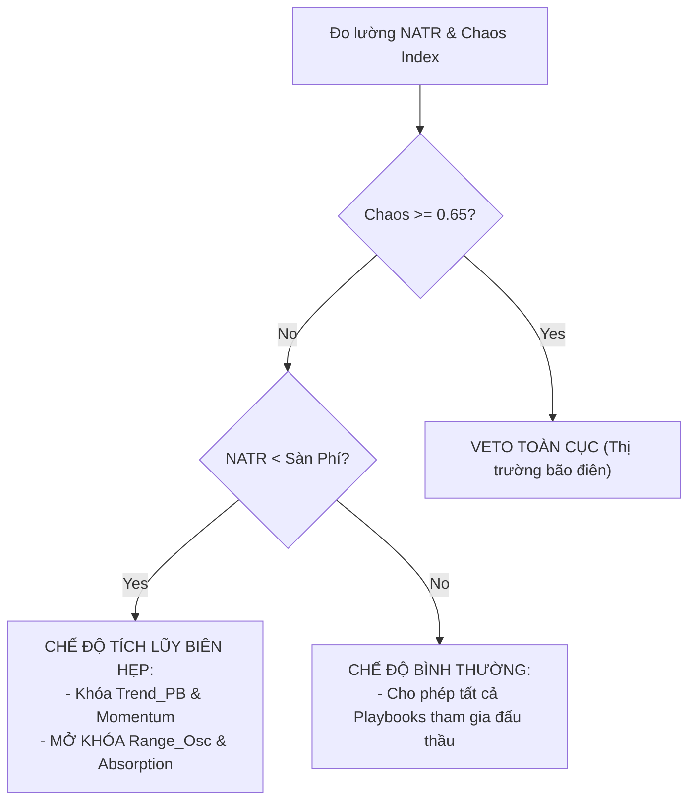

# BÁO CÁO KIỂM TOÁN HẠ TẦNG KIẾN TRÚC: CỔNG VÀO GATEKEEPER & QUẢN TRỊ RỦI RO CHIẾN THUẬT (RISK MANAGER)
**Tài liệu:** Note 54  
**Chủ đề:** Rà Soát Toàn Diện Mã Nguồn `gatekeeper.rs` & `risk.rs`, Hiện Tượng Phủ Quyết Cào Bằng (Regime Agnostic Blanket Veto), Nghịch Lý Catch-22 Giữa Structural SL và Sniper Veto, Khiếm Khuyết Định Cỡ Vị Thế Theo Margin Cố Định Thay Vì Cố Định Rủi Ro Dollar ($Fixed Risk USD), Và Bẫy Gom Nhóm Break-Even Sai Bản Chất  
**Mục tiêu kiểm toán:**
- Khảo sát mã nguồn thực tế:
  - [`strategies_backtests/helios/src/strategy/core_v3/gatekeeper.rs`](file:///e:/Projects/Automations/trading_backtest/strategies_backtests/helios/src/strategy/core_v3/gatekeeper.rs) (442 dòng)
  - [`strategies_backtests/helios/src/strategy/core_v3/risk.rs`](file:///e:/Projects/Automations/trading_backtest/strategies_backtests/helios/src/strategy/core_v3/risk.rs) (1476 dòng)
- Đối chiếu trạng thái với:
  - `strategies_backtests/helios/docs/audit_01/01_sensors/` (`TODO-SEN-03`), `05_risk/` (`TODO-RSK-01` đến `05`), `06_risk/`
  - `strategies_backtests/helios/docs/audit_01/ROADMAP.md` (`TODO-RSK-*`, `TODO-ARB-03`)
  - `strategies_backtests/helios/docs/unfinished_tasks/05_systemic_stability_and_quant_architecture_flaws/` (đặc biệt `notes/12`, `15`, `20`, `22`)

---

## 🏛️ 1. TỔNG QUAN KIẾN TRÚC TẦNG GATEKEEPER & RISK MANAGER



---

## 🚨 2. CÁC TỬ HUYỆT HẠ TẦNG KIẾN TRÚC ĐƯỢC PHÁT HIỆN

### 🔴 Flaw 1 (H-GATE-01): Cầu Dao Gatekeeper Phủ Quyết Cào Bằng Mọi Scanner (Regime Agnostic Blanket Veto)
- **Tình trạng:** 🔴 **TRIỆT TIÊU CƠ HỘI CỦA CÁC PLAYBOOK RANGE-BOUND & ABSORPTION**.
- **Vị trí mã nguồn:** [`gatekeeper.rs:140-152`](file:///e:/Projects/Automations/trading_backtest/strategies_backtests/helios/src/strategy/core_v3/gatekeeper.rs#L140-L152)
  ```rust
  if market_natr_pct < required_min_natr_pct {
      return GateEvaluation {
          passed: false,
          veto_reason: Some(GateVetoReason::VolatilityFlatline),
          ...
      };
  }
  ```
- **Bản chất kinh tế lượng:**
  - Khi `market_natr_pct < required_min_natr_pct`, thị trường rơi vào trạng thái nén biến động sâu hoặc sideway thanh khoản mỏng.
  - Đây là môi trường bất lợi cho `Trend_PB` và `Momentum_Ignition`.
  - **TUY NHIÊN**, đây lại chính là "đất diễn" lý tưởng cho `Range_Osc` (đánh dao động trong biên hẹp) và `Absorption` (quét thanh khoản hấp thụ gom hàng của Market Maker)!
  - Việc `RegimeGatekeeper` trả về `passed: false` nhị phân chặn ngay từ cửa ngõ đã triệt tiêu toàn bộ cơ hội vào lệnh của các Playbook săn nén, khiến `Range_Osc` bị bỏ đói (Starvation) và không có lệnh nào được sinh ra.

---

### 🔴 Flaw 2 (H-GATE-02): Thiếu Phân Loại Chế Độ Thị Trường Vĩ Mô Thực Sự (Zero Macro Regime Classification)
- **Tình trạng:** 🔴 **TÙ MÙ VỀ CHẾ ĐỘ THỊ TRƯỜNG**.
- **Vị trí mã nguồn:** [`gatekeeper.rs:48-67`](file:///e:/Projects/Automations/trading_backtest/strategies_backtests/helios/src/strategy/core_v3/gatekeeper.rs#L48-L67)
- **Bản chất kiến trúc:**
  - Tên struct là `RegimeGatekeeper`, nhưng thực chất bên trong chỉ là 2 phép so sánh ngưỡng đơn giản:
    1. $NATR < Sàn$ $\to$ Veto.
    2. $Chaos \ge Ngưỡng$ $\to$ Veto.
  - **Hoàn toàn không có phân loại Chế độ Thị trường (Regime Classification):**
    - Thị trường đang ở xu hướng mạnh (Trending)?
    - Đi ngang tích lũy biên độ hẹp (Range-Bound)?
    - Bứt phá động lượng (Momentum Breakout)?
    - Hay vùng nhiễu loạn hỗn hợp (Chop Zone)?
  - Cần nâng cấp `GateEvaluation` trả về enum `MarketRegime` để điều phối quyền ưu tiên thầu (Playbook Weights) cho Arbiter.

---

### 🔴 Flaw 3 (H-GATE-03): Đánh Giá Lặp Lại Vô Ích Lãng Phí Chu Kỳ CPU (Redundant Double Evaluation)
- **Tình trạng:** ⚠️ **VI PHẠM NGUYÊN TẮC DRY & LÃNG PHÍ HIỆU NĂNG**.
- **Vị trí mã nguồn:** [`core_v3/mod.rs:163`](file:///e:/Projects/Automations/trading_backtest/strategies_backtests/helios/src/strategy/core_v3/mod.rs#L163) và [`arbiter.rs:169`](file:///e:/Projects/Automations/trading_backtest/strategies_backtests/helios/src/strategy/core_v3/arbiter.rs#L169)
- **Bản chất:**
  - Trong `HeliosStrategyV3::next()`: Gatekeeper đã được gọi để đánh giá `gate_eval`. Nếu `!gate_eval.passed`, hàm đã trả về sớm.
  - Nhưng khi chuyển tiếp vào `arbiter.process_tick()`, Arbiter lại tự gọi lại `RegimeGatekeeper::evaluate(...)` thêm một lần nữa!
  - Việc tính toán lặp lại phép so sánh và duyệt mảng Hysteresis trên mỗi nến 1m làm tiêu tốn chu kỳ CPU vô ích khi chạy tối ưu hóa GA hàng triệu thế hệ.

---

### 🔴 Flaw 4 (H-RSK-01): Nghịch Lý Catch-22: Binary All-or-Nothing Veto Thay Vì Dynamic De-leverage
- **Tình trạng:** 🔴 **BÓP NGHẸT TỶ LỆ SỐNG SÓT CỦA SETUP ĐẸP**.
- **Vị trí mã nguồn:** [`risk.rs:123-138`](file:///e:/Projects/Automations/trading_backtest/strategies_backtests/helios/src/strategy/core_v3/risk.rs#L123-L138) (`validate_structural_sl`)
  ```rust
  if roe > effective_cap_roe {
      return SlValidationResult::StructuralRiskVeto {
          suggested_roe: roe,
          max_roe: effective_cap_roe,
      };
  }
  ```
- **Bản chất vi cấu trúc:**
  - Khi một Scanner (như `Reversal` hoặc `Trend_PB`) phát hiện một vùng hỗ trợ cấu trúc rất đẹp, nhưng do biến động thị trường lúc đó hơi rộng khiến khoảng cách SL tương đương $16.5\%$ ROE (vượt trần $15.0\%$ ROE đúng $1.5\%$).
  - `validate_structural_sl` trả về `StructuralRiskVeto` $\to$ Arbiter lập tức **HỦY BỎ 100% CƠ HỘI VÀO LỆNH**!
  - Trong khi đó, tại [`risk.rs:193-236`](file:///e:/Projects/Automations/trading_backtest/strategies_backtests/helios/src/strategy/core_v3/risk.rs#L193-L236) ta đã có sẵn hàm `clamp_sl_price` để kẹp SL về đúng 15% ROE!
  - **Giải pháp chuẩn Quant (TODO-ARB-03):** Thay vì VETO nhị phân, hệ thống phải áp dụng **Dynamic De-leverage**: Tự động kẹp SL về trần an toàn $15\%$ ROE và giảm tỷ lệ ký quỹ để bảo toàn đúng số tiền rủi ro USD đã định trước.

---

### 🔴 Flaw 5 (H-RSK-02): Định Cỡ Vị Thế Theo Ký Quỹ Cố Định Thay Vì Cố Định Rủi Ro Dollar ($Fixed Risk USD)
- **Tình trạng:** 🔴 **SAI LỆCH CỐT TỬ VỀ NGUYÊN LÝ QUẢN TRỊ RỦI RO ĐỊNH LƯỢNG**.
- **Vị trí mã nguồn:** [`risk.rs:158-189`](file:///e:/Projects/Automations/trading_backtest/strategies_backtests/helios/src/strategy/core_v3/risk.rs#L158-L189) (`calculate_size`)
  ```rust
  let target_margin = equity * risk_pct;
  let order_size_usd = (target_margin * leverage).max(min_order_usd);
  let size_fraction = (order_size_usd / leverage) / equity;
  let final_fraction = size_fraction.min(cap);
  ```
- **Bản chất toán học:**
  - Hàm `calculate_size` hiện tại tính quy mô vị thế danh nghĩa cố định theo:
    $$\text{Notional} = \text{Equity} \times \text{risk\_pct} \times \text{leverage}$$
  - Công thức này **HOÀN TOÀN KHÔNG PHỤ THUỘC VÀO KHOẢNG CÁCH DỪNG LỖ (SL DISTANCE)**!
  - **Hệ quả nguy hiểm:**
    - Nếu Lệnh A có SL hẹp $0.2\%$ giá: Khi dính SL, tài khoản chỉ mất:
      $$\text{Loss}_A = \text{Notional} \times 0.2\% = \text{Equity} \times 4\%$$
    - Nếu Lệnh B có SL rộng $0.75\%$ giá (chạm trần 15% ROE): Khi dính SL, tài khoản mất:
      $$\text{Loss}_B = \text{Notional} \times 0.75\% = \text{Equity} \times 15\%$$
    - Rủi ro mất tiền USD giữa các lệnh bị chênh lệch tới gần **4 lần**!
  - **Chuẩn mực Quản trị Rủi ro Tổ chức (Institutional Quant Standard):**
    Quy mô vị thế bắt buộc phải được tính từ lượng tiền chấp nhận mất cố định ($Risk USD):
    $$\text{Position Size} = \frac{\text{Target Risk USD}}{\text{Entry Price} - \text{SL Price}}$$
    Khi SL hẹp $\to$ Tự động tăng Size; Khi SL rộng $\to$ Tự động co Size. Luôn bảo đảm khi dính SL thì số tiền mất là đồng nhất 100%!

---

### 🟠 Flaw 6 (H-RSK-03): Gom Chung Absorption Vào TrendPB Trong Ngưỡng Kích Hoạt Break-Even (2.5 ATR Quá Xa)
- **Tình trạng:** ⚠️ **BÓP CHẾT LỢI NHUẬN CỦA PLAYBOOK SĂN NÉN VI MÔ**.
- **Vị trí mã nguồn:** [`risk.rs:407-411`](file:///e:/Projects/Automations/trading_backtest/strategies_backtests/helios/src/strategy/core_v3/risk.rs#L407-L411)
  ```rust
  "TREND_PB" | "ABSORPTION" => (
      if risk_cfg.be_atr_trigger_trend > 0.0 { risk_cfg.be_atr_trigger_trend } else { 2.5 },
      if risk_cfg.be_buffer_atr_trend > 0.0 { risk_cfg.be_buffer_atr_trend } else { 1.5 },
  ),
  ```
- **Bản chất chiến thuật:**
  - `TREND_PB` là chiến lược theo xu hướng lớn, cần biên độ rung lắc rộng ($2.5\ \text{ATR}$) để không bị văng lệnh sớm.
  - Nhưng `ABSORPTION` là chiến lược vi mô săn thanh khoản hấp thụ gom hàng, các cú bật sau hấp thụ thường chỉ chạy từ $1.0 - 1.5\ \text{ATR}$ rồi tái tích lũy.
  - Việc ép `ABSORPTION` phải chạy tới $2.5\ \text{ATR}$ mới được kích hoạt hòa vốn khiến hầu hết các lệnh Absorption sau khi có lãi $+8\% - +12\%$ ROE bị thị trường hồi quy và dính Stop Loss ngược!
  - Cần tách riêng `ABSORPTION` thành nhóm tham số độc lập với `be_atr_trigger_absorption` khoảng $1.2 - 1.5\ \text{ATR}$.

---

### 🟠 Flaw 7 (H-RSK-04): Lệch Pha Trạng Thái SL Giữa `Broker` (In-Memory) Và Sàn Thực Tế (`LiveEngine`)
- **Tình trạng:** ⚠️ **NGUY CƠ SPAM LỆNH DỜI SL VÀ NAKED SL TRÊN BINANCE**.
- **Vị trí mã nguồn:** [`risk.rs:650-653`](file:///e:/Projects/Automations/trading_backtest/strategies_backtests/helios/src/strategy/core_v3/risk.rs#L650-L653)
  ```rust
  if sl_changed || tp_changed {
      let sl_to_send = if sl_changed { Some(calculated_sl) } else { trade.sl_price };
      tick.update_trade_sl_tp(trade.id, sl_to_send, new_tp_to_update);
  }
  ```
- **Bản chất:**
  - Trong backtest: `tick.update_trade_sl_tp` cập nhật trực tiếp biến trong RAM của `Broker` không có độ trễ.
  - Trong thực chiến: Lệnh này phát sinh `Action::UpdateTradeSlTp`. Do lỗi `live_position.current_sl_price` luôn là `None` trong LiveEngine (đã ghi nhận ở Note 50 `TB-ORD-02`), bot không nhớ được SL đang chạy trên sàn và liên tục spam lệnh hủy/đặt lại Algo Order trên mỗi cây nến 1m, gây nghẽn API và rủi ro Naked SL Gap 150ms!

---

### 🟡 Flaw 8 (H-RSK-05): Giải Phóng Vốn Ngâm (`Stagnant Capital Release`) Cố Định Số Nến Thay Vì Thích Ứng Biến Động
- **Tình trạng:** ⚠️ **CẮT NON LỆNH KHI THỊ TRƯỜNG NÉN BIÊN ĐỘ DÀI HẠN**.
- **Vị trí mã nguồn:** [`risk.rs:358-371`](file:///e:/Projects/Automations/trading_backtest/strategies_backtests/helios/src/strategy/core_v3/risk.rs#L358-L371)
- **Bản chất:**
  - `max_stagnant_hold_bars` hiện tại được cấu hình cố định theo số lượng nến 1m (ví dụ 120 nến = 2 tiếng).
  - Khi thị trường bước vào các phiên cuối tuần hoặc giai đoạn tích lũy nén cực đại (Volatility Squeeze), việc giá đi ngang 2–3 tiếng là hoàn toàn bình thường.
  - Việc cắt lệnh chỉ vì đếm đủ số nến mà không kiểm tra độ nén biến động (Squeeze Intensity) có thể khiến bot cắt lỗ non ngay trước thềm một cú bùng nổ xu hướng lớn.

---

## 📊 3. BẢNG ĐỐI SOÁT TRẠNG THÁI VỚI TÀI LIỆU CŨ (`audit_01` & `ROADMAP.md`)

| Mã Lỗi / Task | Nội dung | Phân Loại Đối Soát | Hiện Trạng Thực Tế Trong Code |
| :--- | :--- | :---: | :--- |
| `TODO-RSK-01` | Liquidation & MMR Guard | [ĐÃ CÓ TRONG AUDIT CŨ] | 🟢 **ĐÃ SỬA XONG** (Tích hợp đầy đủ trong `risk.rs:33-138`) |
| `TODO-RSK-02` | Xóa siết SL lũy thừa khi vị thế âm | [ĐÃ CÓ TRONG AUDIT CŨ] | 🟢 **ĐÃ SỬA XONG** (Bảo toàn 100% Initial Structural SL) |
| `TODO-RSK-03` | Dynamic BE theo ATR thực tế | [ĐÃ CÓ TRONG AUDIT CŨ] | 🔴 **CHƯA HOÀN THIỆN** (Ngưỡng kích hoạt BE vẫn bị cào bằng) |
| `TODO-RSK-04` | Sizing an toàn cho vốn nhỏ | [ĐÃ CÓ TRONG AUDIT CŨ] | 🟡 **MỚI SỬA BỀ MẶT** (Chặn cap 25%, nhưng chưa cố định Risk USD) |
| `TODO-RSK-05` | Closed-Loop Sync SL Cloud vs RAM | [ĐÃ CÓ TRONG AUDIT CŨ] | 🔴 **CHƯA SỬA** (Vẫn fire-and-forget, dính bẫy Naked SL 150ms) |
| `TODO-ARB-03` | Chuyển Sniper VETO sang Dynamic De-leverage | [ĐÃ CÓ TRONG AUDIT CŨ] | 🔴 **CHƯA SỬA** (`validate_structural_sl` vẫn VETO hủy lệnh) |
| `H-GATE-01` | Gatekeeper VETO cào bằng RangeOsc khi Flatline | 🔴 **LỖI HẠ TẦNG MỚI** | Chặn sạch mọi Playbook khi biến động thấp |
| `H-GATE-02` | Thiếu bộ phân loại Macro Regime thực thụ | 🔴 **LỖI HẠ TẦNG MỚI** | Chỉ có 2 phép so sánh boolean nhị phân |
| `H-GATE-03` | Đánh giá lặp lại Gatekeeper tại `mod.rs` & `arbiter` | 🔴 **LỖI HẠ TẦNG MỚI** | Gọi 2 lần gây lãng phí CPU |
| `H-RSK-02` | Định cỡ vị thế theo Fixed Margin thay vì Fixed Risk USD | 🔴 **LỖI HẠ TẦNG MỚI** | Lệnh SL rộng lỗ gấp 4 lần lệnh SL hẹp |
| `H-RSK-03` | Gom chung Absorption vào TrendPB trong BE Trigger | 🔴 **LỖI HẠ TẦNG MỚI** | Ép Absorption chạy 2.5 ATR làm nhả lại lãi |
| `H-RSK-05` | Stagnant Exit đếm nến mù không thích ứng Squeeze | 🔴 **LỖI HẠ TẦNG MỚI** | Cắt non lệnh ngay trước khi nén bùng nổ |

---

## 🛠️ 4. BẢN THIẾT KẾ NÂNG CẤP KIẾN TRÚC RỦI RO CHUẨN QUANT

### 4.1. Công Thức Định Cỡ Vị Thế Cố Định Rủi Ro Dollar (Fixed Dollar Risk Sizing)
$$\text{Dollar Risk} = \text{Equity} \times \text{Risk Fraction (ví dụ: 1.0\%)}$$
$$\text{Position Size} = \min\left( \frac{\text{Dollar Risk}}{|\text{Entry} - \text{SL}|},\ \frac{\text{Equity} \times \text{Max Capital Cap} \times \text{Leverage}}{\text{Entry}} \right)$$

### 4.2. Cơ Chế Phân Luồng Gatekeeper Theo Chế Độ Thị Trường


---

## 🎯 5. KẾT LUẬN

Tầng `gatekeeper.rs` và `risk.rs` sở hữu những chốt chặn an toàn xuất sắc nhất hệ thống (`Monotonic Ratchet Guard`, `Liquidation & MMR Guard`, `Stagnant Capital Release`).  
Tuy nhiên, việc tồn tại **nghịch lý Catch-22 (VETO thay vì giảm size)**, **tính size theo Margin cố định (khiến rủi ro mất tiền USD bị lệch 4 lần)** và **Gatekeeper cào bằng mọi playbook khi thị trường nén biên độ** chính là nguyên nhân gốc rễ khiến hệ thống bị co cụm, bỏ lỡ nhiều cơ hội sinh lời và làm tê liệt các scanner biên độ.
