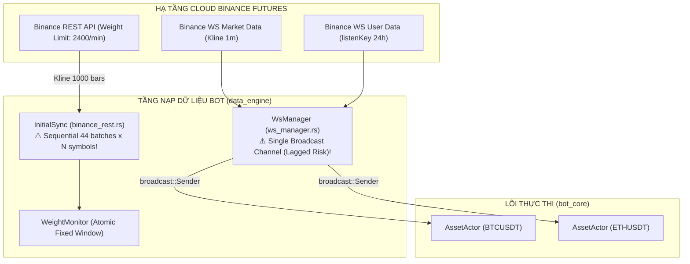
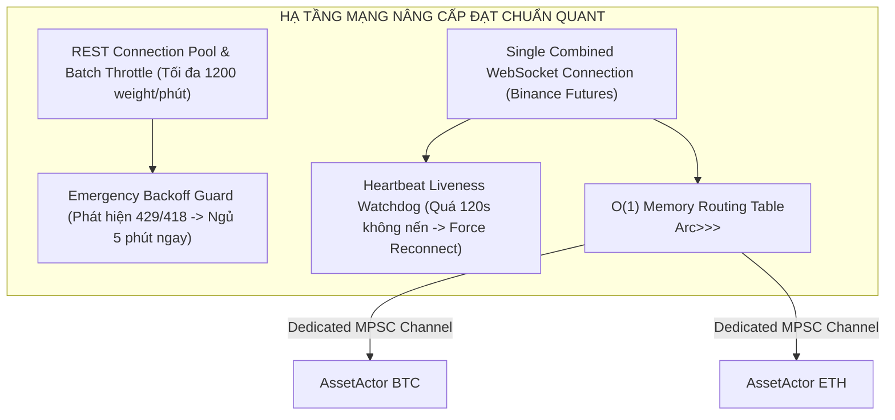

# BÁO CÁO KIỂM TOÁN HẠ TẦNG KIẾN TRÚC: TẦNG NẠP DỮ LIỆU MẠNG & QUẢN TRỊ KẾT NỐI SÀN BINANCE
**Tài liệu:** Note 55  
**Chủ đề:** Khảo sát Toàn Diện Tầng Nạp Dữ Liệu Mạng Sàn Binance (`binance_rest.rs`, `binance_stream.rs`, `ws_manager.rs`, `weight_monitor.rs`), Nghẽn Cổ Chai Đồng Bộ Lịch Sử (Sequential Backward Sync Bottleneck), Bẫy Mất Nến Broadcast Lagged, Zombie Silent Hang Khi Rớt Kết Nối Ngầm, Và Hiểm Họa Bị Ban IP Do Thiếu Emergency Backoff 429/418  
**Mục tiêu kiểm toán:**
- Khảo sát mã nguồn thực tế:
  - [`trading_bot/bot_engine/src/data_engine/binance_rest.rs`](file:///e:/Projects/Automations/trading_backtest/trading_bot/bot_engine/src/data_engine/binance_rest.rs) (356 dòng)
  - [`trading_bot/bot_engine/src/data_engine/binance_stream.rs`](file:///e:/Projects/Automations/trading_backtest/trading_bot/bot_engine/src/data_engine/binance_stream.rs) (74 dòng)
  - [`trading_bot/bot_engine/src/execution/ws_manager.rs`](file:///e:/Projects/Automations/trading_backtest/trading_bot/bot_engine/src/execution/ws_manager.rs) (496 dòng)
  - [`trading_bot/bot_engine/src/models/weight_monitor.rs`](file:///e:/Projects/Automations/trading_backtest/trading_bot/bot_engine/src/models/weight_monitor.rs) (103 dòng)
- Đối chiếu trạng thái với:
  - `strategies_backtests/helios/docs/audit_01/10_helios_bridge/` & `11_asset_actor/`
  - `strategies_backtests/helios/docs/audit_01/ROADMAP.md` (`TODO-ACT-08`, `TODO-AUDIT-TB-01`, `TODO-AUDIT-TB-02`)
  - `strategies_backtests/helios/docs/unfinished_tasks/05_systemic_stability_and_quant_architecture_flaws/`

---

## 🏛️ 1. TỔNG QUAN KIẾN TRÚC TẦNG NẠP DỮ LIỆU MẠNG (NETWORK DATA ENGINE)

Tầng nạp dữ liệu mạng là **hệ thần kinh cảm giác ngoại vi (Peripheral Sensory Nervous System)** của toàn bộ bot giao dịch:
1. **REST Engine (`binance_rest.rs`):** Kéo dữ liệu lịch sử nến 1m lùi về quá khứ (`ensure_history` 30 ngày) và lấp đầy khoảng trống dữ liệu khi bot khởi động lại (`fill_gap`).
2. **WebSocket Streams (`ws_manager.rs` & `binance_stream.rs`):** Lắng nghe trực tiếp nến đóng thời gian thực (Market Data) và thông điệp khớp lệnh/thay đổi số dư (User Data).
3. **Weight Monitor (`weight_monitor.rs`):** Canh gác giới hạn $2400$ API Weight/phút của Binance Futures để tránh bị ăn phạt HTTP 429 / 418.



---

## 🚨 2. CÁC TỬ HUYỆT HẠ TẦNG MẠNG & DÒNG DỮ LIỆU

### 🔴 Flaw 1 (TB-NET-01): Nghẽn Cổ Chai Đồng Bộ Lịch Sử & Nguy Cơ Cạn Kiệt Weight (Sequential Backward Sync Bottleneck)
- **Tình trạng:** 🔴 **LÀM CHẬM KHỞI ĐỘNG VÀ ĐE DỌA CẠN KIỆT RATE LIMIT SÀN**.
- **Vị trí mã nguồn:** [`binance_rest.rs:61-145, 178-261`](file:///e:/Projects/Automations/trading_backtest/trading_bot/bot_engine/src/data_engine/binance_rest.rs#L61-L145)
- **Bản chất kỹ thuật:**
  - Để chuẩn bị đủ $43,200$ nến (30 ngày) cho 1 cặp tiền, bot phải chia nhỏ làm $44$ batch requests tuần tự (mỗi request 1,000 nến, tiêu tốn $5$ weight).
  - Khi người dùng khởi chạy đồng thời $10$ cặp tiền trong Watchlist:
    $$\text{Total Requests} = 10 \times 44 = 440\ \text{requests} \implies \text{Total Weight} = 440 \times 5 = 2,200\ \text{weight}$$
  - Mức $2,200$ weight chạm trần nguy hiểm $91.6\%$ của giới hạn $2,400$ weight/phút của Binance!
  - Việc fetch tuần tự kết hợp với blocking SQLite I/O trên từng batch khiến thời gian khởi động bot kéo dài hàng phút, làm trễ nải toàn bộ quá trình nhận nến thời gian thực của WebSocket.

---

### 🔴 Flaw 2 (TB-NET-02): Bẫy Đứt Gãy Dữ Liệu Khi Gặp Khoảng Trống Nến (Gap Skip Trap)
- **Tình trạng:** 🔴 **LỖI PHÁ VỠ CHUỖI THỜI GIAN NẾN 1M**.
- **Vị trí mã nguồn:** [`binance_rest.rs:85-87, 209-210`](file:///e:/Projects/Automations/trading_backtest/trading_bot/bot_engine/src/data_engine/binance_rest.rs#L85-L87)
  ```rust
  let data = response.data().await?;
  if data.is_empty() { break; }
  ```
- **Kịch bản lỗi chết người:**
  - Khi một cặp tiền vừa được niêm yết, hoặc sàn Binance bảo trì tạm dừng khớp lệnh trong 2 tiếng: Khoảng thời gian đó hoàn toàn không có nến nào được sinh ra.
  - Khi `data.is_empty()`, code thực hiện lệnh `break` thoát vòng lặp ngay lập tức!
  - **Hậu quả:** `fill_gap` dừng đồng bộ giữa chừng, bỏ qua toàn bộ nến từ sau khoảng trống đó đến thời điểm hiện tại!
  - Dữ liệu nến trong bộ đệm bị kẹt lại ở quá khứ, khiến Strategy phân tích trên chuỗi nến bị đứt gãy nghiêm trọng.

---

### 🔴 Flaw 3 (TB-NET-03): Nuốt Lỗi Không Kích Hoạt Emergency Backoff Khi Gặp HTTP 429/418
- **Tình trạng:** 🔴 **NGUY CƠ BỊ SÀN BINANCE BAN IP TOÀN MÁY CHỦ**.
- **Vị trí mã nguồn:** [`binance_rest.rs:73, 198`](file:///e:/Projects/Automations/trading_backtest/trading_bot/bot_engine/src/data_engine/binance_rest.rs#L73)
  ```rust
  let response = self.rest_client.kline_candlestick_data(params).await?;
  ```
- **Bản chất:**
  - Nếu vì lý do nào đó (mạng lag, đồng hồ lệch hoặc chạy đa luồng) mà tổng request vượt trần, Binance sẽ trả về mã lỗi HTTP `429 Too Many Requests` hoặc `418 IP Banned`.
  - Code hiện tại chỉ trả về `Err(e)` thô và thoát hàm.
  - **Không có cơ chế Cầu Dao Ngắt Mạch Khẩn Cấp (Emergency Circuit Breaker Backoff):** Các luồng khác (các Actor khác hoặc WsManager) vẫn tiếp tục bắn request REST lên sàn $\to$ Binance nâng mức phạt lên Ban IP từ 2 phút đến 24 giờ, làm toàn bộ bot bị tê liệt hoàn toàn!

---

### 🔴 Flaw 4 (TB-NET-04): Mất Nến Trong Im Lặng Do Kênh Broadcast Tràn Bộ Đệm (`broadcast::RecvError::Lagged`)
- **Tình trạng:** 🔴 **TỬ HUYỆT MẤT DỮ LIỆU THỜI GIAN THỰC**.
- **Vị trí mã nguồn:** [`ws_manager.rs:48, 134`](file:///e:/Projects/Automations/trading_backtest/trading_bot/bot_engine/src/execution/ws_manager.rs#L48)
  ```rust
  data_tx: broadcast::Sender<(Candle, bool)>,
  ...
  let _ = tx.send((candle, false));
  ```
- **Bản chất vi cấu trúc:**
  - Toàn bộ các `AssetActor` cùng lắng nghe trên một kênh `broadcast` dùng chung.
  - Kênh broadcast của Tokio có dung lượng bộ đệm hữu hạn (ví dụ 1024 phần tử).
  - Khi một Actor bị nghẽn (do Rayon chạy GA, SQLite disk write blocking, hoặc tính toán ma trận MTF mất 1–2 giây): Bộ đệm của Actor đó bị tràn.
  - Tokio broadcast sẽ tự động vứt bỏ các tin nhắn cũ và ném lỗi `RecvError::Lagged(n)`.
  - Actor bị **MẤT TRẮNG CÁC NẾN ĐÓNG 1M**, làm thủng lỗ chuỗi nến thời gian thực, dẫn tới việc tính toán sai lệch hoàn toàn ATR, KAMA và Trailing SL!
  - **Chuẩn kiến trúc:** Phải phân luồng O(1) qua bảng băm `HashMap<String, mpsc::Sender<Candle>>` độc lập cho từng Actor.

---

### 🟠 Flaw 5 (TB-NET-05): Chết Lâm Sàng (Zombie Silent Hang) Khi WebSocket Rớt Kết Nối Ngầm
- **Tình trạng:** ⚠️ **BOT NGỪNG GIAO DỊCH MÀ KHÔNG HỀ BÁO LỖI**.
- **Vị trí mã nguồn:** [`ws_manager.rs:139-142, 273-275`](file:///e:/Projects/Automations/trading_backtest/trading_bot/bot_engine/src/execution/ws_manager.rs#L139-L142)
  ```rust
  loop {
      sleep(Duration::from_secs(60)).await;
  }
  ```
- **Bản chất:**
  - Trong môi trường mạng Internet, kết nối TCP có thể bị đứt ngầm (Half-open TCP connection) do Router/NAT drop gói tin mà phía Client không hề nhận được cờ TCP FIN/RST.
  - Vòng lặp `loop { sleep(60).await; }` vẫn tiếp tục ngủ ngây thơ vì nghĩ rằng kết nối vẫn sống.
  - Callback `stream.on_message` không còn nhận được bất kỳ nến nào nữa. Bot rơi vào trạng thái "Chết Lâm Sàng" (Zombie Silent Hang) suốt nhiều giờ liền mà không hề kích hoạt reconnect!
  - Cần có **Heartbeat Liveness Watchdog**: Nếu quá 120 giây không có nến mới, phải chủ động hủy kết nối TCP cũ và kết nối lại ngay lập tức.

---

### 🟠 Flaw 6 (TB-NET-06): Mất Đồng Bộ User Data Khi `listenKey` Hết Hạn Sau 24 Giờ
- **Tình trạng:** ⚠️ **MÙ TRẠNG THÁI VỊ THẾ VÀ STOP LOSS SÀN**.
- **Vị trí mã nguồn:** [`ws_manager.rs:207-217`](file:///e:/Projects/Automations/trading_backtest/trading_bot/bot_engine/src/execution/ws_manager.rs#L207-L217)
- **Bản chất:**
  - Trên Binance Futures, `listenKey` chỉ có hiệu lực tối đa 24 giờ.
  - Dù có gửi lệnh `keepalive_user_data_stream()` mỗi 30 phút, nếu gặp trục trặc mạng tại một thời điểm hoặc khi bước sang ngày mới, Binance có thể thu hồi listenKey cũ.
  - Khi vòng lặp keepalive bị vỡ, code nhảy ra ngoài lấy `listenKey` mới, nhưng stream WebSocket cũ vẫn đang gắn với `listen_key` cũ đã chết!
  - Toàn bộ luồng User Data (`AccountUpdate`, `OrderTradeUpdate`) bị điếc hoàn toàn. Bot không nhận được thông tin khi lệnh Stop Loss cắn trên sàn, dẫn tới việc Strategy và Bot Engine bị lệch pha 100%.

---

### 🟠 Flaw 7 (TB-NET-07): Mã Mồ Côi `binance_stream.rs` Chia Rẽ Kiến Trúc WebSocket
- **Tình trạng:** ⚠️ **MÃ CHẾT GÂY NHẦM LẪN KIẾN TRÚC**.
- **Vị trí mã nguồn:** [`trading_bot/bot_engine/src/data_engine/binance_stream.rs`](file:///e:/Projects/Automations/trading_backtest/trading_bot/bot_engine/src/data_engine/binance_stream.rs) (74 dòng)
- **Bản chất:**
  - File này là phiên bản sơ khai kết nối WebSocket đơn lẻ cho từng cặp tiền, đã bị thay thế hoàn toàn bởi `ws_manager.rs`.
  - Nhưng file vẫn nằm trong thư mục `src/data_engine/`, không được dọn dẹp, tạo ra tech debt và gây hiểu lầm cho việc bảo trì hệ thống.

---

### 🟡 Flaw 8 (TB-NET-08): Race Condition & Lệch Pha Đồng Hồ Phút UTC Trong `WeightMonitor`
- **Tình trạng:** ⚠️ **RỦI RO VƯỢT HẠN MỨC RATE LIMIT SÀN**.
- **Vị trí mã nguồn:** [`weight_monitor.rs:53-63`](file:///e:/Projects/Automations/trading_backtest/trading_bot/bot_engine/src/models/weight_monitor.rs#L53-L63)
  ```rust
  if (now / 60000) > (last_update / 60000) {
      0
  } else {
      self.used_weight.load(Ordering::Relaxed)
  }
  ```
- **Bản chất:**
  - Phép chia `(now / 60000)` phụ thuộc 100% vào đồng hồ máy tính cục bộ. Nếu đồng hồ máy tính chạy nhanh hơn máy chủ Binance chỉ 100ms:
  - Máy tính đã coi là sang phút mới và trả về weight = 0, trong khi Binance vẫn đang tính vào phút cũ!
  - Bot sẽ ồ ạt gửi request trong 100ms này và bị Binance phạt lỗi HTTP 429.
  - Đồng thời việc sử dụng `Ordering::Relaxed` không đảm bảo tính toàn vẹn bộ nhớ đa luồng giữa các worker thread của Tokio.

---

## 📊 3. BẢNG ĐỐI SOÁT TRẠNG THÁI VỚI TÀI LIỆU CŨ (`audit_01` & `ROADMAP.md`)

| Mã Lỗi / Task | Nội dung | Phân Loại Đối Soát | Hiện Trạng Thực Tế Trong Code |
| :--- | :--- | :---: | :--- |
| `TODO-ACT-08` | Chống rớt nến WebSocket Lagged | [ĐÃ CÓ TRONG ROADMAP:222] | 🔴 **CHƯA SỬA** (Vẫn dùng broadcast chung, nguy cơ Lagged cao) |
| `TODO-AUDIT-TB-01` | Xung đột SQLite & Rate Limit khi Sync | [ĐÃ CÓ TRONG ROADMAP] | 🔴 **CHƯA SỬA** (Sync 30 ngày ngốn hàng ngàn weight tuần tự) |
| `TB-NET-01` | Sequential Backward Sync gây nghẽn & cạn kiệt Weight | 🔴 **LỖI HẠ TẦNG MỚI** | 10 cặp tiền sync đồng thời ngốn tới 2,200 weight |
| `TB-NET-02` | Break nhầm khi gặp khoảng trống nến (Gap Skip Trap) | 🔴 **LỖI HẠ TẦNG MỚI** | Dữ liệu bị đứt gãy không sync tiếp đến hiện tại |
| `TB-NET-03` | Nuốt lỗi không có Emergency Backoff khi gặp 429/418 | 🔴 **LỖI HẠ TẦNG MỚI** | Nguy cơ bị Binance ban IP toàn server |
| `TB-NET-04` | Phân luồng broadcast gây mất nến trong im lặng | 🔴 **LỖI HẠ TẦNG MỚI** | Actor lag CPU bị mất nến đóng 1m |
| `TB-NET-05` | Zombie Silent Hang khi WebSocket đứt kết nối ngầm | 🔴 **LỖI HẠ TẦNG MỚI** | Thiếu Heartbeat Liveness Watchdog 120s |
| `TB-NET-06` | Mất đồng bộ User Data khi listenKey hết hạn sau 24h | 🔴 **LỖI HẠ TẦNG MỚI** | Lấy key mới nhưng không tái kết nối WS stream |
| `TB-NET-07` | Mã mồ côi `binance_stream.rs` gây rác codebase | 🔴 **LỖI HẠ TẦNG MỚI** | 74 dòng mã cũ không sử dụng |
| `TB-NET-08` | Race condition & lệch pha đồng hồ trong WeightMonitor | 🔴 **LỖI HẠ TẦNG MỚI** | Dùng Relaxed ordering và phụ thuộc đồng hồ local |

---

## 🛠️ 4. BẢN THIẾT KẾ NÂNG CẤP KIẾN TRÚC MẠNG ĐẠT CHUẨN QUANT



### Các Trụ Cột Nâng Cấp Cốt Tử:
1. **O(1) MPSC Routing Table:** Xóa bỏ hoàn toàn kênh `broadcast` dùng chung, chuyển sang gửi qua `mpsc::Sender` độc lập của từng Actor.
2. **Heartbeat Liveness Watchdog:** Bổ sung bộ giám sát độ tươi nến (Candle Freshness Watchdog): Quá 120s không có nến mới $\to$ Tự động ngắt kết nối TCP và tái kết nối.
3. **Emergency Circuit Breaker Backoff:** Khi nhận bất kỳ phản hồi 429/418 nào từ Binance, lập tức phong tỏa toàn bộ REST requests trong 5 phút.
4. **Dọn sạch mã mồ côi `binance_stream.rs`:** Hợp nhất $100\%$ về `ws_manager.rs`.

---

## 🎯 5. KẾT LUẬN

Tầng nạp dữ liệu mạng sàn Binance là mắt xích nhạy cảm nhất của bot thực chiến. Việc triệt tiêu các nguy cơ **mất nến do broadcast lagged**, **zombie silent hang** và **nghẽn weight rate limit** sẽ đảm bảo dòng dữ liệu nến 1m được bơm liên tục, ổn định và bảo vệ bot vận hành an toàn 24/7 trên môi trường thực tế.
