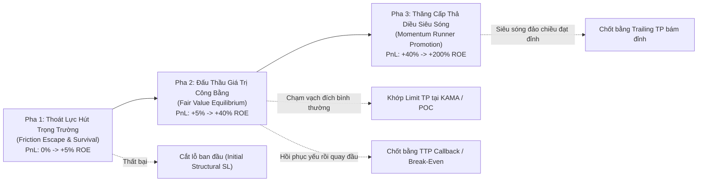

# BÁO CÁO THIẾT KẾ KỸ THUẬT: MÁY TRẠNG THÁI VÒNG ĐỜI VỊ THẾ 3 PHA & ĐỘNG CƠ THĂNG CẤP SIÊU SÓNG
**File tài liệu:** `56_3_stage_position_lifecycle_and_momentum_promotion_engine.md`  
**Chuyên đề:** Kiến trúc Quản trị Vị thế Đa Tầng (3-Stage Lifecycle Exit Engine) & Thăng cấp Runner khi bùng nổ xung lực tại vạch đích; Giải quyết triệt để bài toán Chốt Non (Premature Exit) và KAMA trôi dốc.  
**Mã nhiệm vụ đại diện:** `TODO-AUDIT-NEW-205` (`RISK-3STAGE-LIFECYCLE`)  
**Phân hệ phụ trách:** 🛡️ `helios::core_v3::risk` & `config.rs`  
**Tôn chỉ thiết kế:** Tuân thủ 100% nguyên lý thích ứng toàn năng của `GEMINI.md`, tối ưu vi cấu trúc sàn Binance Futures (`closePosition: true`), và loại bỏ hoàn toàn các giả định ngầm tĩnh.

---

## 🏛️ PHẦN 1: BỐI CẢNH & NGUYÊN LÝ GỐC (FIRST-PRINCIPLES ONTOLOGY)

Trong giao dịch định lượng phái sinh đòn bẩy, một vị thế không bao giờ là một khối tĩnh. Nó vận hành theo một **chu trình sinh học 3 pha** rõ rệt:

---

## 📋 PHẦN 2: CHI TIẾT 3 PHA CỦA MÁY TRẠNG THÁI VÒNG ĐỜI

### 1. Pha 1: Thoát Lực Hút Trọng Trường (Friction Escape & Survival)
* **Thực tế vật lý:** Ngay sau khi mở lệnh, vị thế chịu lực cản lớn nhất của thị trường: Chi phí ma sát sàn 2 chiều ($2 \times \text{Taker Fee} + \text{Slippage} \approx 0.10\%$) và nguy cơ Whipsaw quét râu nến.
* **Mục tiêu cốt tử:** **Bảo toàn vốn và sinh tồn**.
* **Cơ chế:**
  - Vị thế được bảo vệ bởi mức Cắt Lỗ Cấu Trúc Khởi Tạo (**Initial Structural SL**), được tính toán dựa trên đáy râu nến cao trào cộng đệm ATR và kẹp trần an toàn ROE $\le 15.0\%$.
  - Khi giá di chuyển thuận lợi và vượt qua ngưỡng rào cản ma sát sàn ($\text{Realized PnL} \ge \text{EV Hurdle} \approx +3.5\% \sim +5.0\%\text{ ROE}$):
  - Kích hoạt **Break-Even Ratchet**: Dời Stop Loss lên mức Hòa Vốn Dương ($\text{Entry} + \text{Friction Cost}$). Vị thế chính thức hoàn thành Pha 1 và chuyển sang Pha 2.

### 2. Pha 2: Đấu Thầu Giá Trị Công Bằng (Fair Value Equilibrium Auction)
* **Thực tế vật lý:** Vị thế hồi phục về vùng giá trị cân bằng dài hạn ($TP_0 = \text{KAMA Midline}$ cho `REVERSAL`, hoặc $BB_{\text{opposite}} / POC$ cho `RANGE_OSC`).
* **Hành vi kép tại vạch đích:**
  - **Nhánh 2A (Hồi phục yếu / Kiệt sức):** Nếu giá tiệm cận vạch đích (đạt $\ge 70\%$ khoảng cách $\Delta TP_0$) nhưng xuất hiện dấu hiệu suy yếu và quay đầu giảm một khoảng Callback ($\Delta P_{\text{retrace}} \ge 0.4\text{ ATR}$):
    $\implies$ Kích hoạt lệnh Market Exit chốt lời ngay lập tức, bảo toàn tối thiểu $+35\%\text{ ROE}$, triệt tiêu nguy cơ rơi ngược về hòa vốn.
  - **Nhánh 2B (Khớp Limit TP Maker):** Lệnh Limit Take Profit tĩnh đặt sẵn tại $TP_0$ đón các cú giật râu nến cực hạn, khớp lệnh với phí Maker và Zero Slippage.
  - **Nhánh 2C (Cửa ngõ thăng cấp lên Pha 3):** Nếu tại thời điểm chạm $TP_0$, thị trường kích hoạt một đợt bùng nổ xung lực khổng lồ:
    $$\text{Volume} \ge 2.5 \times \text{VolSMA} \quad \text{AND} \quad \text{Close} > \text{KAMA} \quad \text{AND} \quad \text{ADX}_{15m} \ge 30$$
    $\implies$ Hệ thống hủy bỏ trần chốt lời cố định, **thăng cấp vị thế lên Pha 3 (Momentum Runner)**.

### 3. Pha 3: Thăng Cấp Thả Diều Siêu Sóng (Momentum Runner Promotion)
* **Thực tế vật lý:** Cú đảo chiều kích hoạt Short Squeeze dây chuyền, biến một nhịp hồi đàn hồi thành một siêu xu hướng tăng/giảm dài hạn.
* **Hành vi:**
  - Vị thế được đối xử như một lệnh `MOMENTUM_IGN` hoặc `TREND_PB`.
  - Kích hoạt **Peak-Callback Trailing Take Profit (TTP)** nới lỏng ($1.0 \sim 1.5\text{ ATR}$): Giá tiếp tục bay tới đâu, hệ thống đo đỉnh High Watermark và kéo mức chốt bảo vệ chạy theo sau.
  - Vị thế chỉ được đóng khi siêu sóng thực sự cạn kiệt động lượng và quay đầu.

---

## ⚖️ PHẦN 3: BẢNG THAM SỐ DNA DỰ KIẾN (GENETIC PARAMETERS)

Để GA Optimizer thích ứng với các tài sản có thanh khoản và độ biến động khác nhau:

| Tham Số DNA | Ý Nghĩa Nghiệp Vụ | Dải Khuyến Nghị | Bước Nhảy (Step) |
| :--- | :--- | :---: | :---: |
| `lifecycle_escape_roe` | Ngưỡng ROE tối thiểu để hoàn thành Pha 1 và khóa BE | $0.03 \sim 0.08$ ($3\% \sim 8\%$ ROE) | $0.005$ |
| `lifecycle_fair_value_ratio` | Tỷ lệ khoảng cách tới Fair Value để kích hoạt radar chốt lời | $0.60 \sim 0.90$ ($60\% \sim 90\%$ cự ly) | $0.05$ |
| `lifecycle_runner_vol_mult` | Hệ số đột biến Volume tối thiểu tại vạch đích để thăng cấp Pha 3 | $1.80 \sim 4.00 \times \text{SMA}$ | $0.20$ |
| `lifecycle_runner_ttp_atr` | Khoảng cách Callback ATR thả diều khi ở Pha 3 | $0.80 \sim 2.50\text{ ATR}$ | $0.10$ |

---

## 🎯 PHẦN 4: LỘ TRÌNH TRIỂN KHAI TRONG HỆ SINH THÁI

1. **Giai đoạn hiện tại (Baby Steps):** Hoàn thiện Phương Án B (Unified Dual-Layer) cho Task `TODO-AUDIT-NEW-188` để giải quyết dứt điểm lỗi KAMA trôi dốc và chuẩn hóa vạch đích tĩnh $TP_0$.
2. **Giai đoạn nâng cấp toàn diện (Cụm F):** Khi triển khai Cụm F (`TODO-AUDIT-NEW-205`), bổ sung máy trạng thái vị thế và logic thăng cấp siêu sóng vào `RiskManager`, kết nối trọn vẹn với cả 6 Playbooks.
