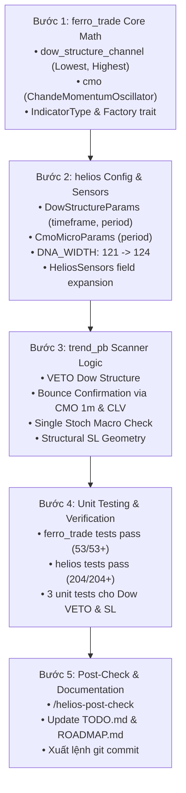

# BÁO CÁO THIẾT KẾ KỸ THUẬT: CẤU TRÚC ĐỈNH ĐÁY BẬC THANG DOW & XÁC NHẬN NẢY LÊN VI MÔ BẰNG CMO
**File tài liệu:** `57_todo_audit_new_52_trend_dow_structure_and_micro_cmo.md`  
**Chuyên đề:** Nhận diện Cấu trúc Đỉnh/Đáy Bậc Thang Dow Theory (Higher Low / Lower High), Bảo vệ Đáy Sóng Cũ, Lượng hóa Xác nhận Nảy lên Vi mô (CMO 1m + CLV) và Neo Stop Loss Thích ứng Đa Khung Thời Gian.  
**Mã nhiệm vụ đại diện:** `TODO-AUDIT-NEW-52` (`TREND-DOW-STRUCTURE`)  
**Phân hệ phụ trách:** 📈 `ferro_trade` (Bulk Indicators Core) & 🎯 `helios::core_v3::scanners::trend_pb` & 🧬 `config.rs` & 📡 `sensors.rs`  
**Tôn chỉ thiết kế:** Tuân thủ 100% Mục 6.15 & 6.16 trong `GEMINI.md`: Đơn Trách Nhiệm & Trực Giao DNA, Phân Định Tường Minh Kiến Trúc Vĩ Mô vs. Vi Mô, loại bỏ hoàn toàn đếm nến $t+1$ và cảm tính Price Action.

---

## 🏛️ PHẦN 1: BẢN CHẤT NGHIỆP VỤ & NGUYÊN LÝ TOÁN HỌC GỐC

### 1. Bản Chất Vi Cấu Trúc Xu Hướng Dow (Dow Theory Structure)
- Một xu hướng tăng (Uptrend) lành mạnh được định nghĩa toán học bởi chuỗi cấu trúc đỉnh cao dần và đáy cao dần ($HH / HL$).
- Trong một nhịp sóng hồi (Pullback), giá có thể chiết khấu sâu về phía đường giá trị trung tâm (KAMA Midline), nhưng **bắt buộc không được phá vỡ đáy sóng xoay chiều gần nhất (Previous Swing Low / Higher Low)**.
- Nếu nến vi mô đóng cửa thủng đáy sóng xoay chiều này ($Close < DowFloor$), cấu trúc tăng của Dow Theory chính thức bị gãy đổ (Trend Structure Breakdown). Bất kỳ hành vi mua vào lúc này đều là **bắt dao rơi trong thác đổ**, xác suất tiếp diễn xu hướng sụp đổ nghiêm trọng.

### 2. Sự Thất Bại Của Bộ Lọc Nến $t+1$ Và Stochastic Hook 15m
- **Bẫy đếm nến $t+1$:** Việc chờ nến $t+1$ đóng cửa để "xác nhận" vi phạm nguyên tắc định lượng (Price Action Dogma), gây độ trễ kép và bỏ lỡ điểm vào lệnh tối ưu.
- **Bẫy đơ nến phẳng của Stochastic 15m (Forward-fill Freeze):** Khi nạp chỉ báo 15m vào luồng nến 1m, 14 trên 15 nến liên tiếp mang giá trị giống hệt nhau ($K[i] == K[i-1]$). Đoạn code so sánh `is_falling = stoch_k < prev_stoch_k` bị tê liệt, biến hàm kiểm tra thành vô dụng hoặc chặn oan tín hiệu.
- **Vi phạm Mục 6.15 & 6.16 `GEMINI.md`:** Ép Stochastic 15m vừa làm thước đo chiết khấu vĩ mô vừa làm thước đo rút chân vi mô là hành vi đa trách nhiệm, gây xung đột và làm ô nhiễm dữ liệu.

### 3. Giải Pháp Tối Thượng: Phương Án 7 (The Ultimate Quant Paradigm)
Hệ thống giải quyết triệt để thông qua 2 tầng trực giao:
1. **Tầng Vĩ Mô (Macro Dow Channel):**
   - Đo đạc đáy thấp nhất ($DowFloor = \min_{p} Low$) và đỉnh cao nhất ($DowCeiling = \max_{p} High$) trên khung MTF ($15m, 1h, 4h$) bằng `yata::methods::{Lowest, Highest}`.
   - VETO cứng:
     - Long: $Close_{1m} < DowFloor$ $\implies$ VETO lập tức (`return None;`).
     - Short: $Close_{1m} > DowCeiling$ $\implies$ VETO lập tức (`return None;`).
2. **Tầng Vi Mô (Micro Bounce Confirmation):**
   - Sử dụng **`ChandeMomentumOscillator` (CMO từ `yata`)** trên nến 1m thuần túy ($[-1.0, +1.0]$) kết hợp Close Location Value ($CLV_{1m}$):
     - Long: $CMO_{1m} \ge prev\_CMO_{1m} \land CLV_{1m} \ge min\_clv$ (Động lượng nảy lên và nến rút chân giữ vững đáy).
     - Short: $CMO_{1m} \le prev\_CMO_{1m} \land CLV_{1m} \le -min\_clv$ (Động lượng chúc xuống và nến từ chối đỉnh).
3. **Neo Stop Loss Cấu Trúc Thích Ứng (Adaptive Structural SL):**
   - Long: $SL = \min(Low_{1m}, DowFloor) - buffer$.
   - Short: $SL = \max(High_{1m}, DowCeiling) + buffer$.
   - Đảm bảo SL luôn nằm ngoài toàn bộ cấu trúc sóng, triệt tiêu nguy cơ bị quét râu thanh khoản bởi market maker.

---

## 📐 PHẦN 2: PHÂN RÃ CÁC BƯỚC TRIỂN KHAI (BABY STEPS)

---

## 🧬 PHẦN 3: THIẾT KẾ KHÔNG GIAN DNA MỚI

| Struct Tham Số | Tên Trường | Kiểu / Dải Giá Trị | Bước Nhảy | Mặc Định | Ý Nghĩa Nghiệp Vụ |
| :--- | :--- | :--- | :--- | :--- | :--- |
| `DowStructureParams` | `timeframe` | `Timeframe::T15m, T1h, T4h` | Phân loại | `T15m` | Khung thời gian vĩ mô quan sát cấu trúc bậc thang Dow |
| `DowStructureParams` | `period` | `10 .. 30` | 5 | `15` | Số nến quan sát để xác định Swing Low / Swing High |
| `CmoMicroParams` | `period` | `5 .. 15` | 2 | `9` | Chu kỳ xung lượng vi mô 1m Chande Momentum Oscillator |

Tổng số gen bổ sung: **+3 gen trực giao**.  
Chiều dài DNA hệ thống `DNA_WIDTH`: **121 $\to$ 124 chiều**.
