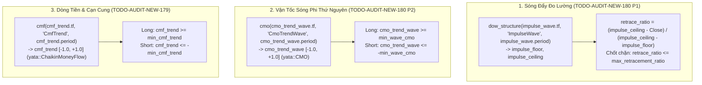

# BÁO CÁO THIẾT KẾ KỸ THUẬT: CẤU TRÚC SÓNG ĐẨY - HỒI THUẦN ĐỊNH LƯỢNG TRỰC GIAO (100% PURE QUANT WAVE ISOLATION)
**File tài liệu:** `58_todo_audit_new_179_180_trend_pb_pure_quant_wave_isolation.md`  
**Chuyên đề:** Tách Biệt Đo Lường Sóng Đẩy (Impulse Wave), Bất Đối Xứng Vận Tốc Hồi Quy (Wave Velocity Asymmetry) và Dòng Tiền Tích Lũy/Xả Hàng (Order-Flow Volume Asymmetry) Khỏi Cấu Trúc Stop Loss Vĩ Mô.  
**Mã nhiệm vụ đại diện:** `TODO-AUDIT-NEW-179` (`TREND-VOL-ASYMMETRY`) & `TODO-AUDIT-NEW-180` (`TREND-MAX-RETRACEMENT-RATIO`)  
*(Ghi nhận đóng: `TODO-AUDIT-NEW-183` Temporal Stagnation và `TODO-AUDIT-NEW-185` RR Hurdle do mâu thuẫn kiến trúc & đã hoàn tất)*  
**Phân hệ phụ trách:** 📈 `ferro_trade` (Bulk Indicators Core) & 🎯 `helios::core_v3::scanners::trend_pb` & 🧬 `config.rs` & 📡 `sensors.rs`  
**Tôn chỉ thiết kế:** Tuân thủ 100% [GEMINI.md](file:///e:/Projects/Automations/trading_backtest/GEMINI.md) Mục **6.1** (Zero Price Action, Zero Đếm Nến), **6.8** (Zero Magic Numbers), **6.15** (Cấm dùng chung chỉ báo/DNA khác mục đích), **6.16** (Tối ưu từ thư viện gốc `yata`).

---

## 🏛️ PHẦN 1: BẢN CHẤT NGHIỆP VỤ & NGUYÊN LÝ TOÁN HỌC GỐC

### 1. Bản Chất Vi Cấu Trúc Sóng Đẩy vs. Sóng Hồi (Impulse vs. Retracement)
Trong một xu hướng thị trường vận động lành mạnh:
1. **Biên độ sóng hồi (Retracement Depth):** Sóng hồi chỉ được phép là sự điều chỉnh kỹ thuật lành mạnh ($L_{\text{retrace}} \le \text{ratio} \times L_{\text{impulse}}$). Nếu sóng hồi thoái lui vượt quá ngưỡng giới hạn (ví dụ $> 75\%$ hoặc $> 61.8\%$ biên độ sóng đẩy), xác suất rất cao đây không còn là nhịp hồi (pullback) mà là sự suy yếu nghiêm trọng hoặc đảo chiều xu hướng thành công của phe đối lập.
2. **Bất đối xứng vận tốc sóng (Wave Velocity Asymmetry):** Một nhịp hồi hợp lệ phải diễn ra một cách từ tốn, chậm rãi ($v_{\text{retrace}} < v_{\text{impulse}}$). Nếu giá lao dốc với gia tốc cực lớn (thác xả chớp nhoáng), tổng động lượng giảm lấn át toàn bộ động lượng tăng của pha đẩy trước đó, báo hiệu áp lực bán tháo hoảng loạn (panic liquidation).
3. **Bất đối xứng dòng tiền / Khối lượng (Order-Flow Volume Asymmetry):** Nhịp hồi lành mạnh là nhịp cạn cung (No-Supply), thể hiện qua việc khối lượng giao dịch thu hẹp dần và áp lực bán chủ động yếu ớt. Ngược lại, nếu trong nhịp hồi xuất hiện dòng tiền xả hàng cực mạnh (Toxic Flow / Heavy Volume Distribution), dòng tiền tổ chức đang thoát hàng quyết liệt.

---

### 2. Sự Thất Bại & Phản Biện Các Phương Án Kém Chất Lượng

Quá trình `/helios-debate` và `/helios-audit` đã vạch trần các sai lầm nghiêm trọng của các phương án ngây thơ trước đó:

| Phương án đề xuất ban đầu | Lỗi bản chất toán học & vi phạm GEMINI.md | Kết luận |
| :--- | :--- | :--- |
| **Đếm thân nến `Close - Open` & Cửa sổ 2 nến `[i-1, i]`** | Vi phạm Mục 6.1 (Price Action Dogma, đếm nến đơn lẻ). Bị cận thị cực đoan: 1 nến xả vô hại trong nhịp hồi dài 30 nến cũng chặn đứng cơ hội, trong khi một chuỗi nến giảm nhỏ dồn dập lại lọt lưới. | **BÁC BỎ HOÀN TOÀN** |
| **Dùng chung `dow_structure` (`dow_floor`, `dow_ceiling`) của `NEW-52`** | Vi phạm Mục 6.15: Ép 1 bộ cảm biến phục vụ 2 mục đích đối kháng. `dow_floor` của `NEW-52` là chốt chặn vĩ mô và neo Stop Loss (được tối ưu để SL hẹp/an toàn). Ép nó đo sóng đẩy sẽ bóp nghẹt độ dài $L_{\text{impulse}}$, khiến tỷ lệ hồi quy bị tính sai lệch hoàn toàn. | **BÁC BỎ HOÀN TOÀN** |
| **Dùng chung `cmo_micro` (1m, `period: 5..15`) của `NEW-52`** | Vi phạm Mục 6.15: `cmo_micro` phục vụ đạo hàm ngoặt đầu vi mô tại nến 1m (`cmo[i] >= cmo[i-1]`). Cửa sổ 5–15 phút hoàn toàn mất dấu pha đẩy trước đó, không thể so sánh vận tốc giữa pha đẩy và pha hồi. | **BÁC BỎ HOÀN TOÀN** |
| **Dùng Money Flow Index (`MFI`)** | Sai lầm toán học khi cạn cung: Khi giá lượn lờ đi xuống với volume kiệt quệ (Pullback hoàn hảo), do không có nến nào có Typical Price tăng, tử số của MFI về `0.0`. MFI sập về `0.0` và đánh đồng nhịp cạn cung tinh khiết với một vụ xả hàng thảm khốc! | **BÁC BỎ HOÀN TOÀN** |
| **Dùng `VWMA - SMA` (Center of Mass)** | Lệch pha vật lý: Khi dòng tiền mua gom lớn (Smart Money Accumulation) xuất hiện ở đáy pha đẩy, giá thấp nhưng volume khổng lồ $\implies$ kéo VWMA xuống dưới SMA. Hệ thống đo đạc bị đảo dấu sai lệch. | **BÁC BỎ HOÀN TOÀN** |
| **So sánh thứ tự thời gian nến cao nhất/thấp nhất $t_{\text{high}} > t_{\text{low}}$** | Khi đáy sóng đẩy trượt ra khỏi cửa sổ trượt $N$, đáy nhịp hồi hiện tại trở thành đáy mới $\implies t_{\text{low}} > t_{\text{high}}$, bộ lọc lập tức phủ quyết nhầm một nhịp hồi đang breakout hoàn hảo. | **BÁC BỎ HOÀN TOÀN** |

---

### 3. Lý Do Đóng & Bác Bỏ `TODO-AUDIT-NEW-183` & `TODO-AUDIT-NEW-185`
- **`TODO-AUDIT-NEW-183` (Stagnation Exit TTL 6 nến):**
  - Vi phạm Mục 6.5 (`Separation of Concerns`): Scanner là bộ phận quan sát tín hiệu thị trường, **tuyệt đối không được kiêm nhiệm quản lý lệnh hay ép thời gian thoát lệnh (Exit Logic)**. Việc quản lý vị thế và thoát lệnh đã có `RiskManager` và `CircuitBreaker`.
  - Bộ đo vi mô `cmo_micro` và `dow_structure` của `NEW-52` cùng bộ ba cảm biến sóng của `NEW-179/180` đã tự động loại bỏ các điểm vào lệnh ì ạch, không cần thêm logic đếm nến thoát hiểm.
- **`TODO-AUDIT-NEW-185` (RR Hurdle $\ge 1.5$ & Bull Flag Exception):**
  - Chốt chặn `EV Hurdle Gate` (với $RR_{\text{dynamic}} \ge 1.5$) đã được triển khai hoàn chỉnh 100% tại `strategies_backtests/helios/src/strategy/core_v3/arbiter.rs` và `risk.rs`.
  - Việc ép thêm bộ lọc RR tĩnh cục bộ vào riêng `TrendPBScanner` là thừa thãi, vi phạm DRY và xung đột với cơ chế định giá rủi ro động của hệ thống.

---

## 📐 PHẦN 2: THIẾT KẾ KIẾN TRÚC TỐI THƯỢNG (PHƯƠNG ÁN 6 — 12/12 PASS)

Hệ thống thiết lập **3 Cảm Biến Sóng Trực Giao 100% Độc Lập**, mỗi cảm biến có cấu hình DNA riêng biệt và công thức toán học chuyên trách:

### 1. Chốt chặn Tỷ lệ Hồi quy Cực đại (`max_retracement_ratio`)
- **Công thức tính:**
  $$\text{impulse\_range} = \max(\text{impulse\_ceiling}_i - \text{impulse\_floor}_i,\ \text{ATR}_i \times 0.1)$$
  $$\text{retrace\_ratio}_{\text{Long}} = \frac{\text{impulse\_ceiling}_i - \text{Close}_i}{\text{impulse\_range}}$$
  $$\text{retrace\_ratio}_{\text{Short}} = \frac{\text{Close}_i - \text{impulse\_floor}_i}{\text{impulse\_range}}$$
- **Điều kiện loại trừ:** $\text{retrace\_ratio} > \text{max\_retracement\_ratio} \implies \text{None}$.

### 2. Chốt chặn Bất đối xứng Vận tốc Sóng (`min_wave_cmo`)
- **Công thức tính:** Chande Momentum Oscillator của chu kỳ sóng đẩy + hồi:
  $$\text{CMO}(N) = \frac{\sum \Delta P_{\text{up}} - \sum \Delta P_{\text{down}}}{\sum \Delta P_{\text{up}} + \sum \Delta P_{\text{down}}} \in [-1.0, +1.0]$$
- **Ý nghĩa:**
  - Nếu pha đẩy tăng mạnh và pha hồi thoai thoải: $\sum \Delta P_{\text{up}} \gg \sum \Delta P_{\text{down}} \implies \text{CMO} > 0$.
  - Nếu xuất hiện cú sập thác (panic dump): $\sum \Delta P_{\text{down}} > \sum \Delta P_{\text{up}} \implies \text{CMO} < 0$.
- **Điều kiện loại trừ:**
  - Long: $\text{wave\_cmo} < \text{min\_wave\_cmo} \implies \text{None}$.
  - Short: $\text{wave\_cmo} > -\text{min\_wave\_cmo} \implies \text{None}$.

### 3. Chốt chặn Dòng tiền & Cạn cung (`min_cmf_trend`)
- **Công thức tính:** Chaikin Money Flow từ thư viện gốc `yata`:
  $$\text{CLV}_k = \frac{(C_k - L_k) - (H_k - C_k)}{H_k - L_k} \in [-1.0, +1.0]$$
  $$\text{CMF}(N) = \frac{\sum_{k=1}^N \text{CLV}_k \cdot V_k}{\sum_{k=1}^N V_k} \in [-1.0, +1.0]$$
- **Ý nghĩa:**
  - Tích lũy (Accumulation): Các nến đẩy đóng gần đỉnh kèm volume khủng đẩy $\text{CMF} \to +0.5$.
  - Nhịp hồi cạn cung (No-Supply Pullback): Các nến giảm có volume rất nhỏ, không làm suy chuyển giá trị $\text{CMF}$ dương trước đó $\implies \text{CMF} \ge 0.0$ được duyệt!
  - Xả hàng độc hại (Toxic Flow / Heavy Distribution): Các nến bán tháo mạnh với volume đột biến ép $\text{CLV} \to -1.0$ và kéo $\text{CMF} < 0.0 \implies$ VETO lập tức.
- **Điều kiện loại trừ:**
  - Long: $\text{cmf\_val} < \text{min\_cmf\_trend} \implies \text{None}$.
  - Short: $\text{cmf\_val} > -\text{min\_cmf\_trend} \implies \text{None}$.

---

## 🧬 PHẦN 3: THIẾT KẾ KHÔNG GIAN DNA MỚI & NGÂN SÁCH GEN

### 1. Phân bổ Cảm biến Mới trong `IndicatorsConfig` (`+6` genes)
| Struct Tham Số | Trường | Dải Giá Trị DNA | Bước Nhảy | Mặc Định | Ý Nghĩa Nghiệp Vụ |
| :--- | :--- | :--- | :--- | :--- | :--- |
| `ImpulseWaveParams` | `timeframe` | `5m, 15m, 30m, 1h, 2h, 4h` | Phân loại | `T15m` | Khung thời gian đo đạc sóng đẩy |
| `ImpulseWaveParams` | `period` | `6.0 .. 60.0` | 3.0 | `21` | Chu kỳ nến đo đỉnh/đáy sóng đẩy ($L_{\text{impulse}}$) |
| `CmoWaveParams` | `timeframe` | `1m, 3m, 5m, 15m, 30m` | Phân loại | `T5m` | Khung thời gian đo vận tốc sóng |
| `CmoWaveParams` | `period` | `6.0 .. 60.0` | 3.0 | `15` | Chu kỳ nến đo vận tốc CMO sóng ($v_{\text{impulse}}$ vs $v_{\text{retrace}}$) |
| `CmfTrendParams` | `timeframe` | `1m, 3m, 5m, 15m, 30m` | Phân loại | `T5m` | Khung thời gian đo dòng tiền Chaikin |
| `CmfTrendParams` | `period` | `6.0 .. 60.0` | 3.0 | `21` | Chu kỳ nến đo dòng tiền Chaikin Money Flow |

### 2. Điều chỉnh Ngưỡng Chiến thuật trong `TacticalPullbackParams` (`+2` net genes)
- **Loại bỏ:** `stoch_climax_thresh` (`-1` gen thừa/mồ côi).
- **Thêm mới:**
  1. `max_retracement_ratio: f64` — `#[dna(min = 0.20, max = 0.95, step = 0.05)]` (16 steps, Default: `0.75`).
  2. `min_wave_cmo: f64` — `#[dna(min = -0.60, max = 0.40, step = 0.05)]` (21 steps, Default: `-0.10`).
  3. `min_cmf_trend: f64` — `#[dna(min = -0.60, max = 0.40, step = 0.05)]` (21 steps, Default: `-0.10`).

### 3. Cân Bằng Chiều Dài DNA Hệ Thống (`DNA_WIDTH`)
- Trước thay đổi: `125` chiều.
- Thay đổi: `-1 (stoch_climax_thresh) + 6 (3 indicators) + 3 (pullback thresholds) = +8`.
- Chiều dài DNA sau nâng cấp: **`133` chiều**.

---

## 📐 PHẦN 4: KẾ HOẠCH BẢO ĐẢM CHẤT LƯỢNG & KIỂM THỬ (TEST MATRIX)

1. **`ferro_trade` Unit Test:**
   - `test_cmf_math_warmup_and_zero_volume_safety`: Kiểm tra đúng công thức CMF, xử lý an toàn chia cho 0 khi `Volume == 0.0` hoặc `High == Low`, trả về `0.0` hữu hạn.
2. **`helios` Unit Tests:**
   - `test_trend_pb_rejects_high_volume_distribution_retrace`: Phủ quyết nhịp hồi bị xả hàng volume lớn (`cmf_trend < min_cmf_trend`).
   - `test_trend_pb_accepts_volume_dry_up`: Chấp thuận nhịp hồi cạn cung lành mạnh (`cmf_trend >= min_cmf_trend`).
   - `test_trend_pb_rejects_deep_retracement_exceeding_618`: Phủ quyết nhịp hồi quá sâu vượt ngưỡng `max_retracement_ratio`.
   - `test_trend_pb_rejects_flash_velocity_inversion`: Phủ quyết nhịp sập thác có gia tốc giảm cực mạnh (`cmo_trend_wave < min_wave_cmo`).
   - `test_dna_width_and_parameter_defs_integrity`: Khẳng định `DNA_WIDTH == 133` và 100% tham số ánh xạ nhất quán 1:1.
