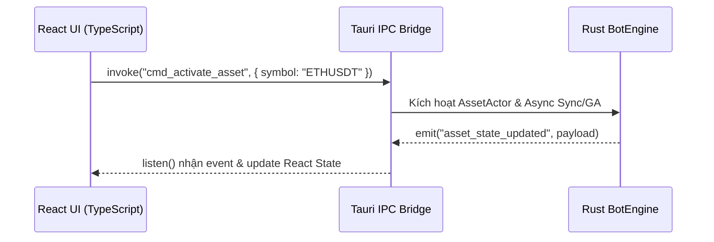

# 🎨 Component Design System & Tauri IPC State Flow

Tài liệu quy định hệ thống kiểu dữ liệu (TypeScript Types), Bảng màu (Theme Tokens) và Cơ chế Truyền Nhận Sự Kiện giữa React Client & Rust Backend.

---

## 🎨 1. Palette Bảng Màu (Dark Theme Tokens)

- **Main Background:** `#0F172A` (Slate 900)
- **Container / Card Background:** `#1E293B` (Slate 800)
- **Border / Divider:** `#334155` (Slate 700)
- **Text Primary:** `#F8FAFC` (Slate 50)
- **Text Secondary:** `#94A3B8` (Slate 400)
- **Buy / Long / Profit:** `#10B981` (Emerald 500)
- **Sell / Short / Loss:** `#EF4444` (Red 500)
- **Warning / Graceful:** `#F59E0B` (Amber 500)
- **Info / Active / Brand:** `#06B6D4` (Cyan 500)

---

## 🔗 2. Data Types (`src/types/bot.ts`)

```typescript
export type AssetStatus = 
  | 'INACTIVE' 
  | 'SYNCING_DATA' 
  | 'GA_OPTIMIZING' 
  | 'READY_TRADING' 
  | 'GRACEFUL_EXIT' 
  | 'ERROR';

export type PositionSide = 'LONG' | 'SHORT' | 'FLAT';

export interface LivePosition {
  side: PositionSide;
  qty: number;
  entryPrice: number;
  unrealizedPnl: number;
  unrealizedPnlPct: number;
  trailingSlPrice?: number;
}

export interface AssetState {
  symbol: string;
  marketType: string;
  status: AssetStatus;
  strategyName: string;
  fitnessReturnPct: number;
  fitnessMaxDdPct: number;
  position: LivePosition;
  recentLogs: string[];
}

export interface AccountState {
  walletBalance: number;
  availableBalance: number;
  totalUnrealizedPnl: number;
  activeAssetsCount: number;
}

export interface SystemHealth {
  apiWeightUsed: number;
  apiWeightMax: number;
  wsConnected: boolean;
  latencyMs: number;
}
```

---

## ⚡ 3. Tauri IPC Flow (React UI <-> Rust Backend)


