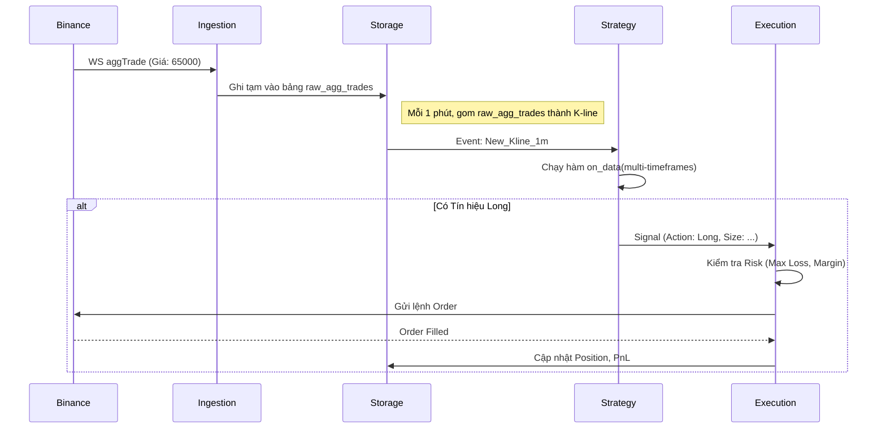

# Luồng Dữ Liệu (Data Flow)

Tài liệu này mô tả cách thông tin chảy xuyên suốt hệ thống từ lúc nhận cấu hình đến lúc gửi lệnh và lưu trữ.

## 1. Luồng Khởi động & Backfill
1. **User** bật chế độ Giao dịch cho BTCUSDT trên UI.
2. **UI** gửi `StartSymbol(BTCUSDT)` qua Tauri IPC đến Rust Controller.
3. **Rust Controller** spawn một Actor mới cho BTCUSDT.
4. **Data Ingestion** của Actor gọi Binance REST API để lấy dữ liệu 1000 nến quá khứ (Backfill).
5. **Storage** lưu đống dữ liệu Backfill này vào DuckDB.
6. Khi Backfill xong, **Data Ingestion** kết nối WebSocket `aggTrade` và `markPrice`.

## 2. Luồng Xử lý Real-time (Mỗi Mili-giây)

## 3. Luồng Bảo Vệ (Risk & Observer)
- Song song với Strategy, có một Task nhỏ gọi là **Observer** (Thám tử).
- Observer lắng nghe trực tiếp `markPrice` WebSocket từ Binance (bỏ qua bước tạo K-line 1 phút).
- Ngay khi `markPrice` chạm ngưỡng Stoploss (đã định trước), Observer báo cho Execution "CẮT NGAY".
- Tốc độ cắt lỗ không bị phụ thuộc vào nến 1 phút, mà là Realtime theo tick của sàn.
