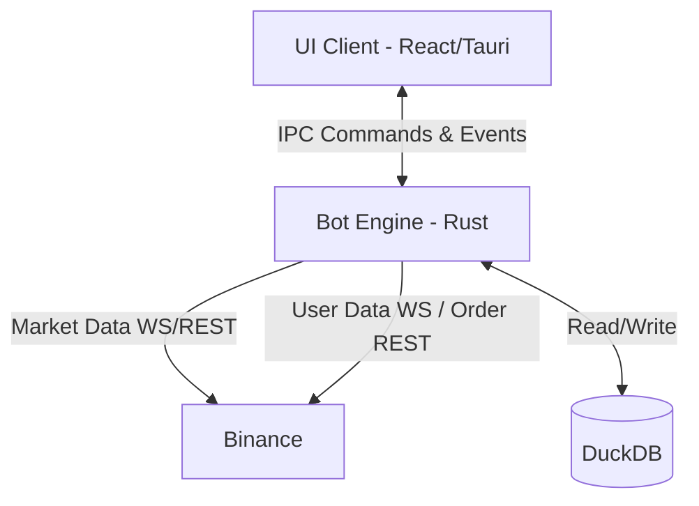

# Tổng quan Kiến trúc Hệ thống (System Overview)

## 1. Triết lý Thiết kế
Trading Bot được xây dựng dựa trên các nguyên tắc bất di bất dịch:
- **Local-First**: Mọi tính toán và lưu trữ đều ở Local, đảm bảo quyền riêng tư và giảm trễ do network.
- **Actor Model / Event-Driven**: Các Component hoạt động độc lập (as Actors), giao tiếp qua Message/Event.
- **Data Integrity**: Dữ liệu nến phải chuẩn xác, không được thiếu sót.
- **High-Performance**: Core Engine dùng Rust, giao diện dùng React kết nối qua cầu nối Tauri.

## 2. Cấu trúc Tổng thể (High-level Architecture)

Hệ thống được chia làm 2 lớp (Layer) chính:

### 2.1. Lớp Engine Backend (Rust)
Đảm nhận toàn bộ nghiệp vụ nặng và giao tiếp sàn.
Bao gồm các Module con:
1. **Controller (Core Controller)**: Điều phối hoạt động, quản lý vòng đời của các Actor (Symbol Task, Interface Task).
2. **Ingestion (Data Engine)**: Thu thập dữ liệu Market (Websocket, REST backfill).
3. **Storage**: Lưu vào DuckDB, xử lý Dataframe bằng Polars.
4. **Intelligence (Strategy Engine)**: Phân tích K-line sinh tín hiệu.
5. **Execution (Risk/Order Management)**: Gửi lệnh, quản lý Stoploss/TakeProfit và vị thế.
6. **Interface**: Lớp trung gian giao tiếp IPC (Inter-Process Communication) gửi/nhận Command qua lại với Tauri Frontend.

### 2.2. Lớp Frontend Client (Tauri + React)
Chỉ chịu trách nhiệm **Hiển thị (View)** và **Gửi Lệnh Người Dùng (User Commands)**. Không chứa bất kỳ logic giao dịch nào.

## 3. Kiến Trúc Con (Actor Model trong Rust)
Mỗi **Cặp giao dịch (Symbol)** (ví dụ: BTCUSDT) sẽ được cấp phát riêng một Actor (Task) độc lập.
Nếu BTCUSDT bị crash, ETHUSDT vẫn hoạt động bình thường. 
Bên trong mỗi Symbol Actor sẽ chứa instance của Data Engine, Strategy Engine và Execution riêng biệt của nó.
