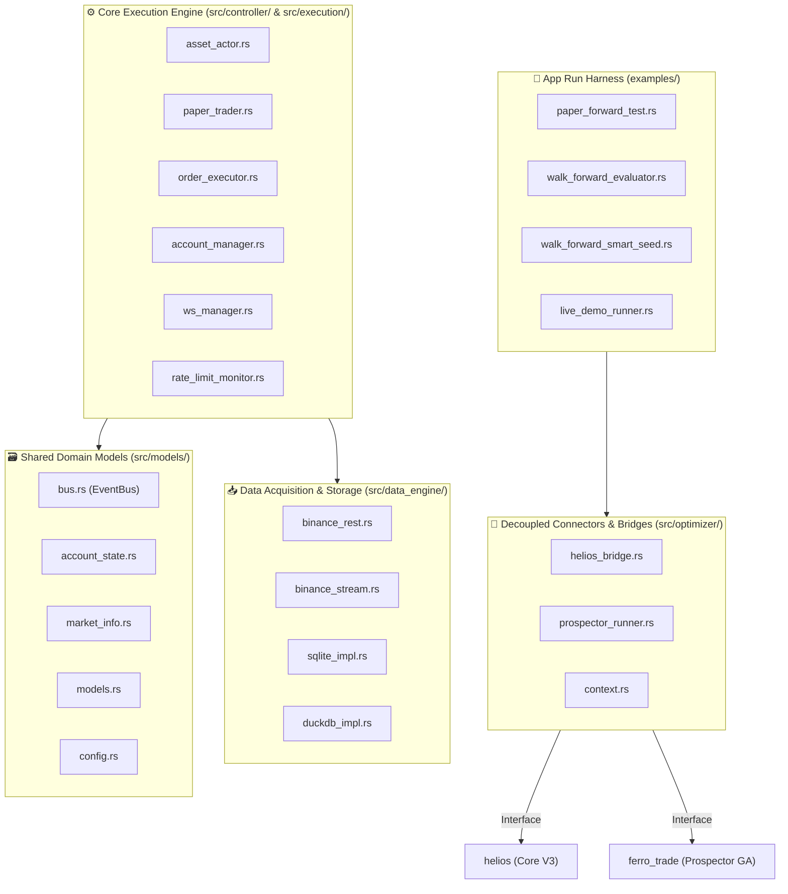

# 🏛️ BẢN ĐỒ KIẾN TRÚC MÃ NGUỒN & PHÂN LOẠI NHÓM NHIỆM VỤ BOT ENGINE

Tài liệu này hệ thống hóa toàn bộ các tệp mã nguồn trong dự án `trading_bot/bot_engine`, phân loại theo phân hệ chức năng, vai trò vận hành và mức độ phụ thuộc dự án (Decoupled vs External Bridge).

---

## 📐 1. TỔNG QUAN HỆ THỐNG MÔ-ĐUN

---

## 📂 2. PHÂN LOẠI CHI TIẾT THEO THƯ MỤC VÀ NHÓM CHỨC NĂNG

### A. Thư mục `src/optimizer/` — Nhóm Cầu Nối Dự Án Bên Ngoài (Decoupled Connectors & Bridges)
> **Nhiệm vụ:** Không chứa logic kinh doanh của Bot. Làm nhiệm vụ chuyển đổi dữ liệu (Adapter/Bridge) liên kết `bot_engine` với **`ferro_trade`** (Engine toán học) và **`helios`** (Bộ não Chiến thuật V3).

- [`src/optimizer/helios_bridge.rs`](file:///E:/Projects/Automations/trading_backtest/trading_bot/bot_engine/src/optimizer/helios_bridge.rs)
  - **Nhiệm vụ:** Cầu nối dữ liệu real-time. Chuyển đổi mảng `Candle` sang Polars `DataFrame`, precompute MTF cache, tiêm vị thế Binance vào `TickContext`, và gọi `strategy.next()` lấy danh sách `Action`.
- [`src/optimizer/prospector_runner.rs`](file:///E:/Projects/Automations/trading_backtest/trading_bot/bot_engine/src/optimizer/prospector_runner.rs)
  - **Nhiệm vụ:** Cầu nối bộ tối ưu GA. Nạp `helios_optimizer_config.json`, kích hoạt `Prospector` GA trên luồng blocking riêng, lưu DNA vào SQLite DB và phát tới `AssetActor` qua `tokio::sync::watch::channel`.
- [`src/optimizer/context.rs`](file:///E:/Projects/Automations/trading_backtest/trading_bot/bot_engine/src/optimizer/context.rs)
  - **Nhiệm vụ:** Wrapper context cho môi trường tính toán chỉ báo trong Prospector.
- [`src/optimizer/mod.rs`](file:///E:/Projects/Automations/trading_backtest/trading_bot/bot_engine/src/optimizer/mod.rs)
  - **Nhiệm vụ:** Khai báo module optimizer.

---

### B. Thư mục `src/controller/` & `src/execution/` — Nhóm Hạ Tầng Thực Thi Cốt Lõi (Core Engine Execution)
> **Nhiệm vụ:** Quản lý vòng lặp trạng thái Bot, thực thi khớp lệnh, quản lý tài khoản và duy trì kết nối WebSocket.

- [`src/controller/asset_actor.rs`](file:///E:/Projects/Automations/trading_backtest/trading_bot/bot_engine/src/controller/asset_actor.rs)
  - **Nhiệm vụ:** Actor chính điều khiển 1 cặp giao dịch (ETHUSDT). Nhận nến real-time, duy trì Rolling Buffer (4,000-43,200 nến), phối hợp `PaperTrader` / `OrderExecutor`, và hoán đổi DNA mới (`check_and_update_dna`).
- [`src/execution/paper_trader.rs`](file:///E:/Projects/Automations/trading_backtest/trading_bot/bot_engine/src/execution/paper_trader.rs)
  - **Nhiệm vụ:** Động cơ khớp lệnh giả lập Paper Trade: Quét High/Low nến đối chiếu Trailing SL/TP, tính toán PnL, trừ phí 2 chiều, cập nhật Equity curve.
- [`src/execution/order_executor.rs`](file:///E:/Projects/Automations/trading_backtest/trading_bot/bot_engine/src/execution/order_executor.rs)
  - **Nhiệm vụ:** Động cơ gửi lệnh thật (Live Trading Mode) tới Binance Derivatives REST API.
- [`src/execution/account_manager.rs`](file:///E:/Projects/Automations/trading_backtest/trading_bot/bot_engine/src/execution/account_manager.rs)
  - **Nhiệm vụ:** Quản lý và truy vấn số dư ví (Wallet Balance) và vị thế thực tế từ Binance REST API.
- [`src/execution/ws_manager.rs`](file:///E:/Projects/Automations/trading_backtest/trading_bot/bot_engine/src/execution/ws_manager.rs)
  - **Nhiệm vụ:** Kênh nhận WebSocket User Data Stream real-time từ Binance (`AccountUpdate`, `PositionUpdate`, `OrderTradeUpdate`).
- [`src/execution/rate_limit_monitor.rs`](file:///E:/Projects/Automations/trading_backtest/trading_bot/bot_engine/src/execution/rate_limit_monitor.rs)
  - **Nhiệm vụ:** Giám sát trọng số API Binance (`x-mbx-used-weight`) phòng chống bị khóa IP.
- [`src/controller/mod.rs`](file:///E:/Projects/Automations/trading_backtest/trading_bot/bot_engine/src/controller/mod.rs) & [`src/execution/mod.rs`](file:///E:/Projects/Automations/trading_backtest/trading_bot/bot_engine/src/execution/mod.rs)
  - **Nhiệm vụ:** Khai báo module controller và execution.

---

### C. Thư mục `src/data_engine/` — Nhóm Thu Thập & Lưu Trữ Dữ Liệu (Data Acquisition & Storage)
> **Nhiệm vụ:** Kéo dữ liệu nến k-line từ sàn Binance và lưu trữ vào SQLite/DuckDB.

- [`src/data_engine/binance_rest.rs`](file:///E:/Projects/Automations/trading_backtest/trading_bot/bot_engine/src/data_engine/binance_rest.rs)
  - **Nhiệm vụ:** Kéo nến lịch sử và Gap-filler lấp khoảng trống nến từ Binance REST API.
- [`src/data_engine/binance_stream.rs`](file:///E:/Projects/Automations/trading_backtest/trading_bot/bot_engine/src/data_engine/binance_stream.rs)
  - **Nhiệm vụ:** Đăng ký WebSocket KLine 1m thời gian thực từ Binance.
- [`src/data_engine/sqlite_impl.rs`](file:///E:/Projects/Automations/trading_backtest/trading_bot/bot_engine/src/data_engine/sqlite_impl.rs)
  - **Nhiệm vụ:** Lưu trữ nến k-line và lưu trữ bộ DNA tốt nhất vào SQLite DB (`paper_forward_v3.db`).
- [`src/data_engine/duckdb_impl.rs`](file:///E:/Projects/Automations/trading_backtest/trading_bot/bot_engine/src/data_engine/duckdb_impl.rs)
  - **Nhiệm vụ:** Động cơ lưu trữ DuckDB phục vụ phân tích dữ liệu lớn.
- [`src/data_engine/mod.rs`](file:///E:/Projects/Automations/trading_backtest/trading_bot/bot_engine/src/data_engine/mod.rs)
  - **Nhiệm vụ:** Khai báo module data engine.

---

### D. Thư mục `src/models/` — Nhóm Mô Hình Dữ Liệu Miền Shared Models
> **Nhiệm vụ:** Định nghĩa các Struct, Enum, Trait và EventBus dùng chung trong hệ thống.

- [`src/models/bus.rs`](file:///E:/Projects/Automations/trading_backtest/trading_bot/bot_engine/src/models/bus.rs)
  - **Nhiệm vụ:** Bộ điều khiển trung tâm EventBus dựa trên `tokio::sync::broadcast`.
- [`src/models/account_state.rs`](file:///E:/Projects/Automations/trading_backtest/trading_bot/bot_engine/src/models/account_state.rs)
  - **Nhiệm vụ:** Định nghĩa `AccountState`, `PositionState`, và Enum `AccountEvent`.
- [`src/models/market_info.rs`](file:///E:/Projects/Automations/trading_backtest/trading_bot/bot_engine/src/models/market_info.rs)
  - **Nhiệm vụ:** Làm tròn bước giá (Tick Size) và làm tròn khối lượng (Step Size) của sàn.
- [`src/models/models.rs`](file:///E:/Projects/Automations/trading_backtest/trading_bot/bot_engine/src/models/models.rs)
  - **Nhiệm vụ:** Định nghĩa đối tượng `Candle`, `Tick`, `OptimizedDna`.
- [`src/models/config.rs`](file:///E:/Projects/Automations/trading_backtest/trading_bot/bot_engine/src/models/config.rs)
  - **Nhiệm vụ:** Struct chứa thông số cấu hình tổng quan của bot.
- [`src/models/repository.rs`](file:///E:/Projects/Automations/trading_backtest/trading_bot/bot_engine/src/models/repository.rs)
  - **Nhiệm vụ:** Định nghĩa Trait `CandleRepository` và `StrategyRepository`.
- [`src/models/weight_monitor.rs`](file:///E:/Projects/Automations/trading_backtest/trading_bot/bot_engine/src/models/weight_monitor.rs)
  - **Nhiệm vụ:** Giám sát trọng số API.
- [`src/models/error.rs`](file:///E:/Projects/Automations/trading_backtest/trading_bot/bot_engine/src/models/error.rs) & [`src/error/mod.rs`](file:///E:/Projects/Automations/trading_backtest/trading_bot/bot_engine/src/error/mod.rs)
  - **Nhiệm vụ:** Định nghĩa các kiểu lỗi (Error Types) trong hệ thống.

---

### E. Thư mục `examples/` — Nhóm Nút Chạy Thử Nghiệm & Test Harnesses
> **Nhiệm vụ:** Chứa các kịch bản chạy thử nghiệm, mô phỏng Paper Forward Test và Walk-Forward Evaluator.

- [`examples/paper_forward_test.rs`](file:///E:/Projects/Automations/trading_backtest/trading_bot/bot_engine/examples/paper_forward_test.rs)
  - **Nhiệm vụ:** Nút chạy Full Engine Paper Forward Test (mô phỏng nến live + re-optimizer ngầm).
- [`examples/walk_forward_evaluator.rs`](file:///E:/Projects/Automations/trading_backtest/trading_bot/bot_engine/examples/walk_forward_evaluator.rs)
  - **Nhiệm vụ:** Đánh giá Walk-Forward chống overfitting.
- [`examples/walk_forward_smart_seed.rs`](file:///E:/Projects/Automations/trading_backtest/trading_bot/bot_engine/examples/walk_forward_smart_seed.rs)
  - **Nhiệm vụ:** Đánh giá Walk-Forward có tiêm hạt giống mồi Champion.
- [`examples/live_demo_runner.rs`](file:///E:/Projects/Automations/trading_backtest/trading_bot/bot_engine/examples/live_demo_runner.rs)
  - **Nhiệm vụ:** Kịch bản chạy Live Demo hiển thị trạng thái Terminal.
- [`examples/live_demo_runner_non_opt.rs`](file:///E:/Projects/Automations/trading_backtest/trading_bot/bot_engine/examples/live_demo_runner_non_opt.rs)
  - **Nhiệm vụ:** Kịch bản chạy Live Demo không Re-Optimize.
- [`examples/binance_execution_test.rs`](file:///E:/Projects/Automations/trading_backtest/trading_bot/bot_engine/examples/binance_execution_test.rs)
  - **Nhiệm vụ:** Kịch bản kiểm thử API khớp lệnh Binance Futures.
- [`examples/resilience_recovery_test.rs`](file:///E:/Projects/Automations/trading_backtest/trading_bot/bot_engine/examples/resilience_recovery_test.rs)
  - **Nhiệm vụ:** Kịch bản kiểm thử khả năng tự phục hồi khi mất kết nối mạng (Resilience).
