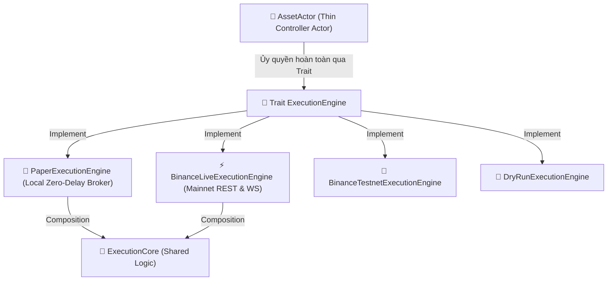

# 🏛️ THIẾT KẾ KIẾN TRÚC THỰC THI `EXECUTIONENGINE` VÀ CHUẨN HÓA DECOUPLING

**Dự án:** `trading_bot/bot_engine`  
**Tệp tài liệu:** [`trading_bot/docs/blueprints/execution_engine_architecture_design.md`](file:///E:/Projects/Automations/trading_backtest/trading_bot/docs/blueprints/execution_engine_architecture_design.md)  
**Ngày lập:** 24/08/2026  
**Trạng thái:** Thiết kế phê duyệt, sẵn sàng tích hợp vào Lộ trình Tái cấu trúc.

---

## I. BẢN CHẤT VẤN ĐỀ CỦA KIẾN TRÚC CŨ (WHY CURRENT CODE IS NOT CLEAN)

Trong kiến trúc ban đầu của `bot_engine`, tệp [`asset_actor.rs`](file:///E:/Projects/Automations/trading_backtest/trading_bot/bot_engine/src/controller/asset_actor.rs) đóng vai trò một **"God Object" (Đối tượng ôm xô)**.

### 1. Triệu chứng & Nguyên nhân gây Lỗi:
- **Vi phạm Single Responsibility Principle (SRP):** `AssetActor` vừa là Actor vòng lặp nến, vừa làm bộ mô phỏng lệnh Paper Trade (`PaperTrader`), vừa làm bộ gửi lệnh HTTP REST API thật (`OrderExecutor`), vừa làm bộ quản lý tài khoản WebSocket.
- **Phân nhánh chằng chịt:** Sử dụng hàng chục câu lệnh `match self.execution_mode` hoặc `if self.execution_mode == ExecutionMode::Paper` rải rác khắp các hàm (`on_new_candle`, `on_account_event`, `run`).
- **Xung đột Trạng thái (Dual Position State Desync):** Chế độ Paper và Live Trade dùng chung biến `self.live_position`. Khi WebSocket Binance gửi sự kiện `PositionUpdate`, nó ghi đè làm mất `live_entry_bar`, `opening_playbook_tag`, và các mức giá `current_sl_price`/`current_tp_price` của chiến thuật.

---

## II. KIẾN TRÚC MỚI: MÔ HÌNH `EXECUTIONENGINE` (SOLID & DECOUPLED)

Áp dụng mẫu thiết kế **Strategy Driver / Trait Pattern**, chuyển đổi các chế độ thực thi (`Paper`, `Testnet`, `RealTrade`, `DryRun`) thành các struct độc lập triển khai chung một Trait trừu tượng.



---

## III. CHI TIẾT ĐỊNH NGHĨA TRỰC QUAN TRONG RUST

### 1. Trait `ExecutionEngine`
```rust
use async_trait::async_trait;
use crate::error::BotError;
use crate::models::models::Candle;
use crate::controller::asset_actor::LivePositionState;
use ferro_trade::broker::actions::Action;

#[async_trait]
pub trait ExecutionEngine: Send + Sync {
    /// Thực thi lệnh (Mua/Bán/Cập nhật SL TP)
    async fn execute_action(&mut self, action: &Action, current_price: f64) -> Result<(), BotError>;

    /// Xử lý nến mới (Paper Trader sẽ tự quét Trailing SL/TP local tại đây)
    async fn on_candle(&mut self, candle: &Candle) -> Result<(), BotError>;

    /// Lấy tổng số dư vốn thực tế (Equity)
    fn get_equity(&self) -> f64;

    /// Lấy ảnh chụp trạng thái vị thế (Live Position Snapshot)
    fn get_position(&self) -> Option<LivePositionState>;

    /// Nhận và đồng bộ sự kiện tài khoản (Chỉ dành cho Live/Testnet engine)
    async fn on_account_event(&mut self, event: &crate::models::account_state::AccountEvent);
}
```

---

## IV. RUST IDIOMS: TÁI SỬ DỤNG LOGIC DÙNG CHUNG (SHARED LOGIC)

Để tránh lặp lại code giữa các Engine mà không cần thừa kế (vì Rust không có OOP Inheritance), ta sử dụng **Mẫu Đóng gói & Uỷ quyền (Composition over Inheritance)**:

### Struct `ExecutionCore` dùng chung:
```rust
pub struct ExecutionCore {
    pub symbol: String,
    pub market_filter: crate::models::market_info::MarketFilter,
    pub allocated_capital: f64,
    pub leverage: f64,
}

impl ExecutionCore {
    /// Làm tròn giá và khối lượng theo quy định của Sàn
    pub fn validate_and_format(&self, price: f64, qty: f64) -> Result<(f64, f64), BotError> {
        let p = self.market_filter.round_price(price);
        let q = self.market_filter.round_qty(qty);
        self.market_filter.validate_order(p, q)?;
        Ok((p, q))
    }
}
```

Mỗi Engine sẽ nhúng `ExecutionCore` làm một trường nội bộ:
- `PaperExecutionEngine { core: ExecutionCore, paper_trader: PaperTrader }`
- `BinanceLiveExecutionEngine { core: ExecutionCore, rest_client: RestApi, ... }`

---

## V. ĐÁNH GIÁ KHUYẾT ĐIỂM VÀ GIẢI PHÁP NGUY CƠ LỖI

| STT | Khuyết điểm / Risk | Tác động | Giải pháp Kỹ thuật Phòng ngừa |
| :---: | :--- | :--- | :--- |
| **1** | **Dynamic Dispatch Overhead (`Box<dyn ExecutionEngine>`)** | Mất ~2 - 5 nanoseconds cho vtable lookup. | Hoàn toàn vô hại với nến 1m. Nếu cần tối ưu CPU có thể dùng Generics `AssetActor<E: ExecutionEngine>`. |
| **2** | **Event Delegation Complexity** | WebSocket từ Binance có thể gửi lầm event sang `PaperExecutionEngine`. | `PaperExecutionEngine::on_account_event` sẽ no-op (bỏ qua hoàn toàn event ngoài). |
| **3** | **Khởi tạo rườm rà hơn** | Phải khởi tạo Engine trước khi truyền vào `AssetActor`. | Sử dụng **Factory Pattern** (`ExecutionEngineFactory::create(config)`). |

---

## VI. BẢN ĐỒ PHÂN CHIA HẰNG SỐ VÀ CẤU HÌNH (`ENGINECONFIG`)

Toàn bộ các hằng số hardcoded sẽ được quy gom vào `EngineConfig`:
```rust
#[derive(Debug, Clone, serde::Serialize, serde::Deserialize)]
pub struct EngineConfig {
    pub initial_cash: f64,             // 60.0 hoặc 10000.0
    pub commission_rate: f64,          // 0.0004
    pub margin_rate: f64,              // 0.05 (1/20)
    pub fractional_unit: Option<f64>,  // Some(0.0001)
    pub max_live_mem_candles: usize,   // 15000 hoặc 43200
    pub historical_sync_days: u64,     // 33 ngày
    pub buffer_padding_bars: usize,    // 200 nến
}
```

---
*Tài liệu này là thiết kế chuẩn mực đã được lưu trữ, dùng làm kim chỉ nam triển khai cho Bước 2 và Bước 3.*
