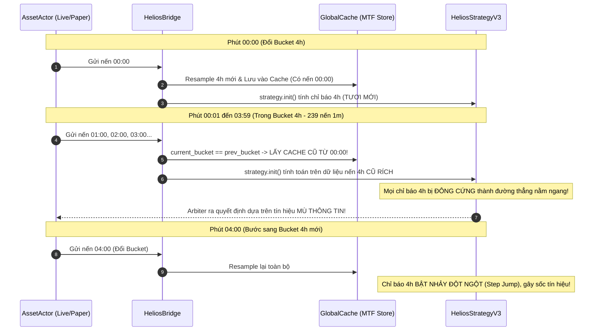

# 🔬 Báo Cáo Phân Tích Chuyên Sâu & Kỹ Thuật: LỖI 1 - Bẫy "Đóng Băng" Dữ Liệu MTF (Frozen MTF Data Bug)

**Chủ đề:** Sự bất đồng bộ nghiêm trọng trong cơ chế Resampling Đa khung thời gian giữa `Backtest Engine` và `HeliosBridge`  
**Dự án ảnh hưởng:** `trading_bot/bot_engine` kết hợp `strategies_backtests/helios` và `ferro_trade`  
**Tập tin tâm điểm:**  
- [`trading_bot/bot_engine/src/optimizer/helios_bridge.rs`](file:///E:/Projects/Automations/trading_backtest/trading_bot/bot_engine/src/optimizer/helios_bridge.rs#L172-L244)  
- [`ferro_trade/src/utils/resample.rs`](file:///E:/Projects/Automations/trading_backtest/ferro_trade/src/utils/resample.rs)  
- [`ferro_trade/src/backtest/context.rs`](file:///E:/Projects/Automations/trading_backtest/ferro_trade/src/backtest/context.rs#L133-L160)  

---

## 🏛️ 1. Bản Chất Kỹ Thuật Của MTF Trong Trading Thuật Toán

Trong hệ thống chiến lược `Helios V3`, các cảm biến và ma trận thị trường (`MarketMatrixV3`, `Sensors`) vận hành dựa trên **bức tranh đa khung thời gian (5m, 15m, 1h, 4h)** để:
1. Xác định chế độ thị trường (Regime: Trend, Range, Volatile).
2. Đo độ dốc xu hướng dài hạn (`KAMA Slope 4h`, `ADX 4h`, `RSI Trend 1h`).
3. Xác định biên độ biến động và bóp nghẹt thanh khoản (`Bollinger Bands 1h/4h`, `Keltner Channels`).

### Quy tắc toán học của Nến Đa Khung Thời Gian:
Xét một cây nến khung **4h** bắt đầu từ `00:00` đến `04:00` (được cấu thành từ $240$ cây nến 1m):
- Tại phút thứ $180$ (`03:00`), cây nến 4h này **đang hình thành (Forming / Incomplete Bar)**.
- Thuộc tính nến 4h tại thời điểm `03:00` phải là:
  $$\text{Open}_{4h} = \text{Open}_{1m}(00:00)$$
  $$\text{High}_{4h} = \max_{t \in [00:00, 03:00]} \text{High}_{1m}(t)$$
  $$\text{Low}_{4h} = \min_{t \in [00:00, 03:00]} \text{Low}_{1m}(t)$$
  $$\text{Close}_{4h} = \text{Close}_{1m}(03:00)$$
  $$\text{Volume}_{4h} = \sum_{t \in [00:00, 03:00]} \text{Volume}_{1m}(t)$$

---

## 💥 2. Cơ Chế Gây Lỗi Trọng Yếu Trong `HeliosBridge::evaluate_live_tick`

### A. Nguồn gốc của giải pháp "tối ưu non" (Premature Optimization)
Để tránh việc mỗi phút đều phải gọi Polars `resample_ohlcv` trên $43.200$ dòng nến (gây tốn $100-200\text{ms}$ CPU mỗi tick), tác giả mã nguồn đã thiết kế bộ nhớ đệm `LIVE_MTF_STORE`:

```rust
// File: trading_bot/bot_engine/src/optimizer/helios_bridge.rs (Dòng 221-236)
for &tf in &HELIOS_REQUIRED_TIMEFRAMES {
    let current_bucket = tf.get_bucket_index(last_candle_ts);
    let prev_bucket = store.tf_buckets.get(&tf.to_string()).copied().unwrap_or(-1);

    let maybe_flat = if current_bucket != prev_bucket || cache.get_resampled_ohlcv(tf).is_none() {
        // [NHÁNH A]: Chỉ chạy khi BƯỚC SANG BUCKET MỚI
        if let Ok(df_res) = ferro_trade::utils::resample::resample_ohlcv(tf.as_polars_rule(), base_df) {
            if let Ok(flat_ohlcv) = ferro_trade::utils::resample::df_to_resampled_ohlcv(&df_res) {
                let flat_arc = Arc::new(flat_ohlcv);
                cache.put_resampled_ohlcv(tf, flat_arc.clone());
                store.tf_buckets.insert(tf.to_string(), current_bucket);
                Some(flat_arc)
            } else { None }
        } else { None }
    } else {
        // [NHÁNH B]: Đang ở trong cùng một bucket -> LẤY LẠI CACHE CŨ TỪ NHIỀU TIẾNG TRƯỚC!
        cache.get_resampled_ohlcv(tf)
    };

    if let Some(flat_arc) = maybe_flat {
        let table = Arc::new(ferro_trade::utils::resample::create_lookup_table(base_times, &flat_arc.datetime));
        cache.put_lookup(tf, table);
    }
}
```

---

### B. Phân tích Tác Động Dây Chuyền (Chain Reaction)



1. **Giai đoạn $00:01 \rightarrow 03:59$ ($239$ cây nến 1m):**
   - Giá thị trường có thể đã tăng hoặc sập $10\%$.
   - Mảng `flat_ohlcv` của khung 4h trong `GlobalCache` **hoàn toàn không có bất kỳ thông tin nào về $239$ cây nến 1m này**.
   - Mọi chỉ báo 4h (`s.adx`, `s.kama_slope`, `s.bb_upper`, `s.rsi_trend`) khi được tính toán lại trong `strategy.init()` đều cho ra **chính xác các giá trị cũ của thời điểm 00:00**.
   - Sau đó, hàm `map_indicator_to_base_tf` rải giá trị cũ này thành một **đường thẳng nằm ngang bất động** trong suốt $239$ phút.
2. **Hậu quả với các Scanners:**
   - Scanner `TrendPB` và `MomentumIgnition` đòi hỏi xác nhận xu hướng từ KAMA Slope khung lớn. Vì Slope bị đóng băng bằng phẳng, bot **bỏ lỡ $100\%$ các điểm vào lệnh breakout hoặc pullback đẹp**.
   - Scanner `RangeOsc` thấy Bollinger Bands 4h không co giãn theo biến động giá thật, tưởng rằng thị trường vẫn đang đi ngang an toàn và liên tục bắt đỉnh/đáy ngược xu hướng $\rightarrow$ **Dẫn đến chuỗi lệnh thua liên tiếp bị cắn Stop Loss**.
3. **Tại sao Single Backtest Eval lại lãi khủng mà Live Paper lại lỗ?**
   - Trong `single_backtest_eval` (`HeliosBridge::diagnostic_backtest`): Toàn bộ $43.158$ nến được Polars resample chuẩn xác một lần từ đầu đến cuối. Mọi điểm giao cắt MTF đều nhìn thấy nến đóng hoàn chỉnh theo đúng dòng thời gian.
   - Trong `evaluate_live_tick`: Chiến lược bị "mù" dữ liệu khung lớn trong $99\%$ thời gian hoạt động.

---

## 🛠️ 3. Giải Pháp Kỹ Thuật Đột Phá: Streaming Incremental MTF Resampling

Để giải quyết triệt để lỗi này mà **vẫn giữ được tốc độ xử lý siêu nhanh ($<1\text{ms}$ mỗi tick)**, ta cần áp dụng cơ chế cập nhật gia tăng cây nến đang hình thành (Incremental Forming Bar):

### Kiến trúc Đề xuất:
1. **Mảng nến MTF Lịch Sử (Base Resampled Array):**
   - Chứa tất cả các cây nến MTF đã đóng hoàn chỉnh trong quá khứ ($N-1$ nến).
   - Chỉ cập nhật khi bước sang bucket mới ($O(1)$).
2. **Cây Nến Đang Hình Thành (Dynamic Incomplete Candle):**
   - Tại mỗi nến 1m mới đến, cập nhật trực tiếp vào slot nến cuối cùng trong RAM:
     $$\text{High}_{\text{last}} = \max(\text{High}_{\text{last}}, \text{candle.high})$$
     $$\text{Low}_{\text{last}} = \min(\text{Low}_{\text{last}}, \text{candle.low})$$
     $$\text{Close}_{\text{last}} = \text{candle.close}$$
     $$\text{Volume}_{\text{last}} += \text{candle.volume}$$
   - Cập nhật `datetime` và tính toán chỉ báo cho nến cuối cùng.
3. **Hiệu năng:** Triệt tiêu hoàn toàn sự phụ thuộc vào Polars DataFrame trong vòng lặp thời gian thực, đạt tốc độ $O(1)$ tức thì mà đảm bảo dữ liệu MTF tươi mới $100\%$.
