# 🏛️ Thảo Luận Kiến Trúc Chuyên Sâu: Phân Định Ranh Giới & 3 Trường Phái Giải Quyết MTF

**Chủ đề:** Phân định trách nhiệm giữa `ferro_trade` và `trading_bot`, đối chiếu 3 kiến trúc xử lý MTF thời gian thực  
**Dự án:** `ferro_trade` $\leftrightarrow$ `trading_bot` $\leftrightarrow$ `helios`  
**Tập tin lưu trữ:** `trading_bot/docs/debugs/06_mtf_streaming_and_bridge_desync/05_architectural_solutions_discussion.md`  

---

## 🧭 1. Phân Định Ranh Giới Trách Nhiệm (Architectural Boundaries)

Câu hỏi cốt lõi: **Logic xử lý MTF thuộc về `ferro_trade` hay `trading_bot`?**

| Tầng Hệ Thống | Module | Vai Trò & Ranh Giới Rõ Ràng |
| :--- | :--- | :--- |
| **Lõi Toán Học & Dữ Liệu (`ferro_trade`)** | `src/data/`, `src/indicators/`, `src/utils/` | **Chịu trách nhiệm 100% về tính đúng đắn toán học:**<br>1. Thuật toán Resampling nến (từ 1m sang 5m, 15m, 1h, 4h).<br>2. Thuật toán Two-Pointer $O(N)$ tạo Lookup Table.<br>3. Tính toán toàn bộ chỉ báo kỹ thuật (`calculate::bulk`).<br>4. Lưu trữ đệm trong `GlobalCache` và cung cấp `InitContext`, `TickContext`. |
| **Cầu Nối Chiến Lược (`bot_engine`)** | `src/optimizer/helios_bridge.rs` | **Đóng vai trò Adapter chuyển đổi:**<br>Chuyển đổi dữ liệu chuỗi nến thời gian thực (`Vec<Candle>`) từ `AssetActor` sang `DataView` / `RawDataCache` của `ferro_trade` và gọi `strategy.next()`. |
| **Thực Thi & Streaming (`bot_engine`)** | `src/controller/asset_actor.rs` | **Quản lý Vòng Đời Thời Gian Thực:**<br>1. Nhận nến 1m từ WebSocket Binance / Database Store.<br>2. Quản lý bộ đệm trượt `Rolling Buffer` (30 ngày).<br>3. Nhận DNA Hot-Swap từ `ProspectorRunner` và đẩy action sang `PaperTrader`/`LiveEngine`. |

**👉 Kết luận Ranh giới:**  
- **Không nhét logic nghiệp vụ trading bot vào `ferro_trade`**: `ferro_trade` chỉ làm nhiệm vụ tính toán thuần túy.
- **Không tự chế logic toán học chắp vá trong `HeliosBridge`**: `HeliosBridge` phải sử dụng đúng các chuẩn trừu tượng hóa dữ liệu mà `ferro_trade` cung cấp để đảm bảo tính đồng nhất 1:1 giữa Backtest và Live.

---

## 🔬 2. Đối Chiếu 3 Trường Phái Kiến Trúc Xử Lý MTF

```mermaid
graph TD
    subgraph Option1 ["Trường Phái 1: Bulk Vectorized Full Recalc (50ms - 100ms)"]
        O1_A["Nến 1m mới vào Rolling Buffer"] --> O1_B["Chạy Polars resample_ohlcv cho 4 khung"]
        O1_B --> O1_C["strategy.init() tính toàn bộ 43k nến"]
        O1_C --> O1_D["strategy.next() trên nến cuối cùng"]
        O1_D --> O1_E["Ưu điểm: Khớp 1:1 Backtest, Cực kỳ đơn giản"]
        O1_D --> O1_F["Nhược điểm: Tốn 50-100ms CPU mỗi phút"]
    end

    subgraph Option2 ["Trường Phái 2: Pure Incremental Streaming (yata / kand - <0.1ms)"]
        O2_A["Nến 1m mới"] --> O2_B["Cập nhật nến MTF forming bar"]
        O2_B --> O2_C["Gọi SMA.next(), macd_inc() từng nến"]
        O2_C --> O2_D["Ưu điểm: Siêu tốc (<0.1ms)"]
        O2_D --> O2_E["Nhược điểm: Rất phức tạp, gãy khi DNA Hot-Swap, lỗi sai số float"]
    end

    subgraph Option3 ["Trường Phái 3 (Khuyên dùng): Native Pure-Rust Zero-Polars Fast Resample (5ms - 10ms)"]
        O3_A["Nến 1m mới trong RAM"] --> O3_B["Pure Rust fast_resample_ohlcv (Không qua Polars DataFrame)"]
        O3_B --> O3_C["Two-Pointer Lookup Table O(N)"]
        O3_C --> O3_D["Vectorized Indicators (SIMD/kand)"]
        O3_D --> O3_E["Ưu điểm: Khớp 1:1 Backtest, Siêu nhanh (~5ms), Kháng 100% Bug Hot-Swap"]
    end
```



---

## ⚖️ 3. Phân Tích Chuyên Sâu Từng Trường Phái

### 🏛️ Trường phái 1: Tái tính toán Vector Toàn Phần bằng Polars (Bulk Full Recalc)
- **Thực tế thời gian:** Một nến 1m xuất hiện mỗi $60.000\text{ms}$.
- Thời gian chạy `diagnostic_backtest` (gồm cả Polars DataFrame conversion + 4 khung Resample + Indicators + Broker simulation) chỉ mất **$\approx 50\text{ms} - 80\text{ms}$**.
- Tỷ lệ chiếm dụng CPU: $\frac{80\text{ms}}{60.000\text{ms}} = \mathbf{0.13\%}$ năng lực của 1 core CPU!
- **Đánh giá:** Nếu mỗi phút đều chạy lại `precompute_timeframes` và `strategy.init()`, hệ thống **ngay lập tức đạt độ chính xác 1:1 tuyệt đối với Backtest**, xóa sạch $100\%$ lỗi MTF Desync mà không cần code phức tạp.

---

### ⚡ Trường phái 2: Pure Incremental Streaming ($O(1)$ qua `yata` / `kand`)
- **Khái niệm:** Dùng struct trạng thái (`struct SMA { window, sum, ... }`) và đẩy từng nến 1m vào.
- **Rào cản & Cạm bẫy thực tế:**
  1. **Hot-Swap DNA gãy trạng thái:** Khi Optimizer tìm ra DNA mới (ví dụ thay đổi chu kỳ RSI từ 14 sang 21, KAMA từ 10 sang 30), các struct `yata::SMA` cũ phải bị hủy hoàn toàn. Để có trạng thái cho nến tiếp theo, hệ thống vẫn bắt buộc phải "tua lại" $43.200$ nến lịch sử để warm-up.
  2. **Các chỉ báo phức tạp không có hàm incremental:** Helios V3 sử dụng các phép toán ma trận đặc thù như:
     - `Chaos Ratio = NATR / SMA(NATR, 100)`
     - `KAMA Slope Adj = Slope / ATR(14)`
     - `Percentile Rank` rolling window 1000 nến trong `MarketMatrixV3`.
     Việc tự viết hàm incremental cho toàn bộ các phép toán này tốn hàng tháng trời và tiềm ẩn rủi ro trôi sai số dấu phẩy động (Floating-point Drift).

---

### 🚀 Trường phái 3 (Giải Pháp Tối Thượng): Pure-Rust Fast Resample (Zero-Polars)
- Thay vì chuyển `Vec<Candle>` $\rightarrow$ `Polars DataFrame` $\rightarrow$ `group_by_dynamic` $\rightarrow$ `ResampledOHLCV` (tốn 40ms cho Polars):
- Viết một hàm Pure-Rust $O(N)$ trong `ferro_trade::utils::resample`:
  ```rust
  pub fn fast_resample_ohlcv(candles: &[Candle], tf: Timeframe) -> ResampledOHLCV
  ```
- Duyệt mảng `Candle` 1 chiều theo time bucket, gom nhóm trực tiếp vào `Vec<f64>` dạng phẳng trong **$\approx 1-2\text{ms}$**.
- Sau đó chạy tiếp Vectorized Indicator của `ferro_trade`.
- **Kết quả:**
  - Tổng thời gian `evaluate_live_tick`: **$< 10\text{ms}$**.
  - Không phụ thuộc Polars DataFrame ở hot-path thời gian thực.
  - Bảo toàn $100\%$ tính đúng đắn toán học 1:1 với Backtest.
  - Tự nhiên tương thích hoàn hảo với việc Hot-Swap DNA.
