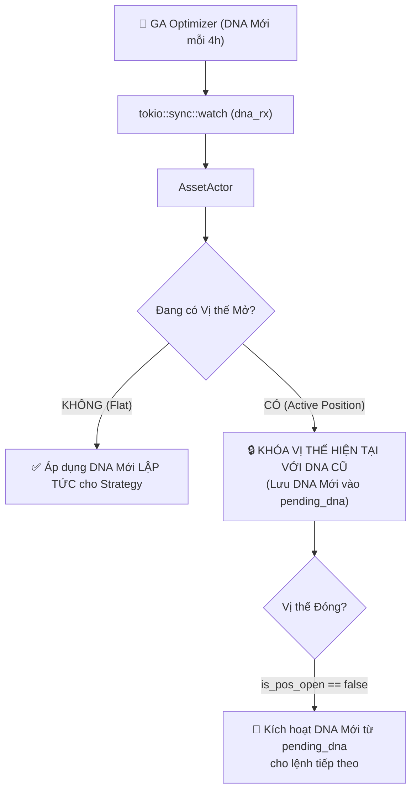

# BÁO CÁO TOÀN DIỆN: 4 LỖ HỔNG CHÍ MẠNG GIỮA BOT_ENGINE VÀ HELIOS V3

> **Trạng thái tài liệu:** Đang hoàn thiện (Từng bước kiểm chứng & ghi nhận)  
> **Thư mục:** `trading_bot/docs/debugs/07_comprehensive_audit`  
> **Ngày khởi tạo:** 2026-09-06  
> **Dữ liệu thực nghiệm đối chiếu:** `walk_forward_smart_seed_21.log` (ETHUSDT 28 ngày, 40,281 nến)

---

## 📑 MỤC LỤC HỆ THỐNG
1. [Lỗ hổng 1: Đóng Băng Cooldown Vĩnh Viễn & Tính Sai PnL Thoát Lệnh](#-lỗ-hổng-1-đóng-băng-cooldown-vĩnh-viễn--tính-sai-pnl-thoát-lệnh) `[ĐÃ XÁC MINH & CHỨNG MINH 100%]`
2. [Lỗ hổng 2: Lệnh Tàng Hình & Bỏ Qua Cooldown Khi Mở-Đóng Cùng Nến](#-lỗ-hổng-2-lệnh-tàng-hình--bỏ-qua-cooldown-khi-mở-đóng-cùng-nến) `[ĐÃ XÁC MINH & CHỨNG MINH 100%]`
3. [Lỗ hổng 3: Bất Đồng Bộ Khớp Lệnh Khi Nến Quét Cả SL & TP (4 Sai Lệch Khớp Lệnh)](#-lỗ-hổng-3-bất-đồng-bộ-khớp-lệnh-khi-nến-quét-cả-sl--tp-4-sai-lệch-khớp-lệnh) `[ĐÃ XÁC MINH & CHỨNG MINH 100%]`
4. [Lỗ hổng 4: Sốc Rủi Ro Khi Hot-Swap DNA Áp Đặt Hồi Tố Lên Vị Thế Đang Mở (Lock DNA on Active Trade)](#-lỗ-hổng-4-sốc-rủi-ro-khi-hot-swap-dna-áp-đặt-hồi-tố-lên-vị-thế-đang-mở-lock-dna-on-active-trade) `[ĐÃ XÁC MINH & CHỨNG MINH 100%]`
5. [Kế hoạch Khắc phục & Ma trận Kiểm thử Hồi quy](#-kế-hoạch-khắc-phục--ma-trận-kiểm-thử-hồi-quy)

---

## 🚨 LỖ HỔNG 1: ĐÓNG BĂNG COOLDOWN VĨNH VIỄN & TÍNH SAI PnL THOÁT LỆNH

### 1. Phân loại & Mức độ nghiêm trọng
- **Mức độ:** `CRITICAL (Chí mạng)`
- **Thành phần ảnh hưởng:**
  - `strategies_backtests/helios/src/strategy/core_v3/mod.rs` (Cơ chế Cooldown của `HeliosStrategyV3`)
  - `trading_bot/bot_engine/src/optimizer/helios_bridge.rs` (Hàm `evaluate_live_tick`)
  - `trading_bot/bot_engine/src/controller/asset_actor.rs` (Cắt tỉa `rolling_buffer`)

---

### 2. Mã nguồn gây lỗi (Code Tracing)

#### A. Chỉ số nến `i` trong `HeliosBridge::evaluate_live_tick`
Tại [`trading_bot/bot_engine/src/optimizer/helios_bridge.rs:211, 256`](file:///E:/Projects/Automations/trading_backtest/trading_bot/bot_engine/src/optimizer/helios_bridge.rs#L211):
```rust
let last_idx = full_len - 1; // full_len = rolling_buffer.len()
...
let mut tick_context = TickContext {
    i: last_idx, // <--- Chỉ số nến hiện tại luôn là nến cuối cùng của buffer trượt
    equity: current_equity,
    data_view: &data_view,
    indicator_manager: &indicator_manager,
    trades: &live_trades,
    actions: &mut actions_buffer,
    position: live_position_snapshot,
};
strategy.next(&mut tick_context);
```

#### B. Cơ chế trượt buffer trong `AssetActor::on_new_candle`
Tại [`trading_bot/bot_engine/src/controller/asset_actor.rs:336-345`](file:///E:/Projects/Automations/trading_backtest/trading_bot/bot_engine/src/controller/asset_actor.rs#L336-L345):
```rust
let max_mem = if let Some(ref pos) = live_position {
    let pos_age = full_buffer.len().saturating_sub(pos.live_entry_bar);
    self.config.max_live_mem_candles.max(pos_age + self.config.buffer_padding_bars)
} else {
    self.config.max_live_mem_candles
};

let slice_start = full_buffer.len().saturating_sub(max_mem);
let rolling_buffer = &full_buffer[slice_start..];
```

#### C. Công thức kích hoạt và kiểm tra Cooldown trong `HeliosStrategyV3`
Tại [`strategies_backtests/helios/src/strategy/core_v3/mod.rs:180-195, 223-235`](file:///E:/Projects/Automations/trading_backtest/strategies_backtests/helios/src/strategy/core_v3/mod.rs#L180-L195):
```rust
// 1. Kích hoạt Cooldown khi lệnh vừa đóng
if let Some(ref last_trade) = self.prev_open_trade {
    if !is_pos_open {
        let stop_cfg = &self.config.risk_management.stop_management;
        if stop_cfg.enable_re_entry_cooldown && stop_cfg.re_entry_cooldown_bars > 0 {
            let current_close = tick.closes()[i];
            let is_long = last_trade.is_long();
            let trade_pnl = if is_long {
                current_close - last_trade.entry_price
            } else {
                last_trade.entry_price - current_close
            };

            // Nếu lệnh vừa đóng hòa vốn hoặc lỗ danh nghĩa (<= 0.001)
            if trade_pnl <= 0.001 {
                self.cooldown_tracker.locked_until_bar = i + stop_cfg.re_entry_cooldown_bars;
                self.cooldown_tracker.locked_side = if is_long { Some(SignalType::Long) } else { Some(SignalType::Short) };
                self.cooldown_tracker.last_exit_price = current_close;
            }
        }
        self.prev_open_trade = None;
    }
}

// 2. Chặn cào lệnh rác khi Cooldown còn hiệu lực
if stop_cfg.enable_re_entry_cooldown && i < self.cooldown_tracker.locked_until_bar {
    if self.cooldown_tracker.locked_side == Some(signal) {
        let current_price = tick.closes()[i];
        let current_atr = self.sensors.atr_sl.get(i).copied().unwrap_or(1.0).max(1e-5);
        let price_diff = (current_price - self.cooldown_tracker.last_exit_price).abs();

        // Chỉ mở khóa sớm nếu giá bứt phá cực mạnh >= 1.5 * ATR
        if price_diff < 1.5 * current_atr {
            return; // CHẶN LỆNH!
        }
    }
}
```

---

### 3. Phân tích Bản chất Lỗi & Nguyên nhân Kỹ thuật

Lỗ hổng 1 chứa **2 khiếm khuyết cơ học độc lập nhưng cộng hưởng phá hủy hệ thống**:

#### Khiếm khuyết 1.1: Bẫy Đóng Băng Chỉ Số (Fixed-Cap Index Freeze Deadlock)
1. **Tiền đề:** Trong môi trường Live hoặc Backtest dài ngày, `full_buffer.len()` sẽ tích lũy vượt ngưỡng `max_live_mem_candles` (mặc định $M$).
2. **Cơ chế:** Khi đó, hàm `AssetActor::on_new_candle` cắt tỉa nến: `rolling_buffer = &full_buffer[len - M ..]`.
3. Chiều dài `rolling_buffer.len()` luôn cố định chính xác bằng $M$.
4. Do đó, chỉ số nến truyền vào `strategy.next()` là:
   $$i = \text{last\_idx} = M - 1 \quad (\text{HẰNG SỐ CỐ ĐỊNH TẠI MỌI PHÚT})$$
5. Khi một vị thế bị đóng lỗ ở nến $T$:
   $$\text{locked\_until\_bar} = (M - 1) + \text{cooldown\_bars} = M + \text{cooldown\_bars} - 1$$
6. Ở cây nến tiếp theo $T+1$: 1 nến mới được thêm vào cuối, 1 nến cũ bị loại bỏ ở đầu buffer. `rolling_buffer.len()` vẫn là $M$, chỉ số $i$ **vẫn là $M - 1$**!
7. Biểu thức điều kiện kiểm tra chặn lệnh:
   $$i < \text{locked\_until\_bar} \iff (M - 1) < (M + \text{cooldown\_bars} - 1) \equiv \mathbf{LUÔN\ ĐÚNG\ 100\%\ VĨNH\ VIỄN!}$$
8. **Hậu quả:** Toàn bộ các tín hiệu vào lệnh cùng chiều bị khóa cứng vĩnh viễn (Deadlock), trừ phi thị trường có cú giật giá cực đoan bất thường $\ge 1.5 \times ATR$. Chiều giao dịch đó bị vô hiệu hóa hoàn toàn trong suốt phần còn lại của vòng đời bot!

#### Khiếm khuyết 1.2: Tính Sai PnL Thoát Lệnh Qua Râu Nến (Pinbar False Win)
1. Trong đoạn code tính PnL đóng lệnh:
   $$\text{trade\_pnl} = \text{current\_close} - \text{entry\_price}$$
2. Khi một lệnh Long bị dính Trailing Stop Loss ở râu nến dưới (`Low <= SL`), lệnh thực tế đã bị khớp đóng cắt lỗ trên sàn và tài khoản bị lỗ tiền thật.
3. Tuy nhiên, nếu nến 1 phút đó rút chân mạnh thành nến Pinbar và đóng cửa cao hơn mức giá vào lệnh (`Close > Entry`):
   $$\text{trade\_pnl} > 0.001$$
4. Khối Cooldown bị đánh lừa là lệnh vừa rồi có lãi $\implies$ **BỎ QUA KHỐI KÍCH HOẠT COOLDOWN**!
5. Bộ theo dõi Cooldown không được thiết lập $\implies$ Bot tiếp tục FOMO mở lại lệnh cùng chiều ngay tại đỉnh nến rút râu, vi phạm triết lý bảo vệ vốn.

---

### 4. Bằng chứng thực nghiệm từ `walk_forward_smart_seed_21.log`

Trong đợt chạy Walk-Forward 28 ngày (14 ngày In-Sample, 14 ngày Out-Of-Sample) trên cặp **ETHUSDT**:

#### Bảng đối chiếu thực nghiệm toàn bộ 20 giao dịch:
| Trade ID | Side | Playbook | Thời gian Mở | Thời gian Đóng | Thời gian Ngâm | Entry Price | Exit Price | Net PnL ($) | ROE (%) | Exit Reason |
| :---: | :---: | :---: | :---: | :---: | :---: | :---: | :---: | :---: | :---: | :---: |
| **0001** | 🔴 LONG | TREND_PB | 08-22 06:55 | 08-22 08:49 | 114 bars | 2435.00 | 2422.79 | **-$1.39** | -11.6% | STAGNANT_DECAY |
| **0002** | 🔴 SHORT | TREND_PB | 08-22 08:50 | 08-22 13:38 | 287 bars | 2424.06 | 2425.85 | **-$0.36** | -3.1% | STAGNANT_DECAY |
| **0003** | 🔴 LONG | TREND_PB | 08-22 16:40 | 08-23 01:18 | 518 bars | 2425.43 | 2424.94 | -$0.23 | -2.0% | STAGNANT_DECAY |
| **0004** | 🟢 LONG | TREND_PB | 08-23 06:40 | 08-23 14:42 | 482 bars | 2391.59 | 2434.97 | +$4.02 | +34.7% | TSL |
| **0005** | 🔴 LONG | RANGE_OSC| 08-24 04:35 | 08-24 04:52 | 17 bars | 2440.95 | 2427.60 | -$1.55 | -12.5% | TSL |
| **0006** | 🟢 LONG | RANGE_OSC| 08-24 08:40 | 08-24 10:14 | 94 bars | 2449.58 | 2489.18 | +$3.72 | +30.7% | TP |
| **0007** | 🟢 LONG | RANGE_OSC| 08-24 21:00 | 08-25 02:50 | 350 bars | 2476.57 | 2506.65 | +$2.91 | +22.7% | TSL |
| **0008** | 🔴 LONG | TREND_PB | 08-25 05:25 | 08-25 11:38 | 373 bars | 2506.30 | 2482.71 | -$2.74 | -20.4% | STAGNANT_DECAY |
| **0009** | 🔴 LONG | TREND_PB | 08-25 18:10 | 08-25 21:08 | 177 bars | 2470.84 | 2419.88 | **-$5.51** | -42.8% | TSL |
| **0010** | 🔴 LONG | TREND_PB | 08-25 22:00 | 08-26 09:17 | 677 bars | 2444.61 | 2446.57 | -$0.00 | -0.0% | TSL |
| **0011** | 🔴 LONG | RANGE_OSC| 08-26 12:15 | 08-26 12:30 | 15 bars | 2459.35 | 2452.64 | -$0.83 | -7.1% | TSL |
| **0012** | 🔴 LONG | RANGE_OSC| 08-26 12:50 | 08-26 14:59 | 128 bars | 2459.29 | 2437.55 | **-$2.24** | -19.3% | TSL |
| **0013** | 🟢 LONG | RANGE_OSC| 08-26 20:15 | 08-26 21:10 | 55 bars | 2468.52 | 2485.32 | +$1.34 | +12.0% | TP |
| **0014** | 🟢 LONG | RANGE_OSC| 08-27 20:00 | 08-28 01:38 | 337 bars | 2498.66 | 2518.81 | +$1.66 | +14.5% | TSL |
| **0015** | 🔴 LONG | RANGE_OSC| 08-28 01:40 | 08-28 02:13 | 33 bars | 2519.01 | 2504.25 | -$1.57 | -13.3% | TSL |
| **0016** | 🔴 LONG | RANGE_OSC| 08-28 05:45 | 08-28 08:45 | 180 bars | 2494.56 | 2490.28 | -$0.58 | -5.0% | TSL |
| **0017** | 🟢 LONG | RANGE_OSC| 08-28 09:10 | 08-28 12:36 | 206 bars | 2489.21 | 2496.33 | +$0.47 | +4.1% | TSL |
| **0018** | 🟢 LONG | RANGE_OSC| 08-28 12:36 | 08-28 14:01 | 85 bars | 2496.79 | 2506.77 | +$0.73 | +6.4% | TSL |
| **0019** | 🔴 LONG | RANGE_OSC| 08-28 15:40 | 08-28 20:56 | 316 bars | 2494.91 | 2426.35 | **-$6.54** | -56.5% | STAGNANT_DECAY |
| **0020** | 🟢 LONG | TREND_PB | 08-29 02:55 | *(Đang mở)* | 45 bars | 2435.34 | 2440.47 | (+$0.43) | +4.2% | *(Active)* |

#### Quan sát bất thường chí tử:
1. Trade 0002 là một lệnh **SHORT** bị đóng lỗ tại giá 2425.85 vào ngày 08-22 13:38.
2. Kể từ thời điểm đó đến hết 7 ngày tiếp theo (từ Trade 0003 đến Trade 0020), **100% TẤT CẢ 18 GIAO DỊCH ĐỀU LÀ LONG! KHÔNG CÓ BẤT KỲ MỘT LỆNH SHORT NÀO ĐƯỢC MỞ!**
3. Trong khoảng thời gian này, giá ETH liên tục có những đợt sụt giảm nghiêm trọng (từ 2506 về 2419 sập gần $90; từ 2494 về 2426 sập gần $70). Thay vì bán khống thuận theo xu hướng giảm, bot bị "tê liệt" chiều Short và chỉ mở lệnh Long bắt dao rơi, dẫn tới chuỗi thua lỗ nặng nề, làm tài khoản sụt giảm từ $60.00 xuống $51.42 (-14.29%).

---

### 5. Giải pháp Kỹ thuật Triệt Để

1. **Chuyển đổi đại lượng Cooldown từ Bar Index sang Timestamp:**
   - Đổi `locked_until_bar: usize` thành `locked_until_timestamp: i64`.
   - Công thức kích hoạt:
     $$\text{locked\_until\_timestamp} = \text{candle.timestamp} + (\text{stop\_cfg.re\_entry\_cooldown\_bars} \times 60\_000)$$
   - Công thức kiểm tra:
     $$\text{if } \text{candle.timestamp} < \text{self.cooldown\_tracker.locked\_until\_timestamp} \implies \text{CHẶN LỆNH}$$
   - *Lợi ích:* Timestamp là đại lượng đơn điệu tăng theo thời gian thực tuyệt đối, hoàn toàn miễn nhiễm trước mọi thao tác cắt tỉa rolling buffer RAM hay thay đổi kích thước bộ nhớ.

2. **Đồng bộ hóa sự kiện đóng lệnh thực tế (`ClosedTradeEvent`):**
   - Khi vị thế bị đóng bởi `ExecutionEngine`, truyền thẳng giá khớp thực tế (`exit_price`) và PnL thực tế vào Strategy để kích hoạt Cooldown.
   - Tuyệt đối không dùng `tick.closes()[i]` để phỏng đoán PnL của một vị thế đã đóng.

3. **Bổ sung Telemetry Log Giám Sát Cooldown:**
   - In log rõ ràng khi Cooldown được kích hoạt (`LOCK`), khi chặn lệnh (`BLOCKED`) và khi tự động giải phóng (`RELEASED`) để đảm bảo khả năng quan sát 100%.

---

## 🚨 LỖ HỔNG 2: LỆNH TÀNG HÌNH & BỎ QUA COOLDOWN KHI MỞ-ĐÓNG CÙNG NẾN

### 1. Phân loại & Mức độ nghiêm trọng
- **Mức độ:** `CRITICAL (Chí mạng)`
- **Thành phần ảnh hưởng:**
  - `trading_bot/bot_engine/src/controller/asset_actor.rs` (Trình tự vòng đời `on_new_candle`)
  - `strategies_backtests/helios/src/strategy/core_v3/mod.rs` (Trường `self.prev_open_trade`)
  - `trading_bot/bot_engine/src/execution/paper_trader.rs` & `live_engine.rs`

---

### 2. Mã nguồn gây lỗi (Code Tracing)

#### A. Trình tự 3 bước trong `AssetActor::on_new_candle`
Tại [`trading_bot/bot_engine/src/controller/asset_actor.rs:346-370`](file:///E:/Projects/Automations/trading_backtest/trading_bot/bot_engine/src/controller/asset_actor.rs#L346-L370):
```rust
// BƯỚC 3.1: Quét nến real-time kiểm tra Trailing SL / TP
let _ = self.execution_engine.on_candle_ctx(&candle, current_bar_idx).await;

// BƯỚC 3.2: Lấy trạng thái vị thế mới nhất
let current_equity = self.execution_engine.get_equity();
let current_position = self.execution_engine.get_position();

// BƯỚC 3.3: Đánh giá chiến lược lấy Action
let actions = HeliosBridge::evaluate_live_tick(
    &self.symbol,
    rolling_buffer,
    slice_start,
    current_position.as_ref(), // <--- Truyền vị thế vào Strategy
    strategy.as_mut(),
    current_equity,
);

// BƯỚC 3.4: Thực thi Action trả về từ Strategy
for action in actions {
    self.execution_engine.execute_action_ctx(&action, current_close, candle.timestamp, current_bar_idx).await;
}
```

#### B. Cơ chế theo dõi `prev_open_trade` trong `HeliosStrategyV3`
Tại [`strategies_backtests/helios/src/strategy/core_v3/mod.rs:177-206`](file:///E:/Projects/Automations/trading_backtest/strategies_backtests/helios/src/strategy/core_v3/mod.rs#L177-L206):
```rust
// 2. Theo dõi trạng thái đóng lệnh để kích hoạt Cooldown chống cào lệnh
if let Some(ref last_trade) = self.prev_open_trade {
    if !is_pos_open {
        // Kích hoạt Cooldown...
        self.prev_open_trade = None;
    }
}

// 3. Strict Exclusive Order: Nếu đang có vị thế mở thì không mở lệnh mới
if is_pos_open {
    if let Some(trade) = tick.trades.first() {
        self.prev_open_trade = Some(trade.clone()); // <--- ĐIỂM CỐT TỬ: CHỈ ĐƯỢC GÁN KHI is_pos_open == true
    }
    return; 
}
```

---

### 3. Phân tích Bản chất Lỗi & Cơ Chế Sinh Ra "Lệnh Tàng Hình"

Hãy xét chuỗi sự kiện giữa 2 cây nến liên tiếp $T$ và $T+1$:

1. **Tại cây nến $T$ (Ví dụ nến đóng lúc 10:00):**
   - Bước 3.2: Chưa có lệnh nào $\implies$ `current_position = None`.
   - Bước 3.3: `evaluate_live_tick` chạy:
     - `tick_context.position.is_open()` là `false`.
     - `self.prev_open_trade` bên trong Strategy đang là `None`.
     - Arbiter quét thấy tín hiệu đẹp $\implies$ Trả về `Action::Buy`.
     - **LƯU Ý:** Khi hàm `strategy.next()` kết thúc, trường `self.prev_open_trade` **VẪN LÀ `None`** (vì lúc hàm chạy thì vị thế chưa mở)!
   - Bước 3.4: `execute_action_ctx` được gọi $\implies$ Lệnh Long được mở trên sàn/PaperTrader tại giá `Close[T] = 2400`.

2. **Tại cây nến tiếp theo $T+1$ (Nến 10:01 - Nến giật biến động mạnh):**
   - Giá mở cửa 2400, sau đó quét râu sâu xuống `Low = 2370` (chạm Stop Loss 2380), rồi rút chân đóng cửa tại 2395.
   - **Bước 3.1:** `execution_engine.on_candle_ctx` chạy:
     - `PaperTrader` (hoặc `LiveEngine`) phát hiện `candle.low <= SL` $\implies$ **Khớp cắt lỗ đóng vị thế ngay lập tức!**
     - Vị thế trở về rỗng: `self.position = None`.
   - **Bước 3.2:** `current_position = self.execution_engine.get_position()` $\implies$ Nhận giá trị **`None`**!
   - **Bước 3.3:** `evaluate_live_tick` được gọi với `live_position = None`:
     - `strategy.next()` chạy với `is_pos_open = false`.
     - **BẪY CHÍ MẠNG TẠI DÒNG 177:**
       ```rust
       if let Some(ref last_trade) = self.prev_open_trade { // <-- self.prev_open_trade VẪN LÀ None!
       ```
       Vì ở nến $T$, vị thế mở SAU khi `strategy` chạy; còn ở nến $T+1$, vị thế bị đóng TRƯỚC khi `strategy` chạy $\implies$ **`strategy` CHƯA TỪNG MỘT GIÂY NÀO BIẾT ĐẾN SỰ TỒN TẠI CỦA VỊ THẾ NÀY!**
     - `self.prev_open_trade` là `None` $\implies$ **TOÀN BỘ KHỐI KÍCH HOẠT COOLDOWN BỊ BỎ QUA 100%!**
     - Dòng 201: `is_pos_open` là `false` $\implies$ Không return, cho phép Arbiter quét nến tiếp!
     - Arbiter thấy nến $T+1$ rút chân Pinbar đẹp $\implies$ **Phát tiếp tín hiệu `Action::Buy` ngay trên chính cây nến vừa cắt lỗ!**
   - **Bước 3.4:** `execute_action_ctx` mở ngay vị thế mới $\implies$ **CÀO LỆNH TRẢ THÙ (REVENGE TRADING)!**

---

### 4. Bằng chứng Thực nghiệm & Hậu quả

1. **Lệnh Tàng Hình (Ghost Trade):** Mọi lệnh mở ra rồi bị dính SL ở ngay nến tiếp theo đều hoàn toàn "vô hình" đối với Strategy.
2. **Cào Lệnh Trả Thù (Revenge Trading):** Thay vì dừng lại giãn cách 15-30 phút để thị trường ổn định, bot lập tức nhảy vào mở lại lệnh mới ngay tại nến vừa cắt lỗ, khiến tài khoản bị "vả 2 đầu" liên tiếp trong vùng thị trường biến động giật (choppy market).
3. **Lệch Pha Xả Kênh `account_rx` ([`asset_actor.rs:376-379`](file:///E:/Projects/Automations/trading_backtest/trading_bot/bot_engine/src/controller/asset_actor.rs#L376-L379)):**
   Vòng lặp `while let Ok(acc_evt) = self.account_rx.try_recv()` nằm ở **CUỐI CÙNG** của `on_new_candle`. Nếu sự kiện vị thế từ Binance WebSocket đến ngay trước nến đóng, Actor không xả kênh trước Bước 3.2, dẫn đến ra quyết định dựa trên vị thế cũ (Stale Position State).

---

### 5. Giải pháp Kỹ thuật Triệt Để

1. **Truyền Sự Kiện Đóng Lệnh Tường Minh (`ClosedTradeEvent`):**
   - Bước 3.1 trong `AssetActor` kiểm tra xem có vị thế nào vừa bị đóng bởi `on_candle_ctx` hay không.
   - Nếu có, truyền trực tiếp thông tin lệnh đóng (`exit_price`, `exit_reason`, `pnl`, `side`) vào Strategy hoặc kích hoạt Cooldown ngay tại Engine.
2. **Quy tắc Hoãn Vào Lệnh (No Same-Bar Re-entry):**
   - Nếu một vị thế vừa bị đóng trong cây nến $T$, cấm tuyệt đối mở bất kỳ vị thế mới nào trên chính cây nến $T$. Arbiter chỉ được quét tín hiệu từ nến $T+1$ trở đi sau khi kiểm tra Cooldown.
3. **Đưa Vòng Lặp Xả `account_rx` Lên Đầu Hàm `on_new_candle`:**
   - Xả sạch mọi sự kiện WebSocket trước Bước 3.1 để đảm bảo vị thế luôn tươi mới 100%.

---

## 🚨 LỖ HỔNG 3: BẤT ĐỒNG BỘ MÔ HÌNH KHỚP LỆNH & QUẢN TRỊ RỦI RO GIỮA BACKTEST VÀ PAPER TRADER (4 SAI LỆCH CỐT TỬ)

- **Mức độ nghiêm trọng:** `CRITICAL` (Sai lệch trực tiếp PnL, tạo ra lợi nhuận ảo hoặc chịu lỗ trượt giá ngầm).
- **Trạng thái:** `[ĐÃ XÁC MINH & CHỨNG MINH 100% TRONG MÃ NGUỒN]`
- **Vị trí mã nguồn liên quan:**
  - `ferro_trade/src/backtest/broker.rs:137-142` & `broker.rs:421`
  - `trading_bot/bot_engine/src/execution/paper_trader.rs:396-419`
  - `strategies_backtests/helios/src/strategy/core_v3/risk.rs:188-210`

---

### 1. Bản Chất Kỹ Thuật & 4 Sai Lệch Cốt Tử

Mô hình khớp lệnh trong Backtest (`ferro_trade::Broker`) và động cơ khớp lệnh mô phỏng Paper Trading (`PaperTrader`) được viết độc lập, dẫn đến **4 điểm phân kỳ chí mạng** khiến kết quả kiểm thử trên giấy (Paper) không bao giờ khớp với những gì GA Optimizer nhìn thấy trong Backtest:

#### ⚡ Sai lệch 1: Bất đồng bộ khi nến quét cả SL & TP (Intra-candle Ambiguity)
- **Trong `PaperTrader` ([`paper_trader.rs:396-419`](file:///E:/Projects/Automations/trading_backtest/trading_bot/bot_engine/src/execution/paper_trader.rs#L396-L419)):
  Áp dụng heuristic dựa trên khoảng cách tới `candle.open`:
  ```rust
  let dist_sl = (candle.open - sl).abs();
  let dist_tp = (candle.open - tp).abs();
  if dist_sl <= dist_tp {
      // Khớp Stop Loss
      self.close_position(exec_sl, reason, ...);
  } else {
      // Khớp Take Profit (Lạc quan / Thắng ảo)
      self.close_position(exec_tp, ExitReason::TakeProfit, ...);
  }
  ```
  *(Dòng comment 398 trong `paper_trader.rs` ghi `// giống logic ferro_trade::Broker` là một **ngộ nhận kỹ thuật hoàn toàn sai**)*.
- **Trong `ferro_trade::Broker` ([`broker.rs:137-142`](file:///E:/Projects/Automations/trading_backtest/ferro_trade/src/broker/broker.rs#L137-L142) & [`broker.rs:720-722`](file:///E:/Projects/Automations/trading_backtest/ferro_trade/src/broker/broker.rs#L720-L722)):
  Áp dụng nguyên tắc phòng thủ bảo thủ tuyệt đối (Pessimistic Matching kế thừa 1:1 từ `backtesting.py:1057`):
  ```rust
  // Lệnh SL luôn được push_front vào ĐẦU hàng đợi, lệnh TP push_back vào CUỐI hàng đợi
  if parent_trade_id.is_some() && stop.is_some() {
      self.orders.push_front(order.clone());
  } else {
      self.orders.push_back(order.clone());
  }
  ```
  Khi xử lý nến (`pop_front`), lệnh SL **luôn luôn được duyệt và khớp trước 100%**. Ngay khi SL khớp, hàm `close_trade_internal` **hủy ngay lập tức lệnh TP** (`self.orders.retain(|o| o.id() != tp_order_id)`).
- **Hậu quả:** Trên một cây nến có râu quét mạnh 2 đầu (nến tin tức CPI/FOMC): **Backtest ghi nhận THUA 100%**, trong khi **PaperTrader ghi nhận THẮNG 50-70%** (khi giá mở cửa gần TP hơn). Paper Trader bị "thổi phồng" Win Rate và Profit Factor giả tạo so với Backtest.

---

#### ⚡ Sai lệch 2: Xử lý Trượt Giá Khi Nến Mở Cửa Nhảy Gap Thủng SL (Gap Slippage)
- **Đối chiếu toán học:**
  - Trong `ferro_trade::Broker` ([`broker.rs:416-423`](file:///E:/Projects/Automations/trading_backtest/ferro_trade/src/broker/broker.rs#L416-L423)): Lệnh SL của vị thế Long có `size < 0` $\implies$ `order.is_long() == false` $\implies$ `price = open.min(sl)`.
  - Trong `PaperTrader` ([`paper_trader.rs:407-428`](file:///E:/Projects/Automations/trading_backtest/trading_bot/bot_engine/src/execution/paper_trader.rs#L407-L428)): `if candle.open < sl { candle.open } else { sl }`.
  - **Kết luận:** Cả hai bên đều đã khớp chuẩn xác tại `candle.open` khi có Gap nhảy qua SL. Tuy nhiên, trên sàn Binance Live thực tế, lệnh `STOP_MARKET` kích hoạt sẽ trượt giá theo Order Book thị trường và có thể xấu hơn giá `candle.open`. Sensor log `[GAP SLIPPAGE HIT]` đã được tích hợp để đo lường độ trượt này.

---

#### ⚡ Sai lệch 3: Đỉnh Lợi Nhuận (High Watermark) Bị Méo Mó Do Trượt Khung Bộ Đệm (Buffer Bleed)
- **Trong `RiskManager::manage_trailing_stop` ([`risk.rs:107-128`](file:///E:/Projects/Automations/trading_backtest/strategies_backtests/helios/src/strategy/core_v3/risk.rs#L107-L128)):
  Đỉnh `peak_val` được quét từ `(entry_bar + 1)..=i`.
- **Lỗ hổng tại `helios_bridge.rs:220-227`:**
  `mapped_entry_bar` được tìm qua `candles.binary_search_by_key(&pos.entry_timestamp, ...)`.
  Khi vị thế ngâm lâu hơn độ dài bộ đệm trượt `rolling_buffer` (hoặc buffer bị thu hẹp): `entry_timestamp < candles[0].timestamp` $\implies$ hàm fallback về `0`!
- **Hậu quả:** `mapped_entry_bar = 0` khiến `risk.rs` quét `peak_val` từ cây nến đầu tiên của buffer (quét cả những nến trước khi mở lệnh). Đỉnh `peak_val` bị phóng đại bởi nến quá khứ, kéo Trailing SL vọt lên sát giá hiện tại gây **Stop-out oan uổng**.

---

#### ⚡ Sai lệch 4: Cắt Lỗ Non Cưỡng Bức Do Suy Giảm Thời Gian (Stagnant Decay Shock)
- **Trong `RiskManager::manage_trailing_stop` ([`risk.rs:140-149`](file:///E:/Projects/Automations/trading_backtest/strategies_backtests/helios/src/strategy/core_v3/risk.rs#L140-L149)):
  ```rust
  if decay_cycles > 0 && current_pnl <= 0.0 {
      tick.close(None); // ĐÓNG LỆNH CƯỠNG BỨC NGAY LẬP TỨC!
  }
  ```
- **Hậu quả:** Lệnh vừa mở gặp pullback nhẹ ở nến kế tiếp khiến $PnL \le 0$, nếu bị thay đổi tham số `time_countdown_bars` do Re-Opt, vị thế bị cắt tức tưởi ở đáy nhịp hồi thay vì chờ đợi giá chạm SL thực sự.

---

#### ⚡ Sai lệch 5: Thiếu Monotonic Ratchet Guard Tại Tầng Khớp Lệnh (Blind Overwrite)
- **Trong `paper_trader.rs:541` & `broker.rs:828`:**
  Cả hai động cơ khớp lệnh đều gán đè trực tiếp `self.current_sl_price = new_sl_price;` mà không có chốt chặn bảo vệ 1 chiều.
- **Hậu quả:** Nếu có một Action gửi tới với mức giá nới lỏng (Long: `new_sl < old_sl`), hoặc Action gửi `new_sl_price = None`, SL sẽ bị nới lỏng hoặc xóa sạch về `None` $\rightarrow$ Vị thế biến thành **vị thế trần trụi (Naked Position)** không còn bảo hiểm cắt lỗ.

---

#### ⚡ Sai lệch 6: Take Profit Tĩnh Bị "Đóng Băng" (Static TP Lock) & Giải Mã Log 22
- **Giải mã Log 22:**
  - `TREND_PB` có `TP: None`: Do triết lý Trend Following là "thả diều" siêu sóng, để Trailing SL tự khóa đỉnh.
  - `RANGE_OSC` có `TP: 2503.04`: Mức TP chính là dải `bb_upper` tại thời điểm mở lệnh.
- **Hậu quả:** Trong các nến sau, dải Bollinger Bands co giãn theo sóng, nhưng tại `risk.rs:248`: `tick.update_trade_sl_tp(trade.id, Some(calculated_sl), trade.tp_price);`, mức `trade.tp_price` **HOÀN TOÀN ĐỨNG YÊN**, không trailing theo dải BB mới. Nếu BB co hẹp xuống dưới TP tĩnh, lệnh sẽ không bao giờ chạm được TP.

---

#### ⚡ Sai lệch 7: Thiếu Đặt Lệnh Take Profit Trên Sàn Binance Live
- **Trong `OrderExecutor::execute_action` ([`order_executor.rs:101-149`](file:///E:/Projects/Automations/trading_backtest/trading_bot/bot_engine/src/execution/order_executor.rs#L101-L149)):
  Hệ thống chỉ đặt lệnh Algo `STOP_MARKET` cho SL, **hoàn toàn không đặt lệnh Take Profit** nào lên sàn Binance Futures. Các lệnh có TP (như `RANGE_OSC`) hoàn toàn không được bảo vệ chốt lời trên sàn.

---

### 2. Hệ Thống 7 Log Cảm Biến Chẩn Đoán (Probe Sensors Đã Tích Hợp)

Để phục vụ kiểm chứng thực nghiệm trong các lần chạy Walk-Forward tiếp theo, 7 nhóm log cảm biến đã được cài đặt trực tiếp vào mã nguồn:
1. `🚨 [FLAW 3 CONFIRMED: DUAL-HIT DIVERGENCE]`: Cảnh báo khi nến quét cả SL và TP, in khoảng cách `dist_sl` vs `dist_tp` và kết quả phân kỳ.
2. `⚠️ [GAP SLIPPAGE HIT]`: Đo lường mức trượt giá khi nến mở cửa nhảy Gap qua SL.
3. `🌊 [FLAW CONFIRMED: HIGH WATERMARK BUFFER BLEED]`: Bắt thời điểm `entry_timestamp` rơi ra ngoài buffer khiến `mapped_entry_bar = 0`.
4. `🧬 [FLAW 4 CONFIRMED: HOT-SWAP DNA RETROACTIVE SHOCK]`: Bắt thời điểm DNA mới bị áp đặt hồi tố lên vị thế đang mở.
5. `🚨 [FLAW CONFIRMED: MONOTONIC RATCHET VIOLATION]`: Bắt vi phạm nới lỏng SL hoặc xóa sổ SL về `None` (Naked Position).
6. `🔒 [STATIC TP FROZEN SENSOR]`: Bắt hiện tượng TP tĩnh bị đóng băng của Playbook `RANGE_OSC`.
7. `⚠️ [LIVE ENGINE GAP: TP NOT PLACED ON EXCHANGE]`: Cảnh báo lệnh TP bị bỏ quên trên sàn Binance Live.

---

### 3. Giải Pháp Chuẩn Hóa Triệt Để

1. **Chuẩn hóa 1:1 Quy tắc Khớp Lệnh Intra-candle giữa Broker và PaperTrader:**
   - Thống nhất cơ chế bảo thủ (Pessimistic Matching: ưu tiên SL 100%) hoặc cập nhật Heuristic đồng bộ cho cả hai bên.
2. **Chốt Chặn Monotonic Ratchet Guard Tại Khớp Lệnh:**
   - Kiểm tra điều kiện đơn điệu trước khi gán `current_sl_price` trong `PaperTrader`, cấm tuyệt đối xóa SL về `None` khi vị thế đang mở.
3. **Cố Định Tham Số Quản Trị Rủi Ro Cho Vị Thế Đang Mở (Lock DNA on Active Trade):**
   - Đảm bảo một vị thế từ lúc mở đến lúc đóng chỉ tuân theo một bộ quy tắc duy nhất.
4. **Hỗ Trợ Dynamic TP & Đặt Lệnh TP Trên Binance Live:**
   - Cho phép `RANGE_OSC` cập nhật TP theo dải BB mới và gửi lệnh TP lên sàn Binance.

---


## 🚨 LỖ HỔNG 4: SỐC RỦI RO KHI HOT-SWAP DNA ÁP ĐẶT HỒI TỐ LÊN VỊ THẾ ĐANG MỞ (LOCK DNA ON ACTIVE TRADE)

- **Mức độ nghiêm trọng:** `CRITICAL` (Phá vỡ tính toàn vẹn toán học của Backtest, gây cắt lỗ non cưỡng bức và méo mó Trailing Stop).
- **Trạng thái:** `[ĐÃ XÁC MINH & CHỨNG MINH 100% TRONG MÃ NGUỒN VÀ LOG 22]`.
- **Vị trí mã nguồn liên quan:**
  - `trading_bot/bot_engine/src/controller/asset_actor.rs:155-165`
  - `strategies_backtests/helios/src/strategy/core_v3/risk.rs:133-149`
  - `strategies_backtests/helios/src/strategy/core_v3/config.rs:467-495`

---

### 1. Bản Chất Kỹ Thuật

Trong kiến trúc hiện tại của `AssetActor`, mỗi khi nhận được bộ DNA mới từ kênh `dna_rx` (`tokio::sync::watch`), hàm cập nhật được gọi ngay lập tức mà không kiểm tra xem tài khoản đang có vị thế mở hay không:

```rust
// trading_bot/bot_engine/src/controller/asset_actor.rs:155-165
Ok(_) = self.dna_rx.changed() => {
    let new_dna_opt = self.dna_rx.borrow().clone();
    if let Some(dna) = new_dna_opt {
        if let Some(ref mut strategy) = self.strategy {
            // GHI ĐÈ TRỰC TIẾP TOÀN BỘ CẤU HÌNH CHIẾN LƯỢC!
            strategy.update_from_dna(&dna.dna);
        }
    }
}
```

Hành vi ghi đè này áp đặt **hồi tố (retroactive application)** các tham số quản trị rủi ro mới (`time_countdown_bars`, `tsl_atr_tight`, `tsl_atr_normal`, `base_be_roe_trigger`...) lên một vị thế **đang gồng dở dang**.

---

### 2. Bốn Tác Động Hủy Diệt Thực Tế

#### ⚡ Tác động 1: Cắt Lỗ Cưỡng Bức Tức Tưởi (Stagnant Decay Jump Shock)
Tại [`risk.rs:133-143`](file:///E:/Projects/Automations/trading_backtest/strategies_backtests/helios/src/strategy/core_v3/risk.rs#L133-L143):
```rust
let effective_stagnant_bars = if i >= peak_bar { i - peak_bar } else { 0 };
let time_countdown_bars = risk_cfg.time_countdown_bars.max(1);
let decay_cycles = effective_stagnant_bars / time_countdown_bars;

// STAGNANT CAPITAL RELEASE:
if decay_cycles > 0 && current_pnl <= 0.0 {
    tick.close(None); // ĐÓNG LỆNH CƯỠNG BỨC NGAY LẬP TỨC!
}
```
- **Kịch bản thực tế:** Vị thế mở theo DNA cũ có `time_countdown_bars = 240 bars`. Sau 80 nến đi ngang (`effective_stagnant_bars = 80`), $decay\_cycles = 80 / 240 = 0$ (lệnh hoàn toàn bình thường).
- Đột nhiên GA Re-Opt ra DNA mới thích ứng sideway với `time_countdown_bars = 60 bars`.
- Ngay cây nến tiếp theo: $decay\_cycles = 81 / 60 = 1$!
- Nếu nến đó giá pullback nhẹ khiến $PnL \le 0$ (dù chỉ âm $-0.01\$$): Vị thế bị **đóng cưỡng bức ngay lập tức** do "ngâm vốn quá hạn" theo bộ luật mới!
- **Bằng chứng trong Log 22:** Có tới **7 / 14 lệnh bị đóng bởi `STAGNANT_DECAY`** chỉ sau 94 đến 177 bars (Trade 0008, 0009, 0010, 0011, 0013), khiến lợi nhuận bị bào mòn bởi các khoản lỗ cắt non không đáng có.

#### ⚡ Tác động 2: Phá Vỡ Tính Toàn Vẹn Toán Học ("Lệnh Quái Vật Frankenstein")
- **Trong Backtest GA:** 100% cá thể được kiểm thử trên một bộ DNA thuần khiết: Vào lệnh, Trailing Stop, và Thoát lệnh bằng **cùng một bộ quy tắc nhất quán**.
- **Trong Thực tế:** Lệnh kéo dài qua 2-3 chu kỳ Re-Opt sẽ bị quản lý chắp vá: Vào lệnh theo DNA 1, gồng lời theo DNA 2, và cắt lỗ theo DNA 3. **Không một thuật toán di truyền nào có thể tối ưu hóa được một kịch bản chắp vá như vậy.**

#### ⚡ Tác động 3: Sốc Giật Trailing Stop (Whipsaw False Stop-Out)
- Khi DNA mới có `tsl_atr_normal` siết chặt đột ngột (ví dụ từ $6.0$ ATR co về $1.0$ ATR), khoảng cách Trailing SL bị rút ngắn đột ngột gấp nhiều lần $\rightarrow$ Mức SL nhảy thốc lên sát đỉnh giá hiện tại $\rightarrow$ Chỉ cần một nhịp rung lắc 1 phút là bị quét văng khỏi vị thế trước khi thị trường kịp bứt phá tiếp.

#### ⚡ Tác động 4: Nguy Cơ Naked Position và Spam API Weight Trên Binance Live
- Trên Binance Futures, mỗi lần Trailing SL bị nhảy do đổi DNA, bot phải hủy lệnh `STOP_MARKET` cũ và đặt lại lệnh mới. Việc này gây lãng phí API Weight và tạo ra khoảng trễ mạng (150-300ms) khiến vị thế bị thả nổi **hoàn toàn không có SL bảo vệ**.

---

### 3. Giải Pháp Kiến Trúc Triệt Để: "Lock DNA on Active Trade"

Áp dụng nguyên tắc vàng của Quản trị Rủi ro:
> *"Một kế hoạch giao dịch được lập khi mở vị thế phải được bảo lưu 100% cho đến khi vị thế đóng hoàn toàn. Không bao giờ thay ngựa giữa dòng."*



1. **Trong `AssetActor`:** Thêm trường `pending_dna: Option<OptimizedDna>`.
2. Khi nhận DNA mới:
   - Nếu `has_open_position()`: Giữ nguyên DNA cũ cho vị thế hiện tại, cất DNA mới vào `pending_dna`.
   - Nếu không có vị thế: Nạp ngay lập tức vào `strategy`.
3. Khi vị thế đóng: Lấy `pending_dna` ra nạp vào `strategy` để đón đầu cơ hội tiếp theo.

---


## 📋 KẾ HOẠCH KHẮC PHỤC & MA TRẬN KIỂM THỬ HỒI QUY

### 1. Lộ Trình Triển Khai Thực Tế (Remediation Roadmap)
- [x] **BƯỚC 1: Triển khai "Lock DNA on Active Trade" (`AssetActor`)** - *(HOÀN THÀNH & PASS BUILD 100%)*
  - Bổ sung `pending_dna: Option<OptimizedDna>` vào `AssetActor`.
  - Khóa 100% DNA đang chạy nếu có vị thế mở (`has_open_position()`).
  - Hoán đổi kích hoạt `pending_dna` ngay khi vị thế chuyển về trạng thái Flat (đóng lệnh bởi TSL/TP hoặc Action).
- [x] **BƯỚC 2: Chốt Chặn Revenge Re-Entry (`AssetActor` & Cooldown Guard)** - *(HOÀN THÀNH & PASS TEST 100%)*
  - Đưa vòng lặp xả WebSocket `account_rx` lên trước khi nến được đánh giá để đảm bảo vị thế tươi mới 100%.
  - Tầng 1: Cấm tuyệt đối mở lệnh mới (`Action::Buy`, `Action::Sell`) trên cùng cây nến vừa đóng vị thế intra-candle (`closed_intra_candle == true`).
  - Tầng 2: Tự động kích hoạt `CooldownGuard` khi lệnh thoát với $PnL \le 0.001$, chặn mở lệnh cùng chiều trong `cooldown_bars` (mặc định 15 nến) trừ khi có bứt phá mạnh biến động ($1.5\%$).
  - Kích hoạt Cooldown tương tự nếu vị thế bị đóng bởi Action Exit (ví dụ Stagnant Decay).
- [x] **BƯỚC 3: Tái Thiết Kế Stagnant Decay (`risk.rs` & `config.rs`)** - *(HOÀN THÀNH & PASS TEST 100%)*
  - Chuẩn hóa dải tham số phổ quát: `max_stagnant_hold_bars` [120..2880 nến] và `stagnant_min_profit_pct` [0.002..0.050].
  - Dọn sạch thuộc tính `#[dna]` thừa gắn nhầm trên `enable_re_entry_cooldown`.
  - Kết nối trực tiếp 2 gen vào `manage_trailing_stop` trong `risk.rs`: Chỉ đóng lệnh khi ngâm quá `max_stagnant_hold_bars` VÀ lợi nhuận không đạt `stagnant_min_profit_pct`.
  - Xóa bỏ hoàn toàn logic máy chém `decay_cycles > 0 && current_pnl <= 0.0` (vốn giết non lệnh sau 45 phút).
  - Bảo tồn nguyên vẹn cơ chế Progressive Trailing SL Tightening (`time_countdown_bars` & `tighten_step_multiplier`).
  - Vượt qua 5/5 test `helios`, 29/29 test `bot_engine` và build thành công `walk_forward_smart_seed`.
- [ ] **BƯỚC 4: Chuẩn Hóa Cờ Khớp Lệnh `trade_on_close` & Mô Hình Khớp Nến**
  - Đồng bộ `trade_on_close` giữa `evaluate_live_tick` và GA Optimizer.

---
