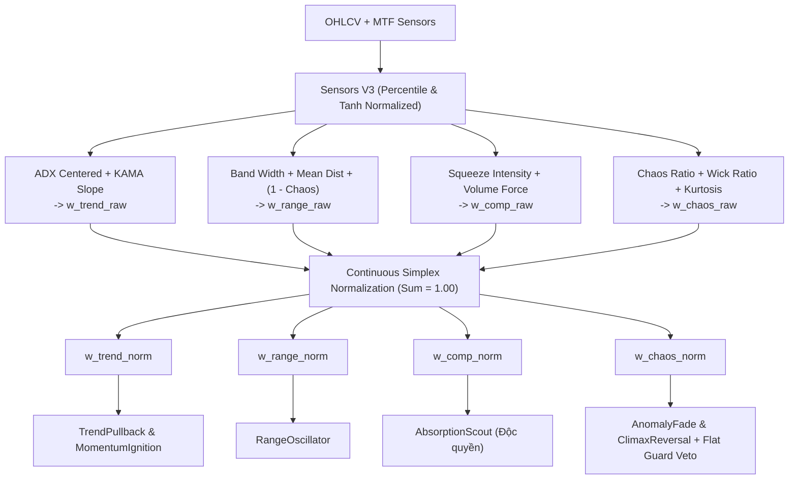

# 📑 TÀI LIỆU KỸ THUẬT: FLAW-REG.1 & FLAW-TSL.9 - 4-STATE CONTINUOUS SIMPLEX VECTOR & FAIR AUCTION

> **Mã lỗi:** FLAW-REG.1 & FLAW-TSL.9  
> **Dự án liên quan:** `strategies_backtests/helios` (Matrix, Arbiter, Config) & `trading_bot/bot_engine` (Walk-Forward Test Harness)  
> **Thư mục tài liệu:** `trading_bot/docs/debugs/07_comprehensive_audit/flaw_reg1_whipsaw_and_absorption_churn/`  
> **Trạng thái:** Sẵn sàng triển khai (Ready for Implementation)

---

## 1. BỐI CẢNH & PHÂN TÍCH BẢN CHẤT LỖI LOGIC

### 1.1. Điểm Mù Của Simplex 3 Trạng Thái Trước Bão Whipsaw (FLAW-REG.1)
Trong phiên bản hiện tại (`matrix.rs:142-165`), vector bối cảnh thị trường được tính theo công thức:
$$w_{\text{trend\_raw}} = t\_mul \times \text{slope\_factor}$$
$$w_{\text{volatile\_raw}} = c\_ratio \times v\_force$$
$$w_{\text{range\_raw}} = \left(1.0 - \max(w_{\text{trend\_raw}}, w_{\text{volatile\_raw}})\right).\max(0.05)$$

**🚨 Lỗ hổng toán học:**
Khi bão Whipsaw quét râu 2 đầu xảy ra (nhiễu vi mô tần số cao, giá giật cục):
- Xu hướng không hình thành $\implies \text{ADX} < 20 \implies w_{\text{trend\_raw}} \approx 0.0$.
- Biên độ biến động NATR ở mức trung bình và Volume không đột biến $\implies w_{\text{volatile\_raw}} \le 0.15$.
- Hệ quả: $\max(w_{\text{trend}}, w_{\text{volatile}}) \le 0.15 \implies w_{\text{range\_raw}} \ge 0.85$!
- **Ma trận bị "mù" hoàn toàn:** Ngộ nhận bão Whipsaw thành **Vùng Đi Ngang Lý Tưởng (Clean Range 85% - 90%)**! 
- Hệ thống kích hoạt `RangeOscillator` nhảy vào bắt đỉnh/đáy dải Bollinger Bands và bị quét Stop Loss liên tục.

### 1.2. Hiện Tượng Độc Tôn Tín Hiệu & Ngủ Đông Của Absorption (FLAW-TSL.9)
Trong Log 34 (19 lệnh cuối), Log 36 (8/8 lệnh), và Log ETH_12hOPT_1 (15/17 lệnh), `ABSORPTION` chiếm lĩnh từ 80% đến 100% tổng số lệnh, đồng thời xuất hiện các khoảng trống "ngủ đông" kéo dài 5 - 10 tiếng hoặc thậm chí 2 ngày:
1. **Sự cộng hưởng kép (Self-Reinforcing Loop):**
   - Trong `absorption.rs`: $\text{raw\_score} = 0.5 \times \text{squeeze} + 0.5 \times \text{vol\_force}$.
   - Trong `matrix.rs`: $\text{absorption\_multiplier} = 0.5 \times \text{squeeze} + 0.5 \times \text{vol\_force}$.
   - Cả hai dùng chung 100% biến số đầu vào. Khi có nén nhẹ và volume gom, điểm tự tin của `Absorption` luôn đạt cực đại ($> 0.85 - 0.95$).
2. **Thiên vị bối cảnh trong Arbiter (`arbiter.rs:136-140`):**
   - `AbsorptionScout` (bản chất là nén tích lũy biên độ hẹp) lại được gán nhầm vào $w_v$ (Volatile).
   - Trong khi đó, DNA tối ưu đặt ngưỡng phê duyệt `min_confidence_volatile = 0.3770` (cực kỳ dễ đỗ), nhưng lại ép `min_confidence_trending = 0.7137` và `trend_pb.min_activation_score = 0.8800`.
3. **Winner-Takes-All của GA Smart Seeding:**
   - GA liên tục nhân bản cá thể tối ưu cho Absorption. Các Scanners bắt Trend (`TrendPullback`, `MomentumIgnition`) bị đẩy rào cản lên mức không thể vượt qua.
   - Khi thị trường kết thúc vùng nén và bước vào con sóng xả lũ dốc đứng 200 giá (như từ $2666 \to 2460$ ngày 11-13/09), dải Bollinger mở toang $\implies \text{squeeze} \to 0 \implies$ `Absorption` tắt tiếng. Do các Scanner bắt Trend bị khóa chặt, bot rơi vào trạng thái tê liệt hoàn toàn, bỏ lỡ toàn bộ con sóng lớn.

---

## 2. THIẾT KẾ KIẾN TRÚC TOÁN HỌC: 4-STATE CONTINUOUS SIMPLEX VECTOR

Hệ thống bóc tách thị trường tại mọi cây nến $i$ thành đúng **4 trạng thái Canonical độc lập, đầy đủ và loại trừ lẫn nhau**:

$$\sum_{k \in \{\text{trend, range, comp, chaos}\}} w_k \equiv 1.00$$



### 2.1. Định Nghĩa 4 Trọng Số Bối Cảnh Vi Phân
Tất cả các biến đầu vào đều được chuẩn hóa qua `rolling_percentile` ($0.0 \to 1.0$) hoặc `tanh_scale` để đảm bảo **100% Universal, không phụ thuộc vào biên độ giá danh nghĩa**:

1. **$w_{\text{trend}}$ (Xu hướng định hướng - Directional Trend):**
   $$w_{\text{trend\_raw}} = \text{trend\_strength}[i] \times \text{slope\_factor}[i]$$
   - $\text{trend\_strength}$: Tính từ $\text{ADX\_centered}$.
   - $\text{slope\_factor}$: Độ dốc chuẩn hóa của KAMA: $\frac{1 + \tanh(|\text{kama\_slope}| / 0.10)}{2}$.
   - *Phục vụ:* `TrendPullback`, `MomentumIgnition`.

2. **$w_{\text{clean\_range}}$ (Đi ngang êm đềm có quy luật - Tradable Clean Range):**
   $$w_{\text{clean\_range\_raw}} = (1.0 - \text{trend\_strength}[i]) \times (1.0 - \text{chaos\_ratio}[i]) \times (1.0 - \text{squeeze\_intensity}[i])$$
   - Khác biệt cốt tử với công thức cũ: **Bắt buộc nhân với $(1.0 - \text{chaos\_ratio})$**. Khi có bão Whipsaw ($\text{chaos\_ratio} \to 1.0$), $w_{\text{clean\_range\_raw}}$ lập tức bị dập tắt về $0.0$, triệt tiêu 100% điểm mù Whipsaw!
   - *Phục vụ:* `RangeOscillator`.

3. **$w_{\text{comp}}$ (Nén tích lũy dòng tiền - Squeeze Compression):**
   $$w_{\text{comp\_raw}} = \text{squeeze\_intensity}[i] \times (1.0 - \text{chaos\_ratio}[i])$$
   - Tách rời hoàn toàn khỏi $w_v$. Đo lường chính xác vùng thắt cổ chai Bollinger Bands trong điều kiện trật tự (không bị nhiễu loạn râu).
   - *Phục vụ ĐỘC QUYỀN:* `AbsorptionScout`.

4. **$w_{\text{chaos}}$ (Hỗn loạn Whipsaw / Biến động phi chuẩn - Untradable Chaos):**
   $$w_{\text{chaos\_raw}} = \text{chaos\_ratio}[i] \times \max(\text{vol\_z\_scale}[i], 0.50)$$
   - Phản ánh trung thực các vùng thị trường nến đổi màu liên tục, quét râu 2 đầu, tin tức giật nến không thể phân tích kỹ thuật.
   - *Phục vụ:* Trinh sát phòng ngự `Flat Guard` (Veto đứng ngoài giữ tiền) và bắt đỉnh/đáy râu nến cho `AnomalyFade` / `ClimaxReversal`.

### 2.2. Thuật Toán Chuẩn Hóa Simplex Tuyệt Đối (Sum = 1.00 & Zero Crash Guard)
$$\text{sum} = w_{\text{trend}} + w_{\text{clean\_range}} + w_{\text{comp}} + w_{\text{chaos}}$$
- Nếu $\text{sum} \le 10^{-6}$ hoặc dính `NaN` (nến warmup đầu tiên):
  $$w_{\text{trend}} = w_{\text{clean\_range}} = w_{\text{comp}} = w_{\text{chaos}} = \frac{1}{4} = 0.25$$
- Trong mọi điều kiện thông thường:
  $$w_k = \frac{w_{k\text{\_raw}}}{\text{sum}} \in [0.0, 1.0], \quad \sum w_k \equiv 1.00$$

---

## 3. CẬP NHẬT SIGNAL ARBITER: ĐẤU THẦU CÔNG BẰNG (FAIR AUCTION)

Trong `arbiter.rs`:
1. **Ánh xạ bối cảnh Đội Nhà (Home-Regime Context):**
   ```rust
   let regime_weight = match id {
       ScannerId::TrendPullback | ScannerId::MomentumIgnition => w_t,
       ScannerId::RangeOscillator                             => w_r,
       ScannerId::AbsorptionScout                             => w_c,
       ScannerId::AnomalyFade | ScannerId::ClimaxReversal     => w_ch,
   };
   ```
2. **Ngưỡng Phê Duyệt Động 4 Trạng Thái:**
   $$\text{required\_confidence} = w_t \cdot \text{min\_conf\_trend} + w_r \cdot \text{min\_conf\_range} + w_c \cdot \text{min\_conf\_comp} + w_{\text{ch}} \cdot \text{min\_conf\_chaos}$$
3. **Cấu Hình DNA 100% Dynamic Trong `config.rs`:**
   - Bổ sung `min_confidence_compression` vào `ArbiterConfig`.
   - Đổi tên `min_confidence_volatile` thành `min_confidence_chaos` để phản ánh đúng bản chất.
   - Toàn bộ dải giá trị gene tuân thủ Universal `[min = 0.01, max = 0.99, step = 0.03]`.

---

## 4. PHÂN TÍCH CÁC EDGE CASES CHÍ MẠNG

| Edge Case | Tình huống thực tế | Phản ứng của hệ thống 4-State Simplex |
| :--- | :--- | :--- |
| **EC-1: Cờ Giảm (Bear Flag)** | Giá sập dốc đứng rồi nén nhẹ đi ngang 10 phút. | $\text{trend\_strength}$ vẫn cao từ MTF (15m/1h) $\implies w_t$ duy trì lớn, $w_c$ chỉ ở mức trung bình. `Absorption` không thể áp đảo điểm số, nhường quyền ưu tiên cho `TrendPullback` canh Short nhịp hồi. |
| **EC-2: Bão Râu Whipsaw** | Thị trường đi ngang quét râu 2 đầu liên tục, giật SL. | $\text{chaos\_ratio}$ tăng vọt $\implies w_{\text{chaos}}$ chiếm $70\% - 85\%$, $w_{\text{clean\_range}}$ bị kéo về $< 0.10$. `RangeOscillator` bị tước quyền tham gia đấu thầu, bảo vệ tài khoản khỏi bị vả 2 đầu. |
| **EC-3: Sổ Lệnh Zombie** | Khối lượng về 0, nến dẹp như sợi chỉ (altcoin mỏng). | Fallback an toàn chia đều $0.25$, kết hợp `volume_force = 0.0` khi NaN, ngăn chặn `Absorption` bắn lệnh ảo. |
| **EC-4: Thích Ứng Altcoin (LSK)** | Nến altcoin có độ ồn cao hơn BTC/ETH. | Hàm `rolling_percentile` tự động lấy ngưỡng phân vị của chính altcoin đó, đảm bảo 4 trọng số luôn phân bổ hài hòa mà không cần sửa 1 dòng code hardcode nào. |

---

## 5. DANH MỤC FILE THAY ĐỔI & KIỂM THỬ

1. `strategies_backtests/helios/src/strategy/core_v3/matrix.rs`: Bổ sung $w_{\text{comp\_norm}}$, $w_{\text{chaos\_norm}}$ và thuật toán chuẩn hóa 4-State Simplex.
2. `strategies_backtests/helios/src/strategy/core_v3/arbiter.rs`: Cập nhật tra cứu `regime_weight` 4 trạng thái và công thức tính `required_confidence`.
3. `strategies_backtests/helios/src/strategy/core_v3/config.rs`: Cập nhật `ArbiterConfig` đưa `min_confidence_compression` và `min_confidence_chaos` vào DNA.
4. Unit tests chuyên sâu trong `matrix.rs` và `arbiter.rs`:
   - `test_4state_simplex_normalization_sum_is_one`: Kiểm chứng $\sum \equiv 1.00$ trong mọi tình huống.
   - `test_whipsaw_discrimination_prevents_fake_range`: Kiểm chứng $w_{\text{clean\_range}} \to 0$ khi bão Whipsaw.
   - `test_fair_auction_balance_scanners`: Kiểm chứng `TrendPullback` thắng thầu khi có Trend, `Absorption` không còn độc tôn.
