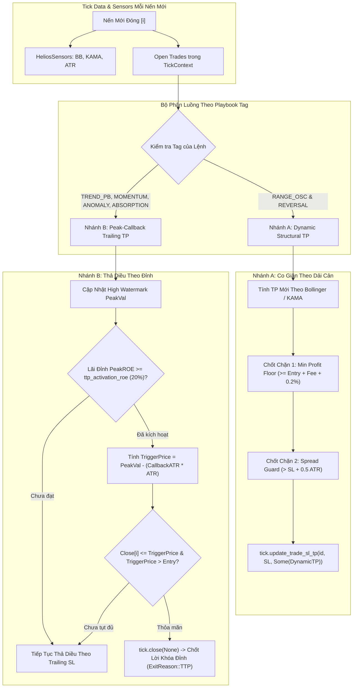

# 📐 ĐẶC TẢ KỸ THUẬT: HYBRID TRAILING TAKE PROFIT (FLAW-TSL.1)

> **Mã định danh:** `FLAW-TSL.1`  
> **Mục tiêu:** Khắc phục triệt để tình trạng Take Profit bị đóng băng tĩnh (`[STATIC TP FROZEN SENSOR]`), trang bị cơ chế chốt lời động co giãn theo thị trường (Dynamic Structural TP) và chốt lời thả diều bám đỉnh (Peak-Callback Trailing TP).  
> **Thư mục tài liệu:** `trading_bot/docs/debugs/07_comprehensive_audit/flaw_tsl1_hybrid_ttp/`  
> **Trạng thái:** `Đang triển khai`

---

## 1. 🎯 BỐI CẢNH VÀ ĐỘNG LỰC THIẾT KẾ

Trong mã nguồn hiện tại (`strategies_backtests/helios/src/strategy/core_v3/risk.rs:362`):
```rust
tick.update_trade_sl_tp(trade.id, Some(safe_tightened_sl), trade.tp_price);
```
- Suốt vòng đời vị thế, `trade.tp_price` luôn giữ nguyên giá trị ban đầu khi mở lệnh.
- **Hậu quả thực tế:**
  1. Đối với `RANGE_OSC` và `REVERSAL`: Khi thị trường nén biên độ (Volatility Squeeze), dải Bollinger Bands hoặc KAMA Mid co hẹp hạ thấp dần. Do TP bị đông cứng trên trời, giá chạm dải mới rồi quay đầu sập mà lệnh không chốt được, buộc phải chờ ngâm lệnh 12 tiếng để cắt qua Stagnant Decay.
  2. Đối với `TREND_PB`, `MOMENTUM_IGN`, `ANOMALY`, `ABSORPTION`: Đặt `TP: None` để gồng lãi ăn siêu sóng (+80% ROE), nhưng khi giá đạt đỉnh và có cú xả mạnh (Flash Dump), hệ thống chỉ dựa vào TSL cách xa 3-5 ATR khiến bốc hơi một phần lợi nhuận lớn ở đỉnh.

---

## 2. 🏛️ KIẾN TRÚC TỔNG THỂ HYBRID TRAILING TAKE PROFIT

Chiến lược chia làm **2 nhánh độc lập** dựa trên bản sắc của từng Tactical Playbook:



---

## 3. 📐 ĐẶC TẢ TOÁN HỌC & CÔNG THỨC CHI TIẾT

### 🏹 A. NHÁNH A: DYNAMIC STRUCTURAL TAKE PROFIT (`RANGE_OSC` & `REVERSAL`)

1. **Công thức tính TP thô theo từng nến $i$:**
   - Đối với `RANGE_OSC`:
     $$\text{raw\_tp}_{\text{Long}} = \text{sensors.bb\_upper}[i]$$
     $$\text{raw\_tp}_{\text{Short}} = \text{sensors.bb\_lower}[i]$$
   - Đối với `REVERSAL`:
     $$\text{raw\_tp}_{\text{Long}} = \text{sensors.kama}[i]$$
     $$\text{raw\_tp}_{\text{Short}} = \text{sensors.kama}[i]$$

2. **Chốt chặn an toàn bắt buộc (Safety Guards):**
   - **Chốt chặn 1: Sàn bảo vệ lợi nhuận tối thiểu (Min Profit Floor):**
     Tuyệt đối không để dải co thắt đâm thủng giá vốn làm chốt lời thành chốt lỗ (loại bỏ 100% Wrong-Side TP):
     $$\text{min\_gain} = \text{config.dynamic\_tp\_min_gain_pct} \quad (\text{mặc định } 0.002 = 0.20\%)$$
     $$\text{safe\_tp}_{\text{Long}} = \max\Big(\text{raw\_tp}_{\text{Long}},\ \text{entry\_price} \times (1.0 + \text{min\_gain})\Big)$$
     $$\text{safe\_tp}_{\text{Short}} = \min\Big(\text{raw\_tp}_{\text{Short}},\ \text{entry\_price} \times (1.0 - \text{min\_gain})\Big)$$

   - **Chốt chặn 2: Khoảng cách tối thiểu so với Stop Loss (Spread Guard):**
     Ngăn chặn nghịch lý toán học $SL \ge TP$ khiến Broker hoặc sàn Binance từ chối lệnh:
     $$\text{safe\_tp}_{\text{Long}} = \max\Big(\text{safe\_tp}_{\text{Long}},\ \text{current\_sl} + 0.5 \times \text{ATR}\Big)$$
     $$\text{safe\_tp}_{\text{Short}} = \min\Big(\text{safe\_tp}_{\text{Short}},\ \text{current\_sl} - 0.5 \times \text{ATR}\Big)$$

---

### 🦅 B. NHÁNH B: PEAK-CALLBACK TRAILING TAKE PROFIT (`TREND_PB`, `MOMENTUM_IGN`, `ABSORPTION`, `ANOMALY`)

1. **Khởi tạo ban đầu:**
   Khi mở lệnh, `suggested_tp = None`. Lệnh được tự do gồng lãi thả diều.

2. **Theo dõi đỉnh cao nhất (High Watermark):**
   - Điểm neo ban đầu: `peak_val = trade.entry_price`.
   - Với $j \in (entry\_bar + 1)..=i$:
     - Long: `peak_val = peak_val.max(highs[j])`
     - Short: `peak_val = peak_val.min(lows[j])`
   - Tính tỷ lệ lợi nhuận cao nhất đạt được trên đòn bẩy:
     $$\text{peak\_roe}_{\text{Long}} = \frac{\text{peak\_val} - \text{entry\_price}}{\text{entry\_price}} \times \text{leverage}$$
     $$\text{peak\_roe}_{\text{Short}} = \frac{\text{entry\_price} - \text{peak\_val}}{\text{entry\_price}} \times \text{leverage}$$

3. **Điều kiện kích hoạt radar bám đỉnh (Activation Threshold):**
   $$\text{is\_ttp\_active} = \Big(\text{peak\_roe} \ge \text{config.ttp\_activation\_roe}\Big) \quad (\text{Mặc định: } 0.20 = 20\% \text{ ROE})$$

4. **Điều kiện chốt lời khi thị trường rút chân (Callback Execution):**
   Khi `is_ttp_active == true`:
   - Tính mức giá kích hoạt thoát lệnh:
     $$\text{trigger\_price}_{\text{Long}} = \text{peak\_val} - (\text{config.ttp\_callback\_atr} \times \text{current\_atr})$$
     $$\text{trigger\_price}_{\text{Short}} = \text{peak\_val} + (\text{config.ttp\_callback\_atr} \times \text{current\_atr})$$
     *(Mặc định: `ttp_callback_atr = 0.80`)*
   - **Chốt chặn có lãi:** $\text{trigger\_price}$ phải đảm bảo đem lại lợi nhuận $> \text{entry\_price} \times (1.0 + \text{min\_gain})$.
   - **Khớp lệnh thoát:**
     - Long: Nếu $\text{current\_close} \le \text{trigger\_price}_{\text{Long}}$ $\rightarrow$ `tick.close(None)`.
     - Short: Nếu $\text{current\_close} \ge \text{trigger\_price}_{\text{Short}}$ $\rightarrow$ `tick.close(None)`.
     - Phân loại lý do đóng lệnh trong telemetry: `ExitReason::TrailingTakeProfit` (ký hiệu `TTP`).

---

## 4. 🛡️ BẢO TOÀN TELEMETRY & LOG DEBUGGING

Theo yêu cầu nghiêm ngặt của người dùng, **tuyệt đối không xóa bỏ các log cảnh báo**. Hệ thống telemetry được nâng cấp:
1. **Giữ nguyên và làm mịn `[STATIC TP FROZEN SENSOR]`:**
   - Nếu lệnh là `RANGE_OSC` hoặc `REVERSAL` mà mức TP qua 3 nến liên tiếp không hề thay đổi dù Bollinger Bands dịch chuyển $\rightarrow$ Bắn cảnh báo `[STATIC TP FROZEN SENSOR]` để phát hiện lỗi cập nhật.
2. **Thêm log giám sát Dynamic TP:**
   - `[DYNAMIC TP UPDATED] Symbol: ETHUSDT | Playbook: RANGE_OSC | Old TP: 2505.20 -> New TP: 2498.40 (Band Shifted)`
3. **Thêm log kích hoạt Peak-Callback TTP:**
   - `[TTP ACTIVATED] Symbol: ETHUSDT | Tag: TREND_PB | Peak ROE: +42.5% >= 20.0% -> Radar Armed (Callback: 0.8 ATR = 12.4$)`
   - `[TTP TRIGGERED EXIT] Symbol: ETHUSDT | Peak: 2528.00 -> Price dropped to 2515.20 (Callback hit) -> Closed to lock +36.2% ROE!`
