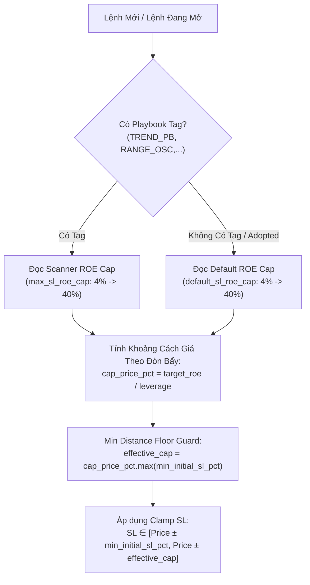

# 📐 ĐẶC TẢ KỸ THUẬT: QUẢN TRỊ RỦI RO LỆNH BẰNG PER-PLAYBOOK ROE CAP & FALLBACK HIERARCHY (FLAW-TSL.8)

> **Mã lỗi:** `FLAW-TSL.8`  
> **Phạm vi tác động:** `strategies_backtests/helios/src/strategy/core_v3/` (`config.rs`, `risk.rs`, `mod.rs`)  
> **Mục tiêu:** Loại bỏ vĩnh viễn magic number `0.80 / lev` (cho phép âm -80% ROE) và giá trị hardcode `0.05` khi lệnh không có tag. Thiết lập hệ thống trần Stop Loss theo % ROE vốn ký quỹ thích ứng động cho mọi mức đòn bẩy ($1\times \to 125\times$).

---

## 1. Bối Cảnh & Phân Tích Lỗ Hổng Cũ

### 1.1. Thực Trạng Mã Nguồn Hiện Tại
1. **Lỗ hổng Magic Number -80% ROE:**
   - Tại [`risk.rs:31`](file:///E:/Projects/Automations/trading_backtest/strategies_backtests/helios/src/strategy/core_v3/risk.rs#L31) (`clamp_sl_price`): `let max_sl_by_lev = 0.80 / lev;`
   - Tại [`risk.rs:267`](file:///E:/Projects/Automations/trading_backtest/strategies_backtests/helios/src/strategy/core_v3/risk.rs#L267) (`manage_trailing_stop`): `let lev_cap_pct = (playbook_max_sl_pct).min(0.80 / leverage);`
   - Khi gặp nến bão táp biến động lớn làm ATR phình to, Stop Loss bị đẩy lùi xa tới mức âm tới -80% ROE vốn ký quỹ (Minh chứng: Lệnh `#0011` trong Log 33 lỗ tới -$5.05, tức -51.6% ROE).
2. **Sai Lệch Đơn Vị Đo Lường Giữa Các Scanner:**
   - 6 Scanner trong [`config.rs`](file:///E:/Projects/Automations/trading_backtest/strategies_backtests/helios/src/strategy/core_v3/config.rs) hiện khai báo trường `max_initial_sl_pct` dưới dạng **% khoảng cách giá** (`0.005 -> 0.100`), không phản ánh đúng rủi ro tài khoản khi đòn bẩy thay đổi.
3. **Hardcode Khi Lệnh Không Có Tag Playbook:**
   - Tại [`mod.rs:291`](file:///E:/Projects/Automations/trading_backtest/strategies_backtests/helios/src/strategy/core_v3/mod.rs#L291) và [`risk.rs:101-105`](file:///E:/Projects/Automations/trading_backtest/strategies_backtests/helios/src/strategy/core_v3/risk.rs#L101), khi lệnh không có tag (`winning_scanner == None` hoặc lệnh thủ công từ sàn do cơ chế "Adopt & Protect" tiếp quản), hệ thống đang fallback về hằng số cứng `0.05` (5%).

---

## 2. Mô Hình Kiến Trúc Mới: Fallback Hierarchy & Dynamic Leverage

### 2.1. Phân Cấp Thẩm Quyền (Fallback Hierarchy)
Nguyên tắc: **Tôn trọng 100% quyền tự chủ của Playbook, có phương án dự phòng chuẩn mực cho lệnh mồ côi.**
$$\text{Target ROE Cap} = \begin{cases} \text{Scanner.max\_sl\_roe\_cap} & \text{nếu lệnh có Tag Playbook hợp lệ} \\ \text{RiskStop.default\_sl\_roe\_cap} & \text{nếu lệnh Untagged hoặc Adopted từ sàn} \end{cases}$$

### 2.2. Công Thức Co Giãn Theo Đòn Bẩy Động ($1\times \to 125\times$)
Khoảng cách giá tối đa cho phép đặt SL tính theo tỷ lệ phần trăm:
$$\text{cap\_price\_dist\_pct} = \frac{\text{Target ROE Cap}}{\text{leverage}}$$
Trong đó:
- $\text{leverage} = \text{config.risk\_base.leverage}.\max(1.0)$ (Bảo vệ chống chia cho 0 hoặc đòn bẩy âm).
- Với đòn bẩy $20\times$, ROE Cap $20\%$ $\rightarrow \text{cap\_price\_dist\_pct} = \frac{0.20}{20} = 1.0\%$ giá.
- Với đòn bẩy Nuke $50\times$, ROE Cap $20\%$ $\rightarrow \text{cap\_price\_dist\_pct} = \frac{0.20}{50} = 0.4\%$ giá.
- Với giao dịch Spot $1\times$, ROE Cap $20\%$ $\rightarrow \text{cap\_price\_dist\_pct} = \frac{0.20}{1} = 20.0\%$ giá.

### 2.3. Cơ Chế Min Distance Floor Guard (Giải Quyết Triệt Để Edge Case 2)
- **Vấn đề:** Khi đòn bẩy rất cao ($50\times - 100\times$), nếu ROE Cap nhỏ ($4\%$), khoảng cách giá SL chỉ còn: $\frac{0.04}{100} = 0.04\%$ giá. Mức này nhỏ hơn phí sàn ($0.08\%$ round-trip) và spread, khiến lệnh bị cắn SL ngay tức khắc và gây ra hiện tượng **Sàn lớn hơn Trần** (`min_pct > cap_pct`).
- **Giải pháp toán học:**
  $$\text{effective\_cap} = \text{cap\_price\_dist\_pct}.\max(\text{min\_initial\_sl\_pct})$$
  Điều này đảm bảo:
  1. Khoảng cách trần luôn $\ge$ khoảng cách sàn an toàn tối thiểu.
  2. Nến luôn có không gian thở vượt qua micro-noise và phí sàn.
  3. Triệt tiêu hoàn toàn nghịch lý kẹp ngược (Inverted Clamp Range).

---

## 3. Quy Hoạch Không Gian Siêu Tham Số DNA

Tất cả các tham số đều được chuẩn hóa và ánh xạ vào DNA để GA Optimizer tự động học theo từng cặp tiền:

| Tên Tham Số | Vị trí Struct | Dải DNA (Min, Max, Step) | Ý nghĩa Vật lý / Tài chính |
| :--- | :--- | :--- | :--- |
| `min_initial_sl_pct` | `RiskStopParams` | `[min = 0.0015, max = 0.040, step = 0.0005]` (78 nấc) | Sàn khoảng cách giá SL tối thiểu ($0.15\% \to 4.0\%$). Bảo vệ nến khỏi cắn spread và phí sàn. |
| `default_sl_roe_cap` | `RiskStopParams` | `[min = 0.04, max = 0.40, step = 0.015]` (25 nấc) | Trần rủi ro ROE mặc định cho lệnh không có tag / Adopted ($4.0\% \to 40.0\%$ ROE, default `0.20`). |
| `pullback.max_sl_roe_cap` | `TacticalPullbackParams` | `[min = 0.04, max = 0.40, step = 0.015]` (25 nấc) | Trần rủi ro ROE tối đa cho Playbook Trend Pullback (default `0.25`). |
| `momentum.max_sl_roe_cap` | `TacticalMomentumParams` | `[min = 0.04, max = 0.40, step = 0.015]` (25 nấc) | Trần rủi ro ROE tối đa cho Playbook Momentum Ignition (default `0.20`). |
| `range.max_sl_roe_cap` | `TacticalRangeParams` | `[min = 0.04, max = 0.40, step = 0.015]` (25 nấc) | Trần rủi ro ROE tối đa cho Playbook Range Oscillator (default `0.15`). |
| `reversal.max_sl_roe_cap` | `TacticalReversalParams` | `[min = 0.04, max = 0.40, step = 0.015]` (25 nấc) | Trần rủi ro ROE tối đa cho Playbook Climax Reversal (default `0.15`). |
| `anomaly.max_sl_roe_cap` | `TacticalAnomalyParams` | `[min = 0.04, max = 0.40, step = 0.015]` (25 nấc) | Trần rủi ro ROE tối đa cho Playbook Anomaly Fade (default `0.25`). |
| `absorption.max_sl_roe_cap` | `TacticalAbsorptionParams` | `[min = 0.04, max = 0.40, step = 0.015]` (25 nấc) | Trần rủi ro ROE tối đa cho Playbook Absorption Scout (default `0.20`). |

> [!NOTE]
> Tổng chiều DNA sau khi bổ sung `default_sl_roe_cap`: **112 gen**. Cần cập nhật test `test_dna_width_and_parameter_defs_integrity` trong `mod.rs`.

---

## 4. Kiểm Soát Trường Hợp Biên (Edge Cases Control)

1. **Edge Case 1: Đòn bẩy $\le 0$ hoặc lỗi dữ liệu:**
   - Code: `let lev = leverage.max(1.0);`
2. **Edge Case 2: Đòn bẩy cao gây kẹp ngược sàn trần:**
   - Code: `let effective_cap = (target_roe / lev).max(min_initial_sl_pct);`
3. **Edge Case 3: Đòn bẩy Spot ($1\times$):**
   - Trần ROE trở thành trần % giá ($20\%$ ROE = $20\%$ giá). SL chính vẫn bám theo ATR của Scanner, ROE Cap đóng vai trò lưới an toàn Black Swan.
4. **Edge Case 4: Flash Crash / Gap nhảy cóc qua SL:**
   - Trong Backtest & Paper Trading: Khớp lệnh tại `candle.open` để phản ánh đúng trượt giá trừng phạt.
   - Trong Live Trading: Sàn Binance Futures tự kích hoạt `STOP_MARKET` nuốt thanh khoản tốt nhất có sẵn trên sổ lệnh. Hệ thống bắn log `tracing::warn!` ghi nhận chênh lệch trượt giá.
5. **Edge Case 5: Hot-Swap DNA khi đang mở vị thế:**
   - Tuân thủ nguyên tắc **Monotonic Ratchet**: SL chỉ được phép dời theo chiều bảo vệ vốn và khóa lãi (siết chặt dần). Nếu DNA mới nới lỏng trần ra xa, hệ thống kiên quyết từ chối dời lùi SL.

---

## 5. Thiết Kế Chuyển Tiếp Cho Tính Năng Đa Đòn Bẩy (Future Multi-Leverage & Nuke Mode)

### 5.1. Thực Trạng Hiện Tại
- **`PaperTrader` (`bot_engine`):** Đã có sẵn trường `pub leverage: f64` lưu đòn bẩy riêng của vị thế.
- **`HeliosConfigV3`:** Đã có sẵn 2 biến độc lập: `leverage` (chuẩn 20x) và `nuke_leverage` (50x).
- **`Trade` (`ferro_trade`):** Chưa có trường `leverage` trong struct, tạm thời đọc từ config.

### 5.2. Giải Pháp Hàm Thuần Túy (Pure Function - Zero Technical Debt)
- Hàm `clamp_sl_price(price, raw_sl, is_long, max_sl_roe_cap, min_initial_sl_pct, leverage)` được thiết kế như một **Pure Function**: Nó không tự ý đọc biến toàn cục hay hardcode đòn bẩy, mà nhận giá trị `leverage: f64` qua tham số.
- **Hiện tại:** Truyền `leverage = config.risk_management.risk_base.leverage.max(1.0)`.
- **Tương lai:** Khi hệ thống mở rộng hỗ trợ chiến lược Nuke ($50\times - 100\times$) hoặc người dùng tùy chọn mức đòn bẩy per-trade trên UI, ta chỉ cần truyền `trade.leverage` hoặc `nuke_leverage` vào hàm này mà **hoàn toàn không phải sửa đổi bất kỳ công thức toán học hay không gian DNA nào**.

