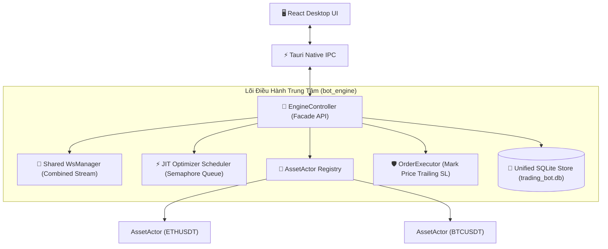

# 🏛️ Bot Engine Architecture & Technical Documentation

Tài liệu thiết kế kiến trúc kỹ thuật và luồng thực thi tổng thể cho **`bot_engine`** – Động cơ giao dịch tự động định lượng (Local-First Multi-Asset Trading Engine).

---

## 🎯 Mục Tiêu & Triết Lý Kiến Trúc

1. **Local-First & Zero Network Port:** Tích hợp trực tiếp thành Rust Library trong ứng dụng Tauri Desktop Client. Không mở cổng mạng ra ngoài, bảo mật cá nhân tuyệt đối.
2. **Multi-Asset Concurrency:** Quản lý và vận hành nhiều cặp tiền (`ETHUSDT`, `BTCUSDT`,...) song song và độc lập.
3. **Event-Driven & Single Source of Truth:** Lõi Rust nắm giữ 100% trạng thái thực tế. Giao diện React UI là chiếc gương phản chiếu thông qua mô hình Snapshot + Delta Event Stream.
4. **Just-In-Time (JIT) Optimization & Smart DNA Expiry:** Chỉ nạp dữ liệu nến tươi mới nhất tại thời điểm thuật toán Di truyền (GA) được cấp quyền chạy, kiểm tra hạn sử dụng của DNA trước khi giao dịch.
5. **Compounding Capital Floor & Safe Rebalancing:** Quản lý vốn theo cơ chế lãi kép từng Asset kèm mức vốn sàn tối thiểu (Base Floor) và luồng điều chuyển vốn thông minh.
6. **Mark Price Trailing SL Guard:** Kích hoạt Trailing SL theo Mark Price để chống quét râu nến ảo, kết hợp vòng lặp Retry 3 lần chống nghẽn mạng.

---

## 📁 Cấu Trúc Tài Liệu Chi Tiết (Documentation Tree)

```text
trading_bot/docs/engine/
├── README.md                                       # Tài liệu tổng quan này
├── TODO.md                                         # Danh sách nhiệm vụ Baby Steps
└── architecture/
    ├── engine_facade_and_lifecycle.md              # Máy trạng thái, Start/Stop/Pause/Cancel & DNA Expiry
    ├── capital_and_risk_compounding.md             # Cơ chế phân bổ vốn, lãi kép, vốn sàn & Rebalancing
    ├── trailing_sl_execution.md                    # Kiến trúc Trailing SL (Mark Price, Delay & 3x Retry)
    ├── shared_ws_and_routing.md                    # Single Shared WsManager & Bảng điều hướng O(1)
    └── system_tray_and_exit_protocol.md            # Chạy nền System Tray & Hộp thoại Thoát tổng hợp
```

---

## 🧩 Tổng Quan Các Khối Cấu Trúc Chính


