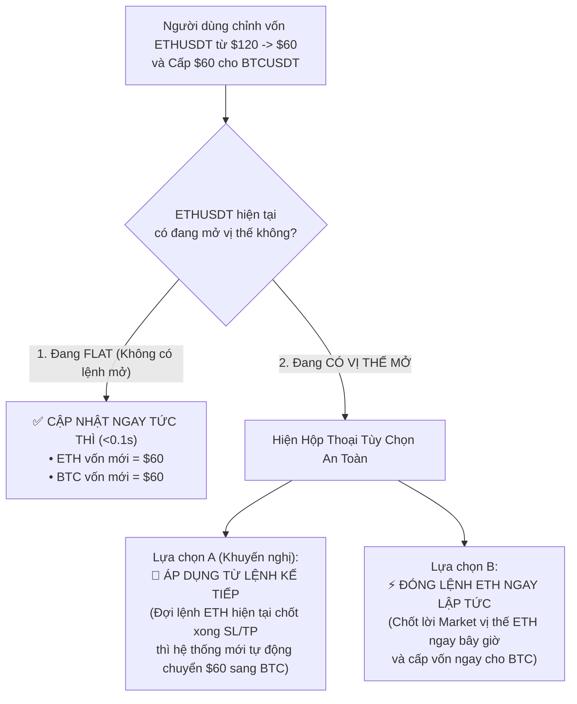

# 💰 Capital Allocation, Compounding Floor & Rebalancing Architecture

Tài liệu thiết kế cơ chế Quản lý vốn, Tăng trưởng lũy tiến (Lãi kép), Bảo vệ rủi ro vốn sàn (Base Floor) và Luồng Điều Chuyển Vốn / Tái Cân Bằng (Capital Rebalancing) giữa các Asset.

---

## 🎯 1. Nguyên Tắc Quản Lý Vốn Lũy Tiến Kèm Vốn Sàn

Để tối ưu hóa lợi nhuận mà vẫn kiểm soát tuyệt đối rủi ro:
1. **Phân bổ Vốn Độc Lập:** Mỗi Asset được cấp một khoản vốn ký quỹ cơ sở ban đầu (Ví dụ: $\text{INITIAL\_BASE\_CAPITAL} = \$60.0$).
2. **Lũy Tiến Lãi Kép (Compounding Profits):** Khi một Asset có lãi ròng đã chốt ($\text{Realized PnL} > 0$), số vốn phân bổ cho Asset đó sẽ tự động tăng lên tương ứng $\rightarrow$ Kích thước các lệnh tiếp theo sẽ tự động tăng theo tỷ lệ % vốn.
3. **Bảo Vệ Vốn Sàn (Base Floor Protection):** Nếu Asset bị thua lỗ, số vốn phân bổ tính toán sẽ **không bao giờ tụt xuống dưới mức vốn cơ sở ban đầu**:

$$\text{Current Allocated Capital} = \max\left(\text{INITIAL\_BASE\_CAPITAL},\ \text{INITIAL\_BASE\_CAPITAL} + \sum \text{Realized PnL}\right)$$

---

## 📊 2. Công Thức Tính Toán Kích Thước Vị Thế (Order Sizing)

Khi chiến thuật `HeliosStrategyV3` phát tín hiệu mở lệnh (`Buy` hoặc `Sell`):

1. **Xác định Vốn Ký Quỹ Cho Phép:**
   $$\text{Margin Allowed} = \text{Current Allocated Capital} \times \text{Risk Fraction (e.g. 100\%)}$$

2. **Tính Toán Khối Lượng Danh Nghĩa (Notional Value Với Đòn Bẩy):**
   $$\text{Notional Value} = \text{Margin Allowed} \times \text{Leverage (20x)}$$

3. **Tính Số Lượng Hợp Đồng & Làm Tròn Bước Nhảy (Step Size):**
   $$\text{Raw Qty} = \frac{\text{Notional Value}}{\text{Current Price}}$$
   $$\text{Order Qty} = \text{round\_step\_size}(\text{Raw Qty},\ \text{market\_filter.step\_size})$$

4. **Kiểm Tra Điều Kiện Sàn Binance:**
   - $\text{Order Qty} \ge \text{market\_filter.min\_qty}$
   - $\text{Order Qty} \times \text{Current Price} \ge \text{market\_filter.min\_notional}$ (Tối thiểu $5.0 USDT trên Binance Futures).

---

## 🔄 3. Cơ Chế Điều Chuyển Vốn & Tái Phân Bổ Lợi Nhuận (Capital Rebalancing Flow)

### 📌 Tình huống thực tế:
*Ví tổng có \$60. Cấp \$60 cho `ETHUSDT`. Khi `ETHUSDT` lãi thêm \$60 (Tổng vốn ETH thành \$120), người dùng muốn rút bớt \$60 lãi này để cấp phát cho `BTCUSDT`.*

### 🛡️ Nguyên tắc an toàn:
1. **Chỉ điều chuyển Lãi Thực (Realized PnL):** Không điều chuyển lãi thả nổi khi lệnh đang mở vì có thể bị đảo chiều.
2. **Xử lý vị thế đang mở (In-Position Guard):** Nếu rút vốn trong khi ETH đang gồng vị thế \$120, đòn bẩy thực tế sẽ bị nhân đôi. Do đó, hệ thống phân nhánh an toàn:

---

## 🛡️ 4. Lợi Ích Của Cơ Chế Này

- **Cách ly rủi ro 100%:** Sự biến động hoặc thua lỗ của `ETHUSDT` không bao giờ ảnh hưởng đến số vốn được cấp của `BTCUSDT`.
- **Tận dụng sức mạnh lãi kép:** Cặp tiền nào chiến thắng liên tục sẽ tự động nhận thêm quyền mở volume lớn hơn để bứt phá lợi nhuận.
- **Tái cân bằng linh hoạt:** Cho phép chuyển dịch lợi nhuận sang các cặp tiền tiềm năng khác mà không làm gián đoạn hay gia tăng rủi ro cho các lệnh đang gồng lãi.
