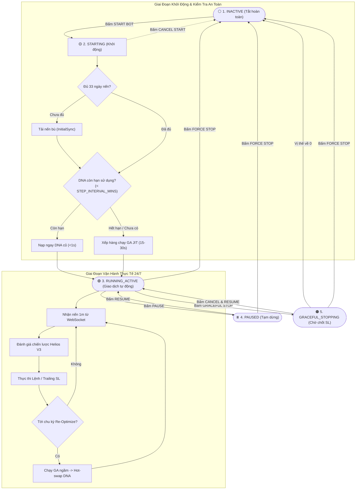

# 👑 Engine Facade, Asset Lifecycle & DNA Expiry Architecture

Tài liệu chi tiết về Tầng điều phối trung tâm (`EngineController`), Máy trạng thái đối xứng (Symmetric FSM), Toàn bộ luồng vòng đời của 1 Asset và Cơ chế kiểm tra hạn sử dụng DNA khi khởi động bot.

---

## 🔄 1. Toàn Bộ Luồng Vòng Đời Của 1 Asset (Asset Lifecycle Flowchart)

Mỗi Cặp tiền (Asset) trong hệ thống được quản lý bởi một Máy trạng thái nghiêm ngặt, đảm bảo mọi hành động Bật đều có Tắt, và mọi tiến trình đang chạy đều có thể Hủy (Cancel):

---

## 🧬 2. Cơ Chế Kiểm Tra Hạn Sử Dụng Của DNA (DNA Freshness Guard)

Khi người dùng bấm **[START BOT]** cho một cặp tiền:
1. **Kiểm tra DNA trong Database:**
   Truy vấn bảng `dna_records` trong SQLite cho `(symbol, strategy_id)`.
2. **Kiểm tra Tính Tươi Mới (Freshness Window):**
   - Đọc thời gian tạo DNA `created_at` (milliseconds).
   - So sánh với chu kỳ `STEP_INTERVAL_MINS` (ví dụ 15 phút):
   $$\Delta t = \text{now\_ms} - \text{created\_at\_ms}$$
3. **Phân nhánh xử lý:**
   - **Trường hợp A ($\Delta t < \text{STEP\_INTERVAL\_MINS}$):** 
     DNA vẫn còn **hạn sử dụng**. Nạp ngay DNA này vào `AssetActor` $\rightarrow$ Chuyển trạng thái sang `RUNNING_ACTIVE` và **bắt đầu trade ngay trong <1 giây**! Lên lịch chạy GA lần tiếp theo sau $\text{STEP\_INTERVAL\_MINS} - \Delta t$.
   - **Trường hợp B (Chưa có DNA hoặc $\Delta t \ge \text{STEP\_INTERVAL\_MINS}$):**
     DNA đã **hết hạn sử dụng**. Chuyển trạng thái sang `STARTING (GA_OPTIMIZING)` $\rightarrow$ Kích hoạt GA Optimizer Just-In-Time trên 30 ngày nến gần nhất (15-30s). Sau khi có DNA mới nhất $\rightarrow$ Chuyển sang `RUNNING_ACTIVE`.

---

## 🎛️ 3. Danh Sách Các Lệnh Điều Khiển (Commands Specification)

| Tên Hàm | Đầu Vào | Hành Vi Hệ Thống |
| :--- | :--- | :--- |
| `start_asset(symbol)` | `symbol: String` | Kiểm tra nến lịch sử, kiểm tra hạn DNA, khởi tạo `AssetActor`, subscribe stream. |
| `cancel_start(symbol)` | `symbol: String` | Hủy tiến trình Sync/GA đang chờ trong hàng đợi, giải phóng trạng thái về `INACTIVE`. |
| `pause_trading(symbol)` | `symbol: String` | Khóa không cho mở vị thế mới, **giữ nguyên vị thế & Trailing SL trên sàn Binance**. |
| `resume_trading(symbol)` | `symbol: String` | Mở lại quyền quét tín hiệu nến và cho phép mở vị thế mới. |
| `graceful_stop(symbol)` | `symbol: String` | Không mở lệnh mới, chờ Trailing SL chốt lệnh tự nhiên rồi mới ngắt actor. |
| `cancel_graceful_stop(symbol)` | `symbol: String` | Đổi ý không dừng nữa, tiếp tục cho phép bot giao dịch bình thường. |
| `force_stop_immediate(symbol)` | `symbol: String` | Hủy toàn bộ lệnh Algo trên Binance, đóng Market vị thế ngay tức khắc. |
| `remove_asset(symbol)` | `symbol: String` | Ngắt WebSocket stream, xóa khỏi Watchlist và giải phóng 100% RAM. |

---

## 🗑️ 4. Cơ Chế Xóa Cặp Tiền Khỏi Watchlist (`remove_asset`)

Khi một cặp tiền đang ở trạng thái `INACTIVE` và người dùng bấm nút **`[🗑️ REMOVE]`**:
1. **Trên Giao Diện (UI):** Dòng của cặp tiền đó biến mất khỏi Active Watchlist Table.
2. **Khả Năng Thêm Lại:** Nút **`[➕ THÊM CẶP TIỀN]`** trên thanh công cụ cho phép mở bảng tìm kiếm để thêm lại bất kỳ lúc nào.
3. **Trong Backend:** Gửi lệnh `UNSUBSCRIBE` lên Binance WebSocket, gỡ khỏi `routing_table` và giải phóng RAM. Dữ liệu nến lịch sử và nhật ký trade cũ trong SQLite được giữ nguyên vẹn để phục vụ báo cáo thống kê.

---

## 🛡️ 5. Tiếp Quản Vị Thế Có Sẵn (Adopt & Protect) & Cấu Hình ISOLATED Margin

Khi `start_asset(symbol)` được kích hoạt:
1. **Tự Động Thiết Lập Ký Quỹ Cô Lập (ISOLATED Margin):**
   - Gọi REST API `POST /fapi/v1/marginType` chuyển sang `ISOLATED` và `POST /fapi/v1/leverage` đặt đòn bẩy `20x`.
   - Mục đích: Cách ly rủi ro tuyệt đối; nếu có sự cố rủi ro thanh lý, chỉ mất tối đa số vốn cấp cho cặp tiền đó, ví tổng an toàn $100\%$.
2. **Tiếp Quản Vị Thế Có Sẵn (Adopt & Protect):**
   - `AccountManager` gọi API Binance kiểm tra xem cặp tiền đó có đang mở vị thế sẵn hay không (từ phiên chạy trước hoặc do người dùng mở tay).
   - Nếu có vị thế mở $\rightarrow$ Tự động đồng bộ `Entry Price`, `Side` và `Size` vào `AssetActor` và **ngay lập tức đặt lệnh Trailing SL bảo vệ vị thế đó**.

---

## 🚨 6. Nguyên Tắc Cô Lập Lỗi Theo Từng Asset (Fault Isolation)

Nếu một cặp tiền gặp sự cố nghiêm trọng từ sàn Binance (Ví dụ: `code: -2019 Margin is insufficient` do thiếu tiền ký quỹ):
- **Chỉ cô lập lỗi tại đúng cặp tiền đó:** Cặp tiền gặp sự cố tự động chuyển sang trạng thái `ERROR` hoặc `PAUSED`, phát cảnh báo Toast màu đỏ lên UI.
- **Không làm sập hệ thống:** Tất cả các cặp tiền khác (`BTCUSDT`, `SOLUSDT`...) **vẫn tiếp tục vận hành và giao dịch bình thường $100\%$**, không bị gián đoạn.
