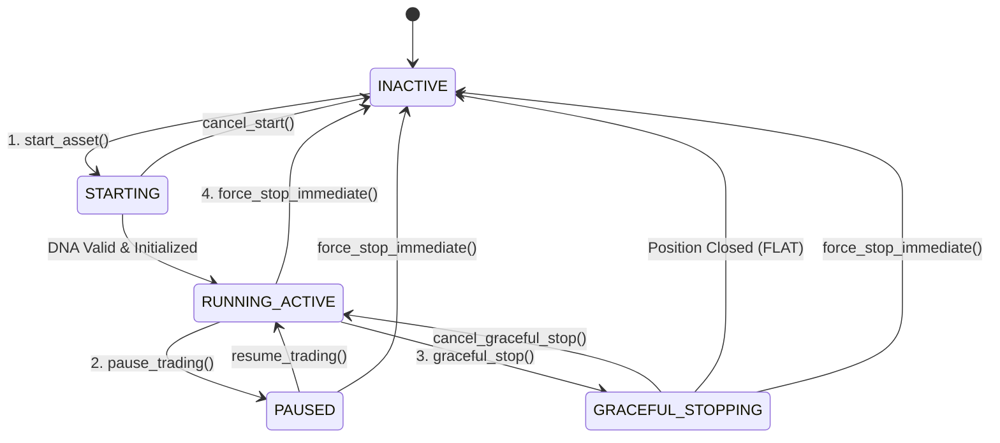

# 👑 Engine Facade, Asset Lifecycle & DNA Expiry Architecture

Tài liệu chi tiết về Tầng điều phối trung tâm (`EngineController`), Máy trạng thái đối xứng (Symmetric FSM) và Cơ chế kiểm tra hạn sử dụng DNA khi khởi động bot.

---

## 🔄 1. Máy Trạng Thái Đối Xứng (Symmetric Finite State Machine)

Mỗi Cặp tiền (Asset) trong hệ thống được quản lý bởi một Máy trạng thái nghiêm ngặt, đảm bảo mọi hành động Bật đều có Tắt, và mọi tiến trình đang chạy đều có thể Hủy (Cancel):

---

## 🧬 2. Cơ Chế Kiểm Tra Hạn Sử Dụng Của DNA (DNA Expiry Check)

Khi người dùng bấm **[START BOT]** cho một cặp tiền:
1. **Kiểm tra DNA trong Database:**
   Truy vấn bảng `dna_records` trong SQLite cho `(symbol, strategy_id)`.
2. **Kiểm tra Tính Tươi Mới (Freshness Window):**
   - Đọc thời gian tạo DNA `created_at` (milliseconds).
   - So sánh với chu kỳ `STEP_INTERVAL_MINS` (ví dụ 15 phút):
   $$\Delta t = \text{now\_ms} - \text{created\_at\_ms}$$
3. **Phân nhánh xử lý:**
   - **Trường hợp A ($\Delta t < \text{STEP\_INTERVAL\_MINS}$):** 
     DNA vẫn còn **hạn sử dụng**. Nạp ngay DNA này vào `AssetActor` $\rightarrow$ Chuyển trạng thái sang `RUNNING_ACTIVE` và **bắt đầu trade ngay trong <1 giây**! Lên lịch chạy GA lần tiếp theo sau $\text{STEP\_INTERVAL\_MINS} - \Delta t$.
   - **Trường hợp B (Chưa có DNA hoặc $\Delta t \ge \text{STEP\_INTERVAL\_MINS}$):**
     DNA đã **hết hạn sử dụng**. Chuyển trạng thái sang `STARTING (GA_OPTIMIZING)` $\rightarrow$ Kích hoạt GA Optimizer Just-In-Time trên 30 ngày nến gần nhất (15-30s). Sau khi có DNA mới nhất $\rightarrow$ Chuyển sang `RUNNING_ACTIVE`.

---

## 🎛️ 3. Danh Sách Các Lệnh Điều Khiển (Commands Specification)

| Tên Hàm | Đầu Vào | Hành Vi Hệ Thống |
| :--- | :--- | :--- |
| `start_asset(symbol)` | `symbol: String` | Kiểm tra nến lịch sử, kiểm tra hạn DNA, khởi tạo `AssetActor`, subscribe stream. |
| `cancel_start(symbol)` | `symbol: String` | Hủy tiến trình Sync/GA đang chờ trong hàng đợi, giải phóng trạng thái về `INACTIVE`. |
| `pause_trading(symbol)` | `symbol: String` | Khóa không cho mở vị thế mới, **giữ nguyên vị thế & Trailing SL trên sàn Binance**. |
| `resume_trading(symbol)` | `symbol: String` | Mở lại quyền quét tín hiệu nến và cho phép mở vị thế mới. |
| `graceful_stop(symbol)` | `symbol: String` | Không mở lệnh mới, chờ Trailing SL chốt lệnh tự nhiên rồi mới ngắt actor. |
| `cancel_graceful_stop(symbol)` | `symbol: String` | Đổi ý không dừng nữa, tiếp tục cho phép bot giao dịch bình thường. |
| `force_stop_immediate(symbol)` | `symbol: String` | Hủy toàn bộ lệnh Algo trên Binance, đóng Market vị thế ngay tức khắc. |
| `remove_asset(symbol)` | `symbol: String` | Ngắt WebSocket stream, xóa khỏi Watchlist và giải phóng 100% RAM. |
