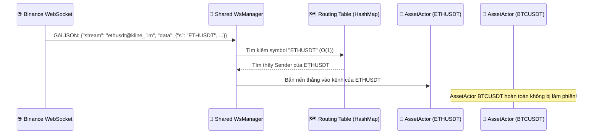

# 🌊 Single Shared WsManager & O(1) Routing Table Architecture

Tài liệu thiết kế kết nối WebSocket duy nhất (`Single Shared WsManager`) gom chung nhiều luồng dữ liệu (Combined Streams) và cơ chế điều hướng gói tin tốc độ cao $O(1)$.

---

## 🎯 1. Tại Sao Phải Dùng Single Shared WsManager?

Thay vì mở nhiều kết nối Socket riêng lẻ cho từng cặp tiền (gây lãng phí tài nguyên và dễ bị Binance khóa IP), hệ thống sử dụng **1 kết nối WebSocket duy nhất** cho toàn bộ các cặp tiền đang theo dõi:

```text
wss://fstream.binancefuture.com/stream?streams=ethusdt@kline_1m/btcusdt@kline_1m/solusdt@kline_1m
```

---

## 🔀 2. Cơ Chế Điều Hướng Gói Tin $O(1)$ (Routing Table HashMap)

Trong `WsManager`, hệ thống duy trì một Bảng Điều Hướng:
```rust
routing_table: Arc<RwLock<HashMap<String, tokio::sync::mpsc::Sender<Candle>>>>
```



---

## 📡 3. Đăng Ký / Hủy Đăng Ký Động (Dynamic Subscribe / Unsubscribe)

Khi người dùng BẬT hoặc TẮT một cặp tiền trong lúc bot đang chạy:

1. **Bật thêm Cặp tiền mới (`subscribe_symbol`):**
   - Thêm `Sender` của `AssetActor` mới vào `routing_table`.
   - Gửi payload JSON đăng ký lên Binance qua WebSocket hiện hữu:
     ```json
     { "method": "SUBSCRIBE", "params": ["btcusdt@kline_1m"], "id": 1001 }
     ```
2. **Hủy Cặp tiền (`unsubscribe_symbol`):**
   - Xóa symbol khỏi `routing_table` (mọi gói tin đến sau sẽ bị drop ngay lập tức).
   - Gửi payload JSON hủy đăng ký lên Binance:
     ```json
     { "method": "UNSUBSCRIBE", "params": ["btcusdt@kline_1m"], "id": 1002 }
     ```
