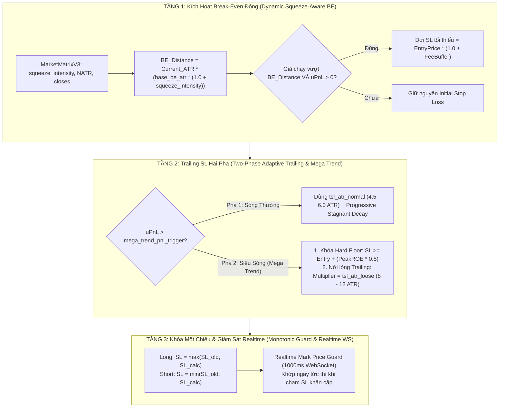

# Kiến Trúc Quản Trị Rủi Ro Động Thích Ứng & Cơ Chế Siêu Sóng Mega Trend (Helios V3.3)

Tài liệu này mô tả chi tiết kiến trúc kỹ thuật của hệ thống Quản trị Rủi ro Động (Continuous Dynamic State Feedback Risk Management), cơ chế Bảo toàn Lợi nhuận Thả Diều Siêu Sóng (Mega Trend Kite Flying with Hard Floor), và Hệ thống Giám sát Realtime Mark Price độc lập trong `trading_bot`.

---

## 🏛️ 1. Triết Lý & Mục Tiêu Thiết Kế

1. **Tính Thích Ứng Toàn Năng (100% Universal & Non-Hardcoded):**
   - Loại bỏ hoàn toàn các con số gán cứng (`hardcoded constants` như 5% ROE hay 1.5 ATR).
   - Mọi ngưỡng kích hoạt Break-Even và Trailing Stop được xác định dựa trên:
     - Dữ liệu cảm biến thời gian thực từ `MarketMatrixV3` (Squeeze Intensity, NATR, Chaos, Directional Velocity).
     - Bộ gen tham số DNA tối ưu hóa di truyền (`Prospector GA`) thích ứng riêng cho từng tài sản (BTC, ETH, Altcoins).
2. **Triệt Tiêu Bẫy Đóng Lệnh Non Trong Vùng Nén (`ABSORPTION` / `RANGE_OSC`):**
   - Khi thị trường đang nén thanh khoản mạnh, ngưỡng Break-Even tự động mở rộng theo hệ số `squeeze_intensity` để cho giá không gian rung lắc và retest vùng tường lệnh trước khi bùng nổ.
3. **Bắt Trọn Siêu Sóng Lớn (Mega Trend +200% đến +300% ROE) - "Không Bỏ Sót Tiềm Năng":**
   - Khi lợi nhuận vượt qua ngưỡng `mega_trend_pnl_trigger`, hệ thống **không siết nghẹt SL**, mà:
     - Ghim một **Mức Sàn Bảo Hiểm Cứng (Hard Profit Floor)** để bảo toàn chắc chắn phần lợi nhuận lớn đã đạt được.
     - Nới lỏng khoảng cách Trailing SL sang `tsl_atr_loose` ($8.0 \dots 15.0\text{ ATR}$) để cho phép các nhịp hồi $20\$ - 30\$$ trên khung 15m/1h diễn ra tự nhiên mà không bị quét văng khỏi tàu.
4. **Phòng Thủ Chớp Nhoáng (Realtime Mark Price Guard):**
   - Luồng giám sát giá độc lập chạy trên WebSocket mili-giây, thoát lệnh khẩn cấp khi có biến cố sập giá trong 1 nến mà không đợi nến 1m đóng cửa.

---

## 🧩 2. Kiến Trúc 3 Tầng Thích Ứng (3-Tier Dynamic Risk Architecture)

---

## 📐 3. Quy Tắc Toán Học & Công Thức Chi Tiết

### A. Ngưỡng Kích Hoạt Break-Even Động (Dynamic Break-Even Trigger)
$$\text{BE\_Activation\_Distance}_K = \text{ATR}_K \times \left( \text{base\_sl\_atr} \times (1.0 + \text{matrix.squeeze\_multiplier}[K]) \right)$$
- Khi `squeeze_multiplier` cao (thị trường gom hàng `ABSORPTION`): Khoảng cách kích hoạt Break-Even tự động giãn rộng ra $\approx 3.0 - 4.5 \times \text{ATR}$, giúp vị thế không bị đóng non khi nến quay về kiểm tra tường lệnh.
- Khi `squeeze_multiplier` thấp (thị trường đã thoát nén bứt phá): Khoảng cách kích hoạt Break-Even thu gọn về $\approx 1.5 - 2.0 \times \text{ATR}$, bảo vệ vốn tức thì.

### B. Cơ Chế Thả Diều Siêu Sóng Mega Trend (Kite Flying with Hard Floor)
Khi $\text{current\_pnl} \ge \text{risk\_cfg.mega\_trend\_pnl\_trigger}$:
1. **Mức Sàn Lợi Nhuận Bảo Hiểm (Hard Profit Floor):**
   $$\text{Locked\_Profit\_ROE} = \max\left( 0.30,\ \text{Peak\_ROE} \times 0.50 \right)$$
   $$\text{SL}_{\text{Floor}} = \text{EntryPrice} \pm \left( \text{EntryPrice} \times \frac{\text{Locked\_Profit\_ROE}}{\text{Leverage}} \right)$$
2. **Khoảng Cách Trailing SL Thả Diều:**
   $$\text{Effective\_TSL} = \text{PeakVal} \mp \left( \text{ATR}_K \times \text{risk\_cfg.tsl\_atr\_loose} \right)$$
3. **Mức Stop Loss Cuối Cùng Được Chọn:**
   - **Lệnh Long:** $\text{SL}_{\text{target}} = \max(\text{Effective\_TSL},\ \text{SL}_{\text{Floor}})$
   - **Lệnh Short:** $\text{SL}_{\text{target}} = \min(\text{Effective\_TSL},\ \text{SL}_{\text{Floor}})$

---

## ⚡ 4. Cơ Chế Chống Lặp Lệnh (Micro-Churn Re-entry Cooldown)

Sau khi một vị thế đóng tại mức Hòa Vốn (`Break-Even / Zero PnL`):
1. **Khóa Tín Hiệu Playbook:** Gán `cooldown_until_bar = current_bar + N` (ví dụ $15$ nến 1m) cho chính Playbook vừa đóng.
2. **Điều Kiện Mở Khóa Sớm (Volatility Breakout Override):** Nếu giá bứt phá vượt qua $\text{High} / \text{Low}$ của cây nến vừa đóng một khoảng $> 1.0 \times \text{ATR}$, khóa Cooldown tự động được gỡ bỏ ngay lập tức để không bỏ lỡ sóng mới.

---

## 🛡️ 5. Realtime Mark Price Guard Độc Lập Trong `bot_engine`

- **Kiến trúc Actor:** `AssetActor` nhận gói tin `markPriceUpdate` từ luồng WebSocket riêng biệt.
- **Xử lý Khẩn Cấp:** Khi `mark_price` chạm ngưỡng `current_sl_price`:
  - Lập tức gửi lệnh `OrderType::Market` (`closePosition: true`) lên sàn Binance mà không cần đợi nến 1m hoàn thành.
  - Triệt tiêu $100\%$ nguy cơ trượt giá sâu khi thị trường sụp đổ trong 1 cây nến duy nhất (Flash Crash).
