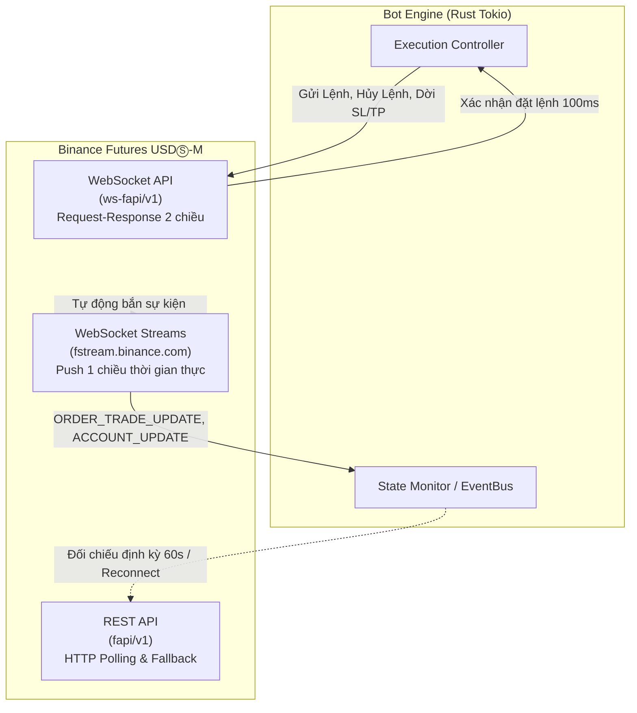
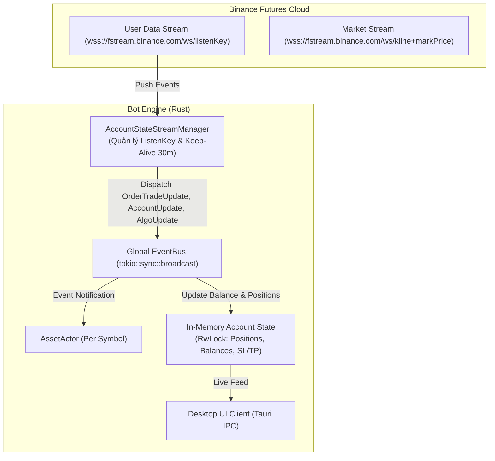

# Kiến Trúc Hệ Thống Giám Sát Trạng Thái Tài Khoản & Thị Trường Qua WebSocket (Binance Futures)

> **Tài liệu thảo luận kỹ thuật & Thiết kế kiến trúc**  
> **Chủ đề:** Giám sát thời gian thực Order, Trade, Position, Balance và Market Data  
> **Mục tiêu:** Chuyển đổi từ cơ chế Polling REST sang Event-Driven WebSocket Streams nhằm đạt độ trễ tối thiểu (<30ms) và tiết kiệm 100% API Weight.

---

## 🏛️ 1. Phân Định Bản Chất: WebSocket API vs. WebSocket Streams

Rất nhiều kỹ sư nhầm lẫn giữa hai khái niệm này trên Binance Futures:

| Tiêu Chí | WebSocket API (`ws-fapi/v1`) | WebSocket Streams (User Data & Market Streams) |
| :--- | :--- | :--- |
| **Bản chất** | **Request - Response (2 chiều)** | **Publish - Subscribe (1 chiều, Event-Driven)** |
| **Vai trò chính** | **THỰC THI (Action):** Gửi lệnh, hủy lệnh, sửa lệnh, truy vấn tức thời. | **QUAN SÁT (Observation):** Sàn tự động đẩy mọi biến động về tài khoản & thị trường ngay khi xảy ra. |
| **Độ trễ** | ~100ms - 250ms (chờ RTT phản hồi request). | **10ms - 30ms** (sàn phát hiện khớp là bắn socket ngay lập tức). |
| **Tốn API Weight?** | Có (tính theo từng request gửi đi). | **HOÀN TOÀN KHÔNG TỐN WEIGHT** (sau khi mở kết nối). |

---

## 📡 2. Các Luồng Giám Sát Cần Thiết Của Tài Khoản Người Dùng

Để giám sát "mọi thứ" (Order, Trade, Vị thế, Số dư, Rủi ro), chúng ta sử dụng **User Data Stream** của Binance Futures.

### 📋 Bảng Các Sự Kiện Thời Gian Thực Từ User Data Stream:

| Sự Kiện (`e`) | Mô Tả Nghiệp Vụ | Dữ Liệu Bắn Về | Ứng Dụng Trong Bot Engine |
| :--- | :--- | :--- | :--- |
| **`ORDER_TRADE_UPDATE`** | Bắn khi lệnh thường/market/limit thay đổi trạng thái hoặc khớp lệnh. | - `orderId`, `clientOrderId` - `orderStatus`: `NEW`, `PARTIALLY_FILLED`, `FILLED`, `CANCELED` - `executedQty`, `avgPrice` - `commission`, `realizedProfit` | **Cập nhật trạng thái lệnh tức thì.** Ghi nhận lợi nhuận thực tế (Realized PnL), phí sàn và cập nhật vốn lũy tiến (Compounding) ngay khi khớp. |
| **`ACCOUNT_UPDATE`** | Bắn khi có thay đổi về số dư hoặc khối lượng vị thế (do lệnh khớp hoặc nạp rút). | - `walletBalance`, `crossWalletBalance` - Mảng `positions`: `symbol`, `positionAmt`, `entryPrice`, `unrealizedPnL` | **Nguồn chân lý vị thế (Single Source of Truth).** Cập nhật RAM State của bot về 0.000 ngay khi cắn SL/TP mà không cần gọi API query! |
| **`ALGO_UPDATE`** | Bắn khi lệnh điều kiện Algo (Stop Loss, Take Profit) thay đổi. | - `algoId`, `algoStatus` (`NEW`, `TRIGGERED`, `FINISHED`, `EXPIRED`, `CANCELED`) - `triggerPrice`, `actualOrderId` | **Giám sát chốt chặn rủi ro.** Biết ngay thời điểm SL/TP bị kích hoạt hoặc khi lệnh TP bị `EXPIRED` tự động. |
| **`MARGIN_CALL`** | Bắn cảnh báo nguy cấp khi Margin chạm ngưỡng nguy hiểm. | - Danh sách vị thế đang bị đe dọa thanh lý. | **Chế độ phòng vệ sinh tồn.** Kích hoạt ngắt mạch khẩn cấp (Circuit Breaker) hoặc hạ tỷ trọng vị thế. |
| **`ACCOUNT_CONFIG_UPDATE`**| Bắn khi đòn bẩy hoặc chế độ ký quỹ thay đổi. | - `leverage`, `marginType` (`ISOLATED` / `CROSSED`). | Đảm bảo bot luôn chạy đúng đòn bẩy và Isolated margin. |
| **`listenKeyExpired`** | Bắn khi `listenKey` hết hạn. | - Thông báo socket sắp bị ngắt. | Kích hoạt cơ chế tự động xin key mới và reconnect. |

---

## 🏗️ 3. Đề Xuất Kiến Trúc Hệ Thống: The Tri-Stream Event-Driven Monitor

Chúng tôi đề xuất xây dựng module **`AccountStateStreamManager`** kết hợp với kiến trúc Actor hiện tại:

### Ưu điểm vượt trội:
1. **Độ trễ bằng 0:** Khi lệnh SL cắn trên sàn, sự kiện `ACCOUNT_UPDATE` và `ALGO_UPDATE` bắn về bot trong **15ms**. Bot lập tức biết vị thế đã đóng mà không phải query liên tục.
2. **Tiết kiệm 100% API Weight:** Loại bỏ hoàn toàn vòng lặp polling `position_information_v2` hay `query_order`. API Weight 2400 được bảo toàn trọn vẹn cho các tác vụ khẩn cấp.
3. **Đồng bộ hóa 1:1 với Desktop UI:** Giao diện Tauri Desktop sẽ nhảy số PnL, trạng thái lệnh và vị thế ngay lập tức theo thời gian thực (Realtime Reactivity).
