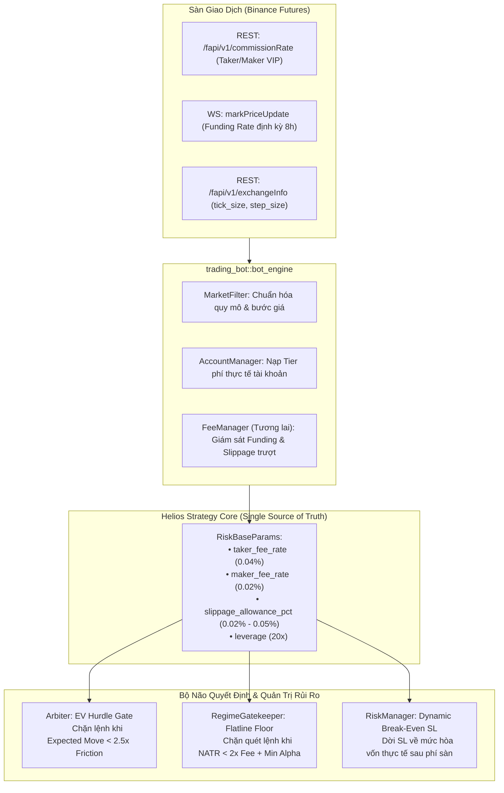

# 🏛️ Centralized Fee, Slippage & Dynamic Friction Management Architecture
## Kiến Trúc Quản Lý Phí, Trượt Giá & Rào Cản Kỳ Vọng Động Toàn Hệ Thống

> **Vị trí tài liệu:** `trading_bot/docs/engine/specs/centralized_fee_and_friction_management_architecture.md`  
> **Phạm vi kiến trúc:** `trading_bot::bot_engine` (Data Engine, MarketFilter, Execution) $\longleftrightarrow$ `helios::core_v3` (Arbiter, Gatekeeper, RiskManager)  
> **Mục tiêu:** Xây dựng cơ chế quản lý phí tập trung (Single Source of Truth), phân định triệt để giữa "Kế toán ghi sổ" và "Trí tuệ chiến lược", đồng thời định hình luồng nạp phí sàn động (WebSocket/REST, VIP Tiers, Slippage, Funding Rates) cho tương lai.

---

## 🎯 1. Bản Chất Vấn Đề: Phân Định Ranh Giới 2 Tầng Riêng Biệt

Một sai lầm phổ biến trong hệ thống giao dịch thuật toán là nhầm lẫn giữa **Kế toán ghi sổ (Accounting)** và **Trí tuệ chiến lược (Pre-trade Intelligence)**:

```
┌─────────────────────────────────────────────────────────────────────────────┐
│ TẦNG 1: TRÍ TUỆ CHIẾN LƯỢC (Helios Strategy / Arbiter) — TIỀN KHỚP LỆNH      │
│ • Trách nhiệm: Đánh giá kỳ vọng toán học (EV). Có nên nổ máy mở lệnh không? │
│ • Yêu cầu: Bắt buộc phải NHẬN THỨC ĐƯỢC CHI PHÍ MA SÁT CỦA SÀN trước khi     │
│   duyệt lệnh, loại bỏ 100% các cơ hội "ăn non" mỏng hơn chi phí mở/đóng.    │
└──────────────────────────────────────┬──────────────────────────────────────┘
                                       │ (Chỉ duyệt cơ hội có EV > 2.5x Friction)
                                       ▼
┌─────────────────────────────────────────────────────────────────────────────┐
│ TẦNG 2: KẾ TOÁN GHI SỔ (Broker / PaperTrader / Binance) — HẬU KHỚP LỆNH      │
│ • Trách nhiệm: Khớp lệnh thực tế, ghi nợ phí sàn vào số dư tài khoản.       │
│ • Yêu cầu: Trừ chính xác phí Taker/Maker, trượt giá và Funding Fee.         │
└─────────────────────────────────────────────────────────────────────────────┘
```

- **Hệ quả nếu thiếu Tầng 1:** Kế toán Tầng 2 dù hạch toán chính xác $100\%$ từng xu phí sàn, nhưng nếu Tầng 1 cứ duyệt những lệnh chỉ lãi $0.10\%$ giá trong khi phí sàn ngốn $0.13\%$ giá $\implies$ **Tài khoản liên tục bị bào mòn âm vốn (Fee Churning)**.

---

## 🏗️ 2. Mô Hình Dữ Liệu & Luồng Dữ Liệu Tập Trung (Single Source of Truth)

Toàn bộ thông số phí được quy hoạch về cấu hình trung tâm trong `HeliosConfigV3::risk_management.risk_base`, đóng vai trò là chiếc cầu nối giữa `trading_bot` và `helios`:



---

## 📊 3. Công Thức Tính Ma Sát Sàn Động & Rào Cản Kỳ Vọng (EV Hurdle)

### 3.1. Tổng Ma Sát 2 Chiều Trên Giá (Price Friction)
$$\text{Roundtrip Friction (Price)} = 2 \times \text{taker\_fee\_rate} + \text{slippage\_allowance\_pct}$$
*Ví dụ tại Binance Futures (VIP 0):*
$$\Delta P_{\text{friction}} = 2 \times 0.0004 + 0.0005 = 0.0013 \quad (\mathbf{0.13\% \text{ giá}})$$

### 3.2. Hiệu Ứng Khuếch Đại Đòn Bẩy Trên Vốn Ký Quỹ (ROE Friction)
$$\text{Friction}_{\text{ROE}} = \Delta P_{\text{friction}} \times \text{Leverage}$$
- Tại đòn bẩy $10\text{x}$: $\text{Friction}_{\text{ROE}} = 0.13\% \times 10 = \mathbf{1.30\% \text{ ROE}}$
- Tại đòn bẩy $20\text{x}$: $\text{Friction}_{\text{ROE}} = 0.13\% \times 20 = \mathbf{2.60\% \text{ ROE}}$
- Tại đòn bẩy $50\text{x}$: $\text{Friction}_{\text{ROE}} = 0.13\% \times 50 = \mathbf{6.50\% \text{ ROE}}$

### 3.3. Rào Cản Kỳ Vọng Tối Thiểu (EV Hurdle)
Một lệnh chỉ được Arbiter phê duyệt khi tiềm năng biến động tối thiểu thỏa mãn:
$$\text{Expected Move} \ge \text{Roundtrip Friction} \times \text{min\_ev\_hurdle\_ratio} \quad (K_{\text{hurdle}} = 2.50)$$
- Tại $20\text{x}$, lợi nhuận kỳ vọng tối thiểu phải đạt $\ge 2.60\% \times 2.5 = \mathbf{6.50\% \text{ ROE}}$ (tương đương biên độ sóng tối thiểu $\ge 0.325\%$ giá).

---

## ⏰ 4. Quản Lý Phí Định Kỳ Giữ Vị Thế (Funding Rate 8h)

Trong giao dịch Hợp đồng Vĩnh cửu (Perpetual Futures), các mốc thanh toán Funding Rate diễn ra vào:
$$\text{Settlement Times: } 00:00, \quad 08:00, \quad 16:00 \text{ UTC}$$

### Nguyên tắc xử lý của hệ thống:
1. **Bản chất chiến lược:** Helios V3 là hệ thống giao dịch sóng vi mô và ngắn hạn (Intraday Swing), thời gian nắm giữ trung bình từ vài phút đến vài chục nến. Vị thế thường được đóng chủ động trước khi chạm các mốc 8 tiếng.
2. **Cầu dao né bão Funding (`GATE-FUNDING-BLACKOUT`):**
   - Tại cửa sổ $t \in [\text{Mốc} - 2\text{m}, \text{Mốc} + 1\text{m}]$, thị trường thường có hiện tượng giật râu giả do các quỹ cân bằng vị thế phòng hộ (Hedging Basis Arbitrage).
   - `RegimeGatekeeper` sẽ tự động đóng băng việc mở lệnh mới trong 3 phút nhạy cảm này.

---

## 🚀 5. Chiến Lược Triển Khai 2 Giai Đoạn (Phased Roadmap)

Để bảo đảm tiến độ hoàn thành kiểm thử Walk-Forward trên tài sản chuẩn `ETHUSDT` mà không bị quá tải kiến trúc:

### 🟢 Giai đoạn 1: Chuẩn Hóa Cục Bộ Trên Tài Sản Chuẩn ETHUSDT (Hiện Tại)
- **Tập trung:** `strategies_backtests/helios/src/strategy/core_v3/arbiter.rs` và `config.rs`.
- **Hành động:** 
  - Trang bị cho Arbiter khả năng đọc trực tiếp `taker_fee_rate` ($0.04\%$), `slippage_allowance_pct` ($0.02\% - 0.05\%$), và `leverage` ($20\text{x}$) từ struct `RiskBaseParams` có sẵn trong cấu hình.
  - Áp dụng cơ chế **Dual-Track EV Hurdle Gate**:
    - Scanner có TP tĩnh (`Reversal`, `Range`): Đo khoảng cách tới TP.
    - Scanner chạy Trend không có TP (`Momentum`, `Pullback`, `Absorption`): Đo qua biên độ nến vi mô $ATR / Price$.
- **Kết quả:** Triệt tiêu hoàn toàn các lệnh scalp mỏng âm sau phí trên `walk_forward_smart_seed`.

### 🔵 Giai đoạn 2: Tự Động Hóa Biểu Phí Động Đa Sàn (Tương Lai - Khi Lên Live)
- **Tập trung:** `trading_bot/bot_engine/src/data_engine` và `execution`.
- **Hành động:**
  - Nạp biểu phí Taker/Maker thực tế của tài khoản từ Binance REST API (`/fapi/v1/commissionRate`).
  - Lắng nghe luồng Funding Rate thời gian thực từ WebSocket (`markPriceUpdate`).
  - Ghi đè tự động vào `RiskBaseParams` trước khi truyền vào Actor.
- **Tính tương thích:** **Strategy Helios và Arbiter không cần sửa đổi bất kỳ dòng code nào**, vì toàn bộ logic ở Giai đoạn 1 đã được thiết kế mở để tiêu thụ trực tiếp từ struct cấu hình trung tâm này.
