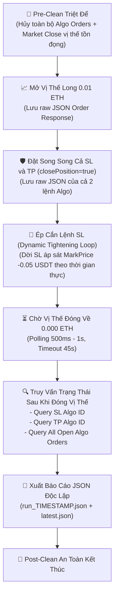

# Kế Hoạch Kiểm Định Chuyên Sâu: Vòng Đời Lệnh Kép Song Song & Trạng Thái Khi Kích Hoạt Khớp (Dual Bracket Trigger Probe)

> **Tài liệu kỹ thuật & Kịch bản kiểm định thực nghiệm trên Binance Futures Testnet**  
> **Phiên bản:** 1.0  
> **Cặp tiền thử nghiệm:** `ETHUSDT`  
> **Mục tiêu cốt lõi:** Xác minh thực tế xem khi treo song song cả Stop Loss và Take Profit (`closePosition = true`), nếu 1 lệnh bị cắn (trigger) và vị thế về 0, sàn Binance có tự động hủy lệnh còn lại không, hay lệnh còn lại vẫn treo lơ lửng trên sổ lệnh Algo.

---

## 🎯 1. Bối Cảnh & Vấn Đề Kỹ Thuật Trọng Yếu

Trong các thảo luận trước, chúng ta đã kiểm chứng được Binance Futures cho phép gửi thành công 2 lệnh Algo có cùng cờ `closePosition = true` (1 lệnh `STOP_MARKET` và 1 lệnh `TAKE_PROFIT_MARKET`). Tuy nhiên:
1. **Chưa có file JSON trích xuất nguyên bản:** Bài test trước chỉ in tóm tắt ra console, chưa xuất file JSON cấu trúc để audit từng trường dữ liệu phản hồi từ Binance.
2. **Chưa kiểm chứng hành vi sau khi cắn lệnh (Post-Trigger Behavior):** Binance Futures USDⓈ-M **không hỗ trợ cơ chế OCO (One-Cancels-the-Other) nguyên bản** cho Algo Orders như Spot. Do đó, nếu lệnh SL cắn làm vị thế về 0:
   - **Kịch bản A:** Binance tự động chuyển lệnh TP còn lại thành `CANCELED` hoặc `EXPIRED`.
   - **Kịch bản B:** Binance **vẫn giữ nguyên lệnh TP ở trạng thái `NEW`** trên danh sách Open Algo Orders. Lệnh này sẽ trở thành rủi ro cực lớn nếu bot mở vị thế tiếp theo.
3. **Cần kiểm định độc lập và không suy đoán:** Phải có dữ liệu thực tế bằng các API query trạng thái (`query_algo_order` và `current_all_algo_open_orders`) ngay sau khi vị thế đóng về 0.

---

## 🔬 2. Thiết Kế Kịch Bản Thực Nghiệm (Baby Steps)



---

## 📋 3. Chi Tiết Các Pha Thực Nghiệm

| Pha | Thao Tác | Mục Tiêu Kỹ Thuật | Dữ Liệu Cần Trích Xuất Vào JSON |
| :--- | :--- | :--- | :--- |
| **Pha 0: Pre-Clean** | Hủy sạch toàn bộ Algo Open Orders (`cancel_all_algo_open_orders`) và đóng Market mọi vị thế đang mở. | Đảm bảo môi trường sạch 100%, không bị nhiễu bởi các lần test trước. | Trạng thái vị thế và số lượng lệnh hủy trước khi bắt đầu. |
| **Pha 1: Entry** | Gửi Market Buy 0.01 ETH qua WebSocket API. | Khớp lệnh vào vị thế, ghi nhận `entry_price` và `order_id`. | Full JSON Response của lệnh Market Buy (`orderId`, `executedQty`, `avgPrice`, `status`). |
| **Pha 2: Dual Bracket** | Gửi song song qua WebSocket API:<br>1. `STOP_MARKET` (-2.0% dưới giá vào)<br>2. `TAKE_PROFIT_MARKET` (+2.0% trên giá vào)<br>Cả 2 đều gắn cờ `closePosition: true`. | Treo cả 2 chốt chặn lên sàn Binance. | Full JSON Response của cả 2 lệnh Algo (`algoId`, `algoStatus`, `triggerPrice`, `closePosition`). |
| **Pha 3: Dynamic Trigger** | Hủy SL xa. Lấy `MarkPrice` thời gian thực, đặt SL mới tại `MarkPrice - 0.05 USDT`. | Ép giá kích hoạt lệnh SL một cách tự nhiên theo trigger engine của sàn, không tự ý đóng bằng Market Order. | JSON phản hồi lệnh hủy SL cũ và lệnh đặt SL siêu sát mới. |
| **Pha 4: Wait for Fill** | Vòng lặp kiểm tra vị thế mỗi 500ms - 1s (Tối đa 45s). Nếu sau 5s chưa cắn do giá Testnet đứng im, tự động cập nhật SL bám sát lại giá mới. | Chờ cho tới khi vị thế thực sự đóng về 0.000 ETH. | Log thời gian khớp, số chu kỳ poll, xác nhận `position_amt == 0.0`. |
| **Pha 5: Post-Fill Audit** | Ngay khi vị thế = 0, thực hiện các truy vấn chuyên sâu:<br>1. `query_algo_order(sl_algo_id)`: lấy trạng thái Algo SL và `actualOrderId`.<br>2. `query_order(symbol, actualOrderId)`: **trích xuất full raw JSON của lệnh Market thực tế đã khớp để đóng vị thế** (`avgPrice`, `executedQty`, `realizedPnl`).<br>3. `query_algo_order(tp_algo_id)`: kiểm tra lệnh TP còn lại.<br>4. `current_all_algo_open_orders(symbol)`: kiểm tra danh sách Algo còn mở.<br>5. `position_information_v2`: xác nhận vị thế về 0.000. | **CÂU HỎI SỐNG CÒN & MINH CHỨNG THỰC TẾ:**<br>- Lệnh SL đã cắn mang trạng thái gì?<br>- **Lệnh Market thực tế đóng vị thế có payload JSON ra sao?**<br>- **Lệnh TP còn lại có tự động CANCELED không hay vẫn NEW?**<br>- Sàn còn giữ lệnh TP trong danh sách Open Orders không? | Full JSON của tất cả các lệnh truy vấn trên. |
| **Pha 6: Storage & Export** | Ghi toàn bộ dữ liệu thu thập được ra file JSON riêng biệt theo timestamp và file `latest.json`. | Đảm bảo tính độc lập giữa các lần chạy, dễ dàng đối chiếu và phân tích. | File `examples/logs/dual_bracket_runs/run_<TIMESTAMP>.json`. |
| **Pha 7: Post-Clean** | Dọn dẹp sạch sẽ tài khoản Testnet sau bài test. | An toàn tuyệt đối cho tài khoản. | Trạng thái dọn dẹp cuối cùng. |

---

## 🗂️ 4. Cấu Trúc File Dữ Liệu JSON Đầu Ra

Mỗi lần chạy test sẽ tạo ra một file JSON độc lập:
`trading_bot/bot_engine/examples/logs/dual_bracket_runs/run_YYYYMMDD_HHMMSS.json`

Cấu trúc JSON dự kiến:
```json
{
  "test_metadata": {
    "run_id": "run_20260918_155500",
    "timestamp_iso": "2026-09-18T08:55:00Z",
    "symbol": "ETHUSDT",
    "quantity": 0.01
  },
  "phases": {
    "pre_clean": {
      "initial_position_amt": 0.0,
      "cleared_algo_orders": true
    },
    "entry_order": {
      "order_id": 16795218038,
      "status": "FILLED",
      "raw_response": { ... }
    },
    "dual_bracket_placement": {
      "stop_loss": {
        "algo_id": 1000000206042666,
        "trigger_price": "2433.46",
        "close_position": true,
        "raw_response": { ... }
      },
      "take_profit": {
        "algo_id": 1000000206042670,
        "trigger_price": "2532.72",
        "close_position": true,
        "raw_response": { ... }
      }
    },
    "trigger_tightening": {
      "tightened_sl_algo_id": 1000000206042700,
      "tightened_trigger_price": "2482.95",
      "raw_response": { ... }
    },
    "fill_wait_result": {
      "position_closed": true,
      "elapsed_seconds": 3.2,
      "final_position_amt": 0.0
    },
    "post_fill_audit": {
      "sl_algo_order_status": {
        "algo_id": 1000000206042700,
        "algo_status": "TRIGGERED",
        "actual_order_id": "16795218999",
        "raw_response": { ... }
      },
      "actual_market_order_execution": {
        "order_id": 16795218999,
        "status": "FILLED",
        "avg_price": "2482.80",
        "executed_qty": "0.010",
        "raw_response": { ... }
      },
      "tp_order_status": {
        "algo_id": 1000000206042670,
        "algo_status": "NEW_OR_CANCELED",
        "raw_response": { ... }
      },
      "open_algo_orders_list": [ ... ],
      "position_status_after_fill": { ... }
    }
  },
  "scientific_conclusions": {
    "tp_auto_canceled_by_binance": false,
    "tp_status_after_sl_filled": "NEW",
    "danger_level": "CRITICAL_IF_NEW",
    "recommended_action": "OrderExecutor must explicitly cancel remaining TP upon position close"
  }
}
```

---

## ⚠️ 5. Phân Tích Edge Cases & Phòng Ngừa Rủi Ro

1. **Edge Case 1: Sàn Testnet đứng im, giá không dao động:**
   - **Xử lý:** Bộ điều khiển `Dynamic Tightening Loop` sẽ đo giá `MarkPrice` sau mỗi 5 giây. Nếu sau 5 giây vị thế chưa đóng, nó sẽ hủy SL cũ và đặt lại SL mới cách `MarkPrice` hiện tại chỉ 1 tick (`0.01 - 0.05 USDT`), đảm bảo sớm muộn giá cũng cắn SL tự nhiên.
   - Timeout an toàn: 45 giây. Nếu quá 45 giây vẫn chưa cắn, bot sẽ Market Close để bảo toàn tài khoản và ghi nhận timeout.
2. **Edge Case 2: Đặt SL sát Mark Price bị sàn từ chối do trễ mạng (`triggerPrice >= MarkPrice`):**
   - **Xử lý:** Lấy MarkPrice tươi từ REST API ngay trước khi gửi lệnh. Nếu bị từ chối với lỗi `-4130` hoặc `-2021`, lùi trigger price thêm 0.05 USDT và thử lại tối đa 3 lần.
3. **Edge Case 3: WebSocket bị ngắt kết nối giữa chừng:**
   - **Xử lý:** Các thao tác Query trạng thái sau khi khớp được bọc bằng REST API dự phòng để đảm bảo việc trích xuất dữ liệu không bao giờ bị đứt gãy.
